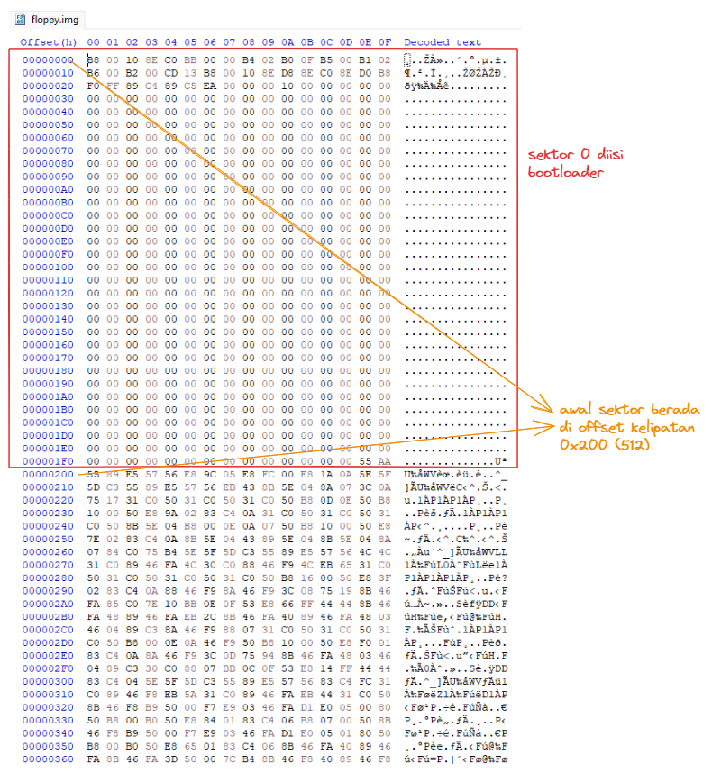
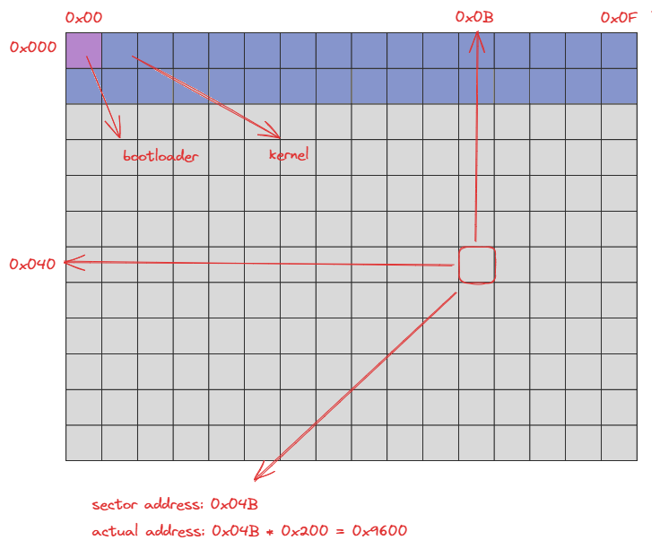
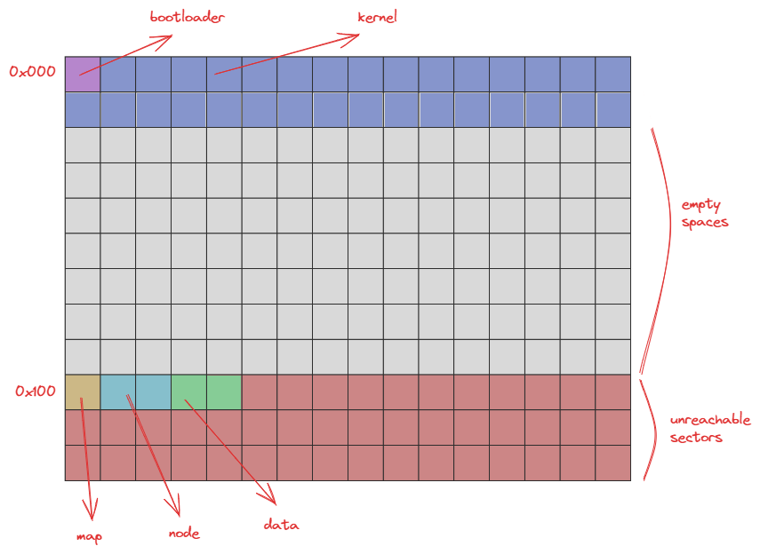
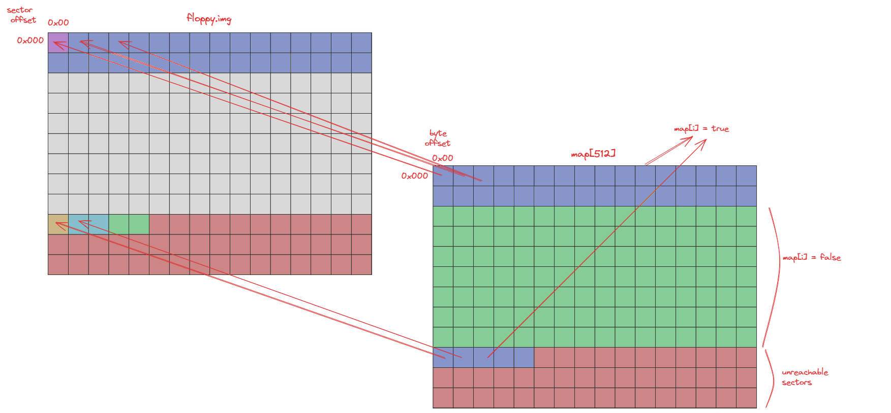
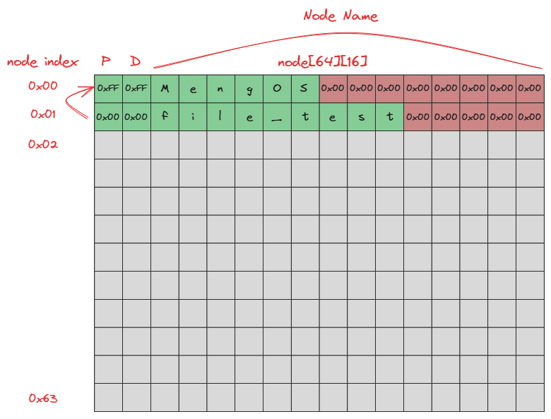
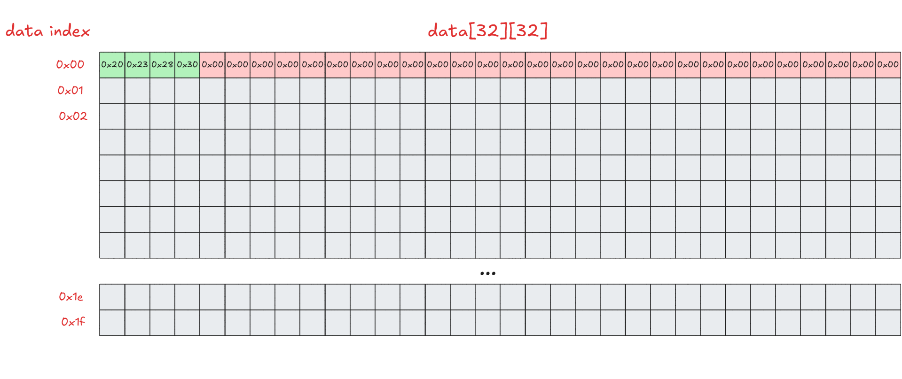
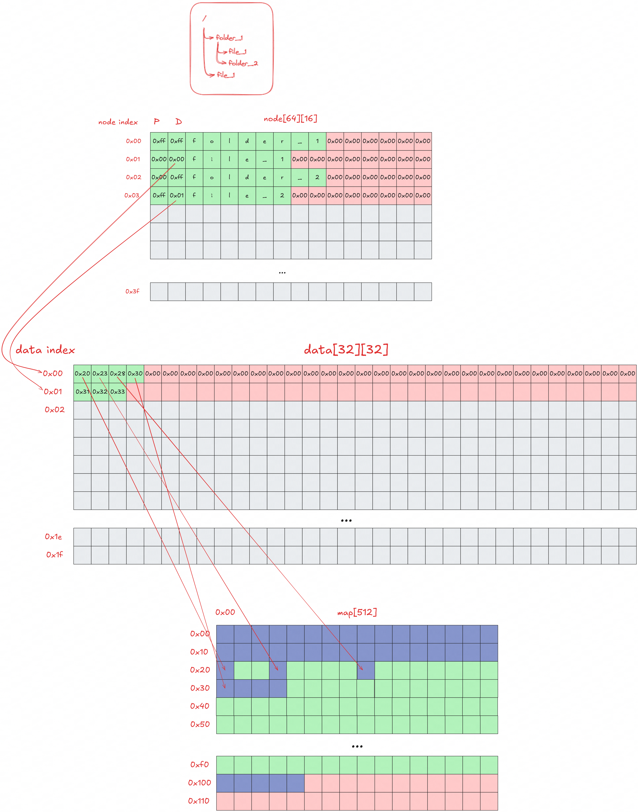
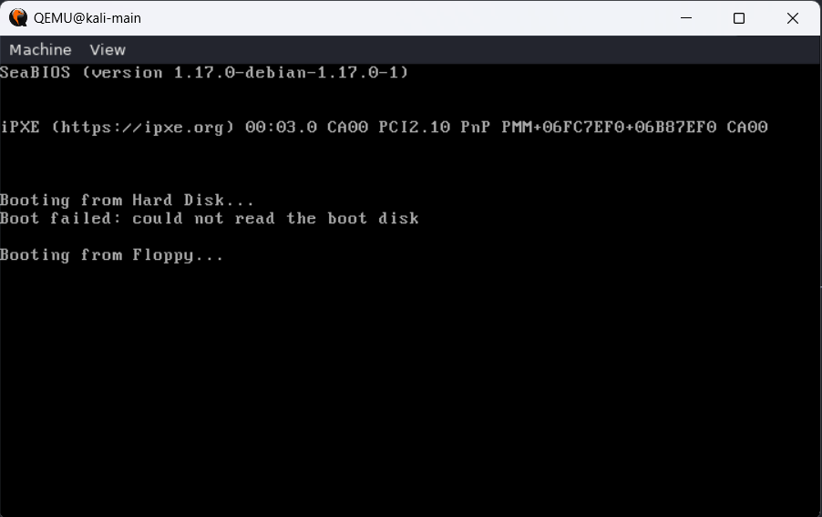
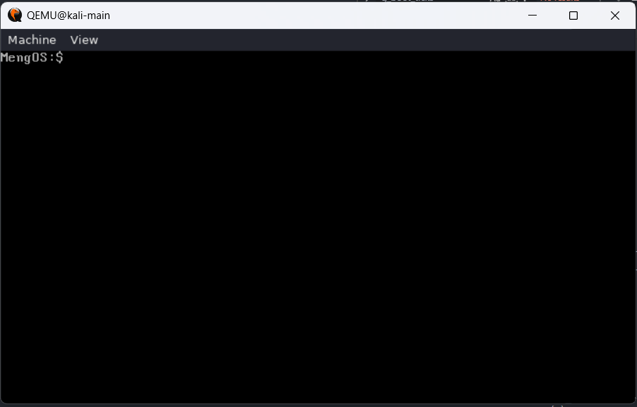
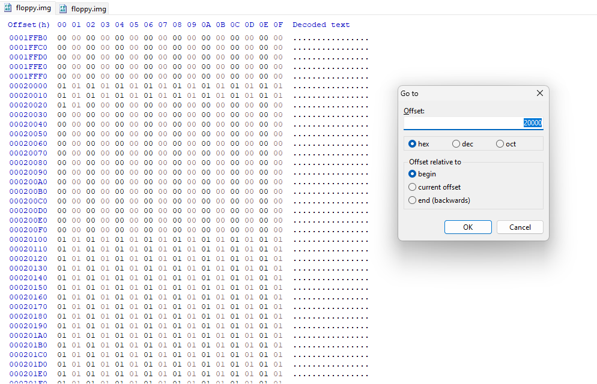

# MengOS

What??? Building a kernel again???? :(

## Introduction

This time we will build a simple operating system using our understanding of bootloaders, kernels, and filesystems. For the filesystem, we will create a simple filesystem that can be used to store files we create. This filesystem will use a simple data storage method — storing file data into blocks provided by the filesystem. If you're eager to jump straight into the tasks, you can search for `TODO` in this workspace. Here is an overview of what you will work on in this final practicum:

- Preparing the bootloader so it can boot into the kernel.
- Creating a filesystem that can be used to store files.
- Completing the kernel to read and write files to the filesystem.
- Building a simple shell to access the filesystem.

The folder structure and function breakdown is as follows:

```
.
├── include
│   ├── filesystem.h
│   ├── kernel.h
│   ├── shell.h
│   ├── std_lib.h
│   └── std_type.h
├── makefile
├── src
│   ├── bootloader.asm
│   ├── filesystem.c
│   ├── kernel.asm
│   ├── kernel.c
│   ├── shell.c
│   └── std_lib.c
```

- **Bootloader**: Contains `bootloader.asm`, the bootloader code that runs first to make preparations so the kernel can be executed. The compiled output is stored in `bin/bootloader.bin`.
- **Kernel**: Contains the combined code from `kernel.asm`, `kernel.c`, `std_lib.c`, `filesystem.c`, and `shell.c` along with their supporting headers. Compiling and linking all these components produces `bin/kernel.bin`. After the bootloader successfully loads the kernel from `floppy.img` into memory, it jumps to the start address of the loaded kernel. That is, the CPU begins executing the first instruction in `kernel.bin` (offset `0x0000` in the kernel segment). Execution then runs the kernel code, starting from the entry point produced by the linking process and ultimately calling `void main()` in `kernel.c`.

## Background

This final practicum documentation frequently uses hexadecimal numbers, indicated by the `0x` prefix. If you are not familiar with hex, you can use a calculator that supports hexadecimal mode or convert values to decimal as needed.

### Disk Structure

If you have completed Module 4, the disk structure used here should be familiar. The disk consists of several blocks, hereafter called **sectors**. Each sector is 512 bytes. The first sector is the boot sector, containing the compiled output of `bootloader.asm`. Sectors 2 through 32 store the kernel code.

Based on the output from Module 4, the disk structure is as follows (viewable with tools like `HxD`, `hexdump`, or `xxd`):



For convenience, the disk structure will be illustrated like this:



One sector is drawn as one block. Sector addresses are re-numbered from `0x00`. The first sector has address `0x00`, the second `0x01`, and so on. One row contains 16 sectors, so the first row covers `0x00`–`0x0F`, the second covers `0x10`–`0x1F`, etc.

To find the byte offset for a sector in `floppy.img`, multiply the sector address by 512 (as shown in the diagram above).

### Filesystem Structure

The filesystem uses three components: **map**, **node**, and **data**.

- Map — 1 sector at sector `0x100`
- Node — 2 sectors at sectors `0x101` and `0x102`
- Data — 2 sectors at sectors `0x103` and `0x104`



### Filesystem Map Structure

The map marks which disk blocks have been used by files. Each block has status `0x00` (unused) or `0x01` (used). For example, since sector `0x00` is used by the bootloader, map entry 0 is `0x01`.



The map is 1 sector (512 bytes). Entries 0–31 are `0x01` (used by the OS: bootloader + kernel). Entries 32–255 are `0x00` (free). Entries 256 (`0x100`) through 511 (`0x1FF`) are marked as used, because files are not permitted to write to sectors at or above `0x100`.

### Filesystem Node Structure

Nodes store information about files or directories. Each node is 16 bytes, so there are 64 node slots in total.



Each node field:

- **P** (first byte): index of the **parent node**. Value `0xFF` means the parent is the root node.

  Example: node index 1 has `P = 0x00`, meaning its parent is node index 0. Node index 0 has `P = 0xFF`, meaning its parent is the root.

- **D** (second byte): index into the **data** component holding this file's data. Value `0xFF` means this node is a **directory**.

  Example: node index 0 has `D = 0xFF` → it's a directory. Node index 1 has `D = 0x00` → its data is at data index 0.

- **Node name** (bytes 3–16): the name of the node, up to 13 characters (null-terminated).

### Filesystem Data Structure

The data component stores the list of sectors used to hold a file's content. Each data item is 32 bytes (`FS_MAX_SECTOR`), so each file can occupy up to 32 sectors (16 KB). There are 32 data items in total, occupying 2 sectors (`0x103`–`0x104`).



Each column in a data item is the sector address holding file data. Because one byte can only represent addresses up to 255 (`0xFF`), only sectors up to `0xFF` are addressable — hence map entries 256 and above are pre-marked as used.

### Filesystem Illustration



### Makefile Explanation

The `makefile` contains the build scripts used to compile all OS components, perform linking, and assemble the `floppy.img` used at boot. The bootloader is compiled into `bin/bootloader.bin` and placed at sector 0 of `floppy.img`; the kernel is compiled and linked into `bin/kernel.bin` and stored starting at sector 1. The Makefile also provides commands to run the OS with QEMU and generate test data. Each target:

- **prepare**: Creates `bin/floppy.img` with 2880 sectors (1.44 MB), representing a floppy disk.
- **bootloader**: Compiles `bootloader.asm` into `bin/bootloader.bin` and copies it to sector 0 of `floppy.img`.
- **kernel**: Compiles all kernel code, links it into `bin/kernel.bin`, and copies it to `floppy.img` starting at sector 1.
- **build**: Runs the full image build process: prepare → bootloader → kernel.
- **run**: Runs `floppy.img` using the QEMU emulator.

## Task Instructions

### Task 1 — Preparing the Bootloader _(5 Points)_

In this task, we first try the bootloader on its own. Its contents are as follows:

```asm
; bootloader.asm

bits 16

KERNEL_SEGMENT equ 0x1000 ; kernel will be loaded at 0x1000:0x0000
KERNEL_SECTORS equ 31     ; kernel will be loaded in 31 sectors maximum (15.872 KB)
KERNEL_START   equ 1      ; kernel will be loaded in sector 1

; bootloader code
bootloader:
  ; load kernel to memory
  mov ax, KERNEL_SEGMENT
  mov es, ax
  mov bx, 0x0000

  mov ah, 0x02
  mov al, KERNEL_SECTORS

  mov ch, 0x00
  mov cl, KERNEL_START + 1
  mov dh, 0x00
  mov dl, 0x00

  int 0x13

  ; set up segment registers
  mov ax, KERNEL_SEGMENT
  mov ds, ax
  mov es, ax
  mov ss, ax

  ; set up stack pointer
  mov ax, 0xFFF0
  mov sp, ax
  mov bp, ax

  ; jump to kernel
  jmp KERNEL_SEGMENT:0x0000

  times 510-($-$$) db 0
  dw 0xAA55
```

In short, the bootloader reads the kernel (stored starting at sector 1 in `floppy.img`, 31 sectors) into memory at address `0x1000:0x0000`. It then initializes segment registers (DS, ES, SS) to point to the kernel segment and sets the stack at `SS:SP = 0x1000:0xFFF0`. Finally, it executes `jmp 0x1000:0x0000` so the CPU begins executing the kernel.

Try the bootloader without a kernel yet:

```
make prepare
make bootloader
make run
```

Expected output:



There will be an error because the kernel isn't loaded yet — the bootloader's `jmp` lands on invalid instructions. That's expected. Once you reach this point, continue to Task 2.

### Task 2 — Preparing the Kernel _(5 Points)_

Now compile the kernel so sectors `0x1`–`0x1F` of `floppy.img` contain the kernel code:

```
make prepare
make bootloader
make kernel
make run
```

Expected output:



Once you reach this output, you can begin implementing the filesystem, kernel, and shell in the remaining tasks.

> **Tip:** Use `printString()` liberally for debugging.
>
> **Tip:** Whenever you change code and want to recompile, run `make prepare` first to wipe `floppy.img` clean of any previous filesystem data or code. This ensures the image contains only your current build.

### Task 3 — Implementing `readSector` and `writeSector` Syscalls _(10 Points)_

Implement `readSector` (read from disk to memory) and `writeSector` (write from memory to disk).

`readSector` implementation:

```c
void readSector(byte* buf, int sector) {
  int ah = 0x02;                    // read sector service number
  int al = 0x01;                    // number of sectors to read
  int ch = div(sector, 36);         // cylinder number
  int cl = mod(sector, 18) + 1;     // sector number
  int dh = mod(div(sector, 18), 2); // head number
  int dl = 0x00;                    // drive number

  interrupt(
    0x13,
    ah << 8 | al,
    buf,
    ch << 8 | cl,
    dh << 8 | dl
  );
}
```

- Interrupt vector `0x13` is used for disk I/O.
- `ah = 0x02` → read operation; `al = 0x01` → read 1 sector.
- `ch`/`cl`: cylinder and sector numbers. A floppy has 2 heads, 18 sectors/track, 36 tracks/cylinder. Cylinder = sector ÷ 36; sector number = (sector mod 18) + 1.
- `dh`/`dl`: head and drive numbers. Head = (sector ÷ 18) mod 2; drive = `0x00`.

For `writeSector`, use the same implementation but set `ah = 0x03` (write operation).

### Task 4 — Implementing `fsRead` _(30 Points)_

Implement `fsRead`, which reads a directory or file from the filesystem:

```c
void fsRead(struct file_metadata* metadata, enum fs_return* status);
```

`file_metadata` structure:

```c
struct file_metadata {
  byte parent_index;
  unsigned int filesize;
  char node_name[MAX_FILENAME];
  byte buffer[FS_MAX_SECTOR * SECTOR_SIZE];
};
```

- `parent_index`: parent node index of the file/directory to read.
- `filesize`: size of the file; `0` when `fsRead` is called.
- `node_name`: name of the file/directory to read.
- `buffer`: buffer for file data; zeroed when `fsRead` is called.

Steps:

1. Read the filesystem from disk into memory.
2. Iterate all node entries to find one whose name matches `metadata->node_name` and parent index matches `metadata->parent_index`.
3. If not found, set `status` to `FS_R_NODE_NOT_FOUND`.
4. If found and it's a directory, set `status` to `FS_R_TYPE_IS_DIRECTORY`.
5. If found and it's a file:
   - Set `metadata->filesize = 0`.
   - Iterate `i` from 0 to `FS_MAX_SECTOR`.
   - If data index `i` is `0x00`, stop.
   - Call `readSector` to read the sector pointed to by data index `i` into `metadata->buffer + i * SECTOR_SIZE`.
   - Add `SECTOR_SIZE` to `metadata->filesize`.
6. Set `status` to `FS_SUCCESS`.

### Task 5 — Implementing `fsWrite` _(30 Points)_

Implement `fsWrite`, which writes a file to the filesystem:

```c
void fsWrite(struct file_metadata* metadata, enum fs_return* status);
```

On entry, `metadata` contains:

- `parent_index`: parent node index. `0xFF` means root directory.
- `filesize`: file size. `0` means the entry is a directory.
- `node_name`: name of the file to write.
- `buffer`: data to write.

Steps:

1. Read the filesystem from disk into memory.
2. Iterate all nodes. If a node with the same name and parent index already exists, set `status` to `FS_W_NODE_ALREADY_EXISTS` and return.
3. Find an empty node (name is an empty string) and save its index. If none, set `status` to `FS_W_NO_FREE_NODE` and return.
4. Find an empty data slot (sector address at index 0 is `0x00`) and save its index. If none, set `status` to `FS_W_NO_FREE_DATA` and return.
5. Count free map entries (status `0x00`/`false`). If fewer than `metadata->filesize / SECTOR_SIZE`, set `status` to `FS_W_NOT_ENOUGH_SPACE` and return.
6. Set the found node's name to `metadata->node_name`, its parent index to `metadata->parent_index`, and its data index to the free data index found in step 4.
7. Write data:
   - Create a counter `j = 0` to track how many sectors have been written.
   - Iterate `i` from 0 to `SECTOR_SIZE`.
   - If map entry `i` is `0x00` (free), write `i` into data item sector slot `j`, then call `writeSector` to write `metadata->buffer + i * SECTOR_SIZE` to sector `i`.
   - Increment `j`.
8. Write the updated filesystem back to disk.
9. Set `status` to `FS_SUCCESS`.

### Task 6 — Implementing `fsDelete` _(20 Points)_

Implement `fsDelete`, which deletes a file from the filesystem:

```c
void fsDelete(struct file_metadata* metadata, enum fs_return* status);
```

`metadata` on entry:

- `parent_index`: parent node index of the file to delete.
- `filesize`: `0` when called.
- `node_name`: name of the file to delete.
- `buffer`: unused.

Steps:

1. Read the filesystem from disk into memory.
2. Iterate all nodes to find one whose name matches `metadata->node_name` and parent index matches `metadata->parent_index`.
3. If not found, set `status` to `FS_R_NODE_NOT_FOUND`.
4. If found and it's a directory, set `status` to `FS_R_TYPE_IS_DIRECTORY`.
5. If found and it's a file:
   - Iterate `i` from 0 to `FS_MAX_SECTOR`.
   - If data index `i` is `0x00`, stop.
   - Set the map entry at the address pointed to by data index `i` to `0x00` (mark as free).
   - Set data index `i` to `0x00` (mark as empty).
6. Set the node's name to an empty string (mark as free).
7. Write the updated filesystem back to disk.
8. Set `status` to `FS_SUCCESS`.

### Task 7 — Implementing `printCWD` _(10 Points)_

Implement `printCWD`, which displays the current working directory (CWD) path.

`printCWD` takes `byte cwd` (the node index of the CWD) and prints the path from root (`/`) to that node. If `cwd` is `0xFF`, print just `/`. Separate each node name with `/`.

### Task 8 — Implementing `parseCommand` _(10 Points)_

Implement `parseCommand`, which splits a user command into its parts:

```c
void parseCommand(char* buf, char* cmd, char arg[2][64]);
```

- `buf`: the raw input string from the user.
- `cmd`: output — the command name.
- `arg`: output — up to 2 arguments.

There will be at most 2 arguments. If only 1 argument is given, `arg[1]` is an empty string. If 0 arguments, both `arg[0]` and `arg[1]` are empty strings.

### Task 9 — Implementing `cd` _(10 Points)_

`cd` changes the current working directory:

- `cd <dirname>` — move into a subdirectory under the CWD.
- `cd ..` — move to the parent directory.
- `cd /` — move to the root directory.
- `cd` can only target directories, not files.
- Relative and absolute path support is not required.

### Task 10 — Implementing `ls` _(20 Points)_

`ls` lists directory contents:

- `ls` — list the CWD.
- `ls .` — list the CWD.
- `ls <dirname>` — list a subdirectory under the CWD.
- `ls` only works on directories, not files.
- Relative and absolute path support is not required.

### Task 11 — Implementing `mv` _(20 Points)_

`mv` moves a file:

- `mv <filename> <dirname>/<outputname>` — move a file from the CWD to a subdirectory under the CWD.
- `mv <filename> /<outputname>` — move a file from the CWD to the root directory.
- `mv <filename> ../<outputname>` — move a file from the CWD to its parent directory.
- `mv` only works on files, not directories.
- Relative and absolute path support is not required.

### Task 12 — Implementing `cp` _(20 Points)_

`cp` copies a file:

- `cp <filename> <dirname>/<outputname>` — copy a file from the CWD to a subdirectory under the CWD.
- `cp <filename> /<outputname>` — copy a file from the CWD to the root directory.
- `cp <filename> ../<outputname>` — copy a file from the CWD to its parent directory.
- `cp` only works on files, not directories.
- Relative and absolute path support is not required.

### Task 13 — Implementing `cat` _(10 Points)_

`cat` displays file contents:

- `cat <filename>` — display the contents of a file in the CWD.
- Relative and absolute path support is not required.

### Task 14 — Implementing `mkdir` _(20 Points)_

`mkdir` creates a directory:

- `mkdir <dirname>` — create a directory under the CWD.

### Task 15 — Implementing `rm` _(10 Points)_

`rm` deletes a file:

- `rm <filename>` — delete a file in the CWD.

### Task 16 — Implementing `uptime` _(10 Points)_

`uptime` displays the time since the OS was started:

- `uptime` — print in the format `Uptime: xh ym zs` (x hours, y minutes, z seconds).

A helper interrupt `_getTickCount` returns the number of ticks since boot. One second equals 18.2 ticks. Compute elapsed seconds by taking the difference between the current tick count and the boot tick count, then divide by 18.2. Convert to hours, minutes, and seconds.

Further reading: https://www.ctyme.com/intr/rb-2271.htm

### Task 17 — Implementing `date` _(20 Points)_

`date` displays the current date and time in the WIB timezone (Western Indonesia Time):

- `date` — print in the format `DD/MM/YYYY HH:MM:SS`.

Helper interrupts `_getRTCDate` and `_getRTCTime` return the current date and time in BCD (Binary-Coded Decimal) format. Convert the BCD values to decimal before displaying.

Further reading: https://www.ctyme.com/intr/rb-2273.htm and https://www.ctyme.com/intr/rb-2277.htm

### Task 18 — Implementing `calc` _(10 Points)_

`calc` is a calculator supporting addition, subtraction, multiplication, and division with correct operator precedence (see: https://en.wikipedia.org/wiki/Order_of_operations):

- `calc <expression>` — evaluate a mathematical expression. Expressions may contain numbers, operators `+`, `-`, `*`, `/`, and parentheses `(` and `)`.
- Must support negative numbers. Decimal support is optional.

Examples:

```
calc 3*(2+1)-4/2   -> 7
calc -5+3          -> -2
calc (1+2)*(3+4)   -> 21
```

### Task 19 — Implementing `echo` _(20 Points)_

`echo` displays a string and optionally writes it to a file:

- `echo <string>` — print the string.
- `echo <string> > <filename>` — write the string to `<filename>` in the CWD, overwriting any existing content.
- `echo <string> >> <filename>` — append the string to `<filename>` in the CWD.

### Task 20 — Implementing `help` _(10 Points)_

`help` displays a list of available commands with descriptions. Implementation details are left to you, but make sure all implemented commands are listed with their descriptions.

### Bonus Task — Implementing `view`

`view` displays an image file stored in the filesystem. Images must be pre-converted using the script [`convert_image.py`](./test/convert_image.py).

Specification:

- `view <filename>` — display the image in the CWD in VGA mode 13h (320×200, 256 colors).
- Center the image on screen.
- Resizing, aspect ratio preservation, quantization, and palette conversion are handled by `convert_image.py` before the file is added to the filesystem.
- Press `q`, `Q`, or `ESC` to return to text mode.
- If the file is not found, is a directory, or has an invalid format, display an error message and stay in text mode.

A helper interrupt `_setVGAPalette` is provided in `kernel.asm` to reprogram all 256 VGA DAC entries from the palette data in the file. Switch to/from VGA graphics mode 13h using `INT 0x10`. Read keyboard input using `INT 0x16`.

Pixel offset in image buffer: `image_offset = y * width + x`

Pixel offset on the VGA 320×200 screen: `vga_offset = y * 320 + x`

Write a pixel to the screen: `putInMemory(0xA000, vga_offset, color_index);`

To center the image:

```
x_offset = (320 - img_width) / 2
y_offset = (200 - img_height) / 2
```

For example, a 160×100 image: `x_offset = 80`, `y_offset = 50` → drawing starts at coordinate `(80, 50)`.

Further reading: https://www.ctyme.com/intr/rb-0069.htm (set video mode), https://www.ctyme.com/intr/rb-0135.htm (set DAC palette), https://wiki.osdev.org/VGA_Hardware

#### Image File Format

| Bytes | Content |
|-------|---------|
| 0–1 | Image width (uint16, little-endian) |
| 2–3 | Image height (uint16, little-endian) |
| 4–771 | VGA palette: 256 entries × 3 bytes (R, G, B), values 0–63 (6-bit DAC) |
| 772+ | Pixel data, row-major, one byte per pixel (palette index) |

Minimum file size is 773 bytes: 4-byte header + 768-byte palette + 1 pixel for a 1×1 image.

#### How `convert_image.py` Works

1. Resize the image to fit within 320×200.
2. Re-resize if the file is still too large for the filesystem (max 16 KB / 32 sectors).
3. Quantize to at most 256 colors (VGA mode 13h supports only 256 colors at once).
4. Convert the RGB palette from 8-bit (0–255) to VGA DAC 6-bit format (0–63).
5. Store pixels as palette indices (1 byte per pixel), not raw RGB.

## Testing

Run `make build run` to compile and launch the OS. Then close the OS and run `make generate test=1` to populate the filesystem with files and directories (replace `1` with the appropriate test number). Restart with `make run` and test your shell commands.

### `make generate test=1`

```
/
├─ dir1
│  ├─ dir1-1
│  │  └─ dir1-1-1
│  └─ dir1-2
│     └─ dirname
├─ dir2
│  └─ dirname
└─ dir3
```

### `make generate test=2`

```
/
├─ file-0
├─ dir-1
│  └─ dir-2
│     └─ . . .
│        └─ dir-62
└─ file-63
```

### `make generate test=3`

```
/
├─ 1024
├─ 4096
├─ 8192_0
├─ 8192_1
├─ 8192_2
├─ 8192_3
├─ 8192_4
├─ 8192_5
├─ 8192_6
├─ 8192_7
├─ 8192_8
├─ 8192_9
├─ 8192_10
└─ 16384
```

### `make generate test=4`

```
/
├─ dir1
│  ├─ katanya
│  ├─ dir3
│  │  ├─ bikin
│  │  ├─ fp
│  │  └─ dir4
│  ├─ dir5
│  │  ├─ cuma
│  │  └─ seminggu
├─ dir2
└─ doang
```

### `make generate test=5`

```
/
└── image.jpg
```

## Tips

- For filesystem debugging, use `hexedit` on Linux or `HxD` on Windows. The map is at sector `0x100`, nodes at `0x101` and `0x102`, and data at `0x103` and `0x104`. To get the byte offset from a sector number: `offset = sector × 512` (or `sector × 0x200`). For example, to inspect the filesystem map, open HxD and go to offset `0x100 × 0x200 = 0x20000`.

  

- `bcc` provides less error checking than `gcc`. Use `gcc` for compile-time error checking during development.

- Because `bcc` uses ANSI C mode, you cannot declare variables in the middle of a block or scope. Declare all variables at the beginning of a block.

- Always run `make` from the `praktikum-final` directory, not from a subdirectory.

- A sneak peek of what you'll build:

  https://github.com/user-attachments/assets/1c66144d-76f9-4251-bbdb-db52f492471d