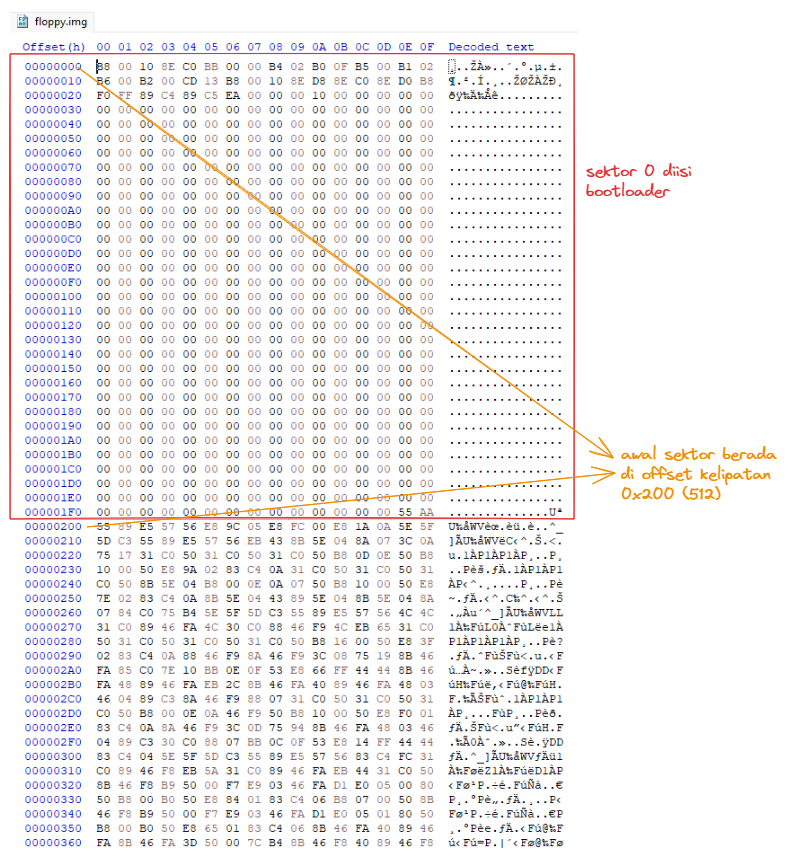
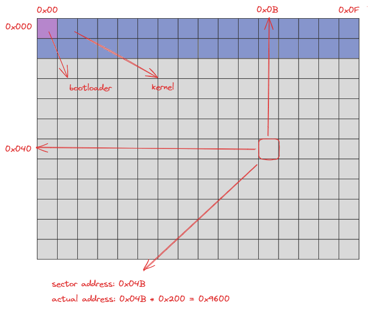
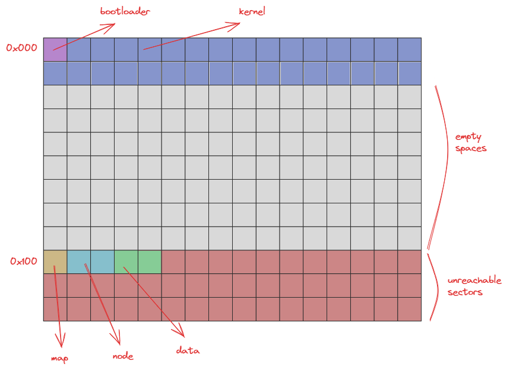
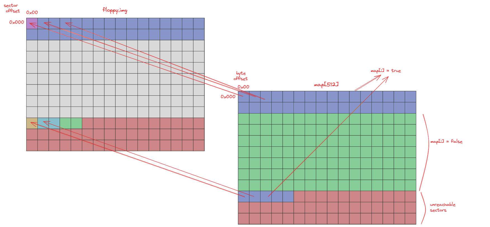
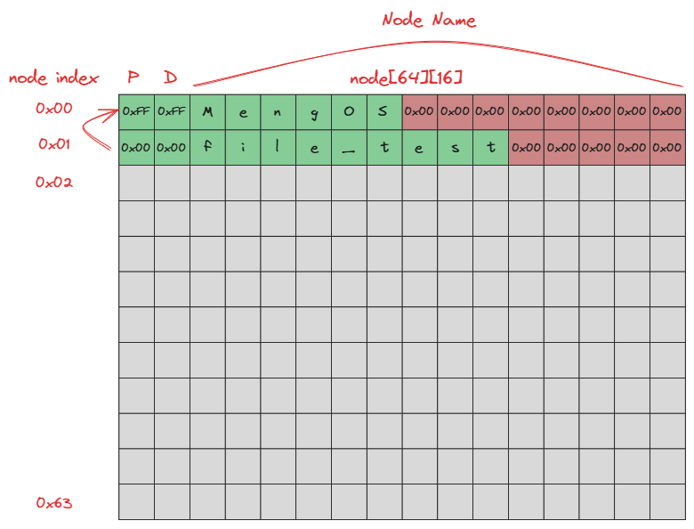
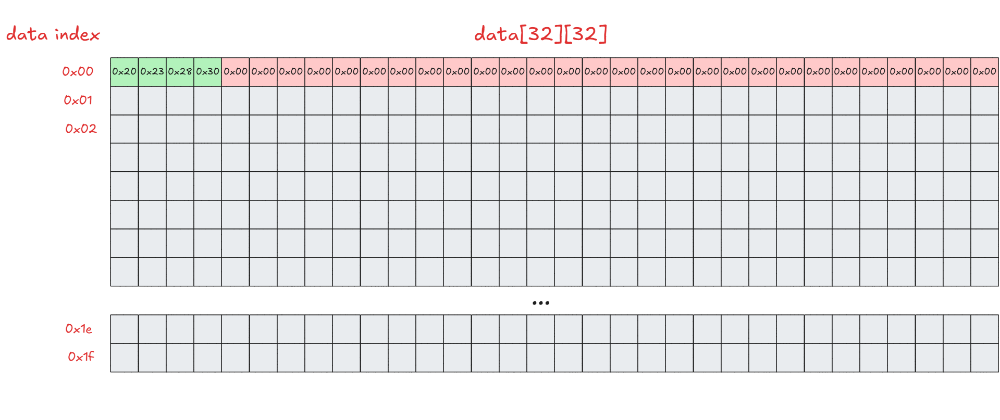
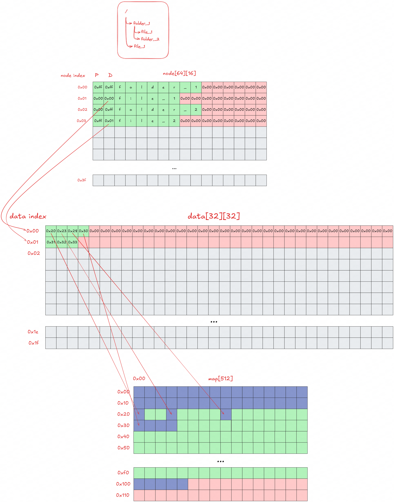
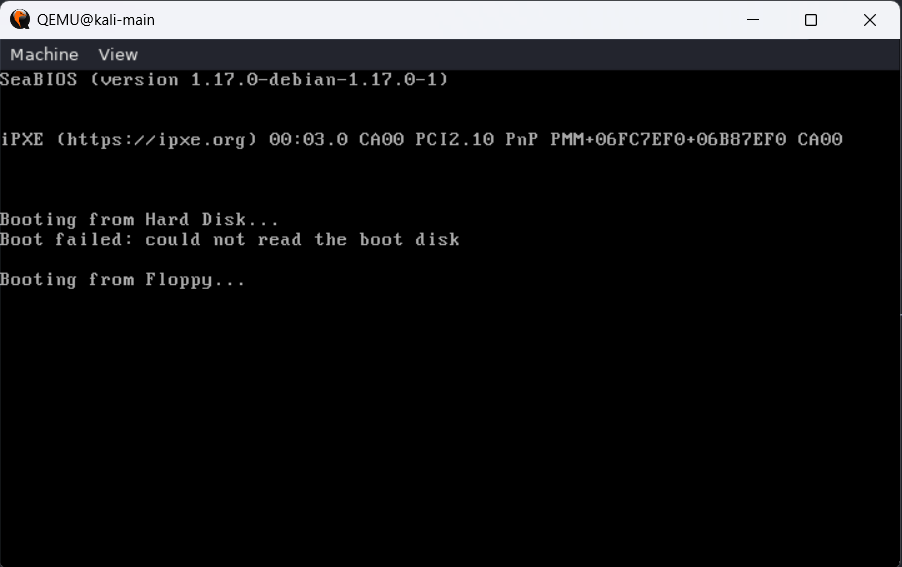
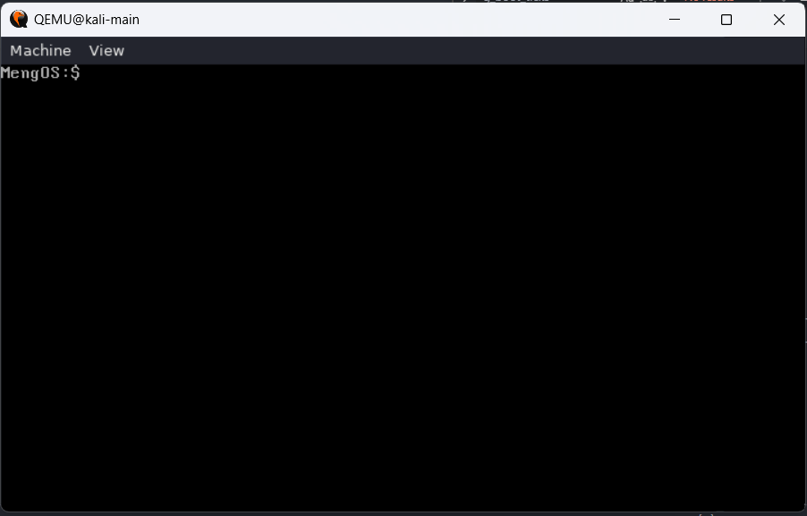
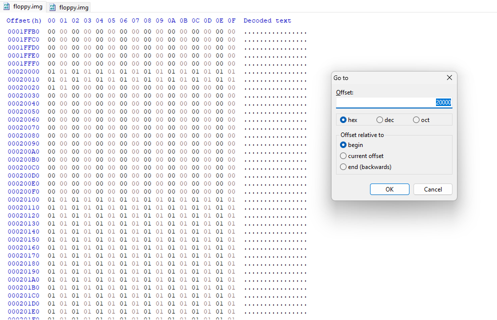

# MengOS

Apa??? Bikin kernel lagi???? :(

[Looking for the English version?](./README-EN.md)

## Pengenalan

Kali ini kita akan membuat sebuah sistem operasi sederhana dengan menggunakan pemahaman kalian mengenai bootloader, kernel, dan filesystem. Untuk filesystem, kita akan membuat sebuah filesystem sederhana yang dapat digunakan untuk menyimpan file-file yang kita buat. Filesystem yang akan kita buat ini akan menggunakan metode penyimpanan data yang sederhana, yaitu dengan menyimpan data file ke dalam blok-blok yang telah disediakan oleh filesystem. Jika kalian sudah tidak sabar ingin langsung mengerjakan task-task yang ada, bisa search `TODO` pada workspace ini. Berikut adalah gambaran yang akan kalian kerjakan pada final praktikum kali ini.

- Mempreparasi bootloader agar bisa berjalan menuju kernel.
- Membuat filesystem yang dapat digunakan untuk menyimpan file-file yang kita buat.
- Melengkapi kernel untuk dapat membaca dan menulis file ke dalam filesystem yang telah kita buat.
- Membuat shell sederhana yang dapat digunakan untuk mengakses filesystem yang telah kita buat.

Selain itu, penjelasan struktur folder dan pembagian fungsinya adalah sebagai berikut
```
.
├── include
│   ├── filesystem.h
│   ├── kernel.h
│   ├── shell.h
│   ├── std_lib.h
│   └── std_type.h
├── makefile
├── src
│   ├── bootloader.asm
│   ├── filesystem.c
│   ├── kernel.asm
│   ├── kernel.c
│   ├── shell.c
│   └── std_lib.c
```
- Bootloader: Berisi bootloader.asm, yaitu kode bootloader yang akan dijalankan pertama kali untuk melakukan beberapa persiapan sehingga kernel dapat dieksekusi. Hasil kompilasi bootloader akan disimpan pada `bin/bootloader.bin`.
- Kernel: Berisi gabungan kode dari kernel.asm, kernel.c, std_lib.c, filesystem.c, dan shell.c beserta header-header pendukungnya. Hasil kompilasi dan linking seluruh komponen tersebut akan menghasilkan `bin/kernel.bin`. Setelah bootloader berhasil memuat (load) isi kernel dari floppy.img ke memori, bootloader akan melakukan jmp ke alamat awal kernel yang telah dimuat. Dengan kata lain, CPU akan mulai mengeksekusi instruksi pertama pada kernel.bin (offset 0x0000 pada segmen kernel). Eksekusi ini kemudian akan menjalankan kode kernel, yang dimulai dari entry point hasil proses linking dan pada akhirnya menjalankan fungsi `void main()` pada `kernel.c`.

## Pencerdasan

Penjelasan pada praktikum final akan sering menggunakan angka heksadesimal. Penggunaan angka heksadesimal ditandai dengan prefix `0x`. Jika kalian belum terbiasa dengan angka heksadesimal, kalian dapat menggunakan kalkulator yang mendukung mode heksadesimal atau menggunakan konversi angka heksadesimal ke desimal.

### Struktur Disk

Jika kalian sudah melewati modul 4, pasti sudah tidak asing lagi dengan struktur disk yang akan kita gunakan. Disk yang kita gunakan terdiri dari beberapa blok. Selanjutnya blok akan disebut sektor. Setiap sektor memiliki ukuran 512 bytes. Sektor pertama akan digunakan sebagai boot sector, yang berisi hasil kompilasi dari `bootloader.asm`. Sektor kedua hingga sektor ke-32 akan digunakan untuk menyimpan kode teks dari kernel yang kita buat.

Dengan melihat hasil dari modul 4, berikut adalah struktur disk yang akan kita gunakan. Dapat dilihat menggunakan aplikasi seperti `HxD` atau menggunakan perintah `hexdump` atau `xxd`.



Untuk memudahkan dalam ilustrasi selanjutnya, struktur disk akan digambarkan sebagai berikut.



Satu sektor akan digambarkan sebagai satu blok. Alamat sektor akan dinomori ulang dari `0x00`. Sehingga sektor pertama akan memiliki alamat `0x00`, sektor kedua akan memiliki alamat `0x01`, dan seterusnya. Satu baris akan berisi 16 sektor. Sehingga baris pertama akan berisi sektor dengan alamat `0x00` hingga `0x0F`, baris kedua akan berisi sektor dengan alamat `0x10` hingga `0x1F`, dan seterusnya.

Untuk mencari alamat sektor pada isi file `floppy.img`, kita dapat mengonversi alamat sektor ke dalam alamat byte dengan cara seperti pada gambar di atas.

### Struktur Filesystem

Filesystem yang akan dibuat akan menggunakan beberapa komponen, yaitu map, node, dan data. Map akan disimpan sebanyak 1 sektor pada sektor `0x100`. Node akan disimpan sebanyak 2 sektor pada sektor `0x101` dan `0x102`. Data akan disimpan sebanyak 2 sektor pada sektor `0x103` dan `0x104`.



### Struktur Filesystem Map

Map akan digunakan untuk menandai blok-blok pada disk yang telah digunakan oleh file. Setiap blok akan memiliki status `0x00` jika sektor yang bersangkutan belum digunakan, dan `0x01` jika sektor yang bersangkutan telah digunakan. Contohnya, karena pada sektor `0x00` telah digunakan oleh bootloader, maka isi dari map ke-0 adalah `0x01`. Komponen map akan digunakan ketika kita ingin menulis file ke dalam disk untuk mengetahui sektor mana saja yang dapat kita gunakan.

Berikut adalah ilustrasi dari komponen map.



Map akan berukuran 1 sektor (512 bytes). Item ke-0 hingga item ke-31 pada map akan memiliki status `0x01` karena telah digunakan oleh sistem operasi (bootloader + kernel). Item ke-32 hingga item ke-255 akan memiliki status `0x00` karena belum digunakan. Mulai dari item ke-256 (`0x100`) hingga item ke 511 (`0x1FF`) akan ditandai sebagai sektor yang telah digunakan. Hal ini dikarenakan kita tidak memperbolehkan file untuk menulis data pada sektor yang berada di atas sektor `0x100`.

### Struktur Filesystem Node

Node akan digunakan untuk menyimpan informasi dari file atau direktori yang kita buat. Setiap node akan memiliki ukuran 16 bytes. Sehingga, total akan terdapat 64 item node yang bisa disimpan. Berikut adalah ilustrasi dari komponen node.



Berikut adalah penjelasan dari setiap item pada node.

- **P**: kolom pertama pada item node berguna sebagai penunjuk _parent node_ dari node yang bersangkutan dan akan bernilai `0xFF` jika parent dari node yang bersangkutan adalah _root node_.

  Sebagai contoh, pada node index ke-1, nilai dari kolom pertama adalah `0x00`. Hal ini menunjukkan bahwa _parent node_ dari node index ke-1 adalah node index ke-0. Sedangkan pada node index ke-0, nilai dari kolom pertama adalah `0xFF`. Hal ini menunjukkan bahwa _parent node_ dari node index ke-0 adalah _root node_.

- **D**: kolom kedua pada item node berguna sebagai penunjuk index dari komponen data yang akan digunakan untuk menyimpan data file. Jika nilai dari kolom kedua adalah `0xFF`, maka node tersebut merupakan direktori.

  Sebagai contoh, pada node index ke-0, nilai dari kolom kedua adalah `0xFF`. Hal tersebut berarti node index ke-0 merupakan direktori. Sedangkan pada node index ke-1, nilai dari kolom kedua adalah `0x00`. Hal tersebut berarti informasi data dari file tersebut bisa diakses pada komponen data index ke-0.

- **Node name**: kolom ketiga hingga kolom terakhir pada item node berguna sebagai nama dari node tersebut. Nama dari node akan memiliki panjang maksimal 13 karakter (karakter terakhir adalah karakter null).

### Struktur Filesystem Data

Komponen data akan digunakan untuk petunjuk sektor-sektor yang digunakan untuk menyimpan data file. Setiap item data akan memiliki ukuran 32 bytes (`FS_MAX_SECTOR`), sehingga setiap file dapat menempati hingga 32 sektor (16 KB). Total akan terdapat 32 item data yang bisa disimpan, sehingga komponen data menempati 2 sektor (`0x103`–`0x104`). Berikut adalah ilustrasi dari komponen data.



Setiap kolom pada item data akan menunjukkan alamat sektor yang digunakan untuk menyimpan data file. Karena satu byte hanya dapat menunjukkan alamat sektor hingga 255 (`0xFF`), maka kita hanya dapat menyimpan alamat sektor hingga sektor `0xFF`. Oleh karena itu, item map ke-256 hingga akhir akan ditandai sebagai sektor yang telah digunakan.

### Ilustrasi Filesystem

Berikut adalah ilustrasi dari ketiga komponen filesystem yang telah dijelaskan sebelumnya.



### Penjelasan Makefile

File dari `makefile` Berisi kumpulan perintah (build script) yang digunakan untuk mengompilasi seluruh komponen sistem operasi, melakukan proses linking, serta menyusun struktur floppy.img yang akan digunakan saat booting. Melalui Makefile ini, bootloader dikompilasi menjadi bin/bootloader.bin dan ditempatkan pada sektor pertama (sector 0) dari floppy.img, sedangkan kernel dikompilasi dan di-link menjadi bin/kernel.bin lalu disimpan mulai dari sektor berikutnya (sector 1). Selain itu, Makefile juga menyediakan perintah untuk menjalankan sistem operasi menggunakan QEMU serta menghasilkan data uji yang diperlukan selama pengembangan. Jika dijabarkan, setiap bagian makefile adalah sebagai berikut.
- prepare: Membuat file bin/floppy.img berukuran 2880 sektor (1.44 MB) yang merepresentasikan sebuah floppy disk.
- bootloader: Mengompilasi bootloader.asm menjadi bin/bootloader.bin dan menyalinnya ke sektor pertama (sector 0) pada floppy.img.
- kernel: Mengompilasi seluruh kode kernel, melakukan proses linking menjadi bin/kernel.bin, lalu menyalinnya ke floppy.img mulai dari sektor ke-1.
- build: Menjalankan seluruh proses pembuatan image floppy mulai dari prepare, bootloader, hingga kernel.
- run: Menjalankan floppy.img menggunakan emulator QEMU.

## Instruksi Pengerjaan

### Task 1 - Mempreparasi Bootloader _(5 Points)_
Pada task ini, kita pertama akan mencoba bootloader terlebih dahulu. Jika kita melihat isi dari bootloader, isinya adalah sebagai berikut
```asm
; bootloader.asm

bits 16

KERNEL_SEGMENT equ 0x1000 ; kernel will be loaded at 0x1000:0x0000
KERNEL_SECTORS equ 31     ; kernel will be loaded in 31 sectors maximum (15.872 KB)
KERNEL_START   equ 1      ; kernel will be loaded in sector 1

; bootloader code
bootloader:
  ; load kernel to memory
  mov ax, KERNEL_SEGMENT    ; load address of kernel
  mov es, ax                ; buffer address are in ES:BX
  mov bx, 0x0000            ; set buffer address to KERNEL_SEGMENT:0x0000

  mov ah, 0x02              ; read disk sectors
  mov al, KERNEL_SECTORS    ; number of sectors to read

  mov ch, 0x00              ; cylinder number
  mov cl, KERNEL_START + 1  ; sector number
  mov dh, 0x00              ; head number
  mov dl, 0x00              ; read from drive A

  int 0x13                  ; call BIOS interrupts

  ; set up segment registers
  mov ax, KERNEL_SEGMENT
  mov ds, ax
  mov es, ax
  mov ss, ax

  ; set up stack pointer
  mov ax, 0xFFF0
  mov sp, ax
  mov bp, ax

  ; jump to kernel
  jmp KERNEL_SEGMENT:0x0000

  ; padding to make bootloader 512 bytes
  times 510-($-$$) db 0
  dw 0xAA55
```
Secara singkat, bootloader akan membaca kernel yang disimpan mulai dari sektor 1 pada floppy.img sebanyak 31 sektor, kemudian memuatnya ke memori (ram) pada alamat (segment:offset) 0x1000:0x0000. Setelah proses pembacaan selesai, bootloader menginisialisasi segment register (DS, ES, dan SS) agar mengarah ke segmen kernel serta mengatur stack pada SS:SP = 0x1000:0xFFF0. Terakhir, bootloader melakukan instruksi jmp 0x1000:0x0000 sehingga CPU mulai mengeksekusi instruksi pertama dari kode kernel kalian yang telah dimuat ke memori.

Kita akan mencoba bootloader tanpa kernel terlebih dahulu, kalian bisa menggunakan command yang tersimpan pada make file dengan penjelasan pada [Lihat Penjelasan Makefile](#penjelasan-makefile).
```
make prepare
make bootloader
```
Setelah bootloader telah dicompile dan disimpan pada floppy.img, maka kalian bisa mencoba menjalankannya.
```
make run
```
Keluaran yang diharapkan adalah seperti ini:


Masih terdapat error karena memang kita masih belum mengisi kernel, sehingga pada saat bootloader melakukan `jmp` pada segment kernel, instruksi yang diberikan invalid karena kernel memang belum terisi. Namun, jika sudah mencapai sini, maka anda bisa melanjutkan task berikutnya untuk memprepare kernel.

### Task 2 - Mempreparasi Kernel _(5 Points)_
Setelah berhasil mencoba bootloader, sekarang kalian akan mempreparasi kernel sehingga pada `floppy.img` akan terdapat kode dari kernel kalian yang disimpan pada sektor 0x1 hingga 0x1F. Untuk melakukan hal itu, kalian bisa menggunakan command yang tersimpan pada make file dengan penjelasan pada [Lihat Penjelasan Makefile](#penjelasan-makefile).
```
make prepare
make bootloader
make kernel
```
Setelah bootloader dan kernel telah dicompile dan disimpan pada floppy.img, maka kalian bisa mencoba menjalankannya.
```
make run
```
Keluaran yang diharapkan adalah seperti ini:


Jika berhasil mencapai hasil tersebut, maka praktikan bisa mulai mengimplementasi filesystem, kernel, dan shell yang tersisa pada task berikutnya.

TIPS: Untuk proses debugging, kalian bisa meutilisasi fungsi printString() dengan baik.

TIPS: Jangan lupa, jika terdapat perubahan pada kode dan ingin merecompile, sebaiknya melakukan `make prepare` terlebih dahulu untuk membersihkan `floppy.img` dari sisa sisa kode atau percobaan filesystem sebelumnya. Hal ini memastikan floppy.img pada saat kalian `make bootloader` dan `make kernel`, akan berisi kode dari yang kalian buat sekarang ini dan bukan yang lalu.

### Task 3 - Membuat syscall readSector dan writeSector _(10 Points)_

Pada task ini, kalian diminta untuk membuat syscall `readSector` dan `writeSector` yang akan digunakan untuk membaca dari disk ke memory dan menulis dari memory ke disk.

Berikut adalah implementasi dari `readSector` dan penjelasannya.

```c
void readSector(byte* buf, int sector) {
  int ah = 0x02;                    // read sector service number
  int al = 0x01;                    // number of sectors to read
  int ch = div(sector, 36);         // cylinder number
  int cl = mod(sector, 18) + 1;     // sector number
  int dh = mod(div(sector, 18), 2); // head number
  int dl = 0x00;                    // drive number

  interrupt(
    0x13,
    ah << 8 | al,
    buf,
    ch << 8 | cl,
    dh << 8 | dl
  );
}
```

- Interrupt vector yang akan digunakan adalah `0x13` untuk melakukan operasi disk I/O.

- Register `ah` akan diisi dengan `0x02` yang menunjukkan operasi `read`.

- Register `al` akan diisi dengan `0x01` yang menunjukkan jumlah sektor yang akan dibaca.

- Register `ch` dan `cl` akan diisi dengan nomor cylinder dan sector yang akan dibaca.

  Pada floppy disk, terdapat 2 head, 18 sector per track, dan 36 track per cylinder. Sehingga, nomor cylinder akan dihitung dengan membagi nomor sektor dengan 36. Sedangkan nomor sector akan dihitung dengan mengambil sisa pembagian nomor sektor dengan 18 dan ditambahkan dengan 1.

- Register `dh` dan `dl` akan diisi dengan nomor head dan drive yang akan digunakan.

  Pada floppy disk, terdapat 2 head. Sehingga, nomor head akan dihitung dengan membagi nomor sektor dengan 18 dan mengambil sisa pembagian dengan 2. Sedangkan nomor drive akan diisi dengan `0x00` yang menunjukkan drive pertama.

Untuk `writeSector`, kalian dapat menggunakan implementasi yang sama dengan `readSector` dengan mengganti nilai register `ah` dengan `0x03` yang menunjukkan operasi `write`.

### Task 4 - Implementasi fsRead _(30 Points)_

Pada [`filesystem.h`](./src/filesystem.h), terdapat beberapa konstanta dan tipe data yang akan digunakan untuk membantu dalam implementasi filesystem. Kalian diminta untuk mengimplementasikan fungsi `fsRead` yang akan digunakan untuk membaca direktori atau file dari filesystem. Fungsi `fsRead` akan menerima parameter sebagai berikut.

```c
void fsRead(struct file_metadata* metadata, enum fs_return* status);
```

- `metadata` adalah pointer ke `file_metadata` yang akan digunakan untuk menyimpan informasi dari file atau direktori yang akan dibaca.

  Struktur `file_metadata` akan memiliki struktur sebagai berikut.

  ```c
  struct file_metadata {
    byte parent_index;
    unsigned int filesize;
    char node_name[MAX_FILENAME];
    byte buffer[FS_MAX_SECTOR * SECTOR_SIZE];
  };
  ```

  - `parent_index` adalah index dari _parent node_ dari file atau direktori yang akan dibaca.
  - `filesize` adalah ukuran dari file yang akan dibaca. `filesize` berisi 0 dalam pemanggilan fungsi `fsRead`.
  - `node_name` adalah nama dari file atau direktori yang akan dibaca.
  - `buffer` adalah pointer ke buffer yang akan digunakan untuk menyimpan data dari file atau direktori yang akan dibaca. `buffer` berisi `0x00` dalam pemanggilan fungsi `fsRead`.

- `status` adalah pointer ke `fs_return` yang akan digunakan untuk menyimpan status dari operasi yang dilakukan.

Langkah-langkah yang harus dilakukan pada fungsi `fsRead` adalah sebagai berikut.

1. Membaca filesystem dari disk ke memory.

2. Iterasi setiap item node untuk mencari node yang memiliki nama yang sesuai dengan `metadata->node_name` dan parent index sesuai dengan `metadata->parent_index`.

3. Jika node yang dicari tidak ditemukan, maka set `status` dengan `FS_R_NODE_NOT_FOUND`.

4. Jika node yang ditemukan adalah direktori, maka set `status` dengan `FS_R_TYPE_IS_DIRECTORY`.

5. Jika node yang ditemukan adalah file, maka proses selanjutnya adalah sebagai berikut.

   - Set `metadata->filesize` dengan 0.
   - Lakukan iterasi i dari 0 hingga `FS_MAX_SECTOR`
   - Jika data index ke-i dari node yang ditemukan adalah `0x00`, maka hentikan iterasi.
   - Lakukan `readSector` untuk membaca data dari sektor yang ditunjuk oleh data pada _data index_ dengan sectors ke-i disimpan ke dalam `metadata->buffer + i * SECTOR_SIZE`.
   - Tambahkan `SECTOR_SIZE` ke `metadata->filesize`.

6. Set `status` dengan `FS_SUCCESS`.

### Task 5 - Implementasi fsWrite _(30 Points)_

Selanjutnya kalian diminta untuk mengimplementasikan fungsi `fsWrite` yang akan digunakan untuk menulis file ke dalam filesystem. Fungsi `fsWrite` akan menerima parameter yang sama dengan `fsRead` sebagai berikut.

```c
void fsWrite(struct file_metadata* metadata, enum fs_return* status);
```

Pada fungsi `fsWrite`, `metadata` yang diterima akan berisi informasi berikut.

- `parent_index` adalah index dari _parent node_ dari file yang akan ditulis. Jika `parent_index` adalah `0xFF`, maka file yang akan ditulis akan disimpan pada _root directory_.
- `filesize` adalah ukuran dari file yang akan ditulis. Jika `filesize` adalah 0, maka file yang akan ditulis adalah direktori.
- `node_name` adalah nama dari file yang akan ditulis.
- `buffer` adalah pointer ke buffer yang berisi data dari file yang akan ditulis.

Langkah-langkah yang harus dilakukan pada fungsi `fsWrite` adalah sebagai berikut.

1. Membaca filesystem dari disk ke memory.

2. Lakukan iterasi setiap item node untuk mencari node yang memiliki nama yang sama dengan `metadata->node_name` dan parent index yang sama dengan `metadata->parent_index`. Jika node yang dicari ditemukan, maka set `status` dengan `FS_W_NODE_ALREADY_EXISTS` dan keluar.

3. Selanjutnya, cari node yang kosong (nama node adalah string kosong) dan simpan index-nya. Jika node yang kosong tidak ditemukan, maka set `status` dengan `FS_W_NO_FREE_NODE` dan keluar.

4. Iterasi setiap item data untuk mencari data yang kosong (alamat sektor data ke-0 adalah `0x00`) dan simpan index-nya. Jika data yang kosong tidak ditemukan, maka set `status` dengan `FS_W_NO_FREE_DATA` dan keluar.

5. Iterasi setiap item map dan hitung blok yang kosong (status blok adalah `0x00` atau `false`). Jika blok yang kosong kurang dari `metadata->filesize / SECTOR_SIZE`, maka set `status` dengan `FS_W_NOT_ENOUGH_SPACE` dan keluar.

6. Set nama dari node yang ditemukan dengan `metadata->node_name`, parent index dengan `metadata->parent_index`, dan data index dengan index data yang kosong.

7. Lakukan penulisan data dengan cara sebagai berikut.

   - Buatlah variabel counter yang akan digunakan untuk menghitung jumlah sektor yang telah ditulis (akan disebut dengan j).

   - Lakukan iterasi i dari 0 hingga `SECTOR_SIZE`.

   - Jika item map pada index ke-i adalah `0x00`, maka tulis index i ke dalam data item sektor ke-j dan tulis data dari buffer ke dalam sektor ke-i.

   - Penulisan dapat menggunakan fungsi `writeSector` dari `metadata->buffer + i * SECTOR_SIZE`.

   - Tambahkan 1 ke j.

8. Tulis kembali filesystem yang telah diubah ke dalam disk.

9. Set `status` dengan `FS_SUCCESS`.

### Task 6 - Implementasi fsDelete _(20 Points)_
Fungsi `fsDelete` akan digunakan untuk menghapus *file* dari filesystem. Berikut adalah spesifikasi dari fungsi `fsDelete`.

```c
void fsDelete(struct file_metadata* metadata, enum fs_return* status);
```

- `metadata` adalah pointer ke `file_metadata` yang akan digunakan untuk menyimpan informasi dari file yang akan dihapus.

  Struktur `file_metadata` akan memiliki struktur sebagai berikut.

  ```c
  struct file_metadata {
    byte parent_index;
    unsigned int filesize;
    char node_name[MAX_FILENAME];
    byte buffer[FS_MAX_SECTOR * SECTOR_SIZE];
  };
  ```

  - `parent_index` adalah index dari _parent node_ dari file yang akan dihapus.
  - `filesize` adalah ukuran dari file yang akan dihapus. `filesize` berisi 0 dalam pemanggilan fungsi `fsDelete`.
  - `node_name` adalah nama dari file yang akan dihapus.
  - `buffer` adalah pointer ke buffer yang tidak digunakan dalam pemanggilan fungsi `fsDelete`.

- `status` adalah pointer ke `fs_return` yang akan digunakan untuk menyimpan status dari operasi yang dilakukan.

Langkah-langkah yang harus dilakukan pada fungsi `fsDelete` adalah sebagai berikut.

1. Membaca filesystem dari disk ke memory.

2. Iterasi setiap item node untuk mencari node yang memiliki nama yang sesuai dengan `metadata->node_name` dan parent index sesuai dengan `metadata->parent_index`.

3. Jika node yang dicari tidak ditemukan, maka set `status` dengan `FS_R_NODE_NOT_FOUND`.

4. Jika node yang ditemukan adalah direktori, maka set `status` dengan `FS_R_TYPE_IS_DIRECTORY`.

5. Jika node yang ditemukan adalah file, maka proses selanjutnya adalah sebagai berikut.
   - Iterasi i dari 0 hingga `FS_MAX_SECTOR`
   - Jika data index ke-i dari node yang ditemukan adalah `0x00`, maka hentikan iterasi.
   - Set item map pada index yang ditunjuk oleh data index ke-i dengan `0x00` untuk menandai bahwa sektor tersebut telah kosong.
   - Set data index ke-i dengan `0x00`. untuk menandai bahwa data tersebut telah kosong.
  
6. Set nama dari node yang ditemukan dengan string kosong, untuk menandai bahwa node tersebut telah kosong.

7. Tulis kembali filesystem yang telah diubah ke dalam disk.

8. Set `status` dengan `FS_SUCCESS`.


### Task 7 - Implementasi printCWD _(10 Points)_

Setelah berhasil mengimplementasikan fungsi `fsRead` dan `fsWrite`, selanjutnya adalah pembuatan shell sederhana. Shell akan menggunakan read-eval-print-loop (REPL) yang akan menerima perintah dari user dan mengeksekusi perintah tersebut. Pada task ini, kalian diminta untuk mengimplementasikan fungsi `printCWD` yang akan digunakan untuk menampilkan _current working directory_ (CWD) dari shell.

Fungsi `printCWD` akan menerima parameter `byte cwd` yang menunjukkan node index dari _current working directory_. Fungsi akan menampilkan path dari root (`/`) hingga node yang ditunjuk oleh `cwd`. Jika `cwd` adalah `0xFF`, maka path yang ditampilkan adalah `/`. Setiap node yang ditampilkan akan dipisahkan oleh karakter `/`.

### Task 8 - Implementasi parseCommand _(10 Points)_

Selanjutnya, kalian diminta untuk mengimplementasikan fungsi `parseCommand` yang akan digunakan untuk memisahkan perintah yang diberikan oleh user. Fungsi `parseCommand` akan menerima parameter sebagai berikut.

```c
void parseCommand(char* buf, char* cmd, char arg[2][64]);
```

- `buf` adalah string yang berisi perintah yang diberikan oleh user.
- `cmd` adalah string yang akan digunakan untuk menyimpan perintah yang diberikan oleh user.
- `arg` adalah array of string yang akan digunakan untuk menyimpan argumen dari perintah yang diberikan oleh user.

Karena hanya akan ada 2 argumen yang diberikan oleh user, maka `arg` akan memiliki ukuran 2. Jika argumen yang diberikan oleh user adalah 1, maka `arg[1]` akan berisi string kosong. Jika argumen yang diberikan oleh user adalah 0, maka `arg[0]` dan `arg[1]` akan berisi string kosong.

### Task 9 - Implementasi cd _(10 Points)_

Fungsi `cd` akan digunakan untuk mengubah _current working directory_ dari shell. Berikut adalah spesifikasi dari fungsi `cd`.

- `cd <dirname>` dapat memindahkan _current working directory_ ke direktori yang berada di bawah _current working directory_.

- `cd ..` akan memindahkan _current working directory_ ke _parent directory_ dari _current working directory_.

- `cd /` akan memindahkan _current working directory_ ke _root directory_.

- `cd` hanya dapat memindahkan _current working directory_ ke direktori, tidak dapat memindahkan _current working directory_ ke file.

- Implementasi relative path dan absolute path tidak diwajibkan.

### Task 10 - Implementasi ls _(20 Points)_

Fungsi `ls` akan digunakan untuk menampilkan isi dari direktori. Berikut adalah spesifikasi dari fungsi `ls`.

- `ls` akan menampilkan isi dari _current working directory_.

- `ls .` akan menampilkan isi dari _current working directory_.

- `ls <dirname>` akan menampilkan isi dari direktori yang berada di bawah _current working directory_.

- `ls` hanya dapat menampilkan isi dari direktori, tidak dapat menampilkan isi dari file.

- Implementasi relative path dan absolute path tidak diwajibkan.

### Task 11 - Implementasi mv _(20 Points)_

Fungsi `mv` akan digunakan untuk memindahkan file atau direktori. Berikut adalah spesifikasi dari fungsi `mv`.

- `mv <filename> <dirname>/<outputname>` akan memindahkan file yang berada di bawah _current working directory_ ke direktori yang berada di bawah _current working directory_.

- `mv <filename> /<outputname>` akan memindahkan file yang berada di bawah _current working directory_ ke direktori _root directory_.

- `mv <filename> ../<outputname>` akan memindahkan file yang berada di bawah _current working directory_ ke _parent directory_ dari _current working directory_.

- `mv` hanya dapat memindahkan file, tidak dapat memindahkan direktori.

- Implementasi relative path dan absolute path tidak diwajibkan.

### Task 12 - Implementasi cp _(20 Points)_

Fungsi `cp` akan digunakan untuk menyalin file. Berikut adalah spesifikasi dari fungsi `cp`.

- `cp <filename> <dirname>/<outputname>` akan menyalin file yang berada di bawah _current working directory_ ke direktori yang berada di bawah _current working directory_.

- `cp <filename> /<outputname>` akan menyalin file yang berada di bawah _current working directory_ ke direktori _root directory_.

- `cp <filename> ../<outputname>` akan menyalin file yang berada di bawah _current working directory_ ke _parent directory_ dari _current working directory_.

- `cp` hanya dapat menyalin file, tidak dapat menyalin direktori.

- Implementasi relative path dan absolute path tidak diwajibkan.

### Task 13 - Implementasi cat _(10 Points)_

Fungsi `cat` akan digunakan untuk menampilkan isi dari file. Berikut adalah spesifikasi dari fungsi `cat`.

- `cat <filename>` akan menampilkan isi dari file yang berada di bawah _current working directory_.

- Implementasi relative path dan absolute path tidak diwajibkan.

### Task 14 - Implementasi mkdir _(20 Points)_

Fungsi `mkdir` akan digunakan untuk membuat direktori. Berikut adalah spesifikasi dari fungsi `mkdir`.

- `mkdir <dirname>` akan membuat direktori yang berada di bawah _current working directory_.

Langkah-langkah yang dilakukan pada fungsi `mkdir` adalah sebagai berikut.

1. Validasi argumen `dirname`. Jika `dirname` kosong, tampilkan pesan penggunaan dan keluar.

2. Siapkan `file_metadata` dengan `parent_index` diset ke `cwd`, `filesize` diset ke `0` (menandakan bahwa yang dibuat adalah direktori), dan `node_name` diset ke `dirname`.

3. Panggil fungsi `fsWrite` dengan metadata yang telah disiapkan. Fungsi `fsWrite` akan mendeteksi bahwa `filesize == 0` dan membuat node baru dengan `data_index` bernilai `FS_NODE_D_DIR` (`0xFF`).

4. Jika `status` bernilai `FS_W_NODE_ALREADY_EXISTS`, tampilkan pesan error. Jika `status` bernilai `FS_W_NO_FREE_NODE`, tampilkan pesan error.

Berikut adalah implementasi dari fungsi `mkdir`.

```c
void mkdir(byte cwd, char* dirname) {
  struct file_metadata metadata;
  enum fs_return status;

  if (dirname[0] == '\0') {
    printString("Usage: mkdir <dirname>\n");
    return;
  }

  metadata.parent_index = cwd;
  metadata.filesize = 0;
  strcpy(metadata.node_name, dirname);
  clear(metadata.buffer, FS_MAX_SECTOR * SECTOR_SIZE);

  fsWrite(&metadata, &status);

  if (status == FS_W_NODE_ALREADY_EXISTS) printString("mkdir: Directory already exists\n");
  else if (status == FS_W_NO_FREE_NODE) printString("mkdir: No free node\n");
}
```

### Task 15 - Implementasi rm _(10 Points)_

Fungsi `rm` akan digunakan untuk menghapus file. Berikut adalah spesifikasi dari fungsi `rm`.

- `rm <filename>` akan menghapus file yang berada di bawah _current working directory_.

Langkah-langkah yang dilakukan pada fungsi `rm` adalah sebagai berikut.

1. Validasi argumen `filename`. Jika `filename` kosong, tampilkan pesan penggunaan dan keluar.

2. Siapkan `file_metadata` dengan `parent_index` diset ke `cwd`, `filesize` diset ke `0`, dan `node_name` diset ke `filename`.

3. Panggil fungsi `fsDelete` dengan metadata yang telah disiapkan. Fungsi `fsDelete` akan mencari node yang sesuai, membebaskan sektor-sektor yang digunakan pada map, mengosongkan data, dan menghapus node.

4. Jika `status` bernilai `FS_R_NODE_NOT_FOUND`, tampilkan pesan error. Jika `status` bernilai `FS_R_TYPE_IS_DIRECTORY`, tampilkan pesan error karena `rm` hanya dapat menghapus file.

Berikut adalah implementasi dari fungsi `rm`.

```c
void rm(byte cwd, char* filename) {
  struct file_metadata metadata;
  enum fs_return status;
  int i, len;
  char clean_name[MAX_FILENAME];

  if (filename[0] == '\0') {
    printString("Usage: rm <filename>\n");
    return;
  }

  len = 0;
  while (filename[len] != '\0') len++;  
  for (i = 0; i < len; i++) clean_name[i] = filename[i];
  clean_name[i] = '\0';

  metadata.parent_index = cwd;
  metadata.filesize = 0;
  strcpy(metadata.node_name, clean_name);

  fsDelete(&metadata, &status);

  if (status == FS_R_NODE_NOT_FOUND) printString("rm: File not found\n");
  else if (status == FS_R_TYPE_IS_DIRECTORY) printString("rm: Cannot remove a directory\n");
  else if (status == FS_SUCCESS) printString("rm: File deleted successfully\n");
  else printString("rm: Unknown error\n");
}

```

### Task 16 - Implementasi uptime _(10 Points)_

Fungsi `uptime` akan digunakan untuk menampilkan waktu sejak OS dijalankan. Berikut adalah spesifikasi dari fungsi `uptime`.

- `uptime` akan menampilkan waktu dalam format `Uptime: xh ym zs` menunjukkan bahwa OS telah berjalan selama x jam, y menit, dan z detik. Untuk menghitung waktu uptime, telah disediakan helper interrupt `_getTickCount` yang akan me-return jumlah tick yang telah terjadi sejak OS dijalankan. Satu detik setara dengan 18.2 tick. Sehingga, kalian dapat melakukan perhitungan yang menghitung selisih dari tick saat ini dengan tick saat OS dijalankan lalu dibagi dengan 18.2 untuk mendapatkan `uptime` dalam satuan detik. Selanjutnya, kalian dapat mengonversi value yang didapat ke dalam format yang sudah ditentukan.

Untuk penjelasan lebih lanjut, kalian dapat membaca interrupt manual berikut: https://www.ctyme.com/intr/rb-2271.htm

Langkah-langkah yang dilakukan pada fungsi `uptime` adalah sebagai berikut.

1. Panggil `getTickCount()` untuk mendapatkan jumlah tick saat ini.

2. Hitung selisih tick saat ini dengan `g_boot_ticks` (tick saat OS pertama kali dijalankan, dicatat pada `main()`).

3. Konversi selisih tick ke detik. Karena 1 detik = 18.2 tick, maka konversi dilakukan dengan rumus `total_secs = (elapsed * 10) / 182` untuk menghindari pembagian bilangan desimal pada arsitektur 16-bit.

4. Konversi total detik ke format jam, menit, dan detik:
   - `h = total_secs / 3600`
   - `m = (total_secs % 3600) / 60`
   - `s = total_secs % 60`

5. Tampilkan hasil dalam format `Uptime: xh ym zs` menggunakan `intToStr` dan `printString`.

Berikut adalah implementasi dari fungsi `uptime`.

```c
void uptime() {
  int now, elapsed, total_secs, h, m, s;
  char buf[8];

  now = getTickCount();
  elapsed = now - g_boot_ticks;
  if (elapsed < 0) elapsed = -elapsed;

  total_secs = div(elapsed * 10, 182);
  h = div(total_secs, 3600);
  m = div(mod(total_secs, 3600), 60);
  s = mod(total_secs, 60);

  printString("Uptime: ");
  intToStr(h, buf); printString(buf);
  printString("h ");
  intToStr(m, buf); printString(buf);
  printString("m ");
  intToStr(s, buf); printString(buf);
  printString("s\n");
}
```

### Task 17 - Implementasi date _(20 Points)_

Fungsi `date` akan digunakan untuk menampilkan tanggal dan waktu saat ini dalam zona waktu WIB (Waktu Indonesia Barat). Berikut adalah spesifikasi dari fungsi `date`.

- `date` akan menampilkan tanggal dan waktu saat ini dalam format `DD/MM/YYYY HH:MM:SS`. Untuk mendapatkan tanggal dan waktu saat ini, telah disediakan helper interrupt yaitu `_getRTCDate` dan `_getRTCTime` yang akan me-return tanggal dan waktu saat ini dalam format BCD (Binary-Coded Decimal). Sehingga, kalian perlu mengonversi value yang didapat dari interrupt tersebut ke dalam format desimal untuk mendapatkan tanggal dan waktu saat ini. Selanjutnya, kalian dapat menampilkan tanggal dan waktu dengan format yang sudah ditentukan.

Untuk penjelasan lebih lanjut, kalian dapat membaca interrupt manual berikut: https://www.ctyme.com/intr/rb-2273.htm dan https://www.ctyme.com/intr/rb-2277.htm

Langkah-langkah yang dilakukan pada fungsi `date` adalah sebagai berikut.

1. Panggil `getRTCDate(&century, &year, &month, &day)` untuk mendapatkan tanggal saat ini dalam format BCD.

2. Panggil `getRTCTime(&hours, &minutes, &seconds)` untuk mendapatkan waktu saat ini dalam format BCD.

3. Konversi jam dari format BCD ke desimal dengan rumus `h = ((hours >> 4) & 0x0F) * 10 + (hours & 0x0F)`. Konversi ini diperlukan karena RTC mengembalikan nilai dalam format BCD, di mana setiap nibble (4 bit) merepresentasikan satu digit desimal.

4. Tambahkan offset +7 untuk konversi dari UTC ke WIB (Waktu Indonesia Barat, UTC+7). Jika hasil penambahan melebihi 24, kurangi dengan 24 untuk menjaga format jam 24 jam.

5. Tampilkan tanggal menggunakan helper `printBCD` untuk day, month, century, dan year. Untuk jam yang telah dikonversi ke WIB, gunakan `intToStr` dengan penambahan leading zero jika jam kurang dari 10. Menit dan detik tetap ditampilkan menggunakan `printBCD` karena masih dalam format BCD asli.

6. Format output: `DD/MM/YYYY HH:MM:SS`.

Berikut adalah implementasi dari fungsi `date`.

```c
void date() {
  byte century, year, month, day;
  byte hours, minutes, seconds;
  int h;

  getRTCDate(&century, &year, &month, &day);
  getRTCTime(&hours, &minutes, &seconds);

  h = ((hours >> 4) & 0x0F) * 10 + (hours & 0x0F);
  h = h + 7;
  if (h >= 24) h = h - 24;

  printBCD(day); printString("/");
  printBCD(month); printString("/");
  printBCD(century); printBCD(year); printString(" ");

  if (div(h, 10) == 0) printString("0");
  {
    char hbuf[8];
    intToStr(h, hbuf);
    printString(hbuf);
  }
  printString(":");
  printBCD(minutes); printString(":");
  printBCD(seconds); printString("\n");
}
```

### Task 18 - Implementasi calc _(10 Points)_

Fungsi `calc` akan digunakan sebagai kalkulator yang dapat melakukan operasi matematika penjumlahan, pengurangan, perkalian, dan pembagian dan sesuai dengan urutan operasi matematika (Baca: https://id.wikipedia.org/wiki/Urutan_operasi) . Berikut adalah spesifikasi dari fungsi `calc`.

- `calc <expression>` akan menghitung hasil dari ekspresi matematika yang diberikan oleh user. Ekspresi matematika dapat terdiri dari angka, operator `+`, `-`, `*`, `/`, dan tanda kurung `(` dan `)`.
- Fungsi harus bisa menghitung bilangan negatif. Untuk penghitungan bilangan desimal, dibebaskan kepada praktikan, boleh diimplementasikan atau tidak.

Contoh:
```
calc 3*(2+1)-4/2   -> 7
calc -5+3          -> -2
calc (1+2)*(3+4)   -> 21
```

Implementasi kalkulator menggunakan teknik _recursive descent parser_ yang terdiri dari tiga fungsi:

- `calcFactor`: Menangani elemen dasar dari ekspresi, yaitu bilangan, unary minus (`-`), dan sub-ekspresi dalam tanda kurung `(...)`. Fungsi ini memiliki prioritas tertinggi.

- `calcTerm`: Menangani operasi perkalian (`*`) dan pembagian (`/`). Fungsi ini memanggil `calcFactor` untuk mendapatkan operand-nya. Untuk pembagian, digunakan fungsi `div` kustom karena arsitektur 16-bit tidak mendukung operator `/` secara langsung.

- `calcExpr`: Menangani operasi penjumlahan (`+`) dan pengurangan (`-`). Fungsi ini memanggil `calcTerm` untuk mendapatkan operand-nya.

Urutan pemanggilan `calcExpr → calcTerm → calcFactor` memastikan urutan operasi matematika yang benar (perkalian/pembagian didahulukan sebelum penjumlahan/pengurangan).

Pada fungsi `calc` sendiri, setelah hasil kalkulasi didapatkan, hasil dikonversi ke string menggunakan `intToStr` dan ditampilkan menggunakan `printString`. Jika terjadi error (syntax error atau division by zero), pesan error yang sesuai akan ditampilkan.

```c
void calc(char* expr) {
  int pos, result;
  char buf[16];

  if (expr[0] == '\0') {
    printString("Usage: calc <expr>  e.g. calc 3*(2+1)-4/2\n");
    return;
  }

  g_calc_error = 0;
  pos = 0;
  result = calcExpr(expr, &pos);

  while (expr[pos] == ' ') pos++;

  if (g_calc_error == 2) {
    printString("calc: division by zero\n");
  } else if (g_calc_error || expr[pos] != '\0') {
    printString("calc: syntax error\n");
  } else {
    intToStr(result, buf);
    printString(buf);
    printString("\n");
  }
}
```

### Task 19 - Implementasi echo _(20 Points)_

Fungsi `echo` akan digunakan untuk menampilkan string dan menuliskan ke dalam file jika diberikan operator redirect output (`>` atau `>>`). Berikut adalah spesifikasi dari fungsi `echo`.

- `echo <string>` akan menampilkan string yang diberikan oleh user.
- `echo <string> > <filename>` akan menuliskan string yang diberikan oleh user ke dalam file dengan nama `<filename>` yang berada di bawah _current working directory_. Jika file dengan nama `<filename>` sudah ada, maka isi dari file tersebut akan ditimpa dengan string yang diberikan oleh user.
- `echo <string> >> <filename>` akan menuliskan string yang diberikan oleh user ke dalam file dengan nama `<filename>` yang berada di bawah _current working directory_. Jika file dengan nama `<filename>` sudah ada, maka string yang diberikan oleh user akan ditambahkan ke akhir isi dari file tersebut.

Implementasi echo terbagi menjadi dua fungsi:

#### Fungsi `echo`

Fungsi `echo` sederhana hanya menampilkan teks yang diberikan oleh user ke layar menggunakan `printString`.

```c
void echo(char* text) {
  printString(text);
  printString("\n");
}
```

#### Fungsi `echoToFile`

Fungsi `echoToFile` menangani penulisan teks ke file dengan dukungan operator redirect `>` (overwrite) dan `>>` (append). Berikut adalah langkah-langkahnya.

1. Validasi argumen `path`. Jika `path` kosong, tampilkan pesan penggunaan dan keluar.

2. Hitung panjang teks menggunakan `strlen`.

3. Jika mode `append` (`>>`):
   - Baca file yang sudah ada menggunakan `fsRead`.
   - Jika file ditemukan, salin teks baru ke akhir buffer yang sudah ada (`metadata.buffer + metadata.filesize`).
   - Tambahkan panjang teks baru ke `metadata.filesize`.
   - Hapus file lama menggunakan `fsDelete`, kemudian tulis ulang file dengan data gabungan menggunakan `fsWrite`.

4. Jika mode `overwrite` (`>`):
   - Hapus file yang sudah ada (jika ada) menggunakan `fsDelete`.
   - Siapkan metadata baru dengan buffer berisi teks yang diberikan.
   - Tulis file baru menggunakan `fsWrite`.

5. Tangani error dari `fsWrite` dan tampilkan pesan yang sesuai.

```c
void echoToFile(byte cwd, char* text, char* path, bool append) {
  struct file_metadata metadata;
  enum fs_return status;
  unsigned int tlen, i;

  if (path[0] == '\0') {
    printString("Usage: echo <text> > <filename>\n");
    return;
  }

  tlen = strlen(text);

  if (append) {
    metadata.parent_index = cwd;
    metadata.filesize = 0;
    strcpy(metadata.node_name, path);
    clear(metadata.buffer, FS_MAX_SECTOR * SECTOR_SIZE);
    fsRead(&metadata, &status);

    if (status == FS_SUCCESS) {
      for (i = 0; i < tlen; i++) metadata.buffer[metadata.filesize + i] = text[i];
      metadata.filesize += tlen;
      fsDelete(&metadata, &status);
      strcpy(metadata.node_name, path);
      metadata.parent_index = cwd;
      fsWrite(&metadata, &status);
      return;
    }
  } else {
    metadata.parent_index = cwd;
    metadata.filesize = 0;
    strcpy(metadata.node_name, path);
    fsDelete(&metadata, &status);
  }

  clear(metadata.buffer, FS_MAX_SECTOR * SECTOR_SIZE);
  metadata.parent_index = cwd;
  strcpy(metadata.node_name, path);
  for (i = 0; i < tlen; i++) metadata.buffer[i] = text[i];
  metadata.filesize = tlen;

  fsWrite(&metadata, &status);

  if (status == FS_W_NODE_ALREADY_EXISTS) printString("echo: File already exists\n");
  else if (status == FS_W_NO_FREE_NODE) printString("echo: No free node\n");
  else if (status == FS_W_NO_FREE_DATA) printString("echo: No free data\n");
  else if (status == FS_W_NOT_ENOUGH_SPACE) printString("echo: Not enough space\n");
}
```

Pada shell, parsing operator redirect dilakukan di fungsi `shell()`. Jika argumen kedua adalah `>`, maka `echoToFile` dipanggil dengan `append = false`. Jika argumen kedua adalah `>>`, maka `echoToFile` dipanggil dengan `append = true`. Jika tidak ada operator redirect, fungsi `echo` biasa yang dipanggil.

### Task 20 - Implementasi help _(10 Points)_

Fungsi `help` akan digunakan untuk menampilkan daftar perintah yang tersedia beserta deskripsinya. Implementasi fungsi ini dibebaskan kepada praktikan, namun pastikan untuk menampilkan daftar perintah yang telah diimplementasikan beserta deskripsinya.

Berikut adalah implementasi dari fungsi `help`. Fungsi ini menampilkan seluruh perintah yang tersedia pada shell beserta deskripsi singkatnya menggunakan `printString`.

```c
void help() {
  printString("Available commands:\n");
  printString("  cd <dir>        - Change directory\n");
  printString("  ls [dir]        - List directory contents\n");
  printString("  mkdir <dir>     - Create directory\n");
  printString("  rm <file>       - Remove file\n");
  printString("  cp <src> <dst>  - Copy file\n");
  printString("  mv <src> <dst>  - Move file\n");
  printString("  cat <file>      - Display file contents\n");
  printString("  echo <text>     - Print text or write to file\n");
  printString("  calc <expr>     - Calculate expression\n");
  printString("  date            - Show current date and time\n");
  printString("  uptime          - Show system uptime\n");
  printString("  pwd             - Print working directory\n");
  printString("  clear           - Clear screen\n");
  printString("  help            - Show this help\n");
}
```

### Task Bonus - Implementasi view _(30 Points)_

Fungsi `view` digunakan untuk menampilkan file image yang berada di dalam filesystem. File image yang ditampilkan harus sudah dikonversi terlebih dahulu menggunakan script [`convert_image.py`](./test/convert_image.py).

Berikut adalah spesifikasi dari fungsi `view`.

- `view <filename>` akan menampilkan file gambar yang berada di bawah current working directory dalam mode VGA 13h `(320×200, 256 warna)`.
- Gambar ditampilkan di tengah layar.
- Resize gambar, penjagaan aspect ratio, quantization, dan konversi palette dilakukan oleh script [convert_image.py](./test/convert_image.py) sebelum file dimasukkan ke filesystem.
- Tekan `q`, `Q`, atau `ESC` untuk kembali ke mode teks.
- Jika file tidak ditemukan, file adalah directory, atau format file tidak valid, tampilkan pesan error dan tetap berada di mode teks.

Untuk menampilkan gambar, telah disediakan helper interrupt `_setVGAPalette` pada kernel.asm yang akan memprogram ulang seluruh 256 entri DAC VGA dari data
palette yang tersimpan di dalam file. Untuk berpindah ke mode grafis VGA 13h dan kembali ke mode teks dapat dilakukan menggunakan interrupt INT 0x10. Untuk
membaca input keyboard, gunakan interrupt INT 0x16.

Untuk mendapatkan offset pixel pada buffer gambar, gunakan:

`image_offset = y * width + x`

Sedangkan untuk mendapatkan offset pixel pada layar VGA 320×200, gunakan:

`vga_offset = y * 320 + x`

Untuk menulis pixel ke layar, kalian bisa menggunakan function `putInMemory(0xA000, vga_offset, color_index);`.

Agar gambar terlihat _centered_ pada layar, sisa ruang kosong pada layar dibagi rata ke dua sisi.

Untuk horizontal:

`x_offset = (320 - img_width) / 2`

Untuk vertikal:

`y_offset = (200 - img_height) / 2`

Misalnya gambar berukuran 160×100, maka:

`x_offset = (320 - 160) / 2 = 80`  
`y_offset = (200 - 100) / 2 = 50`

Artinya gambar mulai digambar dari koordinat `(80, 50)`.

Untuk penjelasan lebih lanjut, kalian dapat membaca interrupt manual berikut: https://www.ctyme.com/intr/rb-0069.htm (set video mode) dan
https://www.ctyme.com/intr/rb-0135.htm (set DAC palette). Dan untuk penjelasan lebih lanjut mengenai VGA, bisa membaca penjelasan berikut: https://wiki.osdev.org/VGA_Hardware

### Format file gambar

| Byte | Isi |
|------|-----|
| 0–1 | Lebar gambar (uint16 little-endian) |
| 2–3 | Tinggi gambar (uint16 little-endian) |
| 4–771 | VGA Pallette: 256 entry × 3 byte (R,G,B), value 0–63 (6-bit DAC) |
| 772+ | Pixel data, row-major, one byte per pixel (palette index) |

Ukuran minimal file gambar adalah 773 byte, yaitu 4 byte header, 768 byte palette, dan 1 byte pixel untuk gambar 1×1.

### (Sedikit) Pencerdasan Tambahan
Pada task ini heavy-lifting algorithm untuk konversi image dari RGB ke format VGA terdapat pada file [convert_image.py](./test/convert_image.py) yang digunakan untuk mengonversi file gambar ke dalam format file gambar yang sudah dijelaskan sebelumnya. Pada file tersebut, ada beberapa step yang dilakukan yaitu:

1. Resize gambar ke dalam resolusi maksimal 320×200.

2. Re-resize gambar lagi jika ukuran file masih terlalu besar untuk disimpan ke dalam filesystem. Hal ini dikarenakan ukuran file gambar yang akan disimpan tidak boleh lebih dari 16 KB atau 32 sektor.

3. _Quantize_ gambar menjadi maksimal 256 warna, karena VGA mode 13h hanya mendukung 256 warna dalam satu waktu.

4. Mengubah palette RGB 8-bit `(0–255)` menjadi format VGA DAC 6-bit `(0–63)`.

5. Menyimpan pixel sebagai palette index, bukan RGB langsung. Jadi setiap pixel hanya membutuhkan 1 byte.

## Testing

Untuk melakukan testing, kalian dapat menjalankan `make build run` pada terminal untuk melakukan kompilasi dan menjalankan OS. Setelah itu tutup OS dan jalankan `make generate test=1` untuk melakukan populasi file dan direktori ke dalam filesystem (ubah nilai 1 dengan nomor test yang sesuai). Setelah itu, jalankan kembali OS dengan `make run` dan coba perintah shell yang telah kalian implementasikan.

### `make generate test=1`

Berikut adalah struktur filesystem yang akan digunakan pada test ini.

```
/
├─ dir1
│  ├─ dir1-1
│  │  └─ dir1-1-1
│  └─ dir1-2
│     └─ dirname
├─ dir2
│  └─ dirname
└─ dir3
```

### `make generate test=2`

Berikut adalah struktur filesystem yang akan digunakan pada test ini.

```
/
├─ file-0
├─ dir-1
│  └─ dir-2
│     └─ . . .
│        └─ dir-62
└─ file-63
```

### `make generate test=3`

Berikut adalah struktur filesystem yang akan digunakan pada test ini.

```
/
├─ 1024
├─ 4096
├─ 8192_0
├─ 8192_1
├─ 8192_2
├─ 8192_3
├─ 8192_4
├─ 8192_5
├─ 8192_6
├─ 8192_7
├─ 8192_8
├─ 8192_9
├─ 8192_10
└─ 16384
```

### `make generate test=4`

Berikut adalah struktur filesystem yang akan digunakan pada test ini.

```
/
├─ dir1
│  ├─ katanya
│  ├─ dir3
│  │  ├─ bikin
│  │  ├─ fp
│  │  └─ dir4
│  ├─ dir5
│  │  ├─ cuma
│  │  └─ seminggu
├─ dir2
└─ doang
```

### `make generate test=5`
Berikut adalah struktur filesystem yang akan digunakan pada test ini.

```
/ 
└── image.jpg
```

## Tips

- Untuk debugging filesystem, kalian dapat mengecek menggunakan hexedit pada Linux atau HxD pada Windows. Dengan informasi sektor map `0x100`, node `0x101` dan `0x102`, serta data `0x103` dan `0x104`, kalian dapat mengetahui data yang tersimpan pada filesystem. Untuk mendapatkan offset byte dari sektor, kalian dapat menggunakan rumus `offset = sektor * 512` atau `offset = sektor * 0x200`. Sebagai contoh untuk mengetahui isi dari filesystem map, dapat membuka HxD dan hexedit dengan menekan `Ctrl + G` dan memasukkan offset byte dari sektor map (`0x100 * 0x200 = 0x20000`).

  

- `bcc` tidak memberikan error checking sebanyak `gcc`. Kalian dapat menggunakan `gcc` untuk melakukan error checking pada saat kompilasi.

- Dikarenakan penggunaan `bcc` dengan mode ANSI C, kalian tidak dapat mendeklarasikan variabel di tengah blok kode atau scope. Variabel harus dideklarasikan di awal blok kode atau scope.

- Selalu jalankan `make` pada direktori `praktikum-final`, bukan pada subdirektori.

- Sedikit sneak peek apa yang akan kalian buat.

  https://github.com/user-attachments/assets/1c66144d-76f9-4251-bbdb-db52f492471d