<div align=center>

|    NRP     |           Nama                |
| :--------: |       :------------:          |
| 5025251045 | Khalisya Zahra Putria Rahman  |
| 5025251028 | Julianda Caesar Prakoso       |
| 5025251072 | Deborah Amalia Sheraviningrum |

# Praktikum Modul 1 _(Module 1 Lab Work)_

</div>

### Daftar Soal _(Task List)_

- [Task 1 - GAME ASSET MANAGER](/task-1/)

- [Task 2 - Monyet Punch dan Ayam Wilson](/task-2/)

- [Task 3 - Pertunjukan Drama Raja Setan Manchester](/task-3/)

---

### Laporan Resmi Praktikum Modul 1 _(Module 1 Lab Work Report)_

Tulis laporan di template berikut!

_Write your lab work on the template here!_

---

# Task 1 - GAME ASSET MANAGER

## A. Sinkronisasi (SYNC)

### Langkah-langkah & Potongan Kode _(Steps & Code Snippets)_

1. Melakukan pengecekan file dalam folder `assets/`, jika file belum ada di `metadata.csv` maka akan ditambahkan
    ```bash
    do_detect(){
        for file in "$ASSETS_DIRECTORY"/*; do
            [ -e "$file" ] || continue
            filename=$(basename "$file")
            if ! grep -q "^$filename," "$METADATA_FILE" 2>/dev/null; then
                size=$(stat -c%s "$file")
                ext="${filename##*.}"
                [ "$ext" == "$filename" ] && ext=""
                created_at=$(date -r "$file" +"%Y-%m-%d_%H:%M:%S")
                echo "$filename,$size,$ext,$created_at" >> "$METADATA_FILE"
                log_msg "INFO" "SYNC" "Added new file $filename"
            fi
        done
    }
    ```

2. Menghapus metadata jika file fisik sudah tidak ada di folder `assets/`
    ```bash
    do_clean(){
        if [ -s "$METADATA_FILE" ]; then
            temp=$(mktemp)
            cp "$METADATA_FILE" "$temp"
            while IFS=, read -r filename size ext created_at; do
                if [ -n "$filename" ] && [ ! -f "$ASSETS_DIRECTORY/$filename" ]; then
                    sed -i "/^$filename,/d" "$METADATA_FILE"
                    log_msg "INFO" "SYNC" "Removed missing file $filename from database"
                fi
            done < "$temp"
            rm "$temp"
        fi
    }
    ```

3. Menggabungkan proses `do_detect` dan `do_clean`
    ```bash
    do_sync(){
        do_detect;
        do_clean;
    }
    ```

4. Menambahkan fitur `autosync` dengan cronjob
    ```bash
    do_autosync(){
        local cron_cmd="*/5 * * * * cd $(pwd) && ./script.sh sync"
        if crontab -l 2>/dev/null | grep -qF "./script.sh sync"; then
            log_msg "INFO" "AUTOSYNC" "Autosync already installed"
            echo "Autosync exist."
        else
            (crontab -l 2>/dev/null; echo "$cron_cmd") | crontab -
            echo "$cron_cmd" > crontabs
            log_msg "INFO" "AUTOSYNC" "Installed autosync every 5 minutes"
            echo "Autosync installed."
        fi
    }
    ```

5. Menjalankan `autosync` setiap 5 menit
    ```bash
    */5 * * * * cd /mnt/c/Users/khalisya/Code/1st\ Year/Semester\ 2/sisop-modul-1-a27/task-1 && ./script.sh sync
    ```

### Screenshot _(Screenshot)_

- Hasil menjalankan `./script.sh sync`, output cronjob berhasil terpasang
  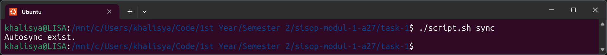

- Isi file `metadata.csv` setelah sinkronisasi
  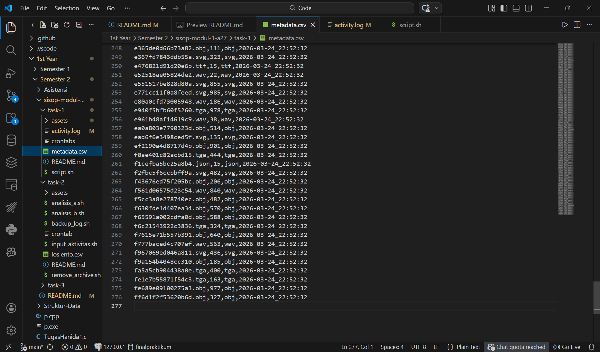

### Kode Penuh _(Full Code)_

```bash
do_detect(){
    for file in "$ASSETS_DIRECTORY"/*; do
        [ -e "$file" ] || continue
        filename=$(basename "$file")
        if ! grep -q "^$filename," "$METADATA_FILE" 2>/dev/null; then
            size=$(stat -c%s "$file")
            ext="${filename##*.}"
            [ "$ext" == "$filename" ] && ext=""
            created_at=$(date -r "$file" +"%Y-%m-%d_%H:%M:%S")
            echo "$filename,$size,$ext,$created_at" >> "$METADATA_FILE"
            log_msg "INFO" "SYNC" "Added new file $filename"
        fi
    done
}

do_clean(){
    if [ -s "$METADATA_FILE" ]; then
        temp=$(mktemp)
        cp "$METADATA_FILE" "$temp"
        while IFS=, read -r filename size ext created_at; do
            if [ -n "$filename" ] && [ ! -f "$ASSETS_DIRECTORY/$filename" ]; then
                sed -i "/^$filename,/d" "$METADATA_FILE"
                log_msg "INFO" "SYNC" "Removed missing file $filename from database"
            fi
        done < "$temp"
        rm "$temp"
    fi
}

do_sync(){
    do_detect;
    do_clean;
}

do_autosync(){
    local cron_cmd="*/5 * * * * cd $(pwd) && ./script.sh sync"
    if crontab -l 2>/dev/null | grep -qF "./script.sh sync"; then
        log_msg "INFO" "AUTOSYNC" "Autosync already installed"
        echo "Autosync exist."
    else
        (crontab -l 2>/dev/null; echo "$cron_cmd") | crontab -
        echo "$cron_cmd" > crontabs
        log_msg "INFO" "AUTOSYNC" "Installed autosync every 5 minutes"
        echo "Autosync installed."
    fi
}
```

---

## B. List

### Langkah-langkah & Potongan Kode _(Steps & Code Snippets)_

1. Parsing argument
    ```bash
    for arg in "$@"; do
        case $arg in
            --sort=name) sort_by="name" ;;
            --sort=size) sort_by="size" ;;
            --ext=*) ext_filter="${arg#*=}" ;;
        esac
    done
    ```

2. Filtering data
    ```bash
    if [ -n "$ext_filter" ]; then
        awk -F, -v ext="$ext_filter" '$3 == ext {print $0}' "$METADATA_FILE" > "$tmp_list"
    else
        cat "$METADATA_FILE" > "$tmp_list"
    fi
    ```

3. Sorting data
    ```bash
    if [ "$sort_by" == "name" ]; then
        sort -t, -k1,1 "$tmp_list" -o "$tmp_list"
    elif [ "$sort_by" == "size" ]; then
        sort -t, -k2,2n "$tmp_list" -o "$tmp_list"
    fi
    ```

4. Output tabel
    ```bash
    echo -e "FILENAME, SIZE, EXTENSION, CREATED_AT" | cat - "$tmp_list" | column -s, -t
    ```

### Screenshot _(Screenshot)_

- Hasil menjalankan `./script.sh list --sort=size`
  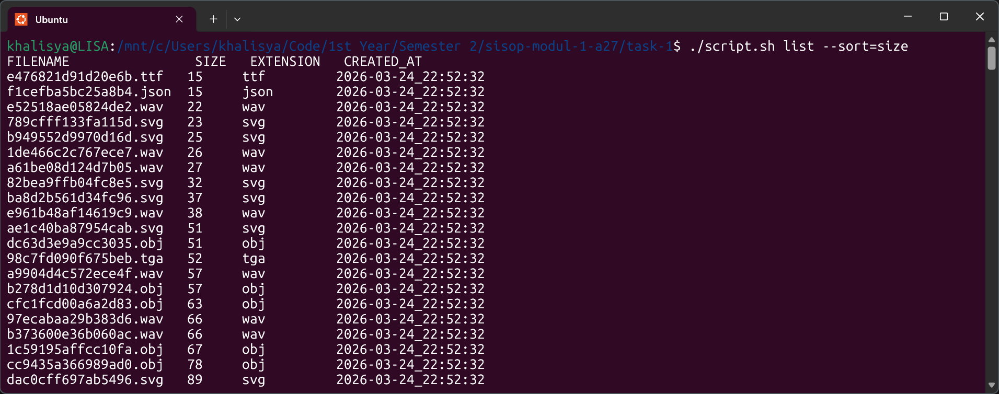

- Hasil menjalankan `./script.sh list --ext=svg`
  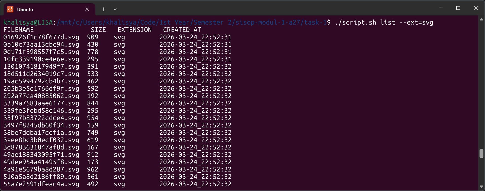

- Hasil menjalankan `./script.sh list --ext=svg --sort=size`
  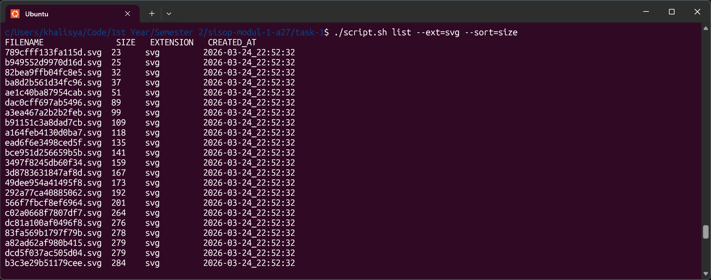

### Kode Penuh _(Full Code)_

```bash
do_list(){
    local sort_by="" ext_filter="" tmp_list=$(mktemp)

    for arg in "$@"; do
        case $arg in
            --sort=name) sort_by="name" ;;
            --sort=size) sort_by="size" ;;
            --ext=*) ext_filter="${arg#*=}" ;;
        esac
    done
    
    if [ -n "$ext_filter" ]; then
        awk -F, -v ext="$ext_filter" '$3 == ext {print $0}' "$METADATA_FILE" > "$tmp_list"
    else
        cat "$METADATA_FILE" > "$tmp_list"
    fi

    if [ ! -s "$tmp_list" ]; then
        log_msg "INFO" "LIST" "Query returned empty result"
        rm "$tmp_list"
        return
    fi

    if [ "$sort_by" == "name" ]; then
        sort -t, -k1,1 "$tmp_list" -o "$tmp_list"
    elif [ "$sort_by" == "size" ]; then
        sort -t, -k2,2n "$tmp_list" -o "$tmp_list"
    fi

    echo -e "FILENAME, SIZE, EXTENSION, CREATED_AT" | cat - "$tmp_list" | column -s, -t
    log_msg "INFO" "LIST" "Displayed database content"
    rm "$tmp_list"
}
```

---

## C. Statistics

### Langkah-langkah & Potongan Kode _(Steps & Code Snippets)_

1. Menghitung statistik dari data dalam `metadata.csv`
    ```bash
    local total_asset=$(wc -l < "$METADATA_FILE")
    local total_size=$(awk -F, '{sum+=$2} END {print sum}' "$METADATA_FILE")
    local avg_size=$(awk -F, '{sum+=$2} END {print sum/NR}' "$METADATA_FILE")
    ```

2. Menentukan file terbesar & terkecil
    ```bash
    local maximum=$(awk -F, 'BEGIN {max=-1; name=""} {if($2>max) {max=$2; name=$1}} END {print name " (" max " bytes)"}' "$METADATA_FILE")
    local minimum=$(awk -F, 'BEGIN {min=99999999999; name=""} {if($2<min) {min=$2; name=$1}} END {print name " (" min " bytes)"}' "$METADATA_FILE")
    ```

3. Menghitung jumlah file per ekstensi
    ```bash
    awk -F, '{print $3}' "$METADATA_FILE" | sort | uniq -c | awk '{print "  - " $2 ": " $1}'
    ```

### Screenshot _(Screenshot)_

Hasil menjalankan `./script.sh stats`

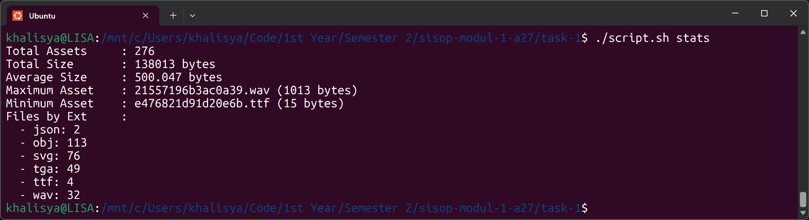

### Kode Penuh _(Full Code)_

```bash
do_stats(){
    if [ ! -s "$METADATA_FILE" ]; then
        log_msg "INFO" "STATS" "Accessed empty database"
        echo "Database empty."
        return
    fi

    local total_asset=$(wc -l < "$METADATA_FILE")
    local total_size=$(awk -F, '{sum+=$2} END {print sum}' "$METADATA_FILE")
    local avg_size=$(awk -F, '{sum+=$2} END {print sum/NR}' "$METADATA_FILE")
    local maximum=$(awk -F, 'BEGIN {max=-1; name=""} {if($2>max) {max=$2; name=$1}} END {print name " (" max " bytes)"}' "$METADATA_FILE")
    local minimum=$(awk -F, 'BEGIN {min=99999999999; name=""} {if($2<min) {min=$2; name=$1}} END {print name " (" min " bytes)"}' "$METADATA_FILE")

    echo "Total Assets     : $total_asset"
    echo "Total Size       : $total_size bytes"
    echo "Average Size     : $avg_size bytes"
    echo "Maximum Asset    : $maximum"
    echo "Minimum Asset    : $minimum"
    echo "Files by Ext     :"
    awk -F, '{print $3}' "$METADATA_FILE" | sort | uniq -c | awk '{print "  - " $2 ": " $1}'

    log_msg "INFO" "STATS" "Generated statistics"
}
```

---

## D. Manajemen Aset (CREATE & DELETE)

### Langkah-langkah & Potongan Kode _(Steps & Code Snippets)_

#### Create Asset

1. Membuat file dummy menggunakan `dd`
    ```bash
    dd if=/dev/zero of="$ASSETS_DIRECTORY/$filename" bs=1 count="$size"
    ```

2. Menambahkan metadata
    ```bash
    echo "$filename,$size,$ext,$created_at" >> "$METADATA_FILE"
    ```

#### Delete Asset

1. Menghapus file dan metadata
    ```bash
    rm "$ASSETS_DIRECTORY/$filename"
    sed -i "/^$filename,/d" "$METADATA_FILE"
    ```

### Screenshot _(Screenshot)_

Hasil menjalankan `./script.sh create test.txt 100` && `./script.sh delete test.txt`

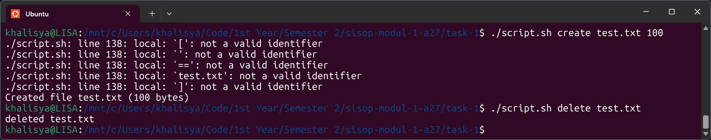

### Kode Penuh _(Full Code)_

```bash
do_create(){
    local filename=$1 size=$2

    if [[ -z "$filename" || -z "$size" ]]; then
        log_msg "ERROR" "CREATE" "Missing arguments"
        echo "Error: missing arguments."
        return
    fi

    if ! [[ "$size" =~ ^[0-9]+$ ]]; then
        log_msg "ERROR" "CREATE" "Invalid size: $size"
        echo "Error: invalid size."
        return
    fi

    if [ -f "$ASSETS_DIRECTORY/$filename" ]; then
        log_msg "ERROR" "CREATE" "File $filename already exists"
        echo "Error: file already exists."
        return
    fi

    dd if=/dev/zero of="$ASSETS_DIRECTORY/$filename" bs=1 count="$size" status=none
    local ext="${filename##*.}" [ "$ext" == "$filename" ] && ext=""
    local created_at=$(date +"%Y-%m-%d_%H:%M:%S")
    echo "$filename,$size,$ext,$created_at" >> "$METADATA_FILE"

    log_msg "INFO" "CREATE" "Created file $filename ($size bytes)"
    echo "Created file $filename ($size bytes)"
}

do_delete() {
    local filename=$1

    if [ -z "$filename" ]; then
        log_msg "ERROR" "DELETE" "No filename provided"
        echo "Error: no filename."
        return
    fi

    if [ ! -f "$ASSETS_DIRECTORY/$filename" ]; then
        log_msg "ERROR" "DELETE" "$filename not found"
        echo "Error: file not found."
        return
    fi

    rm "$ASSETS_DIRECTORY/$filename"
    sed -i "/^$filename,/d" "$METADATA_FILE"

    log_msg "INFO" "DELETE" "Deleted $filename"
    echo "deleted $filename"
}
```

---

## E. Sistem Logging (LOG)

### Langkah-langkah & Potongan Kode _(Steps & Code Snippets)_

1. Mencatat semua aktivitas menggunakan fungsi `log_msg`
    ```bash
    log_msg(){
        local level=$1 cmd=$2 msg=$3
        echo "[$(date +'%Y-%m-%d %H:%M:%S')] [$level] [$cmd] $msg" >> "$LOG_FILE"
    }
    ```

2. Menggunakan fungsi `log_msg` (contoh penggunaan)
    ```bash
    log_msg "INFO" "CREATE" "Created file $filename ($size bytes)"
    log_msg "ERROR" "DELETE" "$filename not found"
    ```

### Screenshot _(Screenshot)_

Isi file `activity.log`

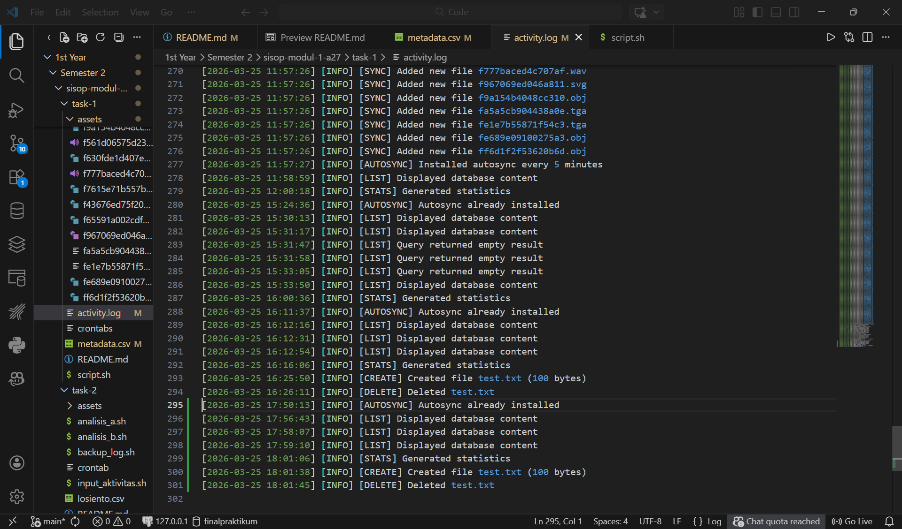

### Kode Penuh _(Full Code)_

```bash
log_msg(){
    local level=$1 cmd=$2 msg=$3
    echo "[$(date +'%Y-%m-%d %H:%M:%S')] [$level] [$cmd] $msg" >> "$LOG_FILE"
}
```

---

# Task 2 - Monyet Punch dan Ayam Wilson

## A. Langkah-langkah & Potongan Kode, Screenshot, Kode Penuh  
_(Steps & Code Snippets, Screenshot, Full Code)_

### Langkah-langkah & Potongan Kode _(Steps & Code Snippets)_
Jelaskan langkah-langkah yang dilakukan dan berikan potongan kode dari langkah-langkah yang kalian jelaskan jika ada.  
_Explain the steps performed and include relevant code snippets from the steps you describe if applicable._

1. Membuka & mengedit script analisis_a.sh
    ```bash
    nano analisis_a.sh
    ```

2. Mengawali script dengan shebang dan perintah awk (dimana pemisah kolomnya adalah koma (,))
    ```bash
    #!/bin/bash

    awk -F ',' '
    ```

3. Mengambil tiap kolom
    ```bash
    nama = $1
    aksi = $2
    durasi = $3
    waktu = $4
    ```

4. Memisahkan waktu lalu tanggal
    ```bash
    split(waktu, t, " ")
    split(t[1], d, "-")
    ```

5. Membuat filtering data berdasarkan tanggal 07-03-2026 dan durasi lebih dari 7200 detik (2 jam)
    ```bash
    if(d[1]=="07" && d[2]=="03" && d[3]=="2026" && durasi > 7200){
        gsub("_", " ", aksi)
        tanggal = d[1] d[2] d[3]
        print "[" nama "] " aksi " selama " durasi " detik pada " tanggal
    }
    ```

6. Membaca data dari file losiento.csv
    ```bash
    ' losiento.csv
    ```

### Screenshot _(Screenshot)_
Masukkan screenshot hasil eksekusi program atau proses yang relevan.  
_Insert screenshots of program execution results or other relevant processes._

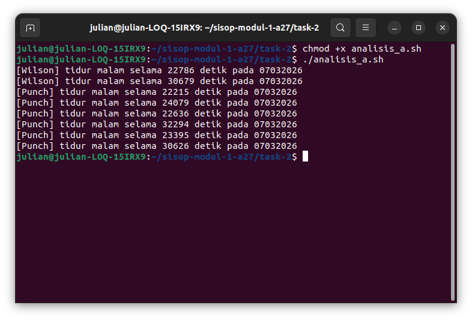

### Kode Penuh _(Full Code)_
Masukkan kode lengkap yang digunakan untuk menyelesaikan bagian ini.  
_Insert the full source code used to solve this section._

```bash
#!/bin/bash

awk -F ',' '
{
    nama = $1
    aksi = $2
    durasi = $3
    waktu = $4

    split(waktu, t, " ")
    split(t[1], d, "-")

    if(d[1]=="07" && d[2]=="03" && d[3]=="2026" && durasi > 7200){
        gsub("_", " ", aksi)
        tanggal = d[1] d[2] d[3]
        print "[" nama "] " aksi " selama " durasi " detik pada " tanggal
    }
}
' losiento.csv
```

## B. Langkah-langkah & Potongan Kode, Screenshot, Kode Penuh

### Langkah-langkah & Potongan Kode _(Steps & Code Snippets)_
Jelaskan langkah-langkah yang dilakukan dan berikan potongan kode dari langkah-langkah yang kalian jelaskan jika ada.  
_Explain the steps performed and include relevant code snippets from the steps you describe if applicable._

1. Membuka & mengedit script analisis_b.sh
    ```bash
    nano analisis_b.sh
    ```
    
2. Mengawali script dengan shebang dan perintah awk (dimana pemisah kolomnya adalah koma (,))
    ```bash
    #!/bin/bash

    awk -F ',' '
    ```

3. Membuat bagian BEGIN untuk inisialisasi jumlah aktivitas Punch tidur & Wilson makan
    ```bash
    BEGIN{
        count_punch = 0
        count_wilson = 0
    }
    ```

4. Mengambil tiap kolom
    ```bash
    nama = $1
    aksi = $2
    durasi = $3
    waktu = $4
    ```

5. Memisahkan waktu lalu tanggal & jam
    ```bash
    split(waktu, t, " ")
    split(t[1], d, "-")
    split(t[2], jam, ":")
    ```

6. Menambahkan variabel dan melakukan konversi dari string ke angka untuk hari dan jam
    ```bash
    hari = d[1] + 0
    bulan = d[2]
    tahun = d[3]
    jam_mulai = jam[1] + 0
    ```

7. Membuat filtering data berdasarkan tanggal 1-5 Maret 2026, kondisi Punch, dan kondisi Wilson
    ```bash
    if(bulan=="03" && tahun=="2026" && hari >= 1 && hari <= 5){
        if(nama=="Punch" && aksi ~ /tidur/ && jam_mulai > 12) count_punch++
        if(nama=="Wilson" && aksi ~ /makan/ && jam_mulai >= 9 && jam_mulai <= 19) count_wilson++
    }
    ```

8. Membuat bagian END untuk menampilkan output berupa hasil perhitungan
    ```bash
    END{
        print "[Punch] tidur sebanyak " count_punch " kali di atas pukul 12.00 siang."
        print "[Wilson] makan sebanyak " count_wilson " kali dari pukul 09.00 sampai 19.00."
    }
    ```

9. Membaca data dari file losiento.csv
    ```bash
    ' losiento.csv
    ```

### Screenshot _(Screenshot)_
Masukkan screenshot hasil eksekusi program atau proses yang relevan.  
_Insert screenshots of program execution results or other relevant processes._

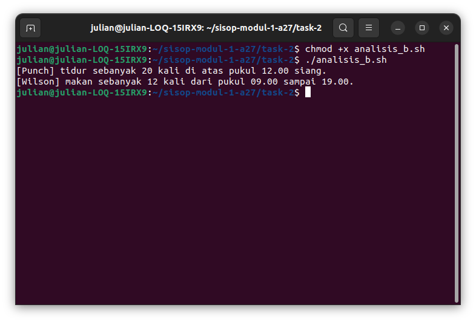

### Kode Penuh _(Full Code)_
Masukkan kode lengkap yang digunakan untuk menyelesaikan bagian ini.  
_Insert the full source code used to solve this section._

```bash
#!/bin/bash

awk -F',' '

BEGIN{
    count_punch = 0
    count_wilson = 0
}

{
    nama = $1
    aksi = $2
    durasi = $3
    waktu = $4

    split(waktu, t, " ")
    split(t[1], d, "-")
    split(t[2], jam, ":")

    hari = d[1] + 0
    bulan = d[2]
    tahun = d[3]
    jam_mulai = jam[1] + 0

    if(bulan=="03" && tahun=="2026" && hari >= 1 && hari <= 5){
        if(nama=="Punch" && aksi ~ /tidur/ && jam_mulai > 12) count_punch++
        if(nama=="Wilson" && aksi ~ /makan/ && jam_mulai >= 9 && jam_mulai <= 19) count_wilson++
    }
}

END{
    print "[Punch] tidur sebanyak " count_punch " kali di atas pukul 12.00 siang."
    print "[Wilson] makan sebanyak " count_wilson " kali dari pukul 09.00 sampai 19.00."
}
' losiento.csv
```

## C. Langkah-langkah & Potongan Kode, Screenshot, Kode Penuh

### Langkah-langkah & Potongan Kode _(Steps & Code Snippets)_
Jelaskan langkah-langkah yang dilakukan dan berikan potongan kode dari langkah-langkah yang kalian jelaskan jika ada.  
_Explain the steps performed and include relevant code snippets from the steps you describe if applicable._

1. Membuka & mengedit script input_aktivitas.sh
    ```bash
    nano input_aktivitas.sh
    ```

2. Mengawali script dengan shebang
    ```bash
    #!/bin/bash
    ```

3. Membuat input dari user
    ```bash
    echo -n "Nama : "
    read nama

    echo -n "Aktivitas : "
    read aktivitas

    echo -n "Durasi : "
    read durasi

    echo -n "Waktu mulai : "
    read waktu
    ```

4. Formating aktivitas
    ```bash
    format_aktivitas=$(echo "$aktivitas" | tr ' ' '_')
    ```

5. Mengambil tanggal dari waktu
    ```bash
    tanggal=$(echo "$waktu" | cut -d' ' -f1)
    ```

6. Memisahkan hari, bulan, tahun
    ```bash
    hari=$(echo "$tanggal" | cut -d'-' -f1)
    bulan=$(echo "$tanggal" | cut -d'-' -f2)
    tahun=$(echo "$tanggal" | cut -d'-' -f3)
    ```

7. Formating tanggal
    ```bash
    format_tanggal="${hari}${bulan}${tahun}"
    ```

8. Formating nama file log
    ```bash
    log_file="${nama}_${format_tanggal}.log"
    ```

9. Menentukan status
    ```bash
    if [[ "$durasi" -gt 21600 ]]
    then
        status="ALERT"
    else
        status="ACCEPTED"
    fi
    ```

10. Menyimpan data ke file log
    ```bash
    echo "[$status] $waktu : $nama $aktivitas selama $durasi detik" >> "$log_file"
    ```

11. Menambahkan data ke file losiento.csv
    ```bash
    echo "${nama},${format_aktivitas},${durasi},${waktu}" >> losiento.csv
    ```

### Screenshot _(Screenshot)_
Masukkan screenshot hasil eksekusi program atau proses yang relevan.  
_Insert screenshots of program execution results or other relevant processes._

- Input
  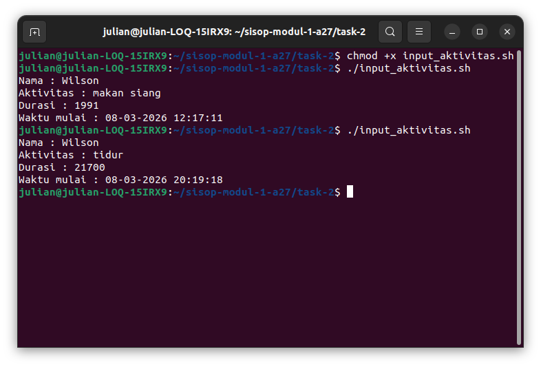

- Isi file log
  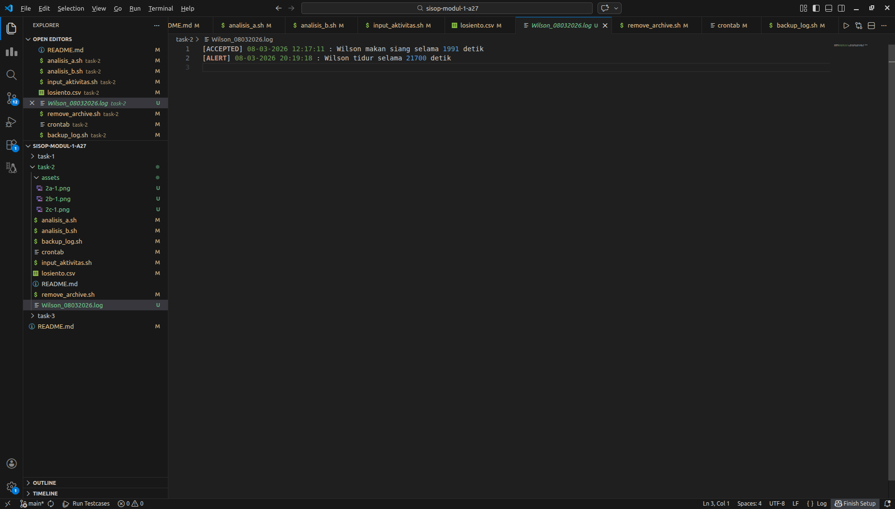

- Isi file losiento.csv
  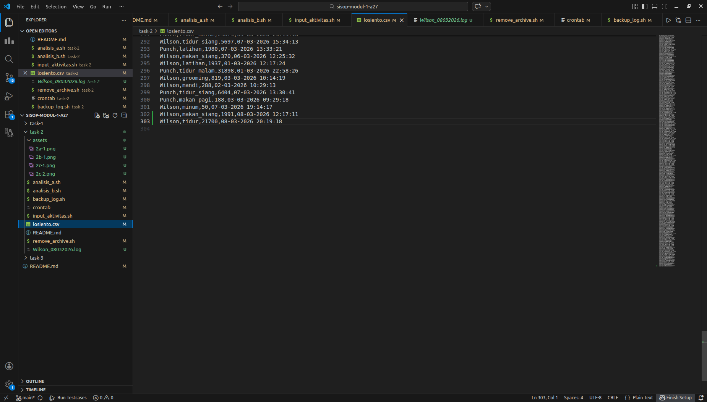

- Direktori
  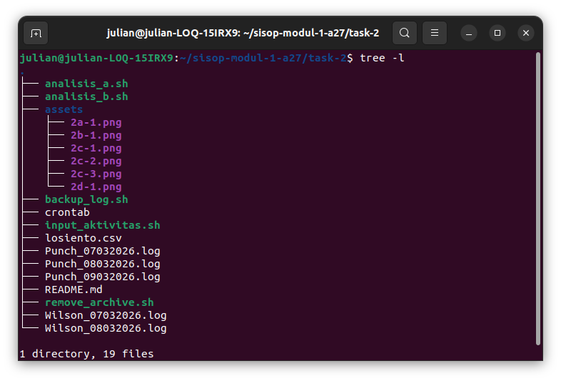

### Kode Penuh _(Full Code)_
Masukkan kode lengkap yang digunakan untuk menyelesaikan bagian ini.  
_Insert the full source code used to solve this section._

```bash
#!/bin/bash

echo -n "Nama : "
read nama

echo -n "Aktivitas : "
read aktivitas

echo -n "Durasi : "
read durasi

echo -n "Waktu mulai : "
read waktu

format_aktivitas=$(echo "$aktivitas" | tr ' ' '_')

tanggal=$(echo "$waktu" | cut -d' ' -f1)

hari=$(echo "$tanggal" | cut -d'-' -f1)
bulan=$(echo "$tanggal" | cut -d'-' -f2)
tahun=$(echo "$tanggal" | cut -d'-' -f3)

format_tanggal="${hari}${bulan}${tahun}"

log_file="${nama}_${format_tanggal}.log"

if [[ "$durasi" -gt 21600 ]]
then
    status="ALERT"
else
    status="ACCEPTED"
fi

echo "[$status] $waktu : $nama $aktivitas selama $durasi detik" >> "$log_file"
echo "${nama},${format_aktivitas},${durasi},${waktu}" >> losiento.csv
```

## D. Langkah-langkah & Potongan Kode, Screenshot, Kode Penuh

### Langkah-langkah & Potongan Kode _(Steps & Code Snippets)_
Jelaskan langkah-langkah yang dilakukan dan berikan potongan kode dari langkah-langkah yang kalian jelaskan jika ada.  
_Explain the steps performed and include relevant code snippets from the steps you describe if applicable._

1. Membuka & mengedit script backup_log.sh
    ```bash
    nano backup_log.sh
    ```

2. Mengawali script dengan shebang
    ```bash
    #!/bin/bash
    ```

3. Pindah direktori
    ```bash
    cd /home/julian/sisop-modul-1-a27/task-2
    ```

4. Mengambil daftar file .log
    ```bash
    file=$(ls *.log 2>/dev/null)
    ```

5. Mengecek adanya file .log
    ```bash
    if [[ -z "$file" ]]
    then
        echo "Tidak ada file log."
        exit 1
    fi
    ```

6. Mengambil tanggal dari nama file
    ```bash
    list_tanggal=$(echo "$file" | grep -oE '[0-9]{8}' | sort -u)
    ```

7. Melakukan looping untuk setiap tanggal, membuat nama file zip, mengarsipkan file, serta menampilkan output berupa isi file .zip
    ```bash
    for tanggal in $list_tanggal
    do
        file_zip="backup_log_${tanggal}.zip"
        zip "$file_zip" *_${tanggal}.log > /dev/null
        echo "Log berhasil diarsipkan."
        echo "Isi arsip:"
        unzip -Z1 "$file_zip"
        echo ""
    done
    ```

### Screenshot _(Screenshot)_
Masukkan screenshot hasil eksekusi program atau proses yang relevan.  
_Insert screenshots of program execution results or other relevant processes._

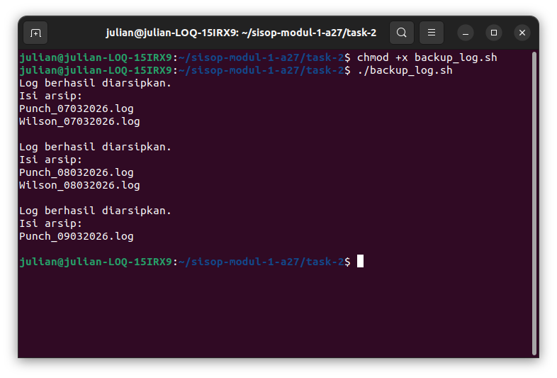

### Kode Penuh _(Full Code)_
Masukkan kode lengkap yang digunakan untuk menyelesaikan bagian ini.  
_Insert the full source code used to solve this section._

```bash
#!/bin/bash

cd /home/julian/sisop-modul-1-a27/task-2

file=$(ls *.log 2>/dev/null)

if [[ -z "$file" ]]
then
    echo "Tidak ada file log."
    exit 1
fi

list_tanggal=$(echo "$file" | grep -oE '[0-9]{8}' | sort -u)

for tanggal in $list_tanggal
do
    file_zip="backup_log_${tanggal}.zip"
    zip "$file_zip" *_${tanggal}.log > /dev/null
    echo "Log berhasil diarsipkan."
    echo "Isi arsip:"
    unzip -Z1 "$file_zip"
    echo ""
done
```

## E. Langkah-langkah & Potongan Kode, Screenshot, Kode Penuh

### Langkah-langkah & Potongan Kode _(Steps & Code Snippets)_
Jelaskan langkah-langkah yang dilakukan dan berikan potongan kode dari langkah-langkah yang kalian jelaskan jika ada.  
_Explain the steps performed and include relevant code snippets from the steps you describe if applicable._

1. Membuka & mengedit script remove_archive.sh
    ```bash
    nano remove_archive.sh
    ```

2. Mengawali script dengan shebang
    ```bash
    #!/bin/bash
    ``` 

3. Melakukan looping untuk setiap file .zip
    ```bash
    for file in /home/julian/sisop-modul-1-a27/task-2/backup_log_*.zip
    ``` 

4. Mengambil nama file
    ```bash
    nama_file=$(basename "$file")
    ``` 

5. Mengambil tanggal dari nama file
    ```bash
    tanggal=$(echo "$nama_file" | grep -oP '[0-9]{8}')
    ``` 

6. Memisahkan hari, bulan, tahun
    ```bash
    hari=$(echo "$tanggal" | cut -c1-2)
    bulan=$(echo "$tanggal" | cut -c3-4)
    tahun=$(echo "$tanggal" | cut -c5-8)
    ``` 

7. Konversi ke timestamp
    ```bash
    tanggal_file=$(date -d "$tahun-$bulan-$hari" +%s)
    ``` 

8. Mengambil waktu sekarang dan menghitung selisih hari
    ```bash
    now=$(date +%s)
    diff=$(( (now - tanggal_file) / 86400 ))
    ``` 

9. Menghapus file jika lebih dari 7 hari
    ```bash
    if [[ "$diff" -gt 7 ]]
        then
            rm "$file"
    fi
    ``` 

10. Mengakses dan mengedit konfigurasi cron
    ```bash
    crontab -e
    ```

11. Menambahkan baris perintah untuk menjalankan script backup setiap hari pada pukul 23.59 dan menjalankan script penghapusan arsip setiap hari pada pukul 02.34
    ```bash
    59 23 * * * /home/julian/sisop-modul-1-a27/task-2/backup_log.sh

    34 2 * * * /home/julian/sisop-modul-1-a27/task-2/remove_archive.sh
    ```

12. Memastikan kedua jadwal berhasil terdaftar dan akan dieksekusi secara otomatis
    ```bash
    crontab -l
    ```

### Screenshot _(Screenshot)_
Masukkan screenshot hasil eksekusi program atau proses yang relevan.  
_Insert screenshots of program execution results or other relevant processes._

- Konfigurasi cron
  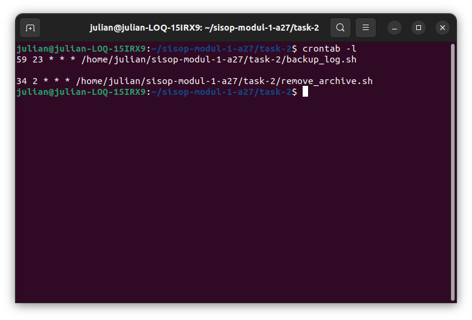

- Untuk uji coba, saya modifikasi waktunya. Dimana, backup pada pukul 17.30 dan penghapusan pada pukul 17.32
  1. Sebelum pukul 17.30
     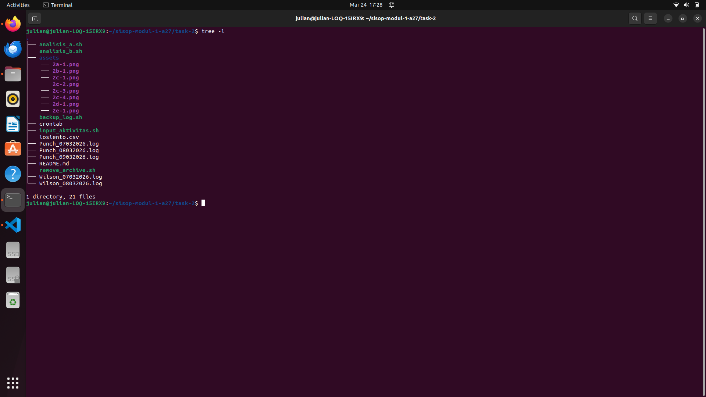

  2. Setelah pukul 17.30
     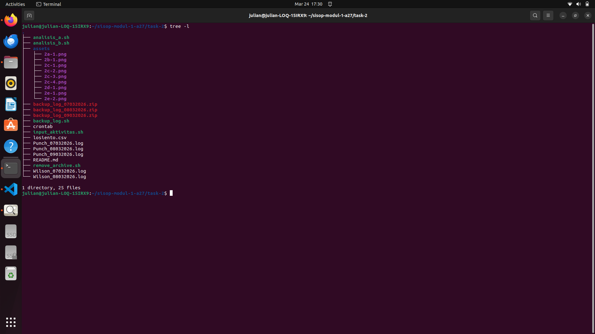

  3. Setelah pukul 17.32
     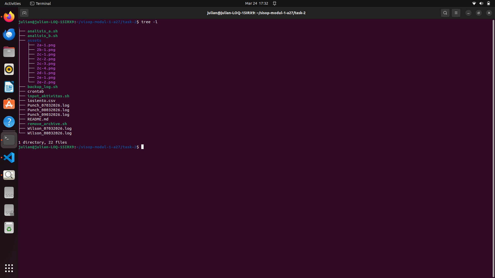

### Kode Penuh _(Full Code)_
Masukkan kode lengkap yang digunakan untuk menyelesaikan bagian ini.  
_Insert the full source code used to solve this section._

1. remove_archive.sh
    ```bash
    #!/bin/bash

    for file in /home/julian/sisop-modul-1-a27/task-2/backup_log_*.zip
    do
        nama_file=$(basename "$file")
        
        tanggal=$(echo "$nama_file" | grep -oP '[0-9]{8}')
        
        hari=$(echo "$tanggal" | cut -c1-2)
        bulan=$(echo "$tanggal" | cut -c3-4)
        tahun=$(echo "$tanggal" | cut -c5-8)
        
        tanggal_file=$(date -d "$tahun-$bulan-$hari" +%s)
        now=$(date +%s)
        diff=$(( (now - tanggal_file) / 86400 ))

        if [[ "$diff" -gt 7 ]]
        then
            rm "$file"
        fi
    done 
    ```

2. Konfigurasi cron
    ```bash
    59 23 * * * /home/julian/sisop-modul-1-a27/task-2/backup_log.sh

    34 2 * * * /home/julian/sisop-modul-1-a27/task-2/remove_archive.sh
    ```

---

# Task 3 - Pertunjukan Drama Raja Setan Manchester  
_(The Manchester Red Devil Drama Show)_

## A. Langkah-langkah & Potongan Kode, Screenshot, Kode Penuh

### Langkah-langkah & Potongan Kode _(Steps & Code Snippets)_
Jelaskan langkah-langkah yang dilakukan dan berikan potongan kode dari langkah-langkah yang kalian jelaskan jika ada.  
_Explain the steps performed and include relevant code snippets from the steps you describe if applicable._

1. Membuat file register.sh
    ```bash
    nano register.sh
    ```
    Dilakukan di dalam terminal ( Ctrl+Alt+T )

2. Mengawali dengan shebang
    ```bash
    #!/bin/bash
    ```
    Shebang berfungsi untuk memberitahu pada sistem operasi bahwa program harus dieksekusi dengan bash shell. Apabila tidak dicantumkan, maka perilaku script/program menjadi tidak konsisten antar sistem.

3. Menginisialisasi _directory_
    ```bash
    mkdir -p storage
    mkdir -p storage/log
    ```
    Directory tersebut digunakan untuk menyimpan data. "mkdir" digunakan untuk membuat direktori secara otomatis apabila belum ada direktori belum tersedia. " -p" dipakai supaya program tidak menghasilkan pesan error apabila memang sudah ada direktori tsb sebelumnya.

4. Membuat variabel global untuk menyimpan path dari file-file yang akan digunakan dalam sistem
    ```bash
    USERS_FILE="storage/users.txt"
    LOG_FILE="storage/log/log.txt"
    ```
    - USERS_FILE: path database pengguna
    - LOG_FILE: path untuk log sistem

5. Membuat fungsi log untuk mencatat aktivitas sistem
    ```bash
    write_log(){
    local type=$1
    local action=$2
    local message=$3

    local date=$(date '+%d/%m/%y')
    local time=$(date '+%H:%M:%S')
    echo "[$type] $date | $time  $action: $message">>"$LOG_FILE"
    }
    ```
    Fungsi tersebut menerima 3 parameter yakni "type", "action", dan "message". Selain itu, fungsi tersebut juga mencatat tanggal dan waktu secara otomatis.

6. Membuat _interface_ untuk registrasi
    ```bash
    echo "===================================================="
    echo "                REGISTRASI USER BARU             "
    echo "===================================================="
    ```

7. Membuat tempat input pengguna
    ```bash
    read -p "Nama Lengkap              : " fullname
    read -p "Tanggal lahir (yyyy-mm-dd): " birthdate
    read -p "Role                      : " role
    ```
    Input yang harus dimasukkan pengguna adalah "Nama Lengkap", "Tanggal Lahir", dan "Role".

8. Validasi role
    ```bash
    if [ "$role" != "Coach" ] && [ "$role" != "Analyst" ] && [ "$role" != "Player" ] && [ "$role" != "coach" ] && [ "$role" != "analyst" ] && [ "$role" != "player" ]; then
    echo "ERROR: Role tidak vaid!"
    write_log "ERROR" "REGISTER" "Role tidak valid!"
    exit 1
    fi
    ```
    Dikarenakan di soal hanya diperbolehkan 3 role, yakni "Coach", "Analyst", "Player", maka kita perlu memberi batasan atau validasi agar user tidak memasukkan role lain selain 3 role tersebut. Apabila user memasukkan di luar 3 role tersebut, sistem akan mencatat di log bahwa terjadi "ERROR" pada saat melakukan "REGISTER" yakni "Role tidak valid!".

9. Pembuatan username dan password
    ```bash
    username=$(echo $fullname | cut -d' ' -f1)
    tahun=$(echo $birthdate | cut -d'-' -f1)
    password="${username}${tahun}${role}"
    ```
    - USERNAME: mengambil dari input "fullname", kemudian dipotong dengan perintah `cut -d' ' -f1` yang artinya memotong string dengan pemisah berupa "spasi" di bagian pertama
    - TAHUN: mengambil dari input "birthdate", kemudian dipotong dengan perintah `cut -d'-' -f1` yang artinya memotong string dengan pemisah berupa "-" di bagian pertama (tahun)
    - PASSWORD: menggabungkan username, tahun, dan role

10. Validasi duplikasi username
    ```bash
    if [ -f "$USERS_FILE" ] && grep -q ",${username}," "$USERS_FILE"; then
    echo "ERROR: Username '$username' sudah terdaftar!"
    write_log "ERROR" "REGISTER" "User $username sudah terdaftar!"
    exit 1
    fi
    ```
    Untuk menghindari duplikasi username, sebelum data disimpan, sistem akan mengecek apakah username tersebut sudah ada dalam database "USERS_FILE" menggunakan perintah `[ -f "$USERS_FILE" ]` dan `grep -q`. Apabila username sudah terdaftar, sistem akan menampilkan hasil "ERROR: Username '$username' sudah terdaftar!" dan mencatat dalam log bahwa dalam sistem telah terjadi "ERROR" pada saat melakukan "REGISTER" yakni "User $username sudah terdaftar!".

11. Menyimpan data pengguna
    ```bash
    echo "${fullname},${birthdate},${role},${username},${password}" >> "$USERS_FILE"
    write_log "INFO" "REGISTER" "User $username berhasil didaftarkan"
    ```
    Apabila tidak ada duplikasi username, maka data pengguna akan disimpan dalam "$USERS_FILE" kemudian sistem akan mencatat bahwa terdapat "INFO" saat melakukan "REGISTER", yakni "User $username berhasil didaftarkan".

12. Menampilkan hasil registrasi
    ```bash
    echo "=================================================="
    echo "              REGISTRASI BERHASIL                 "
    echo "=================================================="
    echo "Nama lengkap    : $fullname "
    echo "Tanggal Lahir   : $birthdate"
    echo "Role            : $role     "
    echo "Username        : $username "
    echo "Password        : $password "
    echo "=================================================="
    ```
    Simpan perubahan dengan Ctrl+O -> Enter -> Ctrl+X

13. Membuat file login.sh
    ```bash
    nano login.sh
    ```
    Dilakukan di dalam terminal ( Ctrl+Alt+T )

14. Mengawali dengan shebang
    ```bash
    #!/bin/bash
    ```
    Shebang berfungsi untuk memberitahu pada sistem operasi bahwa program harus dieksekusi dengan bash shell. Apabila tidak dicantumkan, maka perilaku script/program menjadi tidak konsisten antar sistem.

15. Mendeklarasikan variabel global untuk menyimpan path dari file-file yang akan digunakan dalam sistem
    ```bash
    USERS_FILE="storage/users.txt"
    LOG_FILE="storage/log/log.txt"
    ```
    - USERS_FILE: path database pengguna
    - LOG_FILE: path untuk log sistem

16. Membuat fungsi cek pengguna aktif
    ```bash
    cek_sesi_aktif() {
    if [ ! -f "$LOG_FILE" ]; then
    return 1
    fi 
    ```
    Untuk memeriksa apakah terdapat pengguna yang sedang aktif login. Jika tidak ada, maka fungsi akan mengembalikan nilai 1 yang artinya tidak ada sesi aktif.
    ```bash
    last_line=$(tail -n 1 "$LOG_FILE" 2>/dev/null)
    ```
    Fungsi mengambil baris terakhir dari file log melalui perintah `tail -n 1`.
    ```bash
    if echo "$last_line" | grep -q "LOGIN: User" && ! echo "$last_line" | grep -q "LOGOUT"; then
    return 0
    fi
    return 1
    }
    ```
    Jika pada baris terakhir "$LOG_FILE" terdapat kata "Login: User", tetapi tidak terdapat kata "LOGOUT", maka masih terdapat sesi aktif dan fungsi akan mengembalikan nilai 0. Apabila terjadi sebaliknya, maka fungsi akan mengembalikan nilai 1.

17. Membuat _interface_ login
    ```bash
    echo "=================================================="
    echo "                    LOGIN SYSTEM                  "
    echo "=================================================="
    ```

18. Membuat syarat login
    ```bash
    active_session=$(cek_sesi_aktif)
    if [ $? -eq 0 ]; then
    echo "=================================================="
    echo "ERROR: Sedang ada user yang aktif!                "
    echo "User aktif: $active_session"
    echo "Tunggu hingga user tersebut logout                "
    echo "=================================================="
    exit 1
    fi
    ```
    Sebelum memproses login, sistem akan memeriksa apakah ada user aktif/sesi aktif dengan memanggil fungsi "cek_sesi_aktif". Variabel "$?" menyimpan nilai kembalian dari pemanggilan fungsi tersebut. Apabila bernilai 0 artinya masih terdapat sesi aktif, sistem akan menolak sesi login baru dan menghentikan eksekusi dengan "exit".

19. Menyediakan field input untuk login
    ```bash
    read -p "Username: " username
    read -p "Password: " password
    ```
    User memasukkan username dan password yang sudah didaftarkan di register.sh.

20. Memberikan syarat untuk bisa login

    Terdapat beberapa kondisi yang mungkin terjadi, di antaranya:

    **Kondisi 1: Belum terdapat user yang melakukan register**
    ```bash
    if [ ! -f "$USERS_FILE" ]; then
    echo "=================================================="
    echo "ERROR: Belum ada user terdaftar                   "
    echo "=================================================="
    exit 1
    fi
    ```
    Apabila tidak ditemukan data dalam "$USERS_FILE", maka sistem akan menampilkan "ERROR: Belum ada user terdaftar".

    **Kondisi 2: Sudah ada user yang melakukan register, namun saat login username yang dimasukkan oleh user belum terdaftar**
    ```bash
    user_data=$(grep ",${username}," "$USERS_FILE")

    if [ -z "$user_data" ]; then
    echo "=================================================="
    echo "ERROR: Username tidak ditemukan !"
    echo "=================================================="
    write_log "ERROR" "LOGIN" "Gagal melakukan login pada user $username"
    exit 1
    fi
    ```
    Sistem akan mencari username yang dimasukkan oleh user di dalam database. Apabila tidak ditemukan, sistem akan menampilkan "ERROR: Username tidak ditemukan !" dan menghentikan eksekusi.

    **Kondisi 3: Sudah ada user yang melakukan register, username benar, password salah**
    ```bash
    stored_password=$(echo "$user_data" | cut -d',' -f5)
    fullname=$(echo "$user_data" | cut -d',' -f1)
    role=$(echo "$user_data" | cut -d',' -f3)

    if [ "$password" != "$stored_password" ]; then
    echo "=================================================="
    echo "ERROR: Password salah!"
    echo "=================================================="
    write_log "ERROR" "LOGIN" "Gagal melakukan login pada user $username"
    exit 1
    fi
    ```
    - stored_password: mengambil field ke 5 dari "$user_data"
    - fullname: mengambil field ke 1 dari "$user_data"
    - role: mengambil field ke 3 dari "$user_data"
    - fullname dan role digunakan nanti

    Sistem akan membandingkan apakah password yang diinput oleh user sudah sesuai dengan password yang tersimpan dalam "$user_data". Apabila tidak cocok, maka sistem akan menampilkan "ERROR: Password salah!" dan akan mencatat telah terjadi "ERROR" saat "LOGIN" yakni "Gagal melakukan login pada user $username", kemudian sistem menghentikan eksekusi.

21. Menyediakan menu selanjutnya apabila berhasil login
    ```bash
    write_log "INFO" "LOGIN" "User $username berhasil login"

    echo ""
    echo "===================================================="
    echo "                LOGIN BERHASIL                    "
    echo "===================================================="
    echo "Selamat datang, $fullname!"
    echo "Username        : $username"
    echo "Role            : $role "
    echo "Level           : $(get_level "$role")"
    echo "==================================================="
    ```
    Sistem akan mencatat bahwa terdapat "INFO" saat "LOGIN" yakni "User $username berhasil login". Kemudian, user akan diarahkan pada menu:
    ```bash
    while true; do
    echo ""
    echo "===================================================="
    echo "      Pertunjukan Drama Raja Setan MAnchester      "
    echo "===================================================="
    echo "1. Lihat statistik pertandingan"
    echo "2. Hapus user "
    echo "3. Ubah waktu pengarsipan"
    echo "4. Keluar"
    echo "===================================================="
    read -p "Pilih menu (1-4): " menu

    case $menu in
    1) 
    lihat_statistik
    ;;
    2)
    hapus_user
    ;;
    3)
    ubah_waktu
    ;;
    4)
    write_log "INFO" "LOGIN" "User $username berhasil logout!"
    echo "===================================================="
    echo "                 LOGOUT BERHASIL                   "
    echo "===================================================="
    echo "Terima kasih, $fullname!"
    echo "===================================================="
    break
    ;;
    *)
    echo "===================================================="
    echo "ERROR: Pilihan tidak valid!"
    echo "Silahkan pilih 1,2,3,4"
    echo "===================================================="
    ;;

    esac
    done
    ```
    - Apabila user memilih "1" maka akan diarahkan pada fungsi "lihat_statistik" (dijelaskan pada poin selanjutnya)
    - Apabila user memilih "2" maka akan diarahkan pada fungsi "hapus_user" (dijelaskan pada poin selanjutnya)
    - Apabila user memilih "3" maka akan diarahkan pada fungsi "ubah_waktu" (dijelaskan pada poin selanjutnya)
    - Apabila user memilih "4" maka sistem akan mencatat bahwa terdapat "INFO" saat "LOGIN" yakni "User $username berhasil logout!" pada log
    - Apabila memilih opsi lain, maka sistem akan menampilkan "ERROR: Pilihan tidak valid!"

### Screenshot _(Screenshot)_
Masukkan screenshot hasil eksekusi program atau proses yang relevan.  
_Insert screenshots of program execution results or other relevant processes._

- Register berhasil: tampilan interface
  

- Register berhasil: users.txt
  

- Register berhasil: tampilan log
  

- Register role salah: tampilan interface
  

- Register role salah: tampilan log
  

- Register sudah ada: tampilan interface
  

- Register sudah ada: tampilan log
  

- Login gagal (username tidak ada): tampilan interface
  

- Login gagal (username tidak ada): tampilan log
  

- Login gagal (password salah): tampilan interface
  

- Login gagal (password salah): tampilan log
  

- Login berhasil: tampilan interface
  

- Login berhasil: tampilan log
  

- Logout berhasil: tampilan interface
  

- Logout berhasil: tampilan log
  

### Kode Penuh _(Full Code)_
Masukkan kode lengkap yang digunakan untuk menyelesaikan bagian ini.  
_Insert the full source code used to solve this section._

1. register.sh
    ```bash
    #!/bin/bash

    mkdir -p storage

    FILE="/home/ubuntu/latihan-github/storage/matchResult.csv"

    if [ ! -f "$FILE" ] || [ ! -s "$FILE" ]; then
    echo "Home Team,Away Team,Score,Shots,Winner" > "$FILE"
    fi

    teams=("Barca" "Madrid" "City" "Arsenal" "Bayern" "PSG" "Liverpool" "MU" "Juventus" "Inter")

    home_team=${teams[$RANDOM % ${#teams[@]}]}
    away_team=${teams[$RANDOM % ${#teams[@]}]}

    while [ "$home_team" = "$away_team" ]; do
    away_team=${teams[$RANDOM % ${#teams[@]}]}
    done

    home_scores=$((RANDOM % 5))
    away_scores=$((RANDOM % 5))

    home_shots=$((RANDOM % 20 + 5))
    away_shots=$((RANDOM % 20 + 5))

    if [ $home_score -gt $away_score ]; then
    winner="$home_team"
    elif [ $away_score -gt $home_score ]; then
    winner="$away_team"
    else
    winner="Draw"
    fi

    new_data="${home_team},${away_team},${home_scores}-${away_scores},${home_shots}-${away_shots},${winner}"

    data_count=$(tail -n +2 "$FILE" | wc -l)

    if [ $data_count -lt 5 ]; then
    echo "$new_data" >> "$FILE"
    else
    tail -n +2 "$FILE" > /tmp/data.txt

    echo "$new_data" >> /tmp/data.txt

    tail -n 5 /tmp/data.txt > /tmp/last5.txt

    echo "Home Team,Away Team,Score,Shots,Winner" > "$FILE"
    cat /tmp/last5.txt >> "$FILE"
    rm -f /tmp/data.txt /tmp/last5.txt
    fi

    echo "Data generated: $home_team $home_scores- $away_scores $away_team" >> /home/ubuntu/latihan-github/generate.log
    ```

2. login.sh
    ```bash
    #!/bin/bash

    USERS_FILE="storage/users.txt"
    LOG_FILE="storage/log/log.txt"

    cek_sesi_aktif() {
    if [ ! -f "$LOG_FILE" ]; then
    return 1
    fi 

    last_line=$(tail -n 1 "$LOG_FILE" 2>/dev/null)

    if echo "$last_line" | grep -q "LOGIN: User" && ! echo "$last_line" | grep -q "LOGOUT"; then
    return 0
    fi
    return 1
    }

    write_log(){
    local type=$1
    local action=$2
    local message=$3
    local date=$(date '+%d/%m/%y')
    local time=$(date '+%H:%M:%S')
    echo "[$type] $date | $time $action: $message" >> "$LOG_FILE"
    }

    echo "=================================================="
    echo "                    LOGIN SYSTEM                  "
    echo "=================================================="

    active_session=$(cek_sesi_aktif)
    if [ $? -eq 0 ]; then
    echo "=================================================="
    echo "ERROR: Sedang ada user yang aktif!                "
    echo "User aktif: $active_session"
    echo "Tunggu hingga user tersebut logout                "
    echo "=================================================="
    exit 1
    fi

    read -p "Username: " username
    read -p "Password: " password

    if [ ! -f "$USERS_FILE" ]; then
    echo "=================================================="
    echo "ERROR: Belum ada user terdaftar                   "
    echo "=================================================="
    exit 1
    fi

    user_data=$(grep ",${username}," "$USERS_FILE")

    if [ -z "$user_data" ]; then
    echo "=================================================="
    echo "ERROR: Username tidak ditemukan !"
    echo "=================================================="
    write_log "ERROR" "LOGIN" "Gagal melakukan login pada user $username"
    exit 1
    fi

    stored_password=$(echo "$user_data" | cut -d',' -f5)
    fullname=$(echo "$user_data" | cut -d',' -f1)
    role=$(echo "$user_data" | cut -d',' -f3)

    if [ "$password" != "$stored_password" ]; then
    echo "=================================================="
    echo "ERROR: Password salah!"
    echo "=================================================="
    write_log "ERROR" "LOGIN" "Gagal melakukan login pada user $username"
    exit 1
    fi

    write_log "INFO" "LOGIN" "User $username berhasil login"

    echo ""
    echo "===================================================="
    echo "                LOGIN BERHASIL                    "
    echo "===================================================="
    echo "Selamat datang, $fullname!"
    echo "Username        : $username"
    echo "Role            : $role "
    echo "Level           : $(get_level "$role")"
    echo "==================================================="

    while true; do
    echo ""
    echo "===================================================="
    echo "      Pertunjukan Drama Raja Setan MAnchester      "
    echo "===================================================="
    echo "1. Lihat statistik pertandingan"
    echo "2. Hapus user "
    echo "3. Ubah waktu pengarsipan"
    echo "4. Keluar"
    echo "===================================================="
    read -p "Pilih menu (1-4): " menu

    case $menu in
    1) 
    lihat_statistik
    ;;
    2)
    hapus_user
    ;;
    3)
    ubah_waktu
    ;;
    4)
    write_log "INFO" "LOGIN" "User $username berhasil logout!"
    echo "===================================================="
    echo "                 LOGOUT BERHASIL                   "
    echo "===================================================="
    echo "Terima kasih, $fullname!"
    echo "===================================================="
    break
    ;;
    *)
    echo "===================================================="
    echo "ERROR: Pilihan tidak valid!"
    echo "Silahkan pilih 1,2,3,4"
    echo "===================================================="
    ;;

    esac
    done
    ```

## B. Langkah-langkah & Potongan Kode, Screenshot, Kode Penuh

### Langkah-langkah & Potongan Kode _(Steps & Code Snippets)_
Jelaskan langkah-langkah yang dilakukan dan berikan potongan kode dari langkah-langkah yang kalian jelaskan jika ada.  
_Explain the steps performed and include relevant code snippets from the steps you describe if applicable._

#### Generate.sh

1. Membuat file generate.sh
    ```bash
    nano generate.sh
    ```

2. Mengawali dengan shebang
    ```bash
    #!/bin/bash
    ```
    Shebang berfungsi untuk memberitahu pada sistem operasi bahwa program harus dieksekusi dengan bash shell. Apabila tidak dicantumkan, maka perilaku script/program menjadi tidak konsisten antar sistem.

3. Menginisialisasi _directory_
    ```bash
    mkdir -p storage
    ```
    Directory tersebut digunakan untuk menyimpan data. "mkdir" digunakan untuk membuat direktori secara otomatis apabila belum ada direktori belum tersedia. " -p" dipakai supaya program tidak menghasilkan pesan error apabila memang sudah ada direktori tsb sebelumnya.

4. Menginisialisasi dan membuat file CSV
    ```bash
    FILE="/home/ubuntu/sisop-modul-1-a27/task-3/storage/matchResult.csv"
    if [ ! -f "$FILE" ] || [ ! -s "$FILE" ]; then
    echo "Home Team,Away Team,Score,Shots,Winner" > "$FILE"
    fi
    ```

5. Membuat rotasi/pemilihan tim secara acak
    ```bash
    teams=("Barca" "Madrid" "City" "Arsenal" "Bayern" "PSG" "Liverpool" "MU" "Juventus" "Inter")

    home_team=${teams[$RANDOM % ${#teams[@]}]}
    away_team=${teams[$RANDOM % ${#teams[@]}]}

    while [ "$home_team" = "$away_team" ]; do
    away_team=${teams[$RANDOM % ${#teams[@]}]}
    done
    ```
    - Akan terjadi pengacakan 10 nama tim
    - Program akan memilih home_team dan away_team secara acak melalui $RANDOM
    - "while" memastikan kedua tim tidak sama

6. Membuat _generate_ skor dan shots secara acak
    ```bash
    home_scores=$((RANDOM % 5))
    away_scores=$((RANDOM % 5))

    home_shots=$((RANDOM % 20 + 5))
    away_shots=$((RANDOM % 20 + 5))
    ```
    Di atas hanyalah contoh kasus (untuk simulasi), angkanya bisa diubah.
    - "RANDOM % 5" untuk menghasilkan angka antara 0-4
    - "+ 5" agar minimal ada 5 tembakan (opsional, agar realistis)

7. Membuat syarat penentuan pemenang
    ```bash
    if [ $home_scores -gt $away_scores ]; then
    winner="$home_team"
    elif [ $away_scores -gt $home_scores ]; then
    winner="$away_team"
    else
    winner="Draw"
    fi
    ```

8. Mengatur data CSV
    ```bash
    new_data="${home_team},${away_team},${home_scores}-${away_scores},${home_shots}-${away_shots},${winner}"

    data_count=$(tail -n +2 "$FILE" | wc -l)

    if [ $data_count -lt 5 ]; then
    echo "$new_data" >> "$FILE"
    else
    tail -n +2 "$FILE" > /tmp/data.txt

    echo "$new_data" >> /tmp/data.txt

    tail -n 5 /tmp/data.txt > /tmp/last5.txt

    echo "Home Team,Away Team,Score,Shots,Winner" > "$FILE"
    cat /tmp/last5.txt >> "$FILE"
    rm -f /tmp/data.txt /tmp/last5.txt
    fi
    ```
    Sesuai soal, data yang ditampilkan adalah 5 pertandingan terakhir. Ketika data sudah lebih dari 5, maka data terlama akan dihapus, dan data di bawahnya akan bergeser ke atas.

9. Mencatat aktivitas di log
    ```bash
    echo "Data generated: $home_team $home_scores- $away_scores $away_team" >> /home/ubuntu/latihan-github/generate.log
    ```

#### Menghubungkan dengan crontab

1. Mengedit konfigurasi crontab
    ```bash
    crontab -e
    ```

2. Menambahkan perintah agar crontab menjalankan program generate.sh setiap 2 menit
    ```bash
    */2 * * * * /bin/bash /home/ubuntu/sisop-modul-1-a27/task-3/generate.sh >> /home/ubuntu/sisop-modul-1-a27/task-3/cron.log 2>&1
    ```

3. Memastikan perintah sudah berjalan
    ```bash
    crontab -l
    ```

#### Script.sh

1. Membuat file script.sh
    ```bash
    nano script.sh
    ```
    Dilakukan di dalam terminal ( Ctrl+Alt+T )

2. Mengawali dengan shebang
    ```bash
    #!/bin/bash
    ```
    Shebang berfungsi untuk memberitahu pada sistem operasi bahwa program harus dieksekusi dengan bash shell. Apabila tidak dicantumkan, maka perilaku script/program menjadi tidak konsisten antar sistem.

3. Menginisialisasi _directory_ dan path
    ```bash
    BASE="/home/ubuntu/sisop-modul-1-a27/task-3"
    DATA_FILE="$BASE/storage/matchResult.csv"
    LOG_FILE="$BASE/storage/log/log.txt"
    MATCH_DIR="$BASE/storage/matchStatistic"

    mkdir -p "$BASE/storage"
    mkdir -p "$MATCH_DIR"
    ```
    Path digunakan untuk menyimpan path dari file-file yang akan digunakan dalam sistem. Directory tersebut digunakan untuk menyimpan data. "mkdir" digunakan untuk membuat direktori secara otomatis apabila belum ada direktori belum tersedia. " -p" dipakai supaya program tidak menghasilkan pesan error apabila memang sudah ada direktori tsb sebelumnya.

4. Membuat fungsi log
    ```bash
    write_log() {
        local type=$1
        local action=$2
        local message=$3
        local date=$(date '+%d/%m/%y')
        local time=$(date '+%H:%M:%S')
        echo "[$type] $date | $time $action: $message" >> "$LOG_FILE"
    }
    ```
    Digunakan untuk mencatat aktivitas sistem.

5. Membuat fungsi untuk menghitung total match, total goal, average shots, dan total shots keseluruhan
    ```bash
    hitung_statistik() {
        total_match=0
        total_goal=0
        total_shots_all=0
     
        while IFS=',' read -r home away score shots winner; do
            if [ "$home" != "Home Team" ]; then
                total_match=$((total_match + 1))
     
                home_goal=$(echo "$score" | cut -d'-' -f1)
                away_goal=$(echo "$score" | cut -d'-' -f2)
                total_goal=$((total_goal + home_goal + away_goal))

                home_shot=$(echo "$shots" | cut -d'-' -f1)
                away_shot=$(echo "$shots" | cut -d'-' -f2)
                total_shots_all=$((total_shots_all + home_shot + away_shot))
            fi
        done < "$DATA_FILE"

        if [ $total_match -gt 0 ]; then
            avg_shots=$((total_shots_all / total_match))
        else
            avg_shots=0
        fi
     
        echo "$total_match|$total_goal|$avg_shots|$total_shots_all"
    }
    ```
    Cara kerja:
    - Fungsi membaca matchResult baris demi baris
    - "IFS=','" memberitahu bahwa ada pemisah berupa koma
    - Untuk setiap baris data, program memecah kolom score dan shots, kemudian menjumlahkan semua gol dan semua shots
    - Hasilnya dikembalikan dalam format "$total_match|$total_goal|$avg_shots|$total_shots_all"

6. Membuat fungsi untuk menampilkan riwayat
    ```bash
    tampilkan_riwayat() {
        echo ""
        echo "-------------------------------------"
        echo "RIWAYAT PERTANDINGAN"
        echo "-------------------------------------"
        echo "No | Home Team | Away Team | Score | Shots | Winner"
        echo "-------------------------------------"
        
        nomor=1
        while IFS=',' read -r home away score shots winner; do
            if [ "$home" != "Home Team" ]; then
                echo "$nomor | $home | $away | $score | $shots | $winner"
                nomor=$((nomor + 1))
            fi
        done < "$DATA_FILE"
        
        echo "-------------------------------------"
    }


    if [ ! -f "$DATA_FILE" ]; then
        echo "====================================="
        echo "Belum ada data pertandingan!"
        echo "====================================="
        exit 1
    fi
    ```
    Digunakan untuk mencetak riwayat hasil pertandingan.

7. Membuat logika validasi untuk data awal
    ```bash
    if [ ! -f "$DATA_FILE" ]; then
        echo "====================================="
        echo "Belum ada data pertandingan!"
        echo "====================================="
        exit 1
    fi


    data_count=$(tail -n +2 "$DATA_FILE" | wc -l)

    if [ $data_count -eq 0 ]; then
        echo "====================================="
        echo "Belum ada data pertandingan!"
        echo "====================================="
        exit 1
    fi
    ```
    Digunakan untuk mengecek keberadaan file CSV dan isinya.

8. Mengambil data pertandingan terakhir
    ```bash
    last_match=$(tail -n 1 "$DATA_FILE")
    home_team=$(echo "$last_match" | cut -d',' -f1)
    away_team=$(echo "$last_match" | cut -d',' -f2)
    score=$(echo "$last_match" | cut -d',' -f3)
    shots=$(echo "$last_match" | cut -d',' -f4)
    winner=$(echo "$last_match" | cut -d',' -f5)


    home_goal=$(echo "$score" | cut -d'-' -f1)
    away_goal=$(echo "$score" | cut -d'-' -f2)


    home_shot=$(echo "$shots" | cut -d'-' -f1)
    away_shot=$(echo "$shots" | cut -d'-' -f2)


    stats=$(hitung_statistik)
    total_match=$(echo "$stats" | cut -d'|' -f1)
    total_goal=$(echo "$stats" | cut -d'|' -f2)
    avg_shots=$(echo "$stats" | cut -d'|' -f4)
    ```

9. Menampilkan laporan
    ```bash
    echo ""
    echo "======================================================="
    echo "LAPORAN STATISTIK PERTANDINGAN"
    echo "======================================================="
    echo ""
    echo "Tanggal Laporan : $(date '+%Y %m %d')"
    echo "Waktu Generate  : $(date '+%H:%M:%S')"
    echo ""
    echo "--------------------------------------------------------"
    echo "STATISTIK UMUM"
    echo "--------------------------------------------------------"
    echo "Total Pertandingan : $total_match"
    echo "Total Gol          : $total_goal"
    echo "Average Shots      : $avg_shots"
    echo ""
    echo "--------------------------------------------------------"
    echo "PERTANDINGAN TERBARU $home_team VS $away_team"
    echo "--------------------------------------------------------"
    echo "PEMENANG            : $winner"
    echo "GOL $home_team      : $home_goal"
    echo "GOL $away_team      : $away_goal"
    echo "AVERAGE SHOTS $home_team : $home_shot"
    echo "AVERAGE SHOTS $away_team : $away_shot"


    tampilkan_riwayat

    echo "========================================================"
    ```
    Fungsi tampilkan_riwayat dipanggil untuk menampilkan tabel riwayat.

10. Mencatat hasil di log sesuai soal
    ```bash
    diff=$((home_goal - away_goal))
    if [ $diff -lt 0 ]; then
        diff=$((diff * -1))
    fi


    if [ "$winner" = "Draw" ]; then
        write_log "INFO" "MATCH" "Kok malah DRAW, ga seru ah!"
    elif [ $diff -gt 2 ]; then
        if [ "$winner" = "$home_team" ]; then
            write_log "INFO" "MATCH" "HAHAHAHA, $away_team menjadi penghibur yang sangat lucu!"
        else
            write_log "INFO" "MATCH" "HAHAHAHA, $home_team menjadi penghibur yang sangat lucu!"
        fi
    else
        write_log "INFO" "MATCH" "GACOR, $winner menang bolo!"
    fi
    ```
    Program menghitung selisih gol, kemudian menampilkan pesan log yang berbeda.

11. Menyimpan catatan pertandingan ke dalam file .txt
    ```bash
    filename="MATCH_$(date '+%y-%m-%d_%H:%M').txt"
    cat > "$MATCH_DIR/$filename" << EOF
    LAPORAN STATISTIK PERTANDINGAN
    =====================================================
    Tanggal Laporan : $(date '+%Y %m %d')
    Waktu Generate  : $(date '+%H:%M:%S')

    STATISTIK UMUM
    Total Pertandingan : $total_match
    Total Gol          : $total_goal
    Rata-rata Shots    : $avg_shots

    PERTANDINGAN TERBARU $home_team VS $away_team
    PEMENANG            : $winner
    GOL $home_team      : $home_goal
    GOL $away_team      : $away_goal
    AVERAGE SHOTS $home_team : $home_shot
    AVERAGE SHOTS $away_team : $away_shot

    RIWAYAT PERTANDINGAN
    No |   Home Team   |   Away Team   |   Score  |  Shots  |  Winner  |
    EOF

    nomor=1
    while IFS=',' read -r home away score shots winner;do
    if [ "$home" != "Home Team" ]; then
    echo "$nomor | $home | $away | $score | $shots | $winner" >> "$MATCH_DIR/$filename"
    nomor=$((nomor+1))
    fi
    done < "$DATA_FILE"
    ```

#### Menghubungkan script.sh dan login.sh

1. Membuka file login.sh
    ```bash
    nano login.sh
    ```
    Dilakukan di dalam terminal ( Ctrl+Alt+T )

2. Membuat fungsi untuk memanggil script.sh
    ```bash
    lihat_statistik(){
    echo ""
    if [ -f "./script.sh" ]; then
    ./script.sh
    else
    echo "==============================================="
    echo "          ERROR: Belum ada laporan!            "
    echo "==============================================="
    fi
    read -p "Tekan Enter untuk kembali..."
    }
    ```

3. Mengatur agar ketika user memilih angka 1, maka script.sh akan terbuka
    ```bash
    //sudah diatur dalam poin A
    ```

### Screenshot _(Screenshot)_
Masukkan screenshot hasil eksekusi program atau proses yang relevan.  
_Insert screenshots of program execution results or other relevant processes._

- Mengetes apakah crontab berjalan, pada pukul 20.08
  

- Mengetes apakah crontab berjalan, pada pukul 20.12
  

- Mengecek sinkronisasi antara login.sh dan script.sh
  
  
  

- Tampilan di log
  

### Kode Penuh _(Full Code)_
Masukkan kode lengkap yang digunakan untuk menyelesaikan bagian ini.  
_Insert the full source code used to solve this section._

1. generate.sh
    ```bash
    #!/bin/bash

    mkdir -p storage

    FILE="/home/ubuntu/sisop-modul-1-a27/task-3/storage/matchResult.csv"

    if [ ! -f "$FILE" ] || [ ! -s "$FILE" ]; then
    echo "Home Team,Away Team,Score,Shots,Winner" > "$FILE"
    fi

    teams=("Barca" "Madrid" "City" "Arsenal" "Bayern" "PSG" "Liverpool" "MU" "Juventus" "Inter")

    home_team=${teams[$RANDOM % ${#teams[@]}]}
    away_team=${teams[$RANDOM % ${#teams[@]}]}

    while [ "$home_team" = "$away_team" ]; do
    away_team=${teams[$RANDOM % ${#teams[@]}]}
    done

    home_scores=$((RANDOM % 5))
    away_scores=$((RANDOM % 5))

    home_shots=$((RANDOM % 20 + 5))
    away_shots=$((RANDOM % 20 + 5))

    if [ $home_scores -gt $away_scores ]; then
    winner="$home_team"
    elif [ $away_scores -gt $home_scores ]; then
    winner="$away_team"
    else
    winner="Draw"
    fi

    new_data="${home_team},${away_team},${home_scores}-${away_scores},${home_shots}-${away_shots},${winner}"

    data_count=$(tail -n +2 "$FILE" | wc -l)

    if [ $data_count -lt 5 ]; then
    echo "$new_data" >> "$FILE"
    else
    tail -n +2 "$FILE" > /tmp/data.txt

    echo "$new_data" >> /tmp/data.txt

    tail -n 5 /tmp/data.txt > /tmp/last5.txt

    echo "Home Team,Away Team,Score,Shots,Winner" > "$FILE"
    cat /tmp/last5.txt >> "$FILE"
    rm -f /tmp/data.txt /tmp/last5.txt
    fi

    echo "Data generated: $home_team $home_scores- $away_scores $away_team" >> /home/ubuntu/latihan-github/generate.log
    ```

2. Crontab
    ```bash
    */2 * * * * /bin/bash /home/ubuntu/sisop-modul-1-a27/task-3/generate.sh >> /home/ubuntu/sisop-modul-1-a27/task-3/cron.log 2>&1
    ```

3. script.sh
    ```bash
    #!/bin/bash

    BASE="/home/ubuntu/sisop-modul-1-a27/task-3"
    DATA_FILE="$BASE/storage/matchResult.csv"
    LOG_FILE="$BASE/storage/log/log.txt"
    MATCH_DIR="$BASE/storage/matchStatistic"

    mkdir -p "$BASE/storage"
    mkdir -p "$MATCH_DIR"

    write_log() {
        local type=$1
        local action=$2
        local message=$3
        local date=$(date '+%d/%m/%y')
        local time=$(date '+%H:%M:%S')
        echo "[$type] $date | $time $action: $message" >> "$LOG_FILE"
    }

    hitung_statistik() {
        total_match=0
        total_goal=0
        total_shots_all=0
     
        while IFS=',' read -r home away score shots winner; do
            if [ "$home" != "Home Team" ]; then
                total_match=$((total_match + 1))
     
                home_goal=$(echo "$score" | cut -d'-' -f1)
                away_goal=$(echo "$score" | cut -d'-' -f2)
                total_goal=$((total_goal + home_goal + away_goal))

                home_shot=$(echo "$shots" | cut -d'-' -f1)
                away_shot=$(echo "$shots" | cut -d'-' -f2)
                total_shots_all=$((total_shots_all + home_shot + away_shot))
            fi
        done < "$DATA_FILE"

        if [ $total_match -gt 0 ]; then
            avg_shots=$((total_shots_all / total_match))
        else
            avg_shots=0
        fi
     
        echo "$total_match|$total_goal|$avg_shots|$total_shots_all"
    }


    tampilkan_riwayat() {
        echo ""
        echo "-------------------------------------"
        echo "RIWAYAT PERTANDINGAN"
        echo "-------------------------------------"
        echo "No | Home Team | Away Team | Score | Shots | Winner"
        echo "-------------------------------------"
        
        nomor=1
        while IFS=',' read -r home away score shots winner; do
            if [ "$home" != "Home Team" ]; then
                echo "$nomor | $home | $away | $score | $shots | $winner"
                nomor=$((nomor + 1))
            fi
        done < "$DATA_FILE"
        
        echo "-------------------------------------"
    }


    if [ ! -f "$DATA_FILE" ]; then
        echo "====================================="
        echo "Belum ada data pertandingan!"
        echo "====================================="
        exit 1
    fi


    data_count=$(tail -n +2 "$DATA_FILE" | wc -l)

    if [ $data_count -eq 0 ]; then
        echo "====================================="
        echo "Belum ada data pertandingan!"
        echo "====================================="
        exit 1
    fi


    last_match=$(tail -n 1 "$DATA_FILE")
    home_team=$(echo "$last_match" | cut -d',' -f1)
    away_team=$(echo "$last_match" | cut -d',' -f2)
    score=$(echo "$last_match" | cut -d',' -f3)
    shots=$(echo "$last_match" | cut -d',' -f4)
    winner=$(echo "$last_match" | cut -d',' -f5)


    home_goal=$(echo "$score" | cut -d'-' -f1)
    away_goal=$(echo "$score" | cut -d'-' -f2)


    home_shot=$(echo "$shots" | cut -d'-' -f1)
    away_shot=$(echo "$shots" | cut -d'-' -f2)


    stats=$(hitung_statistik)
    total_match=$(echo "$stats" | cut -d'|' -f1)
    total_goal=$(echo "$stats" | cut -d'|' -f2)
    avg_shots=$(echo "$stats" | cut -d'|' -f4)


    echo ""
    echo "======================================================="
    echo "LAPORAN STATISTIK PERTANDINGAN"
    echo "======================================================="
    echo ""
    echo "Tanggal Laporan : $(date '+%Y %m %d')"
    echo "Waktu Generate  : $(date '+%H:%M:%S')"
    echo ""
    echo "--------------------------------------------------------"
    echo "STATISTIK UMUM"
    echo "--------------------------------------------------------"
    echo "Total Pertandingan : $total_match"
    echo "Total Gol          : $total_goal"
    echo "Average Shots      : $avg_shots"
    echo ""
    echo "--------------------------------------------------------"
    echo "PERTANDINGAN TERBARU $home_team VS $away_team"
    echo "--------------------------------------------------------"
    echo "PEMENANG            : $winner"
    echo "GOL $home_team      : $home_goal"
    echo "GOL $away_team      : $away_goal"
    echo "AVERAGE SHOTS $home_team : $home_shot"
    echo "AVERAGE SHOTS $away_team : $away_shot"


    tampilkan_riwayat

    echo "========================================================"


    diff=$((home_goal - away_goal))
    if [ $diff -lt 0 ]; then
        diff=$((diff * -1))
    fi


    if [ "$winner" = "Draw" ]; then
        write_log "INFO" "MATCH" "Kok malah DRAW, ga seru ah!"
    elif [ $diff -gt 2 ]; then
        if [ "$winner" = "$home_team" ]; then
            write_log "INFO" "MATCH" "HAHAHAHA, $away_team menjadi penghibur yang sangat lucu!"
        else
            write_log "INFO" "MATCH" "HAHAHAHA, $home_team menjadi penghibur yang sangat lucu!"
        fi
    else
        write_log "INFO" "MATCH" "GACOR, $winner menang bolo!"
    fi


    filename="MATCH_$(date '+%y-%m-%d_%H:%M').txt"
    cat > "$MATCH_DIR/$filename" << EOF
    LAPORAN STATISTIK PERTANDINGAN
    =====================================================
    Tanggal Laporan : $(date '+%Y %m %d')
    Waktu Generate  : $(date '+%H:%M:%S')

    STATISTIK UMUM
    Total Pertandingan : $total_match
    Total Gol          : $total_goal
    Rata-rata Shots    : $avg_shots

    PERTANDINGAN TERBARU $home_team VS $away_team
    PEMENANG            : $winner
    GOL $home_team      : $home_goal
    GOL $away_team      : $away_goal
    AVERAGE SHOTS $home_team : $home_shot
    AVERAGE SHOTS $away_team : $away_shot

    RIWAYAT PERTANDINGAN
    No |   Home Team   |   Away Team   |   Score  |  Shots  |  Winner  |
    EOF

    nomor=1
    while IFS=',' read -r home away score shots winner;do
    if [ "$home" != "Home Team" ]; then
    echo "$nomor | $home | $away | $score | $shots | $winner" >> "$MATCH_DIR/$filename"
    nomor=$((nomor+1))
    fi
    done < "$DATA_FILE"
    ```

4. login.sh
    ```bash
    #!/bin/bash

    USERS_FILE="storage/users.txt"
    LOG_FILE="storage/log/log.txt"

    cek_sesi_aktif() {
    if [ ! -f "$LOG_FILE" ]; then
    return 1
    fi 

    last_line=$(tail -n 1 "$LOG_FILE" 2>/dev/null)

    if echo "$last_line" | grep -q "LOGIN: User" && ! echo "$last_line" | grep -q "LOGOUT"; then
    return 0
    fi
    return 1
    }


    write_log(){
    local type=$1
    local action=$2
    local message=$3
    local date=$(date '+%d/%m/%y')
    local time=$(date '+%H:%M:%S')
    echo "[$type] $date | $time $action: $message" >> "$LOG_FILE"
    }

    lihat_statistik(){
    echo ""
    if [ -f "./script.sh" ]; then
    ./script.sh
    else
    echo "==============================================="
    echo "          ERROR: Belum ada laporan!            "
    echo "==============================================="
    fi
    read -p "Tekan Enter untuk kembali..."
    }
    echo "=================================================="
    echo "                    LOGIN SYSTEM                  "
    echo "=================================================="

    active_session=$(cek_sesi_aktif)
    if [ $? -eq 0 ]; then
    echo "=================================================="
    echo "ERROR: Sedang ada user yang aktif!                "
    echo "User aktif: $active_session"
    echo "Tunggu hingga user tersebut logout                "
    echo "=================================================="
    exit 1
    fi

    read -p "Username: " username
    read -p "Password: " password

    if [ ! -f "$USERS_FILE" ]; then
    echo "=================================================="
    echo "ERROR: Belum ada user terdaftar                   "
    echo "=================================================="
    exit 1
    fi

    user_data=$(grep ",${username}," "$USERS_FILE")

    if [ -z "$user_data" ]; then
    echo "=================================================="
    echo "ERROR: Username tidak ditemukan !"
    echo "=================================================="
    write_log "ERROR" "LOGIN" "Gagal melakukan login pada user $username"
    exit 1
    fi

    stored_password=$(echo "$user_data" | cut -d',' -f5)
    fullname=$(echo "$user_data" | cut -d',' -f1)
    role=$(echo "$user_data" | cut -d',' -f3)

    if [ "$password" != "$stored_password" ]; then
    echo "=================================================="
    echo "ERROR: Password salah!"
    echo "=================================================="
    write_log "ERROR" "LOGIN" "Gagal melakukan login pada user $username"
    exit 1
    fi

    write_log "INFO" "LOGIN" "User $username berhasil login"

    echo ""
    echo "===================================================="
    echo "                LOGIN BERHASIL                    "
    echo "===================================================="
    echo "Selamat datang, $fullname!"
    echo "Username        : $username"
    echo "Role            : $role "
    echo "Level           : $(get_level "$role")"
    echo "==================================================="

    while true; do
    echo ""
    echo "===================================================="
    echo "      Pertunjukan Drama Raja Setan MAnchester      "
    echo "===================================================="
    echo "1. Lihat statistik pertandingan"
    echo "2. Hapus user "
    echo "3. Ubah waktu pengarsipan"
    echo "4. Keluar"
    echo "===================================================="
    read -p "Pilih menu (1-4): " menu

    case $menu in
    1) 
    lihat_statistik
    ;;
    2)
    hapus_user
    ;;
    3)
    ubah_waktu
    ;;
    4)
    write_log "INFO" "LOGIN" "User $username berhasil logout!"
    echo "===================================================="
    echo "                 LOGOUT BERHASIL                   "
    echo "===================================================="
    echo "Terima kasih, $fullname!"
    echo "===================================================="
    break
    ;;
    *)
    echo "===================================================="
    echo "ERROR: Pilihan tidak valid!"
    echo "Silahkan pilih 1,2,3,4"
    echo "===================================================="
    ;;

    esac
    done
    ```

## C. Langkah-langkah & Potongan Kode, Screenshot, Kode Penuh

### Langkah-langkah & Potongan Kode _(Steps & Code Snippets)_
Jelaskan langkah-langkah yang dilakukan dan berikan potongan kode dari langkah-langkah yang kalian jelaskan jika ada.  
_Explain the steps performed and include relevant code snippets from the steps you describe if applicable._

1. Membuka login.sh
    ```bash
    nano login.sh
    ```

2. Menambahkan fungsi yang menandai level setiap role
    ```bash
    get_level() {
    case $1 in
    "Coach") echo 3 ;;
    "Analyst") echo 2 ;;
    "Player") echo 1 ;;
    "coach") echo 3 ;;
    "analyst") echo 2 ;;
    "player") echo 1 ;;
    *) echo 0 ;;
    esac
    }
    ```

3. Menambahkan fungsi untuk mengatur penghapusan user
    ```bash
    echo " "
    echo "=========================================================="
    echo "                     HAPUS USER                           "
    echo "=========================================================="

    read -p "Masukkan username yang akan dihapus: " user_to_delete
    user_data=$(grep ",${username}" "$USERS_FILE")
    target_data=$(grep ",${user_to_delete}," "$USERS_FILE")
    ```
    - Digunakan untuk menyediakan field input dari user
    - Mengecek apakah user yang sedang login berada di dalam data $USERS_FILE (jika sudah login pastinya sudah ada)
    - Mengecek apakah data user yang akan di delete ada dalam file $USERS_FILE

    ```bash
    if [ -z "$target_data" ]; then
    echo "==========================================================="
    echo "ERROR: User '$user_to_delete' tidak ditemukan!"
    echo "==========================================================="
    read -p "Tekan Enter untuk kembali..."
    return 
    fi
    ```
    - Apabila tidak ditemukan data target dalam $USERS_FILE, maka output yang akan dikeluarkan adalah "ERROR: User '$user_to_delete' tidak ditemukan!"
    - User diarahkan untuk kembali ke halaman sebelumnya

    ```bash
    if [ "$user_to_delete" = "$username" ]; then
    echo "==========================================================="
    echo "ERROR: Anda tidak bisa menghapus akun sendiri! "
    echo "==========================================================="
    read -p "Tekan Enter untuk kembali..."
    return 
    fi
    ```
    - User tidak bisa menghapus akunnya sendiri

    ```bash
    target_role=$(echo "$target_data" | cut -d',' -f3)
    target_level=$(get_level "$target_role")
    user_role=$(echo "$user_data" | cut -d',' -f3)
    user_level=$(get_level "$user_role")
    ```
    - Mengambil data level user dan target yang akan dihapus

    ```bash
    if [ $user_level -le $target_level ]; then
    echo "==========================================================="
    echo "ERROR: Tidak bisa menghapus user ini!"
    echo "-----------------------------------------------------------"
    echo "Level Anda           : $user_role ($user_level)"
    echo "Level target         : $target_role ($target_level)"
    echo "-----------------------------------------------------------"
    echo "Anda hanya bisa menghapus user dengan level LEBIH RENDAH!"
    echo "==========================================================="
    write_log "ERROR" "MENU" "User $username gagal hapus $user_to_delete"
    read -p "Tekan Entar untuk kembali..."
    return 
    fi
    ```
    - Jika level user < level target, maka akan ditampilkan "ERROR: Tidak bisa menghapus user ini!" dan di dalam log akan tercantum bahwa telah terjadi "ERROR" di "MENU" yaitu "User $username gagal hapus $user_to_delete"

    ```bash
    echo ""
    echo "User yang akan dihapus"
    echo " Username   : $user_to_delete"
    echo " Role       : $target_role"
    echo " Level      : $target_level"
    read -p "Yakin ingin menghapus? (y/n): " confirm

    if [ "$confirm" = "y" ] || [ "$confirm" = "Y" ]; then
    sed -i "/,$user_to_delete,/d" "$USERS_FILE"
    echo "==========================================================="
    echo "User '$user_to_delete' berhasil dihapus"
    echo "==========================================================="
    write_log "INFO" "MENU" "User $username ($user_role) menghapus user $user_to_delete ($target_role)"
    else
    echo "Penghapusan dibatalkan"

    fi

    read -p "Tekan Enter untuk kembali..."
    }
    ```
    - Jika level user > level target, maka sistem akan mengonfirmasi sekali lagi (y/n)
    - Apabila user memilih "y", maka sistem akan menghapus data dari target ($user_to_delete) di dalam "$USERS_FILE"
    - Apabila user memilih "n", maka penghapusan akan dibatalkan
    - User akan diarahkan ke menu kembali apabila menekan enter

4. Mengatur pemanggilan fungsi
    ```bash
    //sudah diatur di poin A
    ```

### Screenshot _(Screenshot)_
Masukkan screenshot hasil eksekusi program atau proses yang relevan.  
_Insert screenshots of program execution results or other relevant processes._

- Data user awal
  

- Keadaan 1: user menghapus dirinya sendiri
  

- Keadaan 2: user menghapus yang levelnya sama
  

- Keadaan 3: user menghapus yang levelnya lebih tinggi
  

- Keadaan 4: user menghapus yang levelnya lebih rendah
  
  

### Kode Penuh _(Full Code)_
Masukkan kode lengkap yang digunakan untuk menyelesaikan bagian ini.  
_Insert the full source code used to solve this section._

1. login.sh
    ```bash
    #!/bin/bash

    USERS_FILE="storage/users.txt"
    LOG_FILE="storage/log/log.txt"

    cek_sesi_aktif() {
    if [ ! -f "$LOG_FILE" ]; then
    return 1
    fi 

    last_line=$(tail -n 1 "$LOG_FILE" 2>/dev/null)

    if echo "$last_line" | grep -q "LOGIN: User" && ! echo "$last_line" | grep -q "LOGOUT"; then
    return 0
    fi
    return 1
    }

    get_level() {
    case $1 in
    "Coach") echo 3 ;;
    "Analyst") echo 2 ;;
    "Player") echo 1 ;;
    "coach") echo 3 ;;
    "analyst") echo 2 ;;
    "player") echo 1 ;;
    *) echo 0 ;;
    esac
    }

    write_log(){
    local type=$1
    local action=$2
    local message=$3
    local date=$(date '+%d/%m/%y')
    local time=$(date '+%H:%M:%S')
    echo "[$type] $date | $time $action: $message" >> "$LOG_FILE"
    }

    hapus_user() {
    echo " "
    echo "=========================================================="
    echo "                     HAPUS USER                           "
    echo "=========================================================="

    read -p "Masukkan username yang akan dihapus: " user_to_delete
    user_data=$(grep ",${username}" "$USERS_FILE")
    target_data=$(grep ",${user_to_delete}," "$USERS_FILE")

    if [ -z "$target_data" ]; then
    echo "==========================================================="
    echo "ERROR: User '$user_to_delete' tidak ditemukan!"
    echo "==========================================================="
    read -p "Tekan Enter untuk kembali..."
    return 
    fi

    if [ "$user_to_delete" = "$username" ]; then
    echo "==========================================================="
    echo "ERROR: Anda tidak bisa menghapus akun sendiri! "
    echo "==========================================================="
    read -p "Tekan Enter untuk kembali..."
    return 
    fi


    target_role=$(echo "$target_data" | cut -d',' -f3)
    target_level=$(get_level "$target_role")
    user_role=$(echo "$user_data" | cut -d',' -f3)
    user_level=$(get_level "$user_role")

    if [ $user_level -le $target_level ]; then
    echo "==========================================================="
    echo "ERROR: Tidak bisa menghapus user ini!"
    echo "-----------------------------------------------------------"
    echo "Level Anda           : $user_role ($user_level)"
    echo "Level target         : $target_role ($target_level)"
    echo "-----------------------------------------------------------"
    echo "Anda hanya bisa menghapus user dengan level LEBIH RENDAH!"
    echo "==========================================================="
    write_log "ERROR" "MENU" "User $username gagal hapus $user_to_delete"
    read -p "Tekan Entar untuk kembali..."
    return 
    fi

    echo ""
    echo "User yang akan dihapus"
    echo " Username   : $user_to_delete"
    echo " Role       : $target_role"
    echo " Level      : $target_level"
    read -p "Yakin ingin menghapus? (y/n): " confirm

    if [ "$confirm" = "y" ] || [ "$confirm" = "Y" ]; then
    sed -i "/,$user_to_delete,/d" "$USERS_FILE"
    echo "==========================================================="
    echo "User '$user_to_delete' berhasil dihapus"
    echo "==========================================================="
    write_log "INFO" "MENU" "User $username ($user_role) menghapus user $user_to_delete ($target_role)"
    else
    echo "Penghapusan dibatalkan"

    fi

    read -p "Tekan Enter untuk kembali..."
    }
    lihat_statistik(){
    echo ""
    if [ -f "./script.sh" ]; then
    ./script.sh
    else
    echo "==============================================="
    echo "          ERROR: Belum ada laporan!            "
    echo "==============================================="
    fi
    read -p "Tekan Enter untuk kembali..."
    }
    echo "=================================================="
    echo "                    LOGIN SYSTEM                  "
    echo "=================================================="

    active_session=$(cek_sesi_aktif)
    if [ $? -eq 0 ]; then
    echo "=================================================="
    echo "ERROR: Sedang ada user yang aktif!                "
    echo "User aktif: $active_session"
    echo "Tunggu hingga user tersebut logout                "
    echo "=================================================="
    exit 1
    fi

    read -p "Username: " username
    read -p "Password: " password

    if [ ! -f "$USERS_FILE" ]; then
    echo "=================================================="
    echo "ERROR: Belum ada user terdaftar                   "
    echo "=================================================="
    exit 1
    fi

    user_data=$(grep ",${username}," "$USERS_FILE")

    if [ -z "$user_data" ]; then
    echo "=================================================="
    echo "ERROR: Username tidak ditemukan !"
    echo "=================================================="
    write_log "ERROR" "LOGIN" "Gagal melakukan login pada user $username"
    exit 1
    fi

    stored_password=$(echo "$user_data" | cut -d',' -f5)
    fullname=$(echo "$user_data" | cut -d',' -f1)
    role=$(echo "$user_data" | cut -d',' -f3)

    if [ "$password" != "$stored_password" ]; then
    echo "=================================================="
    echo "ERROR: Password salah!"
    echo "=================================================="
    write_log "ERROR" "LOGIN" "Gagal melakukan login pada user $username"
    exit 1
    fi

    write_log "INFO" "LOGIN" "User $username berhasil login"

    echo ""
    echo "===================================================="
    echo "                LOGIN BERHASIL                    "
    echo "===================================================="
    echo "Selamat datang, $fullname!"
    echo "Username        : $username"
    echo "Role            : $role "
    echo "Level           : $(get_level "$role")"
    echo "==================================================="

    while true; do
    echo ""
    echo "===================================================="
    echo "      Pertunjukan Drama Raja Setan MAnchester      "
    echo "===================================================="
    echo "1. Lihat statistik pertandingan"
    echo "2. Hapus user "
    echo "3. Ubah waktu pengarsipan"
    echo "4. Keluar"
    echo "===================================================="
    read -p "Pilih menu (1-4): " menu

    case $menu in
    1) 
    lihat_statistik
    ;;
    2)
    hapus_user
    ;;
    3)
    ubah_waktu
    ;;
    4)
    write_log "INFO" "LOGIN" "User $username berhasil logout!"
    echo "===================================================="
    echo "                 LOGOUT BERHASIL                   "
    echo "===================================================="
    echo "Terima kasih, $fullname!"
    echo "===================================================="
    break
    ;;
    *)
    echo "===================================================="
    echo "ERROR: Pilihan tidak valid!"
    echo "Silahkan pilih 1,2,3,4"
    echo "===================================================="
    ;;

    esac
    done
    ```

## D. Langkah-langkah & Potongan Kode, Screenshot, Kode Penuh

### Langkah-langkah & Potongan Kode _(Steps & Code Snippets)_
Jelaskan langkah-langkah yang dilakukan dan berikan potongan kode dari langkah-langkah yang kalian jelaskan jika ada.  
_Explain the steps performed and include relevant code snippets from the steps you describe if applicable._

#### Membuat archive.sh

1. Membuat file archive.sh
    ```bash
    nano archive.sh
    ```
    Dilakukan di dalam terminal ( Ctrl+Alt+T )

2. Mengawali dengan shebang
    ```bash
    #!/bin/bash
    ```
    Shebang berfungsi untuk memberitahu pada sistem operasi bahwa program harus dieksekusi dengan bash shell. Apabila tidak dicantumkan, maka perilaku script/program menjadi tidak konsisten antar sistem.

3. Menginisialisasi _directory_ dan path
    ```bash
    BASE="/home/ubuntu/sisop-modul-1-a27/task-3"
    MATCH_DIR="$BASE/storage/matchStatistic"
    ARCHIVE_DIR="$BASE/storage/archive"
    CONFIG_FILE="$BASE/storage/archive_interval.txt"

    mkdir -p "$MATCH_DIR"
    mkdir -p "$ARCHIVE_DIR"
    ```
    Path digunakan untuk menyimpan path dari file-file yang akan digunakan dalam sistem. Directory tersebut digunakan untuk menyimpan data. "mkdir" digunakan untuk membuat direktori secara otomatis apabila belum ada direktori belum tersedia. " -p" dipakai supaya program tidak menghasilkan pesan error apabila memang sudah ada direktori tsb sebelumnya.

4. Menetapkan default waktu
    ```bash
    if [ -f "$CONFIG_FILE" ]; then
    interval=$(cat "$CONFIG_FILE")
    else
    interval=120
    fi
    ```
    - Apabila ada file $CONFIG_FILE, maka ambil nilai interval dari file
    - Jika tidak ada, menggunakan default 120 menit (2 jam)

5. Menampilkan interval yang terpakai
    ```bash
    echo "=================================================================="
    echo "                 ARCHIVE STATISTIK PERTANDINGAN                   "
    echo "=================================================================="
    echo "Interval pengarsipan: $interval menit"
    echo ""
    ```

6. Mengonversi interval ke dalam detik (agar penghitungan mudah)
    ```bash
    batas_waktu=$((interval * 60))
    ```

7. Membuat inisiasi awal untuk jumlah arsip
    ```bash
    arsip_count=0
    ```

8. Mengatur program untuk membaca semua file .txt yang terdapat dalam direktori matchStatistic dan mengambil informasi yang diperlukan
    ```bash
    for file in "$MATCH_DIR"/*.txt; do
    if [ -f "$file" ]; then
    filename=$(basename "$file")
    date_part=$(echo "$filename" | grep -oP '\d{2}-\d{2}-\d{2}_\d{2}:\d{2}')
    if [ -n "$date_part" ]; then
    file_date=$(echo "$date_part" | cut -d'_' -f1)
    file_time=$(echo "$date_part" | cut -d'_' -f2)
    ```

9. Menghitung selisih waktu
    ```bash
    file_timestamp=$(date -d "20${file_date:6:2}-${file_date:3:2}-${file_date:0:2} $file_time" +%s 2>/dev/null)
    current_timestamp=$(date +%s)
    ```

10. Mengatur pengarsipan file
    ```bash
    if [ $diff -ge $batas_waktu ]; then
    zip_name="MATCH_archive_$(date '+%Y%m%d_%H%M').zip"
    zip -j "$ARCHIVE_DIR/$zip_name" "$file"
    ```
    - Jika selisih waktu file melebihi batas waktu/interval yang telah ditentukan, file akan diarsipkan
    - Dalam file arsip (.zip) terdapat format waktu

    ```bash
    if [ $? -eq 0 ]; then
    rm -f "$file"
    echo "Arsip: $filename -> $zip_name"
    arsip_count=$((arsip_count + 1))
    fi
    fi
    fi
    fi
    fi
    done
    echo ""
    echo "========================================================================="
    echo "Selesai! $arsip_count file diarsipkan"
    echo "========================================================================"
    ```
    - Jika proses pengarsipan berhasil, file asli akan dihapus, jumlah arsip akan bertambah

#### Membuat fungsi yang menghubungkan script.sh dan login.sh

1. Membuka login.sh
    ```bash
    nano login.sh
    ```

2. Menginisialisasi fungsi dan menampilkan waktu default
    ```bash
    ubah_waktu() {
    echo "" 
    echo "==============================================="
    echo "             UBAH WAKTU PENGARSIPAN            "
    echo "==============================================="
    echo "Waktu default: 120 menit (2 jam)               "
    ```

3. Membuat field input dari user
    ```bash
    read -p "Masukkan interval pengarsipan (dalam menit): " interval
    ```

4. Membuat syarat validasi input
    ```bash
    if [ -z "$interval" ]; then
    interval=120
    echo "Menggunakan waktu default: 120 menit"
    elif ! [[ "$interval" =~ ^[0-9]+$ ]]; then
    echo "=============================================="
    echo "ERROR : Input harus berupa angka!"
    echo "=============================================="
    write_log "ERROR" "MENU" "User $username gagal mengubah waktu pengarsipan (input bukan angka)"
    read -p "Tekan Enter untuk kembali..."
    return
    fi
    ```
    - Apabila user tidak memasukkan interval, maka interval dianggap 120 menit
    - Apabila input yang dimasukkan bukan angka, sistem akan menampilkan "ERROR : Input harus berupa angka!" dan mencatat bahwa telah terjadi "ERROR" "MENU" "User $username gagal mengubah waktu pengarsipan (input bukan angka)"

    ```bash
    echo "$interval" > storage/archive_interval.txt
    echo "=================================================="
    echo "Waktu pengarsipan diubah menjadi: $interval menit"
    echo "=================================================="
    write_log "INFO" "MENU" "$username mengubah waktu pengarsipan menjadi $interval menit"
    read -p "Tekan ENter untuk kembali..."
    }
    ```
    - Apabila user memasukkan nilai interval, maka nilai tersebut akan ditulis ke dalam storage/archive_interval.txt
    - Sistem akan mencatat bahwa terdapat "INFO" pada "MENU" yakni "$username mengubah waktu pengarsipan menjadi $interval menit"

### Screenshot _(Screenshot)_
Masukkan screenshot hasil eksekusi program atau proses yang relevan.  
_Insert screenshots of program execution results or other relevant processes._

- Mengubah interval menjadi 1 menit
  

- Tampilan archive.sh setelah dilakukan beberapa kali script.sh
  
  

### Kode Penuh _(Full Code)_
Masukkan kode lengkap yang digunakan untuk menyelesaikan bagian ini.  
_Insert the full source code used to solve this section._

1. login.sh
    ```bash
    #!/bin/bash

    USERS_FILE="storage/users.txt"
    LOG_FILE="storage/log/log.txt"

    cek_sesi_aktif() {
    if [ ! -f "$LOG_FILE" ]; then
    return 1
    fi 

    last_line=$(tail -n 1 "$LOG_FILE" 2>/dev/null)

    if echo "$last_line" | grep -q "LOGIN: User" && ! echo "$last_line" | grep -q "LOGOUT"; then
    return 0
    fi
    return 1
    }

    get_level() {
    case $1 in
    "Coach") echo 3 ;;
    "Analyst") echo 2 ;;
    "Player") echo 1 ;;
    "coach") echo 3 ;;
    "analyst") echo 2 ;;
    "player") echo 1 ;;
    *) echo 0 ;;
    esac
    }

    write_log(){
    local type=$1
    local action=$2
    local message=$3
    local date=$(date '+%d/%m/%y')
    local time=$(date '+%H:%M:%S')
    echo "[$type] $date | $time $action: $message" >> "$LOG_FILE"
    }

    hapus_user() {
    echo " "
    echo "=========================================================="
    echo "                     HAPUS USER                           "
    echo "=========================================================="

    read -p "Masukkan username yang akan dihapus: " user_to_delete
    user_data=$(grep ",${username}" "$USERS_FILE")
    target_data=$(grep ",${user_to_delete}," "$USERS_FILE")

    if [ -z "$target_data" ]; then
    echo "==========================================================="
    echo "ERROR: User '$user_to_delete' tidak ditemukan!"
    echo "==========================================================="
    read -p "Tekan Enter untuk kembali..."
    return 
    fi

    if [ "$user_to_delete" = "$username" ]; then
    echo "==========================================================="
    echo "ERROR: Anda tidak bisa menghapus akun sendiri! "
    echo "==========================================================="
    read -p "Tekan Enter untuk kembali..."
    return 
    fi


    target_role=$(echo "$target_data" | cut -d',' -f3)
    target_level=$(get_level "$target_role")
    user_role=$(echo "$user_data" | cut -d',' -f3)
    user_level=$(get_level "$user_role")

    if [ $user_level -le $target_level ]; then
    echo "==========================================================="
    echo "ERROR: Tidak bisa menghapus user ini!"
    echo "-----------------------------------------------------------"
    echo "Level Anda           : $user_role ($user_level)"
    echo "Level target         : $target_role ($target_level)"
    echo "-----------------------------------------------------------"
    echo "Anda hanya bisa menghapus user dengan level LEBIH RENDAH!"
    echo "==========================================================="
    write_log "ERROR" "MENU" "User $username gagal hapus $user_to_delete"
    read -p "Tekan Entar untuk kembali..."
    return 
    fi

    echo ""
    echo "User yang akan dihapus"
    echo " Username   : $user_to_delete"
    echo " Role       : $target_role"
    echo " Level      : $target_level"
    read -p "Yakin ingin menghapus? (y/n): " confirm

    if [ "$confirm" = "y" ] || [ "$confirm" = "Y" ]; then
    sed -i "/,$user_to_delete,/d" "$USERS_FILE"
    echo "==========================================================="
    echo "User '$user_to_delete' berhasil dihapus"
    echo "==========================================================="
    write_log "INFO" "MENU" "User $username ($user_role) menghapus user $user_to_delete ($target_role)"
    else
    echo "Penghapusan dibatalkan"

    fi

    read -p "Tekan Enter untuk kembali..."
    }
    lihat_statistik(){
    echo ""
    if [ -f "./script.sh" ]; then
    ./script.sh
    else
    echo "==============================================="
    echo "          ERROR: Belum ada laporan!            "
    echo "==============================================="
    fi
    read -p "Tekan Enter untuk kembali..."
    }

    ubah_waktu() {
    echo "" 
    echo "==============================================="
    echo "             UBAH WAKTU PENGARSIPAN            "
    echo "==============================================="
    echo "Waktu default: 120 menit (2 jam)               "
    read -p "Masukkan interval pengarsipan (dalam menit): " interval
    if [ -z "$interval" ]; then
    interval=120
    echo "Menggunakan waktu default: 120 menit"
    elif ! [[ "$interval" =~ ^[0-9]+$ ]]; then
    echo "=============================================="
    echo "ERROR : Input harus berupa angka!"
    echo "=============================================="
    write_log "ERROR" "MENU" "User $username gagal mengubah waktu pengarsipan (input bukan angka)"
    read -p "Tekan Enter untuk kembali..."
    return
    fi

    echo "$interval" > storage/archive_interval.txt
    echo "=================================================="
    echo "Waktu pengarsipan diubah menjadi: $interval menit"
    echo "=================================================="
    write_log "INFO" "MENU" "$username mengubah waktu pengarsipan menjadi $interval menit"
    read -p "Tekan ENter untuk kembali..."
    }

    echo "=================================================="
    echo "                    LOGIN SYSTEM                  "
    echo "=================================================="

    active_session=$(cek_sesi_aktif)
    if [ $? -eq 0 ]; then
    echo "=================================================="
    echo "ERROR: Sedang ada user yang aktif!                "
    echo "User aktif: $active_session"
    echo "Tunggu hingga user tersebut logout                "
    echo "=================================================="
    exit 1
    fi

    read -p "Username: " username
    read -p "Password: " password

    if [ ! -f "$USERS_FILE" ]; then
    echo "=================================================="
    echo "ERROR: Belum ada user terdaftar                   "
    echo "=================================================="
    exit 1
    fi

    user_data=$(grep ",${username}," "$USERS_FILE")

    if [ -z "$user_data" ]; then
    echo "=================================================="
    echo "ERROR: Username tidak ditemukan !"
    echo "=================================================="
    write_log "ERROR" "LOGIN" "Gagal melakukan login pada user $username"
    exit 1
    fi

    stored_password=$(echo "$user_data" | cut -d',' -f5)
    fullname=$(echo "$user_data" | cut -d',' -f1)
    role=$(echo "$user_data" | cut -d',' -f3)

    if [ "$password" != "$stored_password" ]; then
    echo "=================================================="
    echo "ERROR: Password salah!"
    echo "=================================================="
    write_log "ERROR" "LOGIN" "Gagal melakukan login pada user $username"
    exit 1
    fi

    write_log "INFO" "LOGIN" "User $username berhasil login"

    echo ""
    echo "===================================================="
    echo "                LOGIN BERHASIL                    "
    echo "===================================================="
    echo "Selamat datang, $fullname!"
    echo "Username        : $username"
    echo "Role            : $role "
    echo "Level           : $(get_level "$role")"
    echo "==================================================="

    while true; do
    echo ""
    echo "===================================================="
    echo "      Pertunjukan Drama Raja Setan MAnchester      "
    echo "===================================================="
    echo "1. Lihat statistik pertandingan"
    echo "2. Hapus user "
    echo "3. Ubah waktu pengarsipan"
    echo "4. Keluar"
    echo "===================================================="
    read -p "Pilih menu (1-4): " menu

    case $menu in
    1) 
    lihat_statistik
    ;;
    2)
    hapus_user
    ;;
    3)
    ubah_waktu
    ;;
    4)
    write_log "INFO" "LOGIN" "User $username berhasil logout!"
    echo "===================================================="
    echo "                 LOGOUT BERHASIL                   "
    echo "===================================================="
    echo "Terima kasih, $fullname!"
    echo "===================================================="
    break
    ;;
    *)
    echo "===================================================="
    echo "ERROR: Pilihan tidak valid!"
    echo "Silahkan pilih 1,2,3,4"
    echo "===================================================="
    ;;

    esac
    done
    ```

2. archive.sh
    ```bash
    #!/bin/bash

    BASE="/home/ubuntu/sisop-modul-1-a27/task-3"
    MATCH_DIR="$BASE/storage/matchStatistic"
    ARCHIVE_DIR="$BASE/storage/archive"
    CONFIG_FILE="$BASE/storage/archive_interval.txt"

    mkdir -p "$MATCH_DIR"
    mkdir -p "$ARCHIVE_DIR"

    if [ -f "$CONFIG_FILE" ]; then
    interval=$(cat "$CONFIG_FILE")
    else
    interval=120
    fi

    echo "=================================================================="
    echo "                 ARCHIVE STATISTIK PERTANDINGAN                   "
    echo "=================================================================="
    echo "Interval pengarsipan: $interval menit"
    echo ""

    batas_waktu=$((interval * 60))
    arsip_count=0

    for file in "$MATCH_DIR"/*.txt; do
    if [ -f "$file" ]; then
    filename=$(basename "$file")
    date_part=$(echo "$filename" | grep -oP '\d{2}-\d{2}-\d{2}_\d{2}:\d{2}')
    if [ -n "$date_part" ]; then
    file_date=$(echo "$date_part" | cut -d'_' -f1)
    file_time=$(echo "$date_part" | cut -d'_' -f2)

    file_timestamp=$(date -d "20${file_date:6:2}-${file_date:3:2}-${file_date:0:2} $file_time" +%s 2>/dev/null)
    current_timestamp=$(date +%s)

    if [ -n "$file_timestamp" ]; then
    diff=$((current_timestamp - file_timestamp))

    if [ $diff -ge $batas_waktu ]; then
    zip_name="MATCH_archive_$(date '+%Y%m%d_%H%M').zip"
    zip -j "$ARCHIVE_DIR/$zip_name" "$file"

    if [ $? -eq 0 ]; then
    rm -f "$file"
    echo "Arsip: $filename -> $zip_name"
    arsip_count=$((arsip_count + 1))
    fi
    fi
    fi
    fi
    fi
    done
    echo ""
    echo "========================================================================="
    echo "Selesai! $arsip_count file diarsipkan"
    echo "========================================================================"
    ```
