<div align=center>

|    NRP     |           Nama                |
| :--------: |       :------------:          |
| 5025251028 | Julianda Caesar Prakoso       |
| 5025251045 | Khalisya Zahra Putria Rahman  |
| 5025251072 | Deborah Amalia Sheraviningrum |

# Praktikum Modul 2 _(Module 2 Lab Work)_

</div>

### Daftar Soal _(Task List)_

- [Task 1 - Tim Biru](https://github.com/juliandacp/s1-sistem-operasi/tree/main/sisop-modul-2-a27/task-1/)

- [Task 2 - DEANND'S Adventure](https://github.com/juliandacp/s1-sistem-operasi/tree/main/sisop-modul-2-a27/task-2/)

- [Task 3 - Simulasi Pertempuran Laut](https://github.com/juliandacp/s1-sistem-operasi/tree/main/sisop-modul-2-a27/task-3/)

---

### Laporan Resmi Praktikum Modul 2 _(Module 2 Lab Work Report)_

Tulis laporan di template berikut!

_Write your lab work on the template here!_

---

# Task 1 - Tim Biru
_(Blue Team)_

## A. Langkah-langkah & Potongan Kode, Screenshot, Kode Penuh  
_(Steps & Code Snippets, Screenshot, Full Code)_

### Langkah-langkah & Potongan Kode _(Steps & Code Snippets)_
Jelaskan langkah-langkah yang dilakukan dan berikan potongan kode dari langkah-langkah yang kalian jelaskan jika ada.  
_Explain the steps performed and include relevant code snippets from the steps you describe if applicable._

1. Membuka file extract.c

2. Import library
    ```c
    #include <stdio.h>
    #include <sys/wait.h>
    #include <unistd.h>
    ```

3. Membuat proses baru (fork)
    ```c
    pid_t child = fork();
    ```

4. Menyiapkan argumen untuk perintah unzip dan remove
    ```c
    char *argv1[] = {"unzip", "evidence.zip", "-d", "logs_dump", NULL};
    char *argv2[] = {"rm", "evidence.zip", NULL};
    ```

5. Eksekusi pada child process
    ```c
    if(child == 0) execv("/bin/unzip", argv1);
    ```

6. Eksekusi pada parent process
    ```c
    else{
        wait(NULL);
        execv("/bin/rm", argv2);
    }
    ```

### Screenshot _(Screenshot)_
Masukkan screenshot hasil eksekusi program atau proses yang relevan.  
_Insert screenshots of program execution results or other relevant processes._

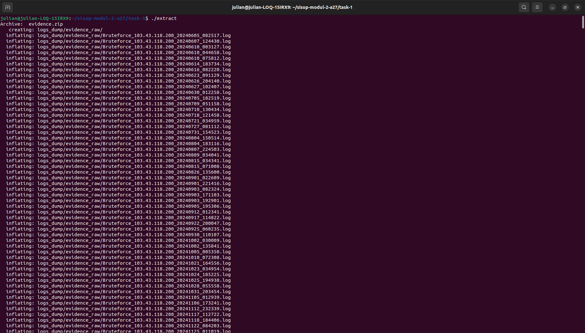

### Kode Penuh _(Full Code)_
Masukkan kode lengkap yang digunakan untuk menyelesaikan bagian ini.  
_Insert the full source code used to solve this section._

```c
#include <stdio.h>
#include <sys/wait.h>
#include <unistd.h>

int main(){
    pid_t child = fork();
    char *argv1[] = {"unzip", "evidence.zip", "-d", "logs_dump", NULL};
    char *argv2[] = {"rm", "evidence.zip", NULL};

    if(child == 0) execv("/bin/unzip", argv1);
    else{
        wait(NULL);
        execv("/bin/rm", argv2);
    }
    return 0;
}
```

## B. Langkah-langkah & Potongan Kode, Screenshot, Kode Penuh  
_(Steps & Code Snippets, Screenshot, Full Code)_

### Langkah-langkah & Potongan Kode _(Steps & Code Snippets)_
Jelaskan langkah-langkah yang dilakukan dan berikan potongan kode dari langkah-langkah yang kalian jelaskan jika ada.  
_Explain the steps performed and include relevant code snippets from the steps you describe if applicable._

1. Membuka file classify.c

2. Import library
    ```c
    #include <stdio.h>
    #include <stdlib.h>
    #include <string.h>
    #include <unistd.h>
    #include <sys/wait.h>
    #include <sys/types.h>
    #include <sys/stat.h>
    #include <dirent.h>
    #define MAX 512
    ```

3. Deklarasi variabel utama
    ```c
    DIR *directory;
    struct dirent *note;
    char attack_type[50][100];
    int attack_count = 0;
    ```

4. Membuka direktori log
    ```c
    directory = opendir("logs_dump/evidence_raw");
    ```

5. Membaca file dan mengambil jenis serangan unik
    ```c
    while((note = readdir(directory)) != NULL){
            if(note->d_type == DT_REG){ 
                char file_name[MAX];
                strcpy(file_name, note->d_name);

                char *attack_name = strtok(file_name, "_"); // Mengambil bagian pertama nama file (jenis serangan)
                if(attack_name != NULL){
                    int found = 0;
                    for(int i = 0; i < attack_count; i++){ // Pengecekan tipe serangan
                        if(strcmp(attack_type[i], attack_name) == 0){
                            found = 1;
                            break;
                        }
                    }
                    if(!found){ // Menyimpan jenis serangan baru
                        strcpy(attack_type[attack_count], attack_name);
                        attack_count++;
                    }
                }
            }
        }
        closedir(directory);
    ```

6. Mengelompokkan dan memindahkan file berdasarkan jenis serangan
    ```c
    for(int i = 0; i < attack_count; i++){
            pid_t pid = fork();
            if(pid == 0){ // CHild process untuk satu kategori serangan
                char path[MAX];
                sprintf(path, "logs_dump/%s", attack_type[i]);
                pid_t pid = fork();
                if(pid == 0){
                    char *argv[] = {"mkdir", "-p", path, NULL};
                    execv("/bin/mkdir", argv); // Membuat folder kategori
                }else wait(NULL); 

                DIR *directory2 = opendir("logs_dump/evidence_raw"); // Membuat folder berisi file log mentah
                struct dirent *note2;

                while((note2 = readdir(directory2)) != NULL){
                    if(note2->d_type == DT_REG){
                        char temp[MAX];
                        strcpy(temp, note2->d_name);

                        char *type_name = strtok(temp, "_"); // Mengambil bagian pertama nama file (jenis serangan)
                        if(type_name != NULL && strcmp(type_name, attack_type[i]) == 0){ // Pengecekan serangan yang cocok dengan kategori
                            char source[MAX];
                            char destination[MAX];
                            sprintf(source, "logs_dump/evidence_raw/%s", note2->d_name);
                            sprintf(destination, "logs_dump/%s/%s", attack_type[i], note2->d_name);

                            pid_t pid = fork();
                            if(pid == 0){
                                char *argv[] = {"mv", source, destination, NULL};
                                execv("/bin/mv", argv); // Memindahkan file ke folder kategori
                            }else wait(NULL);
                        }
                    }
                }
                closedir(directory2);
                exit(EXIT_SUCCESS);
            }
        }
        while(wait(NULL) > 0);
    ```

7. Menghapus folder raw
    ```c
    pid_t pid = fork();
        if(pid == 0){
            char *argv[] = {"rm", "-rf", "logs_dump/evidence_raw", NULL};
            execv("/bin/rm", argv);
        }
    ```

### Screenshot _(Screenshot)_
Masukkan screenshot hasil eksekusi program atau proses yang relevan.  
_Insert screenshots of program execution results or other relevant processes._

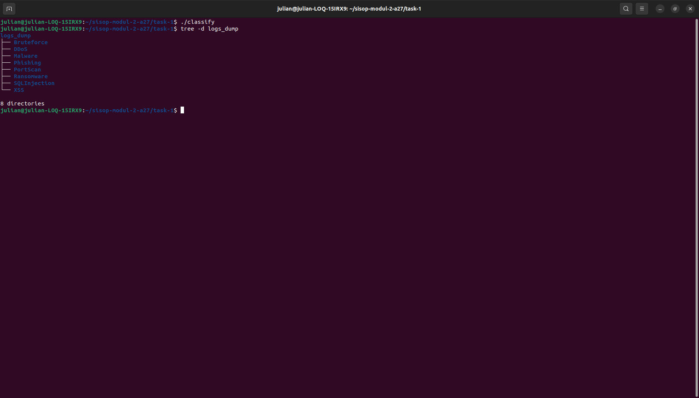

### Kode Penuh _(Full Code)_
Masukkan kode lengkap yang digunakan untuk menyelesaikan bagian ini.  
_Insert the full source code used to solve this section._

```c
#include <stdio.h>
#include <stdlib.h>
#include <string.h>
#include <unistd.h>
#include <sys/wait.h>
#include <sys/types.h>
#include <sys/stat.h>
#include <dirent.h>
#define MAX 512

int main(){
    DIR *directory;
    struct dirent *note;
    char attack_type[50][100];
    int attack_count = 0;

    directory = opendir("logs_dump/evidence_raw");

    while((note = readdir(directory)) != NULL){
        if(note->d_type == DT_REG){
            char file_name[MAX];
            strcpy(file_name, note->d_name);

            char *attack_name = strtok(file_name, "_");
            if(attack_name != NULL){
                int found = 0;
                for(int i = 0; i < attack_count; i++){
                    if(strcmp(attack_type[i], attack_name) == 0){
                        found = 1;
                        break;
                    }
                }
                if(!found){
                    strcpy(attack_type[attack_count], attack_name);
                    attack_count++;
                }
            }
        }
    }
    closedir(directory);

    for(int i = 0; i < attack_count; i++){
        pid_t pid = fork();
        if(pid == 0){
            char path[MAX];
            sprintf(path, "logs_dump/%s", attack_type[i]);
            pid_t pid = fork();
            if(pid == 0){
                char *argv[] = {"mkdir", "-p", path, NULL};
                execv("/bin/mkdir", argv);
            }else wait(NULL); 

            DIR *directory2 = opendir("logs_dump/evidence_raw");
            struct dirent *note2;

            while((note2 = readdir(directory2)) != NULL){
                if(note2->d_type == DT_REG){
                    char temp[MAX];
                    strcpy(temp, note2->d_name);

                    char *type_name = strtok(temp, "_");
                    if(type_name != NULL && strcmp(type_name, attack_type[i]) == 0){
                        char source[MAX];
                        char destination[MAX];
                        sprintf(source, "logs_dump/evidence_raw/%s", note2->d_name);
                        sprintf(destination, "logs_dump/%s/%s", attack_type[i], note2->d_name);

                        pid_t pid = fork();
                        if(pid == 0){
                            char *argv[] = {"mv", source, destination, NULL};
                            execv("/bin/mv", argv);
                        }else wait(NULL);
                    }
                }
            }
            closedir(directory2);
            exit(EXIT_SUCCESS);
        }
    }
    while(wait(NULL) > 0);

    pid_t pid = fork();
    if(pid == 0){
        char *argv[] = {"rm", "-rf", "logs_dump/evidence_raw", NULL};
        execv("/bin/rm", argv);
    }
    return 0;
}
```

## C. Langkah-langkah & Potongan Kode, Screenshot, Kode Penuh  
_(Steps & Code Snippets, Screenshot, Full Code)_

### Langkah-langkah & Potongan Kode _(Steps & Code Snippets)_
Jelaskan langkah-langkah yang dilakukan dan berikan potongan kode dari langkah-langkah yang kalian jelaskan jika ada.  
_Explain the steps performed and include relevant code snippets from the steps you describe if applicable._

1. Membuka file watcher.c

2. Import library
    ```c
    #include <stdio.h>
    #include <stdlib.h>
    #include <string.h>
    #include <dirent.h>
    #include <unistd.h>
    #include <sys/stat.h>
    #include <sys/types.h>
    #include <signal.h>
    #include <time.h>
    #define MAX 512
    ```

3. Deklarasi variabel global
    ```c
    FILE *log_file;
    char file_pid[MAX];
    char file_log[MAX];
    char honeypot[MAX];
    char quarantine[MAX];

    volatile sig_atomic_t running = 1;
    ```

4. Konversi waktu
    ```c
    void convert_time(char *timestamp){
        time_t now = time(NULL);
        struct tm *waktu = localtime(&now);
        strftime(timestamp, 50, "%Y-%m-%d %H:%M:%S", waktu);
    }
    ```

5. Handler sinyal
    ```c
    void handle_sigterm(int sigterm){
        unlink(file_pid);
        exit(EXIT_SUCCESS);
    }
    ```

6. Pengecekan file mencurigakan berdasarkan ekstensi, yaitu .exe & .pcap
    ```c
    int check_file(char *name){
        return (strstr(name, ".exe") || strstr(name, ".pcap"));
    }
    ```

7. Inisialisasi path & fork awal
    ```c
    char path[256];
        if(getcwd(path, sizeof(path)) == NULL){
            exit(EXIT_FAILURE);
        }
    ```

8. Pembentukan path file sistem
    ```c
    sprintf(file_pid, "%s/watcher.pid", path);
    sprintf(file_log, "%s/security.log", path);
    sprintf(honeypot, "%s/honeypot", path);
    sprintf(quarantine, "%s/quarantine", path);
    ```

9. Proses fork dan pembuatan direktori
    ```c
    pid_t pid = fork();
        if(pid == 0){
            char *argv[] = {"mkdir", "-p", honeypot, NULL};
            execv("/bin/mkdir", argv);
        }
        pid_t pid2 = fork();
        if(pid2 == 0){
            char *argv[] = {"mkdir", "-p", quarantine, NULL};
            execv("/bin/mkdir", argv);
        }
    ```

10. Pembuatan daemon process
    ```c
    pid_t pid3 = fork();
    if(pid3 < 0) exit(EXIT_FAILURE);
    if(pid3 > 0) exit(EXIT_SUCCESS);
    ```

11. Konfigurasi daemon
    ```c
    setsid(); // Membuat session baru (daemon)
    umask(0); // Mengatur izin file default
    chdir("/"); // Pindah ke root direktori 
    ```

12. Redirect input/output (semua input/output diarahkan ke /dev/null)
    ```c
    freopen("/dev/null", "r", stdin);
    freopen("/dev/null", "w", stdout);
    freopen("/dev/null", "w", stderr);
    ```

13. Pembuatan file PID dan file log
    ```c
    FILE *pid_file = fopen(file_pid, "w");
        if(pid_file){
            fprintf(pid_file, "%d", getpid());
            fclose(pid_file);
        }

    log_file = fopen(file_log, "a");
    ```

14. Signal handler (agar program bisa berhenti dengan aman)
    ```c
    signal(SIGTERM, handle_sigterm);
    ```

15. Pemantauan dan karantina file mencurigakan pada direktori honeypot
    ```c
    while(1){
            DIR *directory = opendir(honeypot);
            if(!directory){
                sleep(1);
                continue;
            }
            struct dirent *note;
            while((note = readdir(directory)) != NULL){
                if(strcmp(note->d_name, ".") == 0 || strcmp(note->d_name, "..") == 0) continue;
                if(!check_file(note->d_name)) continue; // Mengecek file yang termasuk kategori file yang dipantau

                // Membentuk path file asal dan tujuan
                char source[1000], destination[1000];
                sprintf(source, "%s/%s", honeypot, note->d_name);
                sprintf(destination, "%s/%s", quarantine, note->d_name);

                char timestamp[50];
                convert_time(timestamp); // Mencatat waktu saat file mencurigakan ditemukan
                fprintf(log_file, "[%s] Peringatan! Menemukan file mencurigakan: %s\n", timestamp, note->d_name);
                fflush(log_file);

                pid_t pid = fork();
                if(pid == 0){
                    char *argv[] = {"mv", source, destination, NULL};
                    execv("/bin/mv", argv); // Memindahkan file ke folder quarantine
                }

                convert_time(timestamp); // Mencatat log setelah proses fork dibuat
                fprintf(log_file, "[%s] Berhasil mengkarantina file: %s\n", timestamp, note->d_name);
                fflush(log_file);
            }
            sleep(1);
            closedir(directory);
        }
    ```

### Screenshot _(Screenshot)_
Masukkan screenshot hasil eksekusi program atau proses yang relevan.  
_Insert screenshots of program execution results or other relevant processes._

- Struktur direktori
  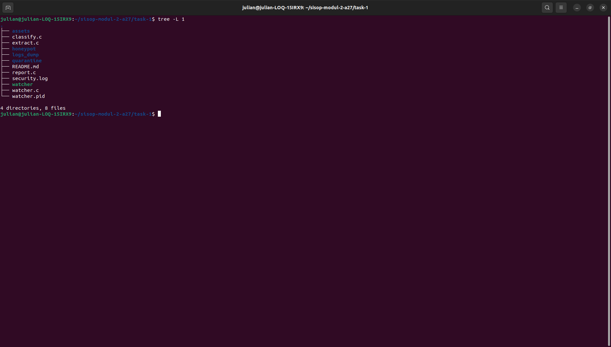

- Proses watcher
  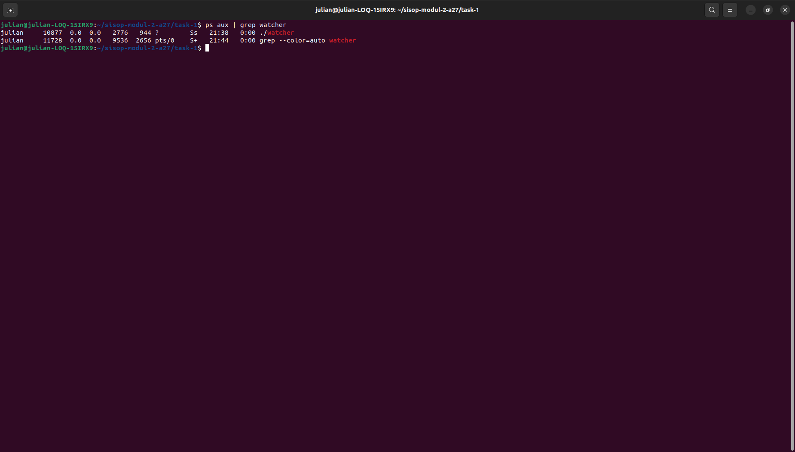

- Pengecekan karantina file mencurigakan
  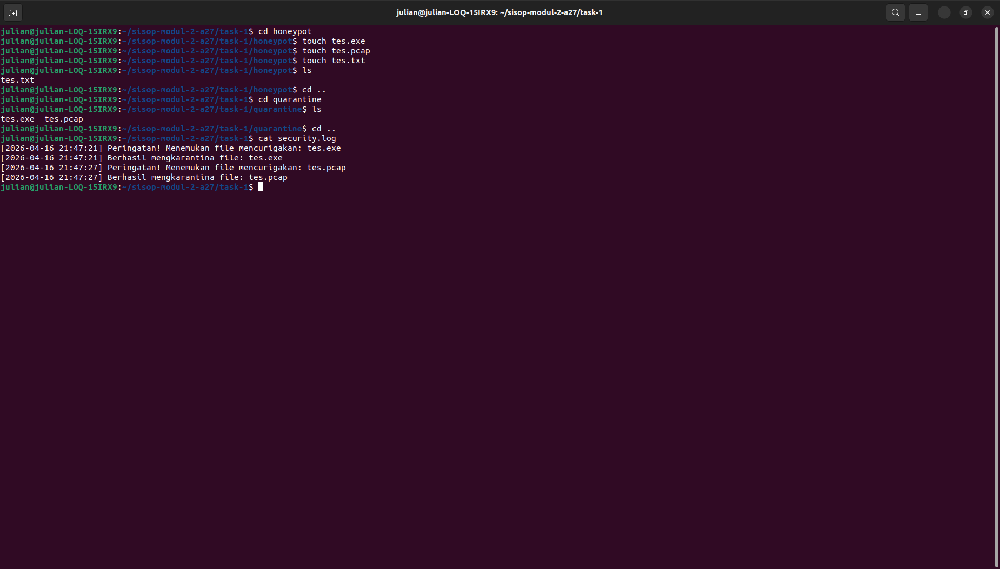

- Ketika daemon dihentikan
  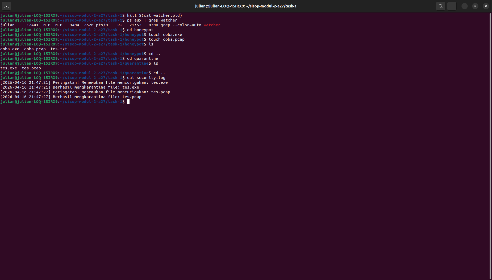

### Kode Penuh _(Full Code)_
Masukkan kode lengkap yang digunakan untuk menyelesaikan bagian ini.  
_Insert the full source code used to solve this section._

```c
#include <stdio.h>
#include <stdlib.h>
#include <string.h>
#include <dirent.h>
#include <unistd.h>
#include <sys/stat.h>
#include <sys/types.h>
#include <signal.h>
#include <time.h>
#define MAX 512

FILE *log_file;
char file_pid[MAX];
char file_log[MAX];
char honeypot[MAX];
char quarantine[MAX];

volatile sig_atomic_t running = 1;

void convert_time(char *timestamp){
    time_t now = time(NULL);
    struct tm *waktu = localtime(&now);
    strftime(timestamp, 50, "%Y-%m-%d %H:%M:%S", waktu);
}

void handle_sigterm(int sigterm){
    unlink(file_pid);
    exit(EXIT_SUCCESS);
}

int check_file(char *name){
    return (strstr(name, ".exe") || strstr(name, ".pcap"));
}

int main(){
    char path[256];
    if(getcwd(path, sizeof(path)) == NULL){
        exit(EXIT_FAILURE);
    }
    sprintf(file_pid, "%s/watcher.pid", path);
    sprintf(file_log, "%s/security.log", path);
    sprintf(honeypot, "%s/honeypot", path);
    sprintf(quarantine, "%s/quarantine", path);

    pid_t pid = fork();
    if(pid == 0){
        char *argv[] = {"mkdir", "-p", honeypot, NULL};
        execv("/bin/mkdir", argv);
    }
    pid_t pid2 = fork();
    if(pid2 == 0){
        char *argv[] = {"mkdir", "-p", quarantine, NULL};
        execv("/bin/mkdir", argv);
    }
    pid_t pid3 = fork();
    if(pid3 < 0) exit(EXIT_FAILURE);
    if(pid3 > 0) exit(EXIT_SUCCESS);

    setsid();
    umask(0);
    chdir("/"); 

    freopen("/dev/null", "r", stdin);
    freopen("/dev/null", "w", stdout);
    freopen("/dev/null", "w", stderr);

    FILE *pid_file = fopen(file_pid, "w");
    if(pid_file){
        fprintf(pid_file, "%d", getpid());
        fclose(pid_file);
    }

    log_file = fopen(file_log, "a");

    signal(SIGTERM, handle_sigterm);

    while(1){
        DIR *directory = opendir(honeypot);
        if(!directory){
            sleep(1);
            continue;
        }
        struct dirent *note;
        while((note = readdir(directory)) != NULL){
            if(strcmp(note->d_name, ".") == 0 || strcmp(note->d_name, "..") == 0) continue;
            if(!check_file(note->d_name)) continue;

            char source[1000], destination[1000];
            sprintf(source, "%s/%s", honeypot, note->d_name);
            sprintf(destination, "%s/%s", quarantine, note->d_name);

            char timestamp[50];
            convert_time(timestamp);
            fprintf(log_file, "[%s] Peringatan! Menemukan file mencurigakan: %s\n", timestamp, note->d_name);
            fflush(log_file);

            pid_t pid = fork();
            if(pid == 0){
                char *argv[] = {"mv", source, destination, NULL};
                execv("/bin/mv", argv);
            }

            convert_time(timestamp);
            fprintf(log_file, "[%s] Berhasil mengkarantina file: %s\n", timestamp, note->d_name);
            fflush(log_file);
        }
        sleep(1);
        closedir(directory);
    }
    return 0;
}
```

## D. Langkah-langkah & Potongan Kode, Screenshot, Kode Penuh  
_(Steps & Code Snippets, Screenshot, Full Code)_

### Langkah-langkah & Potongan Kode _(Steps & Code Snippets)_
Jelaskan langkah-langkah yang dilakukan dan berikan potongan kode dari langkah-langkah yang kalian jelaskan jika ada.  
_Explain the steps performed and include relevant code snippets from the steps you describe if applicable._

1. Membuka file report.c

2. Import library
    ```c
    #include <stdio.h>
    #include <stdlib.h>
    #include <string.h>
    #include <dirent.h>
    #include <unistd.h>
    #include <sys/wait.h>
    #include <sys/stat.h>
    #include <sys/types.h>
    ```

3. Struktur data
    ```c
    typedef struct{
        char name[50];
        int count;
    }Data;
    ```

4. Deklarasi array dan variabel global
    ```c
    Data attack[50];
    int size_attack = 0;
    Data ip[50];
    int size_ip = 0;
    ```

5. Fungsi grouping data berdasarkan nama
    ```c
    int group(Data arr[], int *size, char *name){
        for(int i = 0; i < *size; i++){
            if(strcmp(arr[i].name, name) == 0) return i;
        }
        strcpy(arr[*size].name, name);
        arr[*size].count = 0;
        (*size)++;
        return (*size) - 1;
    }
    ```

6. Fungsi sorting secara descending
    ```c
    void sort(Data arr[], int size){
        for(int i = 0; i < size - 1; i++){
            for(int j = 0; j < size - i - 1; j++){
                if(arr[j].count < arr[j + 1].count){
                    Data temp = arr[j];
                    arr[j] = arr[j + 1];
                    arr[j + 1] = temp;
                }
            }
        }
    }
    ```

7. Membuka folder utama logs_dump
    ```c
    DIR *directory = opendir("logs_dump");
    ```

8. Fungsi pembacaan direktori & pengelompokan data serangan serta ip address
    ```c
    struct dirent *note;
        while((note = readdir(directory)) != NULL){
            if(strcmp(note->d_name, ".") == 0 ||strcmp(note->d_name, "..") == 0) continue;
            
            // Menyimpan path lengkap ke subfolder
            char path[1000];
            sprintf(path, "logs_dump/%s", note->d_name);

            if (note->d_type != DT_DIR) continue;

            char *attack_type = note->d_name;

            DIR *sub_directory = opendir(path); // Membuka subfolder berdasarkan jenis serangan
            if(!sub_directory) continue;

            struct dirent *note;

            while((note = readdir(sub_directory)) != NULL){
                if(note->d_type != DT_REG) continue;

                // Menyimpan/mengambil idx tipe serangan dan menambah jumlah kemunculan serangan tersebut
                int idx_attack = group(attack, &size_attack, attack_type);
                attack[idx_attack].count++;

                char temp[50];
                strcpy(temp, note->d_name);

                // Memisahkan nama file
                char *type = strtok(temp, "_");
                char *ip_address = strtok(NULL, "_");
                if(!ip_address) continue;

                // Menyimpan/mengambil idx IP dan menambah jumlah kemunculan IP tersebut
                int idx_ip = group(ip, &size_ip, ip_address);
                ip[idx_ip].count++;
            }
            closedir(sub_directory);
        }
        closedir(directory);
    ```

9. Mengurutkan data
    ```c
    sort(attack, size_attack);
    sort(ip, size_ip);
    ```

10. Membuat laporan hasil analisa di threat_report.txt
    ```c
    FILE *file = fopen("threat_report.txt", "w");
    ```

11. Menulis hasil ke file
    ```c
    fprintf(file, "Laporan Klasifikasi Serangan:\n");
    for(int i = 0; i < size_attack; i++) fprintf(file, "%d. %s muncul sebanyak %d kali.\n", i + 1, attack[i].name, attack[i].count);
    fprintf(file, "\n");
    fprintf(file, "Top 5 IP Mencurigakan:\n");
    for(int i = 0; i < size_ip && i < 5; i++) fprintf(file, "%d. %s muncul sebanyak %d kali.\n", i + 1, ip[i].name, ip[i].count);
    ```

12. Proses zip
    ```c
    pid_t pid = fork();
        if(pid == 0){
            freopen("/dev/null", "w", stdout);
            freopen("/dev/null", "w", stderr);
            char *argv[] = {"zip", "-r", "backup_evidence.zip", "logs_dump", "threat_report.txt", NULL};
            execv("/usr/bin/zip", argv);
        }else if(pid > 0){
            wait(NULL);
            printf("[Info] Laporan dan arsip berhasil dibuat\n");
        }
    ```

### Screenshot _(Screenshot)_
Masukkan screenshot hasil eksekusi program atau proses yang relevan.  
_Insert screenshots of program execution results or other relevant processes._

- Output
  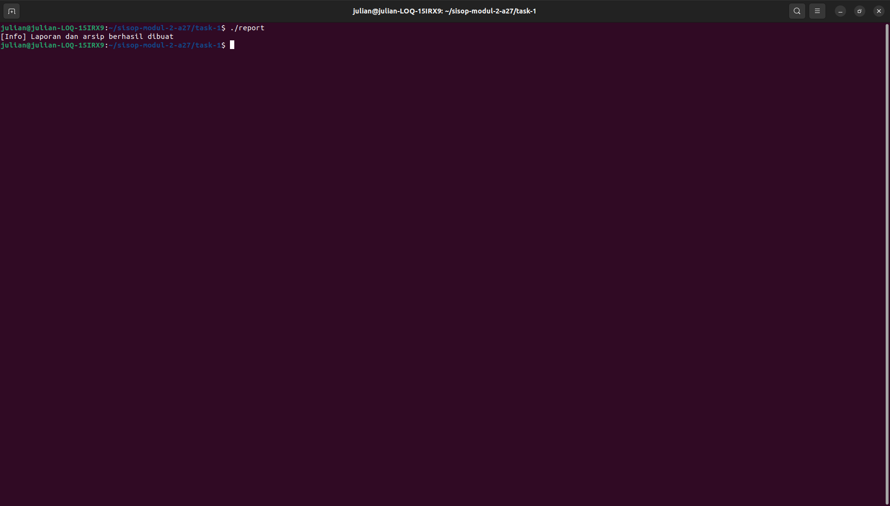

- Struktur direktori
  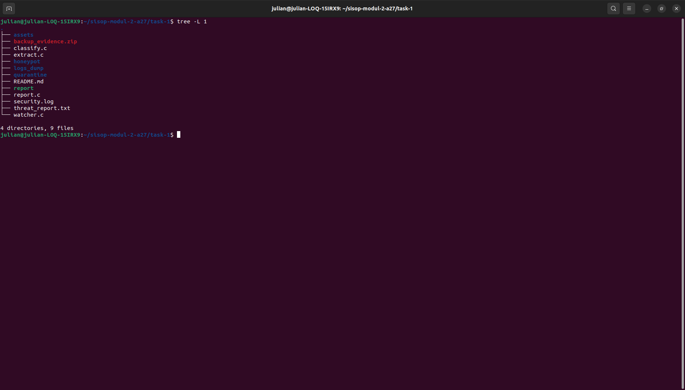

- Hasil analisa
  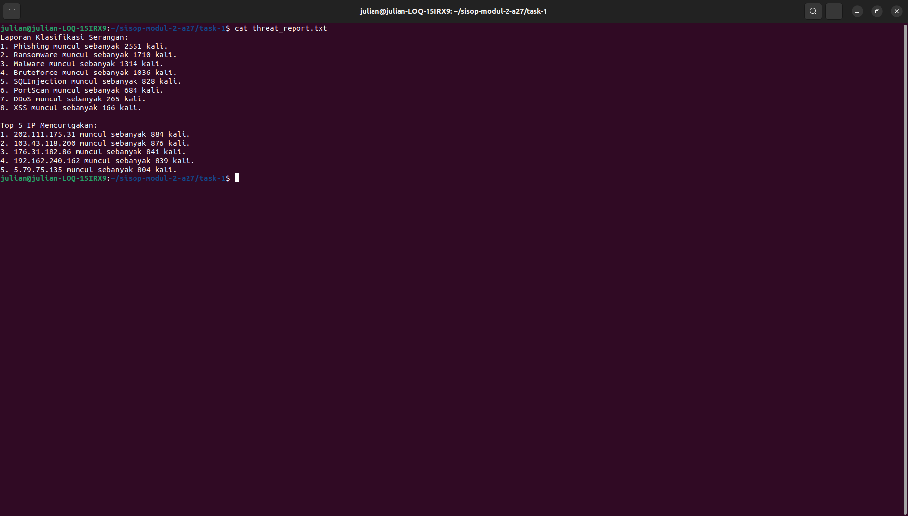

### Kode Penuh _(Full Code)_
Masukkan kode lengkap yang digunakan untuk menyelesaikan bagian ini.  
_Insert the full source code used to solve this section._

```c
#include <stdio.h>
#include <stdlib.h>
#include <string.h>
#include <dirent.h>
#include <unistd.h>
#include <sys/wait.h>
#include <sys/stat.h>
#include <sys/types.h>

typedef struct{
    char name[50];
    int count;
}Data;

Data attack[50];
int size_attack = 0;
Data ip[50];
int size_ip = 0;

int group(Data arr[], int *size, char *name){
    for(int i = 0; i < *size; i++){
        if(strcmp(arr[i].name, name) == 0) return i;
    }
    strcpy(arr[*size].name, name);
    arr[*size].count = 0;
    (*size)++;
    return (*size) - 1;
}

void sort(Data arr[], int size){
    for(int i = 0; i < size - 1; i++){
        for(int j = 0; j < size - i - 1; j++){
            if(arr[j].count < arr[j + 1].count){
                Data temp = arr[j];
                arr[j] = arr[j + 1];
                arr[j + 1] = temp;
            }
        }
    }
}

int main(){
    DIR *directory = opendir("logs_dump");

    struct dirent *note;
    while((note = readdir(directory)) != NULL){
        if(strcmp(note->d_name, ".") == 0 ||strcmp(note->d_name, "..") == 0) continue;

        char path[1000];
        sprintf(path, "logs_dump/%s", note->d_name);

        if (note->d_type != DT_DIR) continue;

        char *attack_type = note->d_name;

        DIR *sub_directory = opendir(path);
        if(!sub_directory) continue;

        struct dirent *note;

        while((note = readdir(sub_directory)) != NULL){
            if(note->d_type != DT_REG) continue;

            int idx_attack = group(attack, &size_attack, attack_type);
            attack[idx_attack].count++;

            char temp[50];
            strcpy(temp, note->d_name);

            char *type = strtok(temp, "_");
            char *ip_address = strtok(NULL, "_");
            if(!ip_address) continue;

            int idx_ip = group(ip, &size_ip, ip_address);
            ip[idx_ip].count++;
        }
        closedir(sub_directory);
    }
    closedir(directory);

    sort(attack, size_attack);
    sort(ip, size_ip);

    FILE *file = fopen("threat_report.txt", "w");

    fprintf(file, "Laporan Klasifikasi Serangan:\n");
    for(int i = 0; i < size_attack; i++) fprintf(file, "%d. %s muncul sebanyak %d kali.\n", i + 1, attack[i].name, attack[i].count);
    fprintf(file, "\n");
    fprintf(file, "Top 5 IP Mencurigakan:\n");
    for(int i = 0; i < size_ip && i < 5; i++) fprintf(file, "%d. %s muncul sebanyak %d kali.\n", i + 1, ip[i].name, ip[i].count);

    fclose(file);

    pid_t pid = fork();
    if(pid == 0){
        freopen("/dev/null", "w", stdout);
        freopen("/dev/null", "w", stderr);
        char *argv[] = {"zip", "-r", "backup_evidence.zip", "logs_dump", "threat_report.txt", NULL};
        execv("/usr/bin/zip", argv);
    }else if(pid > 0){
        wait(NULL);
        printf("[Info] Laporan dan arsip berhasil dibuat\n");
    }
    return 0;
}
```

---

# Task 2 - DEANND'S Adventure

## A. Langkah-langkah & Potongan Kode, Screenshot, Kode Penuh  
_(Steps & Code Snippets, Screenshot, Full Code)_

### Langkah-langkah & Potongan Kode _(Steps & Code Snippets)_
Jelaskan langkah-langkah yang dilakukan dan berikan potongan kode dari langkah-langkah yang kalian jelaskan jika ada.  
_Explain the steps performed and include relevant code snippets from the steps you describe if applicable._

1. Membuat file header

    Tujuan dari dibuatnya file header adalah untuk menyamakan definisi agar kedua program, yakni "server" dan "sensor" saling mengerti (seperti kode rahasia kedua program). File ini berisi hal-hal utama, seperti:
    - _Library_ yang dibutuhkan program: **pthread.h** untuk threading, **mqueue.h** untuk message queue
    - _Nama message queue_: **/stc_server** dan **/stc_client** yang dipakai sebagai "jalur komunikasi" antara sensor dan server
    - _Tipe pesan_: data traffic, exit, status kota, dan shutdown sistem
    - _Struct Message_: format pesan yang dikirim sensor ke server

    ```bash
    nano common.h
    ```

    ```c
    #ifndef COMMON_H
    #define COMMON_H


    #include <stdio.h>
    #include <stdlib.h>
    #include <string.h>
    #include <unistd.h>
    #include <signal.h>
    #include <pthread.h>
    #include <mqueue.h>
    #include <errno.h>
    #include <fcntl.h>
    #include <sys/stat.h>

    // Nama message queue (harus diawali dengan '/')
    #define SERVER_QUEUE "/stc_server"
    #define CLIENT_QUEUE "/stc_client"

    // Konfigurasi message queue
    #define MAX_MSG_SIZE sizeof(Message)
    #define MAX_MSGS 10

    // Tipe-tipe pesan yang akan dikirim
    #define MSG_DATA 1  // Pesan data traffic
    #define MSG_EXIT 2  // Pesan sinyal exit
    #define MSG_STATUS 3 // Pesan status kota
    #define MSG_SHUTDOWN 4 // Pesan shutdown sistem

    // ID Sensor
    #define SENSOR1_ID 1
    #define SENSOR2_ID 2

    // Struktur pesan yang akan dikirim melalui message queue
    typedef struct{
    long mtype;   // Tipe pesan (MSG_DATA, MSG_EXIT, dll)
    int sensor_id; // ID sensor (1 atau 2)
    char location; // Lokasi (A, B, C, D)
    char status; // Status traffic (L atau H)
    int is_exit;  // Flag exit (1 jika exit, 0 jika tidak)
    } Message;

    #endif

    ```

2. Membuat file server

    File ini digunakan untuk menunggu dan menerima koneksi dari kedua sensor.

    Logika berpikir:
    - Server menyiapkan dua jalur komunikasi (satu untuk menerima pesan dari sensor, satu untuk mengirim pesan ke sensor)
    - Hapus queue lama: sebelum dimulai, queue dari run sebelumnya dihapus dulu agar tidak bentrok
    - Buat queue baru: **server_q** sebagai tempat sensor kirim pesan ke server (server baca) dan **client_q** sebagai tempat server kirim pesan ke sensor (server tulis)
    - Menunggu kedua sensor connect: server menunggu sampai sensor 1 dan sensor 2 mengirim pesan pertamanya, jika salah satu belum connect maka server akan terus menunggu
    - Jika kedua sensor sudah connect, server print "[SERVER] System Ready!"

    ```bash
    nano server.c
    ```

    ```c
    #include "common.h"

    int main() {
        // Deklarasi variabel
        mqd_t server_q, client_q;      // Message queue descriptors
        struct mq_attr attr;           // Atribut message queue
        Message msg;                   // Buffer untuk menerima pesan
        int sensor1_connected = 0;     // Flag sensor 1 (0=belum, 1=sudah)
        int sensor2_connected = 0;     // Flag sensor 2
        
        // ===== 1. SETUP ATRIBUT MESSAGE QUEUE =====
        attr.mq_flags = 0;             // Tidak ada flag khusus (blocking mode)
        attr.mq_maxmsg = MAX_MSGS;     // Maksimal 10 pesan dalam antrian
        attr.mq_msgsize = MAX_MSG_SIZE;// Ukuran setiap pesan
        attr.mq_curmsgs = 0;           // Jumlah pesan saat ini (0)
        
        // ===== 2. HAPUS QUEUE LAMA (JIKA ADA) =====
        // Mencegah error karena queue sudah ada dari run sebelumnya
        mq_unlink(SERVER_QUEUE);
        mq_unlink(CLIENT_QUEUE);
        
        // ===== 3. BUAT MESSAGE QUEUE =====
        // Queue untuk sensor -> server (READ-ONLY)
        server_q = mq_open(SERVER_QUEUE, O_CREAT | O_RDONLY, 0666, &attr);
        if (server_q == -1) {
            perror("mq_open server gagal");
            return 1;
        }
        
        // Queue untuk server -> sensor (WRITE-ONLY)
        client_q = mq_open(CLIENT_QUEUE, O_CREAT | O_WRONLY, 0666, &attr);
        if (client_q == -1) {
            perror("mq_open client gagal");
            return 1;
        }
        
        // ===== 4. TUNGGU KONEKSI DARI SENSOR =====
        printf("[SERVER] Waiting for sensors...\n");
        
        // Loop terus sampai kedua sensor terhubung
        while (sensor1_connected == 0 || sensor2_connected == 0) {
            
            // Menerima pesan dari sensor (blocking jika queue kosong)
            if (mq_receive(server_q, (char*)&msg, sizeof(Message), NULL) != -1) {
                
                // Cek apakah pesan adalah data (bukan exit/shutdown)
                if (msg.mtype == MSG_DATA) {
                    
                    // Cek apakah pesan dari Sensor 1
                    if (msg.sensor_id == SENSOR1_ID && !sensor1_connected) {
                        sensor1_connected = 1;
                        printf("[SERVER] Sensor 1 connected\n");
                    }
                    // Cek apakah pesan dari Sensor 2
                    else if (msg.sensor_id == SENSOR2_ID && !sensor2_connected) {
                        sensor2_connected = 1;
                        printf("[SERVER] Sensor 2 connected\n");
                    }
                }
            }
        }
        
        // ===== 5. SISTEM SIAP =====
        printf("[SERVER] System ready!\n");
        
        // ===== 6. BERSIHKAN RESOURCE =====
        mq_close(server_q);    // Tutup queue descriptor
        mq_close(client_q);
        // Catatan: mq_unlink tidak dipanggil di sini agar queue masih ada untuk sensor
        
        return 0;
    }
    ```

3. Membuat file sensor

    File ini digunakan untuk menghubungkan diri ke server, menentukan posisi (sebagai sensor 1 atau sensor 2), dan mengirimkan pesan koneksi ke server.

    Logika berpikir:
    - Membuka message queue: sensor membuka jalur komunikasi yang sudah dibuat server sebelumnya (untuk mengirim dan menerima pesan)
    - Menentukan ID sensor: sensor memakai file /tmp/sensor_counter.txt sebagai counter, jika file belum ada maka ini menjadi sensor pertama (ID = 1), jika file sudah ada maka counter dibaca lalu ditambah 1 (ID = 2)
    - Mengirim pesan koneksi ke server: sensor mengirim pesan ke server sebagai tanda bahwa dirinya sudah tersambung, dengan isi lokasi dan status masih kosong
    - Setelah selesai, sensor menunggu 2 detik kemudian menutup koneksi

    ```bash
    nano sensor.c
    ```

    ```c
    #include "common.h"

    int main() {
        // Deklarasi variabel
        mqd_t server_q, client_q;    // Message queue descriptors
        Message msg;                 // Pesan yang akan dikirim
        int sensor_id;               // ID sensor (1 atau 2)
        static int counter = 0;      // Counter untuk menentukan ID
        
        // ===== 1. BUKA MESSAGE QUEUE =====
        // Buka queue untuk mengirim ke server (WRITE-ONLY)
        server_q = mq_open(SERVER_QUEUE, O_WRONLY);
        if (server_q == -1) {
            perror("mq_open server gagal");
            return 1;
        }
        
        // Buka queue untuk menerima dari server (READ-ONLY)
        client_q = mq_open(CLIENT_QUEUE, O_RDONLY);
        if (client_q == -1) {
            perror("mq_open client gagal");
            return 1;
        }
        
        // ===== 2. TENTUKAN ID SENSOR =====
        // Menggunakan file temporary sebagai counter
        FILE *f = fopen("/tmp/sensor_counter.txt", "r+");
        
        if (f) {
            // File sudah ada → baca counter, lalu increment
            fscanf(f, "%d", &counter);   // Baca nilai counter
            rewind(f);                    // Kembali ke awal file
            counter++;                    // Tambah 1
            fprintf(f, "%d", counter);    // Tulis nilai baru
            fclose(f);
        } else {
            // File belum ada → ini sensor pertama (ID = 1)
            f = fopen("/tmp/sensor_counter.txt", "w");
            counter = 1;
            fprintf(f, "%d", counter);
            fclose(f);
        }
        
        sensor_id = counter;  // Simpan ID sensor
        
        // ===== 3. TAMPILKAN INFORMASI SENSOR =====
        printf("[SENSOR] Starting as Sensor %d\n", sensor_id);
        
        // ===== 4. KIRIM PESAN KONEKSI KE SERVER =====
        msg.mtype = MSG_DATA;          // Tipe pesan: data
        msg.sensor_id = sensor_id;     // ID sensor
        msg.location = '\0';           // Kosong (belum ada data)
        msg.status = '\0';             // Kosong
        msg.is_exit = 0;               // Bukan exit
        
        // Kirim pesan ke server queue
        if (mq_send(server_q, (char*)&msg, sizeof(Message), 0) == 0) {
            printf("[SENSOR] Connection message sent to server\n");
        } else {
            perror("mq_send gagal");
        }
        
        // ===== 5. KONFIRMASI TERHUBUNG =====
        printf("[SENSOR] Connected to server\n");
        
        // ===== 6. TUNGGU SEBENTAR (AGAR SERVER MEMPROSES) =====
        sleep(2);
        
        // ===== 7. BERSIHKAN RESOURCE =====
        mq_close(server_q);
        mq_close(client_q);
        
        return 0;
    }
    ```

### Screenshot _(Screenshot)_
Masukkan screenshot hasil eksekusi program atau proses yang relevan.  
_Insert screenshots of program execution results or other relevant processes._

- Step 1, terminal 1 (server): belum ada sensor yang dikirimkan (keadaan mula-mula)
  

- Step 2, terminal 2 (sensor 1): sensor 1 mengirimkan pesan ke server
  

- Step 2, terminal 1 (server): sensor 1 mengirimkan pesan ke server
  

- Step 3, terminal 3 (sensor 2): sensor 2 mengirimkan pesan ke server
  

- Step 3, terminal 1 (server): sensor 2 mengirimkan pesan ke server
  

### Kode Penuh _(Full Code)_
Masukkan kode lengkap yang digunakan untuk menyelesaikan bagian ini.  
_Insert the full source code used to solve this section._

1. common.h
    ```c
    #ifndef COMMON_H
    #define COMMON_H


    #include <stdio.h>
    #include <stdlib.h>
    #include <string.h>
    #include <unistd.h>
    #include <signal.h>
    #include <pthread.h>
    #include <mqueue.h>
    #include <errno.h>
    #include <fcntl.h>
    #include <sys/stat.h>

    #define SERVER_QUEUE "/stc_server"
    #define CLIENT_QUEUE "/stc_client"
    #define MAX_MSG_SIZE sizeof(Message)
    #define MAX_MSGS 10

    #define MSG_DATA 1
    #define MSG_EXIT 2
    #define MSG_STATUS 3
    #define MSG_SHUTDOWN 4

    #define SENSOR1_ID 1
    #define SENSOR2_ID 2

    typedef struct{
    long mtype; 
    int sensor_id;
    char location;
    char status;
    int is_exit;
    } Message;

    #endif

    ```

2. sensor.c
    ```c
    #include "common.h"
    int main(){
    mqd_t server_q, client_q;
    Message msg;
    int sensor_id;
    static int counter=0;
    server_q = mq_open(SERVER_QUEUE, O_WRONLY);
    client_q = mq_open(CLIENT_QUEUE, O_RDONLY);

    FILE *f= fopen("/tmp/sensor_counter.txt", "r+");
    if(f){
    fscanf(f, "%d", &counter);
    rewind(f);
    counter++;
    fprintf(f, "%d", counter);
    fclose(f);
    }
    else{
    f = fopen("/tmp/sensor_counter.txt", "w");
    counter = 1;
    fprintf(f, "%d", counter);
    fclose(f);
    }
    sensor_id=counter;
    printf("[SENSOR] Starting as Sensor %d\n", sensor_id);
    msg.mtype= MSG_DATA;
    msg.sensor_id = sensor_id;
    msg.location = '\0';
    msg.status = '\0';
    msg.is_exit = 0;

    mq_send(server_q, (char*)&msg, sizeof(Message), 0);
    printf("[SENSOR] Connection message sent to server\n");
    printf("[SENSOR] Connected to server\n");
    sleep(2);
    mq_close(server_q);
    mq_close(client_q);
    return 0;
    }
    ```

3. server.c
    ```c
    #include "common.h"

    int main(){
    mqd_t server_q, client_q;
    struct mq_attr attr;
    Message msg;
    int sensor1_connected=0, sensor2_connected=0;
    attr.mq_flags =0;
    attr.mq_maxmsg= MAX_MSGS;
    attr.mq_msgsize = MAX_MSG_SIZE;
    attr.mq_curmsgs = 0;

    mq_unlink(SERVER_QUEUE);
    mq_unlink(CLIENT_QUEUE);

    server_q = mq_open(SERVER_QUEUE, O_CREAT | O_RDONLY, 0666, &attr);
    client_q = mq_open(CLIENT_QUEUE, O_CREAT | O_WRONLY, 0666, &attr);

    printf("[SERVER] Waiting for sensors...\n");

    while(sensor1_connected == 0 || sensor2_connected == 0){
    if (mq_receive(server_q, (char*)&msg, sizeof(Message), NULL) != -1) {
    if(msg.mtype == MSG_DATA) {
    if(msg.sensor_id == SENSOR1_ID && !sensor1_connected) {
    sensor1_connected = 1;
    printf("[SERVER] Sensor 1 connected\n");
    }
    else if(msg.sensor_id == SENSOR2_ID && !sensor2_connected){
    sensor2_connected = 1;
    printf("[SERVER] Sensor 2 connected\n");
    }
    }
    }
    }

    printf("[SERVER] System ready!\n");

    mq_close(server_q);
    mq_close(client_q);

    return 0;

    }

    ```

## B. Langkah-langkah & Potongan Kode, Screenshot, Kode Penuh

### Langkah-langkah & Potongan Kode _(Steps & Code Snippets)_
Jelaskan langkah-langkah yang dilakukan dan berikan potongan kode dari langkah-langkah yang kalian jelaskan jika ada.  
_Explain the steps performed and include relevant code snippets from the steps you describe if applicable._

1. Membuka sensor.c
    ```bash
    nano sensor.c
    ```

2. Menggunakan header yang telah dibuat sebelumnya
    ```c
    #include "common.h"
    ```

3. Menginisialisasi dan membuka queue
    ```c
    mqd_t server_q, client_q;
    Message msg;
    int sensor_id;
    static int counter = 0;
    int running = 1; //<-- PERBAIKAN: TAMBAHAN variabel running

    server_q = mq_open(SERVER_QUEUE, O_WRONLY);
    client_q = mq_open(CLIENT_QUEUE, O_RDONLY);
    ```
    - Membuka **message queue** ke server (untuk mengirim data) dan dari client (untuk menerima data)
    - O_WRONLY = hanya bisa menulis ke server
    - O_RDONLY = hanya bisa membaca dari client

4. Melakukan penomoran sensor secara otomatis
    ```c
    FILE *f = fopen("/tmp/sensor_counter.txt", "r+");
    if(f){
        fscanf(f, "%d", &counter);
        rewind(f);
        counter++;
        fprintf(f, "%d", counter);
        fclose(f);
    } else {
        f = fopen("/tmp/sensor_counter.txt", "w");
        counter = 1;
        fprintf(f, "%d", counter);
        fclose(f);
    }
    sensor_id = counter;
    ```
    Algoritma:
    - Jumlah sensor yang sudah berjalan disimpan di /tmp/sensor_counter.txt
    - Jika file sudah ada, baca angka, tambah 1, simpan lagi
    - Jika file belum ada, buat baru, mulai dari 1
    - Sensor pertama = ID 1, sensor kedua = ID 2

5. Mengirim pesan koneksi ke server
    ```c
    msg.mtype = MSG_DATA;
    msg.sensor_id = sensor_id;
    msg.location = '\0';
    msg.status = '\0';
    msg.is_exit = 0;

    mq_send(server_q, (char*)&msg, sizeof(Message), 0);
    ```

6. Melakukan loop input utama
    ```c
    while(running){
        printf("[SENSOR %d] Input: ", sensor_id);
        fgets(input, sizeof(input), stdin);
        input[strcspn(input, "\n")] = '\0';
    ```
    Program menunggu input dari user.

7. Validasi dan kirim data sensor
    ```c
    if(sscanf(input, "%c %c", &location, &status) == 2){
        // Validasi lokasi per sensor
        if(sensor_id == SENSOR1_ID){
            if(location == 'A' || location == 'B') valid = 1;
        }
        else if(sensor_id == SENSOR2_ID){
            if(location == 'C' || location == 'D') valid = 1;
        }

        // Validasi status
        if(valid && status != 'L' && status != 'H'){
            valid = 0;
        }

        // Kirim kalau valid
        if(valid){
            mq_send(server_q, (char*)&msg, sizeof(Message), 0);
        }
    }
    ```
    - Format input yang harus dimasukkan oleh user adalah <LOKASI> <STATUS>, contoh: A H
    - Sensor 1 hanya dibolehkan untuk A atau B
    - Sensor 2 hanya dibolehkan untuk C atau D
    - Status hanya boleh L (Low) atau H (High)

8. Menutup queue
    ```c
    sleep(2);
    mq_close(server_q);
    mq_close(client_q);
    ```

#### Tambahan

1. Menambahkan perintah exit
    ```c
    // Setelah membaca input user
    if (strcmp(input, "exit") == 0) {
        printf("[SENSOR] Sending exit signal...\n");
        msg.mtype = MSG_EXIT;           // Tipe pesan = EXIT
        msg.sensor_id = sensor_id;
        msg.is_exit = 1;
        mq_send(server_q, (char*)&msg, sizeof(Message), 0);  // Kirim ke server
        printf("[SENSOR] Shutting down...\n");
        break;  // Keluar dari loop, program berhenti
    }
    ```
    Cara kerja:
    - strcmp() membandingkan input user dengan string "exit"
    - Jika sama, sensor mengirim MSG_EXIT ke server
    - Sensor lalu berhenti (break dari loop)

2. Menangani sinyal exit dari sensor
    ```c
    // Cek apakah pesan adalah MSG_EXIT
    if (msg.mtype == MSG_EXIT) {
        printf("[SERVER] Exit signal received from Sensor %d\n", msg.sensor_id);
        printf("[SERVER] Shutting down system...\n");
        
        // Kirim shutdown ke semua sensor (2 sensor)
        Message shutdown_msg;
        shutdown_msg.mtype = MSG_SHUTDOWN;
        for (int i = 0; i < 2; i++) {
            mq_send(client_q, (char*)&shutdown_msg, sizeof(Message), 0);
            printf("[SERVER] Shutdown sent to sensor %d\n", i+1);
        }
        
        running = 0;  // Hentikan loop server
        break;        // Keluar dari loop
    }
    ```
    - Server menerima MSG_EXIT dari sensor
    - Server membuat pesan MSG_SHUTDOWN dan mengirim ke semua sensor
    - Server lalu berhenti (running = 0, break)

3. Menutup queue (di akhir program)
    ```c
    // sleep(2);  // <-- PERBAIKAN: HAPUS sleep(2) untuk Poin B

    printf("[SERVER] Done.\n");  // <-- TAMBAHKAN

    mq_close(server_q);
    mq_close(client_q);
    return 0;
    ```
    Penjelasan:
    - sleep(2) dihapus karena tidak diperlukan (sensor akan jalan terus sampai ada input)
    - printf("[SERVER] Done.\n") ditambahkan sesuai output yang diminta soal

4. Membuka sensor.c
    ```bash
    nano sensor.c
    ```

5. Menambahkan variabel
    ```c
    char input[100];          // Buffer untuk menyimpan input dari user
    char location, status;    // Menyimpan hasil parsing lokasi dan status
    char temp[100];           // Untuk sprintf (menyimpan string sementara)
    char success[100];        // Untuk sprintf (menyimpan pesan sukses)
    int running = 1;          // Flag untuk mengontrol loop program
    ```

6. Menghapus sleep(2)
    ```c
    printf("[SENSOR] Connected to server\n");

    // sleep(2);  ← DIHAPUS (tidak ada baris ini)

    // Langsung masuk ke loop input
    printf("\n[SENSOR] Format input: <LOKASI> <STATUS> (contoh: A H)\n");
    ```
    - sleep(2) adalah fungsi dari <unistd.h> yang menghentikan program selama 2 detik
    - Di poin A, sensor hanya connect lalu tidur 2 detik dan selesai
    - Di poin B, sleep(2) dihapus agar sensor langsung masuk ke loop input user dan terus berjalan

7. Menampilkan panduan format input
    ```c
    printf("\n[SENSOR] Format input: <LOKASI> <STATUS> (contoh: A H)\n");
    printf("[SENSOR] Ketik 'exit' untuk berhenti\n\n");
    ```

8. Loop utama
    ```c
    while (running) {
        printf("[SENSOR %d] Input: ", sensor_id);
        fflush(stdout);
        
        fgets(input, sizeof(input), stdin);
        input[strcspn(input, "\n")] = '\0';
        
        if (strcmp(input, "exit") == 0) {
            printf("[SENSOR] Sending exit signal...\n");
            msg.mtype = MSG_EXIT;
            msg.sensor_id = sensor_id;
            msg.is_exit = 1;
            mq_send(server_q, (char*)&msg, sizeof(Message), 0);
            printf("[SENSOR] Shutting down...\n");
            running = 0;
            break;
        }
        
        if (sscanf(input, "%c %c", &location, &status) == 2) {
            int valid = 0;
            
            if (sensor_id == SENSOR1_ID) {
                if (location == 'A' || location == 'B') {
                    valid = 1;
                } else {
                    printf("[ERROR] Sensor 1 hanya bisa A atau B!\n");
                }
            } else if (sensor_id == SENSOR2_ID) {
                if (location == 'C' || location == 'D') {
                    valid = 1;
                } else {
                    printf("[ERROR] Sensor 2 hanya bisa C atau D!\n");
                }
            }
            
            if (valid && status != 'L' && status != 'H') {
                printf("[ERROR] Status harus L atau H!\n");
                valid = 0;
            }
            
            if (valid) {
                msg.mtype = MSG_DATA;
                msg.sensor_id = sensor_id;
                msg.location = location;
                msg.status = status;
                msg.is_exit = 0;
                mq_send(server_q, (char*)&msg, sizeof(Message), 0);
                printf("[SENSOR] Data sent: %c %c\n", location, status);
            }
        } else {
            printf("[ERROR] Format salah! Gunakan: A H\n");
        }
    }
    ```

9. Membaca input user dengan fgets()
    ```c
    fgets(input, sizeof(input), stdin);
    input[strcspn(input, "\n")] = '\0';
    ```

10. Menambah perintah exit

    Dijelaskan pada poin 1 dan 2 di bagian tambahan.

11. Memparsing input dengan sscanf()
    ```c
    if (sscanf(input, "%c %c", &location, &status) == 2) {
        int valid = 0;
        
        if (sensor_id == SENSOR1_ID) {
            if (location == 'A' || location == 'B') {
                valid = 1;
            } else {
                printf("[ERROR] Sensor 1 hanya bisa A atau B!\n");
            }
        } else if (sensor_id == SENSOR2_ID) {
            if (location == 'C' || location == 'D') {
                valid = 1;
            } else {
                printf("[ERROR] Sensor 2 hanya bisa C atau D!\n");
            }
        }
        
        if (valid && status != 'L' && status != 'H') {
            printf("[ERROR] Status harus L atau H!\n");
            valid = 0;
        }
        
        if (valid) {
            msg.mtype = MSG_DATA;
            msg.sensor_id = sensor_id;
            msg.location = location;
            msg.status = status;
            msg.is_exit = 0;
            mq_send(server_q, (char*)&msg, sizeof(Message), 0);
            printf("[SENSOR] Data sent: %c %c\n", location, status);
        }
    } else {
        printf("[ERROR] Format salah! Gunakan: A H\n");
    }
    ```

12. Membuat validasi lokal
    ```c
    int valid = 0;

    if (sensor_id == SENSOR1_ID) {
        if (location == 'A' || location == 'B') {
            valid = 1;
        } else {
            printf("[ERROR] Sensor 1 hanya bisa A atau B!\n");
        }
    } else if (sensor_id == SENSOR2_ID) {
        if (location == 'C' || location == 'D') {
            valid = 1;
        } else {
            printf("[ERROR] Sensor 2 hanya bisa C atau D!\n");
        }
    }
    ```

13. Validasi status
    ```c
    if (valid && status != 'L' && status != 'H') {
        printf("[ERROR] Status harus L atau H!\n");
        valid = 0;
    }
    ```

14. Mengirim data ke server
    ```c
    if (valid) {
        msg.mtype = MSG_DATA;
        msg.sensor_id = sensor_id;
        msg.location = location;
        msg.status = status;
        msg.is_exit = 0;
        mq_send(server_q, (char*)&msg, sizeof(Message), 0);
        printf("[SENSOR] Data sent: %c %c\n", location, status);
    }
    ```

### Screenshot _(Screenshot)_
Masukkan screenshot hasil eksekusi program atau proses yang relevan.  
_Insert screenshots of program execution results or other relevant processes._

- Perintah exit, terminal 1 (sensor 1)
  

- Perintah exit, terminal 2 (sensor 2)
  

- Perintah exit, terminal 3 (server)
  

### Kode Penuh _(Full Code)_
Masukkan kode lengkap yang digunakan untuk menyelesaikan bagian ini.  
_Insert the full source code used to solve this section._

1. server.c
    ```c
    #include "common.h"

    int main() {
        mqd_t server_q, client_q;
        struct mq_attr attr;
        Message msg;
        int sensor1_connected = 0, sensor2_connected = 0;
        int running = 1;
        
        attr.mq_flags = 0;
        attr.mq_maxmsg = MAX_MSGS;
        attr.mq_msgsize = MAX_MSG_SIZE;
        attr.mq_curmsgs = 0;
        
        mq_unlink(SERVER_QUEUE);
        mq_unlink(CLIENT_QUEUE);
        
        server_q = mq_open(SERVER_QUEUE, O_CREAT | O_RDONLY, 0666, &attr);
        if (server_q == -1) {
            perror("mq_open server gagal");
            return 1;
        }
        
        client_q = mq_open(CLIENT_QUEUE, O_CREAT | O_WRONLY, 0666, &attr);
        if (client_q == -1) {
            perror("mq_open client gagal");
            return 1;
        }
        
        printf("[SERVER] Waiting for sensors...\n");
        
        while (sensor1_connected == 0 || sensor2_connected == 0) {
            if (mq_receive(server_q, (char*)&msg, sizeof(Message), NULL) != -1) {
                if (msg.mtype == MSG_DATA && msg.location == '\0') {
                    if (msg.sensor_id == SENSOR1_ID && !sensor1_connected) {
                        sensor1_connected = 1;
                        printf("[SERVER] Sensor 1 connected\n");
                    } else if (msg.sensor_id == SENSOR2_ID && !sensor2_connected) {
                        sensor2_connected = 1;
                        printf("[SERVER] Sensor 2 connected\n");
                    }
                }
            }
        }
        
        printf("[SERVER] System ready!\n");
        printf("[SERVER] Waiting for traffic data...\n\n");
        
        while (running) {
            if (mq_receive(server_q, (char*)&msg, sizeof(Message), NULL) != -1) {
                
                if (msg.mtype == MSG_EXIT) {
                    printf("[SERVER] Exit signal received from Sensor %d\n", msg.sensor_id);
                    printf("[SERVER] Shutting down system...\n");
                    
                    Message shutdown_msg;
                    shutdown_msg.mtype = MSG_SHUTDOWN;
                    for (int i = 0; i < 2; i++) {
                        mq_send(client_q, (char*)&shutdown_msg, sizeof(Message), 0);
                        printf("[SERVER] Shutdown sent to sensor %d\n", i+1);
                    }
                    
                    printf("[SERVER] Cleaning up message queue...\n");
                    running = 0;
                    break;
                }
                
                if (msg.mtype == MSG_DATA && msg.location != '\0') {
                    printf("[SERVER] Received: Sensor %d -> %c : %c\n", 
                           msg.sensor_id, msg.location, msg.status);
                }
            }
        }
        
        printf("[SERVER] Done.\n");
        mq_close(server_q);
        mq_close(client_q);
        
        return 0;
    }
    ```

2. sensor.c
    ```c
    #include "common.h"

    int main() {
        mqd_t server_q, client_q;
        Message msg;
        int sensor_id;
        static int counter = 0;
        char input[100];
        char location, status;
        char temp[100];
        char success[100];
        int running = 1;
        
        server_q = mq_open(SERVER_QUEUE, O_WRONLY);
        client_q = mq_open(CLIENT_QUEUE, O_RDONLY);
        
        if (server_q == -1 || client_q == -1) {
            perror("mq_open gagal");
            return 1;
        }
        
        FILE *f = fopen("/tmp/sensor_counter.txt", "r+");
        if (f) {
            fscanf(f, "%d", &counter);
            rewind(f);
            counter++;
            fprintf(f, "%d", counter);
            fclose(f);
        } else {
            f = fopen("/tmp/sensor_counter.txt", "w");
            counter = 1;
            fprintf(f, "%d", counter);
            fclose(f);
        }
        sensor_id = counter;
        
        printf("[SENSOR] Starting as Sensor %d\n", sensor_id);
        
        msg.mtype = MSG_DATA;
        msg.sensor_id = sensor_id;
        msg.location = '\0';
        msg.status = '\0';
        msg.is_exit = 0;
        mq_send(server_q, (char*)&msg, sizeof(Message), 0);
        
        printf("[SENSOR] Connection message sent to server\n");
        printf("[SENSOR] Connected to server\n");
        
        printf("\n[SENSOR] Format input: <LOKASI> <STATUS> (contoh: A H)\n");
        printf("[SENSOR] Ketik 'exit' untuk berhenti\n\n");
        
        while (running) {
            printf("[SENSOR %d] Input: ", sensor_id);
            fflush(stdout);
            
            fgets(input, sizeof(input), stdin);
            input[strcspn(input, "\n")] = '\0';
            
            if (strcmp(input, "exit") == 0) {
                printf("[SENSOR] Sending exit signal...\n");
                msg.mtype = MSG_EXIT;
                msg.sensor_id = sensor_id;
                msg.is_exit = 1;
                mq_send(server_q, (char*)&msg, sizeof(Message), 0);
                printf("[SENSOR] Shutting down...\n");
                running = 0;
                break;
            }
            
            if (sscanf(input, "%c %c", &location, &status) == 2) {
                int valid = 0;
                
                if (sensor_id == SENSOR1_ID) {
                    if (location == 'A' || location == 'B') {
                        valid = 1;
                    } else {
                        printf("[ERROR] Sensor 1 hanya bisa A atau B!\n");
                    }
                } else if (sensor_id == SENSOR2_ID) {
                    if (location == 'C' || location == 'D') {
                        valid = 1;
                    } else {
                        printf("[ERROR] Sensor 2 hanya bisa C atau D!\n");
                    }
                }
                
                if (valid && status != 'L' && status != 'H') {
                    printf("[ERROR] Status harus L atau H!\n");
                    valid = 0;
                }
                
                if (valid) {
                    msg.mtype = MSG_DATA;
                    msg.sensor_id = sensor_id;
                    msg.location = location;
                    msg.status = status;
                    msg.is_exit = 0;
                    mq_send(server_q, (char*)&msg, sizeof(Message), 0);
                    printf("[SENSOR] Data sent: %c %c\n", location, status);
                }
            } else {
                printf("[ERROR] Format salah! Gunakan: A H\n");
            }
        }
        
        mq_close(server_q);
        mq_close(client_q);
        return 0;
    }
    ```

## C. Langkah-langkah & Potongan Kode, Screenshot, Kode Penuh

### Langkah-langkah & Potongan Kode _(Steps & Code Snippets)_
Jelaskan langkah-langkah yang dilakukan dan berikan potongan kode dari langkah-langkah yang kalian jelaskan jika ada.  
_Explain the steps performed and include relevant code snippets from the steps you describe if applicable._

1. Membuka server.c
    ```bash
    nano server.c
    ```

2. Mendeklarasikan dan menginisialisasi array traffic
    ```c
    TrafficData traffic[4];  // index 0=A, 1=B, 2=C, 3=D
    int total_received = 0;
    int high_count = 0, low_count = 0;
    int i;

    for (i = 0; i < 4; i++) {
        traffic[i].received = 0;
        traffic[i].status = '?';
    }
    ```
    - traffic[4] adalah array berisi 4 struct TrafficData untuk 4 lokasi (arah mata angin)
    - total_received menghitung berapa data yang sudah diterima (target = 4)
    - high_count dan low_count untuk menyimpan hasil perhitungan
    - Loop for menginisialisasi semua status awal menjadi '?' (belum diketahui)

3. Mengedit deteksi koneksi sensor
    ```c
    if (msg.mtype == MSG_DATA && msg.location == '\0') {
        if (msg.sensor_id == SENSOR1_ID && !sensor1_connected) {
            sensor1_connected = 1;
            printf("[SERVER] Sensor 1 connected\n");
        }
        else if (msg.sensor_id == SENSOR2_ID && !sensor2_connected) {
            sensor2_connected = 1;
            printf("[SERVER] Sensor 2 connected\n");
        }
    }
    ```
    - Menambahkan pengecekan msg.location == '\0' untuk membedakan pesan koneksi dengan pesan data
    - Pesan koneksi memiliki location = '\0', pesan data memiliki location = 'A'/'B'/'C'/'D'
    - Tujuan penyuntingan: mencegah server salah mengartikan pesan data sebagai pesan koneksi

4. Loop menerima 4 data
    ```c
    printf("[SERVER] System ready!\n");
    printf("[SERVER] Waiting for traffic data...\n\n");

    while (running && total_received < 4) {
        if (mq_receive(server_q, (char*)&msg, sizeof(Message), NULL) != -1) {
            
            if (msg.mtype == MSG_DATA && msg.location != '\0') {
                // Proses data...
            }
        }
    }
    ```
    - Loop "while" akan terus berjalan sampai "total_received" mencapai 4
    - "mq_receive" bersifat blocking (menunggu jika queue kosong)
    - Program hanya akan memproses pesan dengan mtype == MSG_DATA dan location != '\0' (pesan data, bukan koneksi)

5. Menyimpan data berdasarkan lokasi
    ```c
    int index = -1;
    switch (msg.location) {
        case 'A': index = 0; break;
        case 'B': index = 1; break;
        case 'C': index = 2; break;
        case 'D': index = 3; break;
        default: continue;
    }

    if (!traffic[index].received) {
        traffic[index].status = msg.status;
        traffic[index].received = 1;
        total_received++;
        
        printf("[SERVER] Received: Sensor %d -> %c : %c\n", 
               msg.sensor_id, msg.location, msg.status);
    }
    ```
    - "switch-case" mengonversi huruf lokasi ke indeks array (A=0, B=1, C=2, D=3)
    - "if(!traffic[index].received)" mencegah duplikasi data untuk lokasi yang sama
    - Data disimpan ke array, flag "received" diubah menjadi 1
    - "total_received" ditambah, dan pesan diterima ditampilkan

6. Menampilkan semua data
    ```c
    printf("\n[SERVER] Received data:\n");
    printf("A: %c\n", traffic[0].status);
    printf("B: %c\n", traffic[1].status);
    printf("C: %c\n", traffic[2].status);
    printf("D: %c\n", traffic[3].status);
    ```
    - Setelah 4 data terkumpul, semua isi array ditampilkan
    - Format: <LOKASI> : <STATUS> (contoh: A : H)

7. Menghitung high and low traffic
    ```c
    high_count = 0;
    low_count = 0;

    for (i = 0; i < 4; i++) {
        if (traffic[i].status == 'H') {
            high_count++;
        } else if (traffic[i].status == 'L') {
            low_count++;
        }
    }

    printf("\n[SERVER] Summary:\n");
    printf("High Traffic: %d\n", high_count);
    printf("Low Traffic: %d\n", low_count);
    ```
    - Loop "for" memeriksa status setiap lokasi
    - Jika 'H', high_count ditambah 1
    - Jika 'L', low_count ditambah 1
    - Hasil perhitungan akan ditampilkan sebagai SUMMARY

### Screenshot _(Screenshot)_
Masukkan screenshot hasil eksekusi program atau proses yang relevan.  
_Insert screenshots of program execution results or other relevant processes._

- Terminal 1 (sensor 1)
  

- Terminal 2 (sensor 2)
  

- Terminal 3 (server)
  

### Kode Penuh _(Full Code)_
Masukkan kode lengkap yang digunakan untuk menyelesaikan bagian ini.  
_Insert the full source code used to solve this section._

1. server.c
    ```c
    #include "common.h"

    typedef struct {
        char status;
        int received;
    } TrafficData;

    int main() {
        mqd_t server_q, client_q;
        struct mq_attr attr;
        Message msg;
        TrafficData traffic[4];
        int total_received = 0;
        int high_count = 0, low_count = 0;
        int sensor1_connected = 0, sensor2_connected = 0;
        int running = 1;
        int i;
        
        for (i = 0; i < 4; i++) {
            traffic[i].received = 0;
            traffic[i].status = '?';
        }
        
        attr.mq_flags = 0;
        attr.mq_maxmsg = MAX_MSGS;
        attr.mq_msgsize = MAX_MSG_SIZE;
        attr.mq_curmsgs = 0;
        
        mq_unlink(SERVER_QUEUE);
        mq_unlink(CLIENT_QUEUE);
        
        server_q = mq_open(SERVER_QUEUE, O_CREAT | O_RDONLY, 0666, &attr);
        if (server_q == -1) {
            perror("mq_open server gagal");
            return 1;
        }
        
        client_q = mq_open(CLIENT_QUEUE, O_CREAT | O_WRONLY, 0666, &attr);
        if (client_q == -1) {
            perror("mq_open client gagal");
            return 1;
        }
        
        printf("[SERVER] Waiting for sensors...\n");
        
        while (sensor1_connected == 0 || sensor2_connected == 0) {
            if (mq_receive(server_q, (char*)&msg, sizeof(Message), NULL) != -1) {
                if (msg.mtype == MSG_DATA && msg.location == '\0') {
                    if (msg.sensor_id == SENSOR1_ID && !sensor1_connected) {
                        sensor1_connected = 1;
                        printf("[SERVER] Sensor 1 connected\n");
                    } else if (msg.sensor_id == SENSOR2_ID && !sensor2_connected) {
                        sensor2_connected = 1;
                        printf("[SERVER] Sensor 2 connected\n");
                    }
                }
            }
        }
        
        printf("[SERVER] System ready!\n");
        printf("[SERVER] Waiting for traffic data...\n\n");
        
        while (running && total_received < 4) {
            if (mq_receive(server_q, (char*)&msg, sizeof(Message), NULL) != -1) {
                
                if (msg.mtype == MSG_EXIT) {
                    printf("[SERVER] Exit signal received from Sensor %d\n", msg.sensor_id);
                    printf("[SERVER] Shutting down system...\n");
                    
                    Message shutdown_msg;
                    shutdown_msg.mtype = MSG_SHUTDOWN;
                    for (i = 0; i < 2; i++) {
                        mq_send(client_q, (char*)&shutdown_msg, sizeof(Message), 0);
                        printf("[SERVER] Shutdown sent to sensor %d\n", i+1);
                    }
                    
                    printf("[SERVER] Cleaning up message queue...\n");
                    running = 0;
                    break;
                }
                
                if (msg.mtype == MSG_DATA && msg.location != '\0') {
                    int index = -1;
                    switch (msg.location) {
                        case 'A': index = 0; break;
                        case 'B': index = 1; break;
                        case 'C': index = 2; break;
                        case 'D': index = 3; break;
                        default: continue;
                    }
                    
                    if (!traffic[index].received) {
                        traffic[index].status = msg.status;
                        traffic[index].received = 1;
                        total_received++;
                        printf("[SERVER] Received: Sensor %d -> %c : %c\n", msg.sensor_id, msg.location, msg.status);
                    } else {
                        printf("[SERVER] Warning: Duplicate data for location %c ignored\n", msg.location);
                    }
                }
            }
        }
        
        if (total_received == 4) {
            printf("\n[SERVER] Received data:\n");
            printf("A: %c\n", traffic[0].status);
            printf("B: %c\n", traffic[1].status);
            printf("C: %c\n", traffic[2].status);
            printf("D: %c\n", traffic[3].status);
            
            for (i = 0; i < 4; i++) {
                if (traffic[i].status == 'H') {
                    high_count++;
                } else if (traffic[i].status == 'L') {
                    low_count++;
                }
            }
            
            printf("\n[SERVER] Summary:\n");
            printf("High Traffic: %d\n", high_count);
            printf("Low Traffic: %d\n", low_count);
        }
        
        mq_close(server_q);
        mq_close(client_q);
        
        return 0;
    }
    ```

## D. Langkah-langkah & Potongan Kode, Screenshot, Kode Penuh  
_(Steps & Code Snippets, Screenshot, Full Code)_

### Langkah-langkah & Potongan Kode _(Steps & Code Snippets)_
Jelaskan langkah-langkah yang dilakukan dan berikan potongan kode dari langkah-langkah yang kalian jelaskan jika ada.  
_Explain the steps performed and include relevant code snippets from the steps you describe if applicable._

1. Membuka server.c
    ```bash
    nano server.c
    ```

2. Mendeklarasikan variabel status
    ```c
    char *status_text;   // Pointer untuk menyimpan string status (contoh: "PADAT")
    char status_code;    // Karakter untuk menyimpan kode status ('1', '2', atau '3')
    }
    ```
    - "status_text" untuk menampilkan status ke layar server dalam bentuk teks yang mudah dibaca
    - "status_code" karakter yang digunakan untuk dikirim ke sensor (lebih ringkas dan efisien)

    Alasan ada 2 variabel:
    - Server perlu menampilkan teks panjang seperti "MACET TOTAL" agar user mudah memahami
    - Sensor cukup menerima kode singkat ('1', '2', '3') untuk diproses lebih lanjut

3. Menentukan status
    ```c
    if (high_count >= 3) {
        status_text = "MACET TOTAL";
        status_code = '3';
    } 
    else if (high_count == 2) {
        status_text = "PADAT";
        status_code = '2';
    } 
    else {  // high_count <= 1
        status_text = "LANCAR";
        status_code = '1';
    }
    ```
    - Kalau "high_count >= 3", status MACET TOTAL dengan kode '3'
    - Kalau "high_count == 2", status PADAT dengan kode '2'
    - Kalau "high_count <= 1", status LANCAR dengan kode '1'

4. Menampilkan status ke layar server
    ```c
    printf("\n[SERVER] City Status: %s\n", status_text);
    ```
    - "printf()" digunakan untuk mencetak status ke layar server
    - "%s" adalah format specifier untuk string (teks)
    - "status_text" berisi teks statis yang sudah ditentukan

5. Menyimpan data berdasarkan lokasi
    ```c
    Message status_msg;
    status_msg.mtype = MSG_STATUS;   // Tipe pesan = STATUS (didefinisikan di common.h)
    status_msg.status = status_code; // Isi dengan kode status ('1', '2', atau '3')
    status_msg.sensor_id = 0;        // 0 = pesan untuk semua sensor
    status_msg.is_exit = 0;          // Bukan pesan exit
    ```
    - Field "mtype" bernilai "MSG_STATUS", menandakan bahwa ini merupakan pesan berisi status kota
    - Field "status" bernilai "'1'/'2'/'3'", merupakan kode status yang sudah ditentukan
    - Field "sensor_id" bernilai "0", berarti pesan ditujukan untuk semua sensor
    - Field "is_exit" bernilai "0", berarti bukan sinyal exit

6. Mengirim status ke semua sensor
    ```c
    for (int j = 0; j < 2; j++) {
        if (mq_send(client_q, (char*)&status_msg, sizeof(Message), 0) == 0) {
            printf("[SERVER] Status sent to sensor %d\n", j+1);
        } else {
            perror("mq_send status gagal");
        }
    }
    ```
    - Loop "for" akan berjalan sebanyak 2 kali (untuk sensor 1 dan sensor 2)
    - "mq_send" mengirim pesan ke client_q (queue untuk komunikasi server ke sensor)
    - Jika berhasil (== 0), tampilkan konfirmasi
    - Jika gagal, perror() menampilkan pesan error

    Alasan loop 2 kali: karena ada 2 sensor yang terhubung ke sistem, setiap sensor perlu menerima informasi status kota.

### Screenshot _(Screenshot)_
Masukkan screenshot hasil eksekusi program atau proses yang relevan.  
_Insert screenshots of program execution results or other relevant processes._

- Status "MACET TOTAL" (4 high traffic), terminal 1 (sensor 1)
  

- Status "MACET TOTAL" (4 high traffic), terminal 2 (sensor 2)
  

- Status "MACET TOTAL" (4 high traffic), terminal 3 (server)
  

- Status "PADAT" (2 high traffic), terminal 1 (sensor 1)
  

- Status "PADAT" (2 high traffic), terminal 2 (sensor 2)
  

- Status "PADAT" (2 high traffic), terminal 3 (server)
  

- Status "MACET TOTAL" (3 high traffic), terminal 1 (sensor 1)
  

- Status "MACET TOTAL" (3 high traffic), terminal 2 (sensor 2)
  

- Status "MACET TOTAL" (3 high traffic), terminal 3 (server)
  

- Status "LANCAR" (1 high traffic), terminal 1 (sensor 1)
  

- Status "LANCAR" (1 high traffic), terminal 2 (sensor 2)
  

- Status "LANCAR" (1 high traffic), terminal 3 (server)
  

### Kode Penuh _(Full Code)_
Masukkan kode lengkap yang digunakan untuk menyelesaikan bagian ini.  
_Insert the full source code used to solve this section._

1. server.c
    ```c
    #include "common.h"

    typedef struct {
        char status;
        int received;
    } TrafficData;

    int main() {
        mqd_t server_q, client_q;
        struct mq_attr attr;
        Message msg;
        TrafficData traffic[4];
        int total_received = 0;
        int high_count = 0, low_count = 0;
        int sensor1_connected = 0, sensor2_connected = 0;
        int running = 1;
        int i;
        
        for (i = 0; i < 4; i++) {
            traffic[i].received = 0;
            traffic[i].status = '?';
        }
        
        attr.mq_flags = 0;
        attr.mq_maxmsg = MAX_MSGS;
        attr.mq_msgsize = MAX_MSG_SIZE;
        attr.mq_curmsgs = 0;
        
        mq_unlink(SERVER_QUEUE);
        mq_unlink(CLIENT_QUEUE);
        
        server_q = mq_open(SERVER_QUEUE, O_CREAT | O_RDONLY, 0666, &attr);
        if (server_q == -1) {
            perror("mq_open server gagal");
            return 1;
        }
        
        client_q = mq_open(CLIENT_QUEUE, O_CREAT | O_WRONLY, 0666, &attr);
        if (client_q == -1) {
            perror("mq_open client gagal");
            return 1;
        }
        
        printf("[SERVER] Waiting for sensors...\n");
        
        while (sensor1_connected == 0 || sensor2_connected == 0) {
            if (mq_receive(server_q, (char*)&msg, sizeof(Message), NULL) != -1) {
                if (msg.mtype == MSG_DATA && msg.location == '\0') {
                    if (msg.sensor_id == SENSOR1_ID && !sensor1_connected) {
                        sensor1_connected = 1;
                        printf("[SERVER] Sensor 1 connected\n");
                    } else if (msg.sensor_id == SENSOR2_ID && !sensor2_connected) {
                        sensor2_connected = 1;
                        printf("[SERVER] Sensor 2 connected\n");
                    }
                }
            }
        }
        
        printf("[SERVER] System ready!\n");
        printf("[SERVER] Waiting for traffic data...\n\n");
        
        while (running && total_received < 4) {
            if (mq_receive(server_q, (char*)&msg, sizeof(Message), NULL) != -1) {
                
                if (msg.mtype == MSG_EXIT) {
                    printf("[SERVER] Exit signal received from Sensor %d\n", msg.sensor_id);
                    printf("[SERVER] Shutting down system...\n");
                    
                    Message shutdown_msg;
                    shutdown_msg.mtype = MSG_SHUTDOWN;
                    for (i = 0; i < 2; i++) {
                        mq_send(client_q, (char*)&shutdown_msg, sizeof(Message), 0);
                        printf("[SERVER] Shutdown sent to sensor %d\n", i+1);
                    }
                    
                    printf("[SERVER] Cleaning up message queue...\n");
                    running = 0;
                    break;
                }
                
                if (msg.mtype == MSG_DATA && msg.location != '\0') {
                    int index = -1;
                    switch (msg.location) {
                        case 'A': index = 0; break;
                        case 'B': index = 1; break;
                        case 'C': index = 2; break;
                        case 'D': index = 3; break;
                        default: continue;
                    }
                    
                    if (!traffic[index].received) {
                        traffic[index].status = msg.status;
                        traffic[index].received = 1;
                        total_received++;
                        printf("[SERVER] Received: Sensor %d -> %c : %c\n", msg.sensor_id, msg.location, msg.status);
                    } else {
                        printf("[SERVER] Warning: Duplicate data for location %c ignored\n", msg.location);
                    }
                }
            }
        }
        
        if (total_received == 4) {
            printf("\n[SERVER] Received data:\n");
            printf("A: %c\n", traffic[0].status);
            printf("B: %c\n", traffic[1].status);
            printf("C: %c\n", traffic[2].status);
            printf("D: %c\n", traffic[3].status);
            
            for (i = 0; i < 4; i++) {
                if (traffic[i].status == 'H') {
                    high_count++;
                } else if (traffic[i].status == 'L') {
                    low_count++;
                }
            }
            
            printf("\n[SERVER] Summary:\n");
            printf("High Traffic: %d\n", high_count);
            printf("Low Traffic: %d\n", low_count);
            
            char *status_text;
            char status_code;
            
            if (high_count >= 3) {
                status_text = "MACET TOTAL";
                status_code = '3';
            } else if (high_count == 2) {
                status_text = "PADAT";
                status_code = '2';
            } else {
                status_text = "LANCAR";
                status_code = '1';
            }
            
            printf("\n[SERVER] City Status: %s\n", status_text);
            
            Message status_msg;
            status_msg.mtype = MSG_STATUS;
            status_msg.status = status_code;
            
            for (i = 0; i < 2; i++) {
                mq_send(client_q, (char*)&status_msg, sizeof(Message), 0);
                printf("[SERVER] Status sent to sensor %d\n", i+1);
            }
        }
        
        mq_close(server_q);
        mq_close(client_q);
        
        return 0;
    }
    ```

## E. Langkah-langkah & Potongan Kode, Screenshot, Kode Penuh  
_(Steps & Code Snippets, Screenshot, Full Code)_

### Langkah-langkah & Potongan Kode _(Steps & Code Snippets)_
Jelaskan langkah-langkah yang dilakukan dan berikan potongan kode dari langkah-langkah yang kalian jelaskan jika ada.  
_Explain the steps performed and include relevant code snippets from the steps you describe if applicable._

1. Membuka sensor.c
    ```bash
    nano sensor.c
    ```

2. Menambah header yang dibutuhkan
    ```c
    #include "common.h"
    #include <pthread.h>   // Untuk thread dan mutex
    #include <time.h>      // Untuk mq_timedreceive
    #include <signal.h>    // Untuk pthread_kill
    #include <unistd.h>    // Untuk sleep/usleep
    ```
    - "pthread.h" digunakan untuk menyediakan fungsi untuk membuat dan mengelola thread
    - "time.h" digunakan untuk mq_timedreceive (timeout pada message queue)
    - "signal.h" untuk mengirim sinyal ke thread lain (pthread_kill)
    - "unistd.h" untuk fungsi dasar seperti usleep

3. Menentukan dan menambah variabel global
    ```c
    pthread_mutex_t print_mutex = PTHREAD_MUTEX_INITIALIZER;  // Mutex untuk output
    int running = 1;                  // Flag kontrol program
    int sensor_id;                    // ID sensor
    pthread_t main_thread;            // ID thread utama (untuk dikirim sinyal)
    ```
    - print_mutex: mutex yang akan mengunci output agar tidak tabrakan
    - running: flag global yang bisa diubah oleh kedua thread
    - sensor_id: disimpan global agar bisa diakses listener thread
    - main_thread: disimpan agar listener bisa mengirim sinyal ke main thread

4. Membuat fungsi "safe_print()" sebagai mutex
    ```c
    void safe_print(const char *str) {
        pthread_mutex_lock(&print_mutex);   // Kunci mutex
        printf("%s", str);                  // Cetak
        fflush(stdout);                     // Langsung tampil
        pthread_mutex_unlock(&print_mutex); // Buka mutex
    }
    ```
    - pthread_mutex_lock(&print_mutex): mengunci mutex, jika mutex sudah dikunci thread lain maka thread ini akan menunggu sampai mutex terbuka
    - printf("%s", str): mencetak string ke layar
    - fflush(stdout): memaksa output langsung tampil (tanpa menunggu buffer)
    - pthread_mutex_unlock(&print_mutex): membuka mutex, thread lain yang sedang menunggu bisa melanjutkan

5. Membuat fungsi "listener_thread()"
    ```c
    void *listener_thread(void *arg) {
        mqd_t client_q = *(mqd_t*)arg;
        Message msg;
        struct timespec ts;
        
        while (running) {
            // Timeout 1 detik (biar bisa cek running)
            clock_gettime(CLOCK_REALTIME, &ts);
            ts.tv_sec += 1;
            
            int ret = mq_timedreceive(client_q, (char*)&msg, sizeof(Message), NULL, &ts);
            
            if (ret != -1) {
                // ===== TERIMA STATUS KOTA =====
                if (msg.mtype == MSG_STATUS) {
                    const char *status_str;
                    if (msg.status == '3') status_str = "MACET TOTAL";
                    else if (msg.status == '2') status_str = "PADAT";
                    else status_str = "LANCAR";
                    
                    char buffer[200];
                    snprintf(buffer, sizeof(buffer), "\n[INFO] Current city status: %s\n", status_str);
                    safe_print(buffer);
                }
                // ===== TERIMA SHUTDOWN =====
                else if (msg.mtype == MSG_SHUTDOWN) {
                    safe_print("\n[INFO] Another sensor has exited\n");
                    safe_print("[INFO] System shutting down...\n");
                    running = 0;
                    
                    // Kirim sinyal ke main thread untuk membangunkan fgets
                    pthread_kill(main_thread, SIGINT);
                    break;
                }
            }
        }
        return NULL;
    }
    ```
    - mqd_t client_q = *(mqd_t*)arg: argumen dari pthread_create diubah menjadi tipe mqd_t
    - while (running): loop terus selama program belum berhenti
    - clock_gettime(CLOCK_REALTIME, &ts): mendapatkan waktu saat ini
    - ts.tv_sec += 1: set timeout 1 detik dari sekarang
    - mq_timedreceive(...): menerima pesan dengan batas waktu 1 detik, jika tidak ada pesan maka return -1
    - if (ret != -1): jika ada pesan yang diterima
    - MSG_STATUS: server mengirim status kota, kemudian tampilkan ke user
    - MSG_SHUTDOWN: server mengirim shutdown, sensor harus berhenti
    - pthread_kill(main_thread, SIGINT): kirim sinyal SIGINT ke main thread untuk membangunkan fgets()

6. Mengatur agar di "main()" dapat menyimpan id thread utama
    ```c
    main_thread = pthread_self();   // Simpan ID thread utama
    ```
    pthread_self() mengembalikan ID thread yang sedang berjalan (dalam hal ini thread utama). ID ini disimpan agar listener thread bisa mengirim sinyal ke main thread saat shutdown.

7. Membuat thread listener
    ```c
    pthread_t listener;
    pthread_create(&listener, NULL, listener_thread, &client_q);
    ```
    - &listener: pointer untuk menyimpan ID thread yang dibuat
    - NULL: atribut thread (NULL = default)
    - listener_thread: fungsi yang akan dijalankan oleh thread baru
    - &client_q: argumen yang dikirim ke fungsi listener_thread

8. Mengatur loop input user
    ```c
    while (running) {
        char prompt[50];
        sprintf(prompt, "[SENSOR %d] Input: ", sensor_id);
        safe_print(prompt);
        
        // fgets akan return NULL jika terganggu sinyal (dari pthread_kill)
        if (fgets(input, sizeof(input), stdin) == NULL) {
            if (!running) break;  // Jika shutdown, keluar dari loop
            continue;
        }
        
        input[strcspn(input, "\n")] = '\0';
        
        // Cek apakah user mengetik "exit"
        if (strcmp(input, "exit") == 0) {
            safe_print("[SENSOR] Sending exit signal...\n");
            msg.mtype = MSG_EXIT;
            msg.sensor_id = sensor_id;
            msg.is_exit = 1;
            mq_send(server_q, (char*)&msg, sizeof(Message), 0);
            running = 0;
            safe_print("[SENSOR] Shutting down...\n");
            break;
        }
        
        // ... validasi dan kirim data ...
    }
    ```
    - while (running): loop terus selama flag running = 1
    - safe_print(prompt): tampilkan prompt dengan aman
    - fgets(...): baca input user, jika terganggu sinyal maka return NULL
    - if (!running) break: jika shutdown terjadi, keluar dari loop
    - if (strcmp(input, "exit") == 0): user mengetik exit, kirim sinyal ke server

9. Menunggu thread listener selesai dengan pthread_join
    ```c
    pthread_join(listener, NULL);
    ```
    pthread_join() menunggu thread listener benar-benar selesai sebelum program keluar. Ini memastikan tidak ada thread yang masih berjalan saat program berakhir.

### Screenshot _(Screenshot)_
Masukkan screenshot hasil eksekusi program atau proses yang relevan.  
_Insert screenshots of program execution results or other relevant processes._

- Sensor menerima status kota, terminal 1 (server)
  

- Sensor menerima status kota, terminal 2 (sensor 1)
  

- Sensor menerima status kota, terminal 3 (sensor 2)
  

### Kode Penuh _(Full Code)_
Masukkan kode lengkap yang digunakan untuk menyelesaikan bagian ini.  
_Insert the full source code used to solve this section._

1. sensor.c
    ```c
    #include "common.h"
    #include <pthread.h>
    #include <time.h>
    #include <signal.h>
    #include <unistd.h>

    pthread_mutex_t print_mutex = PTHREAD_MUTEX_INITIALIZER;
    int running = 1;
    int sensor_id;

    void safe_print(const char *str) {
        pthread_mutex_lock(&print_mutex);
        printf("%s", str);
        fflush(stdout);
        pthread_mutex_unlock(&print_mutex);
    }

    void *listener_thread(void *arg) {
        mqd_t client_q = *(mqd_t*)arg;
        Message msg;
        struct timespec ts;
        
        while (running) {
            clock_gettime(CLOCK_REALTIME, &ts);
            ts.tv_sec += 1;
            
            if (mq_timedreceive(client_q, (char*)&msg, sizeof(Message), NULL, &ts) != -1) {
                if (msg.mtype == MSG_STATUS) {
                    const char *status_str;
                    if (msg.status == '3') status_str = "MACET TOTAL";
                    else if (msg.status == '2') status_str = "PADAT";
                    else status_str = "LANCAR";
                    
                    char buffer[200];
                    snprintf(buffer, sizeof(buffer), "\n[INFO] Current city status: %s\n", status_str);
                    safe_print(buffer);
                }
                else if (msg.mtype == MSG_SHUTDOWN) {
                    safe_print("\n[INFO] Another sensor has exited\n");
                    safe_print("[INFO] System shutting down...\n");
                    running = 0;
                    break;
                }
            }
        }
        return NULL;
    }

    int main() {
        mqd_t server_q, client_q;
        Message msg;
        static int counter = 0;
        char input[100];
        char location, status;
        char temp[100];
        char success[100];
        
        server_q = mq_open(SERVER_QUEUE, O_WRONLY);
        client_q = mq_open(CLIENT_QUEUE, O_RDONLY);
        
        if (server_q == -1 || client_q == -1) {
            perror("mq_open gagal");
            return 1;
        }
        
        FILE *f = fopen("/tmp/sensor_counter.txt", "r+");
        if (f) {
            fscanf(f, "%d", &counter);
            rewind(f);
            counter++;
            fprintf(f, "%d", counter);
            fclose(f);
        } else {
            f = fopen("/tmp/sensor_counter.txt", "w");
            counter = 1;
            fprintf(f, "%d", counter);
            fclose(f);
        }
        sensor_id = counter;
        
        sprintf(temp, "[SENSOR] Starting as Sensor %d\n", sensor_id);
        safe_print(temp);
        
        msg.mtype = MSG_DATA;
        msg.sensor_id = sensor_id;
        msg.location = '\0';
        msg.status = '\0';
        msg.is_exit = 0;
        mq_send(server_q, (char*)&msg, sizeof(Message), 0);
        
        safe_print("[SENSOR] Connection message sent to server\n");
        safe_print("[SENSOR] Connected to server\n");
        
        safe_print("\n[SENSOR] Format input: <LOKASI> <STATUS> (contoh: A H)\n");
        safe_print("[SENSOR] Ketik 'exit' untuk berhenti\n\n");
        
        pthread_t listener;
        pthread_create(&listener, NULL, listener_thread, &client_q);
        
        while (running) {
            char prompt[50];
            sprintf(prompt, "[SENSOR %d] Input: ", sensor_id);
            safe_print(prompt);
            fflush(stdout);
            
            fgets(input, sizeof(input), stdin);
            input[strcspn(input, "\n")] = '\0';
            
            if (strcmp(input, "exit") == 0) {
                safe_print("[SENSOR] Sending exit signal...\n");
                msg.mtype = MSG_EXIT;
                msg.sensor_id = sensor_id;
                msg.is_exit = 1;
                mq_send(server_q, (char*)&msg, sizeof(Message), 0);
                running = 0;
                safe_print("[SENSOR] Shutting down...\n");
                break;
            }
            
            if (sscanf(input, "%c %c", &location, &status) == 2) {
                int valid = 0;
                
                if (sensor_id == SENSOR1_ID) {
                    if (location == 'A' || location == 'B') {
                        valid = 1;
                    } else {
                        safe_print("[ERROR] Sensor 1 hanya bisa A atau B!\n");
                    }
                } else if (sensor_id == SENSOR2_ID) {
                    if (location == 'C' || location == 'D') {
                        valid = 1;
                    } else {
                        safe_print("[ERROR] Sensor 2 hanya bisa C atau D!\n");
                    }
                }
                
                if (valid && status != 'L' && status != 'H') {
                    safe_print("[ERROR] Status harus L atau H!\n");
                    valid = 0;
                }
                
                if (valid) {
                    msg.mtype = MSG_DATA;
                    msg.sensor_id = sensor_id;
                    msg.location = location;
                    msg.status = status;
                    msg.is_exit = 0;
                    mq_send(server_q, (char*)&msg, sizeof(Message), 0);
                    sprintf(success, "[SENSOR] Data sent: %c %c\n", location, status);
                    safe_print(success);
                }
            } else {
                safe_print("[ERROR] Format salah! Gunakan: A H\n");
            }
        }
        
        pthread_join(listener, NULL);
        
        mq_close(server_q);
        mq_close(client_q);
        return 0;
    }
    ```

## [F]. Langkah-langkah & Potongan Kode, Screenshot, Kode Penuh  
_(Steps & Code Snippets, Screenshot, Full Code)_

### Langkah-langkah & Potongan Kode _(Steps & Code Snippets)_
Jelaskan langkah-langkah yang dilakukan dan berikan potongan kode dari langkah-langkah yang kalian jelaskan jika ada.  
_Explain the steps performed and include relevant code snippets from the steps you describe if applicable._

1. Membuka server.c
    ```bash
    nano server.c
    ```

2. Mengatur mekanisme cleanup
    ```c
    int main() {
        // ... kode server ...
        
        // ===== POIN F: PEMBERSIHAN RESOURCE =====
        mq_close(server_q);
        mq_close(client_q);
        mq_unlink(SERVER_QUEUE);
        mq_unlink(CLIENT_QUEUE);
        // ========================================
        
        return 0;
    }
    ```
    - mq_close(): fungsi ini digunakan untuk menutup akses program ke message queue. Setelah mq_close() dipanggil, program tidak bisa lagi menggunakan queue descriptor tersebut untuk mengirim atau menerima pesan. Namun, queue itu sendiri masih tetap ada di sistem.
    - mq_unlink(): fungsi ini digunakan untuk menghapus message queue dari sistem. Setelah mq_unlink() dipanggil, queue akan hilang dari direktori /dev/mqueue/. Fungsi ini mirip dengan perintah rm di terminal, tetapi dipanggil langsung dari dalam kode program sesuai dengan ketentuan bahwa tidak boleh menggunakan system().

### Screenshot _(Screenshot)_
Masukkan screenshot hasil eksekusi program atau proses yang relevan.  
_Insert screenshots of program execution results or other relevant processes._

- Terminal 1 (server)
  

- Terminal 2 (sensor 1)
  

- Terminal 3 (sensor 2)
  

- Isi direktori message queue
  

### Kode Penuh _(Full Code)_
Masukkan kode lengkap yang digunakan untuk menyelesaikan bagian ini.  
_Insert the full source code used to solve this section._

1. sensor.c
    ```c
    #include "common.h"
    #include <pthread.h>
    #include <time.h>
    #include <signal.h>
    #include <unistd.h>

    pthread_mutex_t print_mutex = PTHREAD_MUTEX_INITIALIZER;
    int running = 1;
    int sensor_id;

    void safe_print(const char *str) {
        pthread_mutex_lock(&print_mutex);
        printf("%s", str);
        fflush(stdout);
        pthread_mutex_unlock(&print_mutex);
    }

    void *listener_thread(void *arg) {
        mqd_t client_q = *(mqd_t*)arg;
        Message msg;
        struct timespec ts;
        
        while (running) {
            clock_gettime(CLOCK_REALTIME, &ts);
            ts.tv_sec += 1;
            
            if (mq_timedreceive(client_q, (char*)&msg, sizeof(Message), NULL, &ts) != -1) {
                if (msg.mtype == MSG_STATUS) {
                    const char *status_str;
                    if (msg.status == '3') status_str = "MACET TOTAL";
                    else if (msg.status == '2') status_str = "PADAT";
                    else status_str = "LANCAR";
                    
                    char buffer[200];
                    snprintf(buffer, sizeof(buffer), "\n[INFO] Current city status: %s\n", status_str);
                    safe_print(buffer);
                }
                else if (msg.mtype == MSG_SHUTDOWN) {
                    safe_print("\n[INFO] Another sensor has exited\n");
                    safe_print("[INFO] System shutting down...\n");
                    running = 0;
                    break;
                }
            }
        }
        return NULL;
    }

    int main() {
        mqd_t server_q, client_q;
        Message msg;
        static int counter = 0;
        char input[100];
        char location, status;
        char temp[100];
        char success[100];
        
        server_q = mq_open(SERVER_QUEUE, O_WRONLY);
        client_q = mq_open(CLIENT_QUEUE, O_RDONLY);
        
        if (server_q == -1 || client_q == -1) {
            perror("mq_open gagal");
            return 1;
        }
        
        FILE *f = fopen("/tmp/sensor_counter.txt", "r+");
        if (f) {
            fscanf(f, "%d", &counter);
            rewind(f);
            counter++;
            fprintf(f, "%d", counter);
            fclose(f);
        } else {
            f = fopen("/tmp/sensor_counter.txt", "w");
            counter = 1;
            fprintf(f, "%d", counter);
            fclose(f);
        }
        sensor_id = counter;
        
        sprintf(temp, "[SENSOR] Starting as Sensor %d\n", sensor_id);
        safe_print(temp);
        
        msg.mtype = MSG_DATA;
        msg.sensor_id = sensor_id;
        msg.location = '\0';
        msg.status = '\0';
        msg.is_exit = 0;
        mq_send(server_q, (char*)&msg, sizeof(Message), 0);
        
        safe_print("[SENSOR] Connection message sent to server\n");
        safe_print("[SENSOR] Connected to server\n");
        
        safe_print("\n[SENSOR] Format input: <LOKASI> <STATUS> (contoh: A H)\n");
        safe_print("[SENSOR] Ketik 'exit' untuk berhenti\n\n");
        
        pthread_t listener;
        pthread_create(&listener, NULL, listener_thread, &client_q);
        
        while (running) {
            char prompt[50];
            sprintf(prompt, "[SENSOR %d] Input: ", sensor_id);
            safe_print(prompt);
            fflush(stdout);
            
            fgets(input, sizeof(input), stdin);
            input[strcspn(input, "\n")] = '\0';
            
            if (strcmp(input, "exit") == 0) {
                safe_print("[SENSOR] Sending exit signal...\n");
                msg.mtype = MSG_EXIT;
                msg.sensor_id = sensor_id;
                msg.is_exit = 1;
                mq_send(server_q, (char*)&msg, sizeof(Message), 0);
                running = 0;
                safe_print("[SENSOR] Shutting down...\n");
                break;
            }
            
            if (sscanf(input, "%c %c", &location, &status) == 2) {
                int valid = 0;
                
                if (sensor_id == SENSOR1_ID) {
                    if (location == 'A' || location == 'B') {
                        valid = 1;
                    } else {
                        safe_print("[ERROR] Sensor 1 hanya bisa A atau B!\n");
                    }
                } else if (sensor_id == SENSOR2_ID) {
                    if (location == 'C' || location == 'D') {
                        valid = 1;
                    } else {
                        safe_print("[ERROR] Sensor 2 hanya bisa C atau D!\n");
                    }
                }
                
                if (valid && status != 'L' && status != 'H') {
                    safe_print("[ERROR] Status harus L atau H!\n");
                    valid = 0;
                }
                
                if (valid) {
                    msg.mtype = MSG_DATA;
                    msg.sensor_id = sensor_id;
                    msg.location = location;
                    msg.status = status;
                    msg.is_exit = 0;
                    mq_send(server_q, (char*)&msg, sizeof(Message), 0);
                    sprintf(success, "[SENSOR] Data sent: %c %c\n", location, status);
                    safe_print(success);
                }
            } else {
                safe_print("[ERROR] Format salah! Gunakan: A H\n");
            }
        }
        
        pthread_join(listener, NULL);
        
        mq_close(server_q);
        mq_close(client_q);
        return 0;
    }
    ```

---

# Task 3 - Simulasi Pertempuran Laut
_(Naval Battle Simulation)_

## A. Langkah-langkah & Potongan Kode, Screenshot, Kode Penuh

### Langkah-langkah & Potongan Kode _(Steps & Code Snippets)_
Jelaskan langkah-langkah yang dilakukan dan berikan potongan kode dari langkah-langkah yang kalian jelaskan jika ada.  
_Explain the steps performed and include relevant code snippets from the steps you describe if applicable._

1. Pembuatan POSIX message queue (1 publik, 4 privat)

    Sesuai permintaan soal, program mendefinisikan 1 queue publik (`PUB_Q`) untuk menerima koneksi awal, dan 4 queue privat (`P1_TX`, `P1_RX`, `P2_TX`, `P2_RX`) untuk komunikasi dua arah pemain. *(Catatan: ditambahkan 1 queue ekstra `INIT_Q` secara internal agar sistem pembagian ID di WSL tidak mengalami race-condition)*

    ```c
    #define PUB_Q "/bs_pub_v12"
    #define INIT_Q "/bs_init_v12" 
    #define P1_TX "/bs_p1tx_v12"
    #define P1_RX "/bs_p1rx_v12"
    #define P2_TX "/bs_p2tx_v12"
    #define P2_RX "/bs_p2rx_v12"
    ```

2. Penugasan pemain dan pesan menunggu (wait message)

    Program `player.c` dijalankan sederhana dengan `./player`. Server menangkap koneksi dari program pertama, menugaskannya sebagai Player 1, dan mengirimkan pesan instruksi agar klien menampilkan `[SERVER] Menunggu Pemain 2 untuk bergabung...`. Setelah program kedua dijalankan, server menugaskannya sebagai Player 2 dan mengirimkan sinyal permainan siap dimulai.

    ```c
    // server.c
    printf("[SERVER] Menunggu Pemain 1...\n");
    mq_receive(q_pub, (char*)&msg, sizeof(Message), NULL);
    msg.type = MSG_ASSIGN_P1; mq_send(q_init, (char*)&msg, sizeof(Message), 0);
    msg.type = MSG_WAIT; mq_send(q_p1_rx, (char*)&msg, sizeof(Message), 0);
    printf("[SERVER] Pemain 1 terhubung.\n");

    // player.c
    if(msg.type == MSG_ASSIGN_P1) {
        // ... setup antrean privat ...
        mq_receive(q_rx, (char*)&msg, sizeof(Message), NULL); 
        if(msg.type == MSG_WAIT) printf("[SERVER] Menunggu Pemain 2 untuk bergabung...\n");
    }
    ```

### Screenshot _(Screenshot)_
Masukkan screenshot hasil eksekusi program atau proses yang relevan.  
_Insert screenshots of program execution results or other relevant processes._

- Terminal 1 (server)
  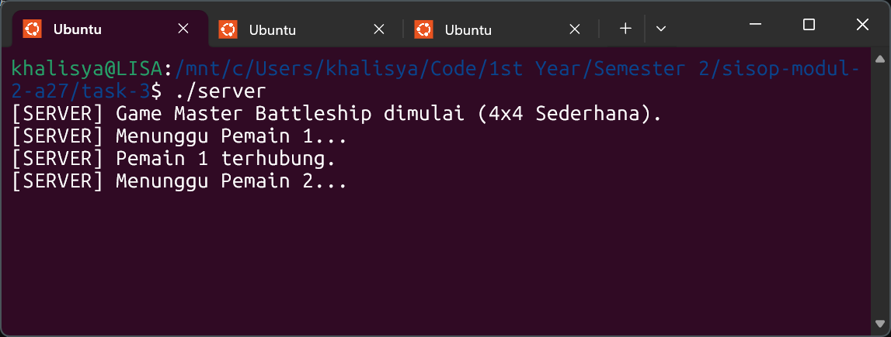

- Terminal 2 (pemain 1)
  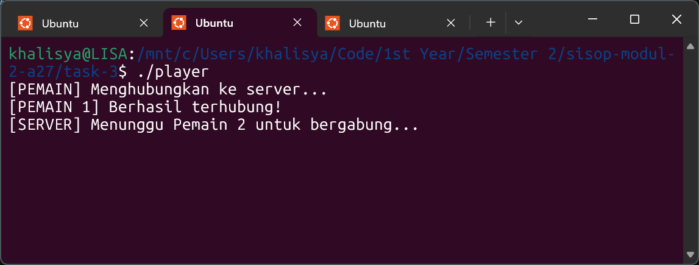

### Kode Penuh _(Full Code)_
Masukkan kode lengkap yang digunakan untuk menyelesaikan bagian ini.  
_Insert the full source code used to solve this section._

```c
struct mq_attr attr = {.mq_flags = 0, .mq_maxmsg = 10, .mq_msgsize = sizeof(Message), .mq_curmsgs = 0};

q_pub = mq_open(PUB_Q, O_CREAT | O_RDWR, 0666, &attr);
q_init = mq_open(INIT_Q, O_CREAT | O_RDWR, 0666, &attr);
q_p1_tx = mq_open(P1_TX, O_CREAT | O_RDWR, 0666, &attr);
q_p1_rx = mq_open(P1_RX, O_CREAT | O_RDWR, 0666, &attr);
q_p2_tx = mq_open(P2_TX, O_CREAT | O_RDWR, 0666, &attr);
q_p2_rx = mq_open(P2_RX, O_CREAT | O_RDWR, 0666, &attr);

printf("[SERVER] Game Master Battleship dimulai.\n");
Message msg;

printf("[SERVER] Menunggu Pemain 1...\n");
mq_receive(q_pub, (char*)&msg, sizeof(Message), NULL);
msg.type = MSG_ASSIGN_P1; mq_send(q_init, (char*)&msg, sizeof(Message), 0);
msg.type = MSG_WAIT; mq_send(q_p1_rx, (char*)&msg, sizeof(Message), 0);
printf("[SERVER] Pemain 1 terhubung.\n");

printf("[SERVER] Menunggu Pemain 2...\n");
mq_receive(q_pub, (char*)&msg, sizeof(Message), NULL);
msg.type = MSG_ASSIGN_P2; mq_send(q_init, (char*)&msg, sizeof(Message), 0);
printf("[SERVER] Pemain 2 terhubung. Permainan dimulai!\n");
```

## B. Langkah-langkah & Potongan Kode, Screenshot, Kode Penuh

### Langkah-langkah & Potongan Kode _(Steps & Code Snippets)_
Jelaskan langkah-langkah yang dilakukan dan berikan potongan kode dari langkah-langkah yang kalian jelaskan jika ada.  
_Explain the steps performed and include relevant code snippets from the steps you describe if applicable._

1. Validasi batas papan dan input pemain

    Setiap pemain menempatkan tepat 2 kapal. Koordinat yang diinput dipastikan menggunakan format batas papan baris `0-3` dan kolom `A-D` (huruf kapital atau kecil karena sudah di-*handle* dengan fungsi `toupper()`).

    ```c
    // membaca koordinat input dari user (player.c)
    printf("Tempatkan Kapal %d:\n> ", i);
    scanf("%s", input);
    r = input[0] - '0'; 
    c = toupper(input[1]) - 'A';

    if(r < 0 || r > 3 || c < 0 || c > 3 || strlen(input) != 2) {
        printf("Koordinat salah! Gunakan format AngkaHuruf (contoh: 0A).\n"); continue;
    }
    ```

2. Validasi tumpang tindih (overlap) oleh server

    Server menerima pesan penempatan dan mengecek isi *array* papan. Jika petak sudah terisi simbol kapal (`'S'`), server mengirim pesan gagal (`MSG_PLACE_FAIL`) sehingga pemain menerima output "Petak sudah ditempati!". Setelah 2 kapal diletakkan, tampil informasi menunggu lawan.

    ```c
    // validasi di server (server.c)
    mq_receive(q_p1_tx, (char*)&msg, sizeof(Message), NULL);
    if(board_p1[msg.r][msg.c] == 'S') {
        msg.type = MSG_PLACE_FAIL; 
        mq_send(q_p1_rx, (char*)&msg, sizeof(Message), 0);
    } else {
        board_p1[msg.r][msg.c] = 'S'; 
        p1_ready++; ships_p1++;
        msg.type = MSG_PLACE_OK; 
        mq_send(q_p1_rx, (char*)&msg, sizeof(Message), 0);
    }
    ```

### Screenshot _(Screenshot)_
Masukkan screenshot hasil eksekusi program atau proses yang relevan.  
_Insert screenshots of program execution results or other relevant processes._

Pemain 1 menempatkan kapal dan terdapat caution karena salah satu petak menimpa kapal sebelumnya

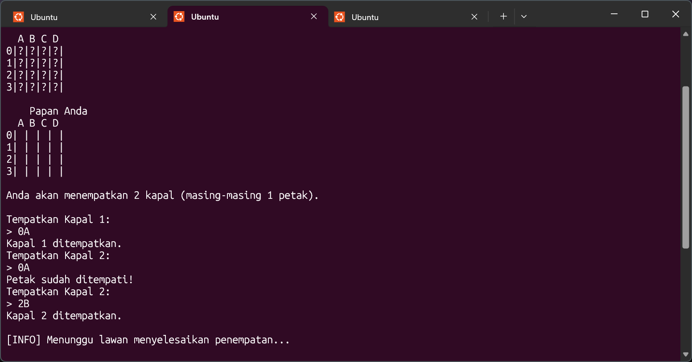

### Kode Penuh _(Full Code)_
Masukkan kode lengkap yang digunakan untuk menyelesaikan bagian ini.  
_Insert the full source code used to solve this section._

```c
if(msg.type == MSG_START_SETUP) {
    printf("[SERVER] Permainan dimulai (4x4 Sederhana)!\n");
    print_boards();
    printf("\nAnda akan menempatkan %d kapal (masing-masing 1 petak).\n\n", SHIPS_PER_PLAYER);
    
    for(int i = 1; i <= SHIPS_PER_PLAYER; i++) {
        char input[256]; int r, c;
        while(1) {
            printf("Tempatkan Kapal %d:\n> ", i);
            scanf("%s", input);
            r = input[0] - '0'; c = toupper(input[1]) - 'A';
            
            if(r < 0 || r > 3 || c < 0 || c > 3 || strlen(input) != 2) {
                printf("Koordinat salah! Gunakan format AngkaHuruf (contoh: 0A).\n"); continue;
            }
            
            msg.type = MSG_PLACE_REQ; msg.r = r; msg.c = c;
            mq_send(q_tx, (char*)&msg, sizeof(Message), 0);
            
            mq_receive(q_rx, (char*)&msg, sizeof(Message), NULL);
            if(msg.type == MSG_PLACE_OK) {
                pthread_mutex_lock(&board_mutex);
                my_board[r][c] = 'S';
                pthread_mutex_unlock(&board_mutex);
                printf("Kapal %d ditempatkan.\n", i);
                break;
            } else {
                printf("Petak sudah ditempati!\n");
            }
        }
    }
}
printf("\n[INFO] Menunggu lawan menyelesaikan penempatan...\n");
```

## C. Langkah-langkah & Potongan Kode, Screenshot, Kode Penuh

### Langkah-langkah & Potongan Kode _(Steps & Code Snippets)_
Jelaskan langkah-langkah yang dilakukan dan berikan potongan kode dari langkah-langkah yang kalian jelaskan jika ada.  
_Explain the steps performed and include relevant code snippets from the steps you describe if applicable._

1. Penentuan giliran awal secara acak

    Server menggunakan seed `srand(time(NULL))` dan `rand() % 2 + 1` untuk memilih pemain secara acak di awal fase permainan.

    ```c
    int turn = rand() % 2 + 1;
    printf("[SERVER] Dipilih secara acak: Pemain %d bermain duluan.\n", turn);
    ```

2. Pencatatan tembakan (terminal server)

    Ketika mendapat koordinat, server memeriksa `enemy_board`. Jika mengenai `'S'`, simbol diubah menjadi `'X'`. Tembakan pada petak yang sudah pernah ditembak otomatis dianggap MELESET karena tidak berisi `'S'`. Terminal server mencatat rekam jejak ini sesuai spesifikasi soal.

    ```c
    // pemrosesan dan log kejadian server
    int is_hit = 0;
    if(enemy_board[msg.r][msg.c] == 'S') { 
        enemy_board[msg.r][msg.c] = 'X'; (*enemy_ships)--; is_hit = 1; 
    } else if (enemy_board[msg.r][msg.c] == ' ') { 
        enemy_board[msg.r][msg.c] = 'O'; 
    }

    printf("[GILIRAN] Pemain %d menembak %d%c: %s\n", turn, msg.r, col_c, is_hit ? "KENA" : "MELESET");
    ```

3. Notifikasi berurutan (penembak dan lawan)

    Sesuai ketentuan, hasil dikirim ke penembak menggunakan string awalan `[HASIL TEMBAKAN]`, dan ke lawan menggunakan `[INFO]`. Keterangan SISA KAPAL juga disisipkan ke dalam format teks menggunakan `sprintf`.

    ```c
    // server mengirimkan respon format spesifik ke klien
    msg.type = MSG_SHOOT_RES_ME;
    sprintf(msg.text, "%d%c %s, SISA %d KAPAL LAGI", msg.r, col_c, is_hit ? "KENA KAPAL" : "MELESET", *enemy_ships);
    mq_send(q_rx_active, (char*)&msg, sizeof(Message), 0);

    msg.type = MSG_SHOOT_RES_ENEMY;
    sprintf(msg.text, "Lawan menembak %d%c: %s, SISA %d KAPAL LAGI", msg.r, col_c, is_hit ? "KENA KAPAL" : "MELESET", *enemy_ships);
    mq_send(q_rx_enemy, (char*)&msg, sizeof(Message), 0);
    ```

### Screenshot _(Screenshot)_
Masukkan screenshot hasil eksekusi program atau proses yang relevan.  
_Insert screenshots of program execution results or other relevant processes._

Player memperlihatkan notifikasi "KENA KAPAL" atau "MELESET", beserta format papan lawan dan pemain

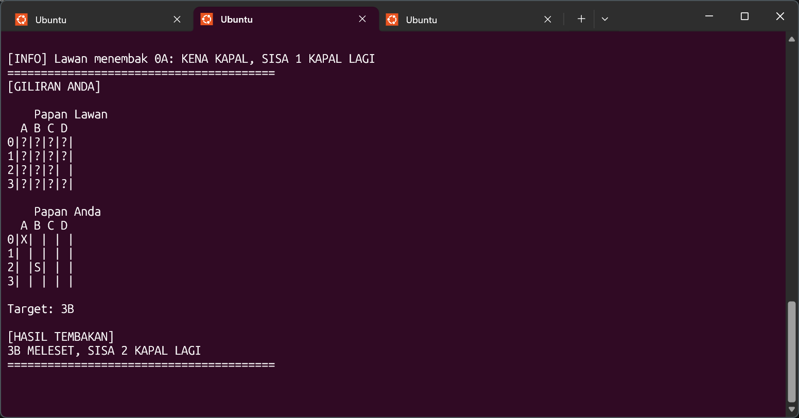

### Kode Penuh _(Full Code)_
Masukkan kode lengkap yang digunakan untuk menyelesaikan bagian ini.  
_Insert the full source code used to solve this section._

```c
while(ships_p1 > 0 && ships_p2 > 0) {
    mqd_t q_tx_active = (turn == 1) ? q_p1_tx : q_p2_tx;
    mqd_t q_rx_active = (turn == 1) ? q_p1_rx : q_p2_rx;
    mqd_t q_rx_enemy  = (turn == 1) ? q_p2_rx : q_p1_rx;
    char (*enemy_board)[4] = (turn == 1) ? board_p2 : board_p1;
    int *enemy_ships = (turn == 1) ? &ships_p2 : &ships_p1;

    msg.type = MSG_TURN_START; mq_send(q_rx_active, (char*)&msg, sizeof(Message), 0);
    
    mq_receive(q_tx_active, (char*)&msg, sizeof(Message), NULL);
    
    char col_c = msg.c + 'A'; int is_hit = 0;
    if(enemy_board[msg.r][msg.c] == 'S') { 
        enemy_board[msg.r][msg.c] = 'X'; (*enemy_ships)--; is_hit = 1; 
    } else if (enemy_board[msg.r][msg.c] == ' ') { 
        enemy_board[msg.r][msg.c] = 'O'; 
    }

    printf("[GILIRAN] Pemain %d menembak %d%c: %s\n", turn, msg.r, col_c, is_hit ? "KENA" : "MELESET");
    
    msg.type = MSG_SHOOT_RES_ME;
    sprintf(msg.text, "%d%c %s, SISA %d KAPAL LAGI", msg.r, col_c, is_hit ? "KENA KAPAL" : "MELESET", *enemy_ships);
    mq_send(q_rx_active, (char*)&msg, sizeof(Message), 0);
    
    msg.type = MSG_SHOOT_RES_ENEMY;
    sprintf(msg.text, "Lawan menembak %d%c: %s, SISA %d KAPAL LAGI", msg.r, col_c, is_hit ? "KENA KAPAL" : "MELESET", *enemy_ships);
    mq_send(q_rx_enemy, (char*)&msg, sizeof(Message), 0);

    if(*enemy_ships == 0) {
        printf("[TENGGELAM] Pemain %d menenggelamkan Kapal Pemain %d!\n", turn, (turn==1)?2:1);
        printf("[SERVER] Pemain %d menang!\n", turn);
        msg.type = MSG_GAME_OVER_WIN; mq_send(q_rx_active, (char*)&msg, sizeof(Message), 0);
        msg.type = MSG_GAME_OVER_LOSE; mq_send(q_rx_enemy, (char*)&msg, sizeof(Message), 0);
        break;
    }
    turn = (turn == 1) ? 2 : 1;
}
```

## D. Langkah-langkah & Potongan Kode, Screenshot, Kode Penuh

### Langkah-langkah & Potongan Kode _(Steps & Code Snippets)_
Jelaskan langkah-langkah yang dilakukan dan berikan potongan kode dari langkah-langkah yang kalian jelaskan jika ada.  
_Explain the steps performed and include relevant code snippets from the steps you describe if applicable._

1. Multithreading dan mutex untuk sinkronisasi papan

    Program `player.c` memecah proses menjadi dua agar tidak memblokir input terminal. *Thread* utama memproses fungsi `scanf` input pemain, sedangkan thread terpisah (`listener_thread`) bertugas mendengarkan pesan terus menerus. Digunakan `pthread_mutex_lock` untuk mencegah *race condition* agar tidak ada tabrakan akses visual pada `my_board` dan `enemy_board`.

    ```c
    // player.c (update papan aman dengan mutex di dalam thread)
    pthread_mutex_lock(&board_mutex);
    enemy_board[msg.r][msg.c] = strstr(msg.text, "KENA KAPAL") ? 'X' : ' ';
    pthread_mutex_unlock(&board_mutex);
    ```

2. Output menang/kalah sesuai format

    Thread pendengar bereaksi secara langsung jika server mengirim `MSG_GAME_OVER_WIN` dan akan menghentikan permainan dengan me-reset variabel volatile `game_running = 0`. Notifikasi di-*print* persis sesuai garis format di soal.

    ```c
    case MSG_GAME_OVER_WIN:
        printf("========================================\n[HASIL] Semua kapal musuh telah tenggelam!\n[HASIL] ANDA MENANG!\n========================================\n");
        game_running = 0; break;
    ```

3. Pembersihan seluruh message queue (cleanup)

    Setelah loop permainan berakhir, fungsi `cleanup()` diletakkan pada akhir alur server yang menjalankan iterasi `mq_close` dan `mq_unlink` untuk seluruh 6 *message queue* (`PUB`, `INIT`, dan `TX/RX` masing-masing pemain) untuk memastikan tidak ada memori POSIX yang tertinggal di `/dev/mqueue/`. Klien juga bergabung ulang ke thread utama dengan `pthread_join`.

    ```c
    void cleanup() {
        mq_close(q_pub); mq_close(q_init); 
        mq_close(q_p1_tx); mq_close(q_p1_rx);
        mq_close(q_p2_tx); mq_close(q_p2_rx);
        
        mq_unlink(PUB_Q); mq_unlink(INIT_Q); 
        mq_unlink(P1_TX); mq_unlink(P1_RX);
        mq_unlink(P2_TX); mq_unlink(P2_RX);
    }
    ```

### Screenshot _(Screenshot)_
Masukkan screenshot hasil eksekusi program atau proses yang relevan.  
_Insert screenshots of program execution results or other relevant processes._

Server mencatat penenggelaman kapal, serta sisi klien memunculkan status kemenangan atau kekalahan secara *real-time* berkat thread pendengar

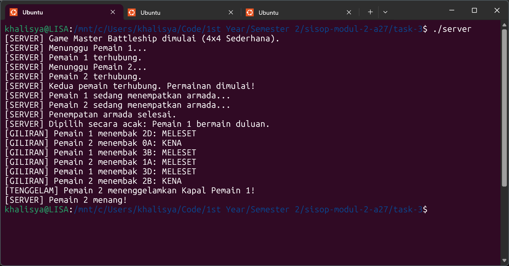

### Kode Penuh _(Full Code)_
Masukkan kode lengkap yang digunakan untuk menyelesaikan bagian ini.  
_Insert the full source code used to solve this section._

```c
void* listener_thread(void* arg) {
    Message msg;
    while(game_running) {
        if (mq_receive(q_rx, (char*)&msg, sizeof(Message), NULL) > 0) {
            switch(msg.type) {
                case MSG_TURN_START:
                    is_my_turn = 1;
                    printf("========================================\n[GILIRAN ANDA]\n");
                    print_boards(); 
                    printf("\nTarget: "); fflush(stdout);
                    break;
                case MSG_SHOOT_RES_ME:
                    pthread_mutex_lock(&board_mutex);
                    enemy_board[msg.r][msg.c] = strstr(msg.text, "KENA KAPAL") ? 'X' : ' ';
                    pthread_mutex_unlock(&board_mutex);
                    printf("\n[HASIL TEMBAKAN]\n%s\n========================================\n\n", msg.text);
                    break;
                case MSG_SHOOT_RES_ENEMY:
                    pthread_mutex_lock(&board_mutex);
                    if(strstr(msg.text, "KENA KAPAL")) my_board[msg.r][msg.c] = 'X';
                    pthread_mutex_unlock(&board_mutex);
                    printf("\n[INFO] %s\n", msg.text);
                    break;
                case MSG_GAME_OVER_WIN:
                    printf("========================================\n[HASIL] Semua kapal musuh telah tenggelam!\n[HASIL] ANDA MENANG!\n========================================\n");
                    game_running = 0; break;
                case MSG_GAME_OVER_LOSE:
                    printf("========================================\n[HASIL] Semua kapal Anda telah tenggelam.\n[HASIL] ANDA KALAH.\n========================================\n");
                    game_running = 0; break;
                default: break;
            }
        }
    }
    return NULL;
}

pthread_join(tid, NULL);
mq_close(q_tx); mq_close(q_rx);
return 0;
```