<div align=center>

|    NRP     |           Nama                |
| :--------: |       :------------:          |
| 5025251028 | Julianda Caesar Prakoso       |
| 5025251045 | Khalisya Zahra Putria Rahman  |
| 5025251072 | Deborah Amalia Sheraviningrum |

# Praktikum Modul 3 _(Module 3 Lab Work)_

</div>

### Daftar Soal _(Task List)_

- [Task 1 - NgeBOOT](https://github.com/juliandacp/s1-sistem-operasi/tree/main/sisop-modul-3-a27/task-1/)

- [Task 2 - SentinelOS](https://github.com/juliandacp/s1-sistem-operasi/tree/main/sisop-modul-3-a27/task-2/)

- [Task 3 - Project V-Protocol: HSS Recovery](https://github.com/juliandacp/s1-sistem-operasi/tree/main/sisop-modul-3-a27/task-3/)

---

### Laporan Resmi Praktikum Modul 3 _(Module 3 Lab Work Report)_

Tulis laporan di template berikut!

_Write your lab work on the template here!_

---

# Task 1 - NgeBOOT

## A. Langkah-langkah & Potongan Kode, Screenshot, Kode Penuh  
_(Steps & Code Snippets, Screenshot, Full Code)_

### Langkah-langkah & Potongan Kode _(Steps & Code Snippets)_
Jelaskan langkah-langkah yang dilakukan dan berikan potongan kode dari langkah-langkah yang kalian jelaskan jika ada.  
_Explain the steps performed and include relevant code snippets from the steps you describe if applicable._

1. Membuka file kernel.sh

2. Mengawali script dengan shebang
    ```bash
    #!/bin/bash
    ```

3. Membuat direktori osboot
    ```bash
    mkdir -p osboot
    ```

4. Mengunduh source code kernel Linux
    ```bash
    wget https://cdn.kernel.org/pub/linux/kernel/v6.x/linux-6.1.1.tar.xz
    ```

5. Mengekstrak file kernel
    ```bash
    tar -xvf linux-6.1.1.tar.xz
    ```

6. Masuk ke direktori kernel
    ```bash
    cd linux-6.1.1
    ```

7. Menyalin file konfigurasi kernel & memperbarui konfigurasi kernel
    ```bash
    cp ../.config .config
    make olddefconfig
    ```

8. Melakukan kompilasi kernel
    ```bash
    make -j$(nproc)
    ```

9. Menyalin file kernel hasil build
    ```bash
    cp arch/x86/boot/bzImage ../osboot/
    ```

10. Kembali ke direktori sebelumnya dan menghapus folder source kernel & file arsip kernel
    ```bash
    cd ..
    rm -rf linux-6.1.1
    rm -f linux-6.1.1.tar.xz
    ```

11. Menampilkan output
    ```bash
    echo "osboot/bzImage"
    ```

### Screenshot _(Screenshot)_
Masukkan screenshot hasil eksekusi program atau proses yang relevan.  
_Insert screenshots of program execution results or other relevant processes._

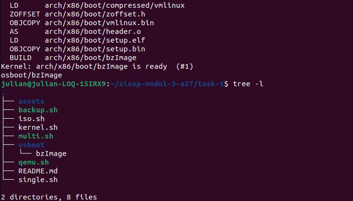

### Kode Penuh _(Full Code)_
Masukkan kode lengkap yang digunakan untuk menyelesaikan bagian ini.  
_Insert the full source code used to solve this section._

```bash
#!/bin/bash

mkdir -p osboot

wget https://cdn.kernel.org/pub/linux/kernel/v6.x/linux-6.1.1.tar.xz
tar -xvf linux-6.1.1.tar.xz
cd linux-6.1.1

cp ../.config .config
make olddefconfig

make -j$(nproc)

cp arch/x86/boot/bzImage ../osboot/

cd ..
rm -rf linux-6.1.1
rm -f linux-6.1.1.tar.xz

echo "osboot/bzImage"
```

## B. Langkah-langkah & Potongan Kode, Screenshot, Kode Penuh  
_(Steps & Code Snippets, Screenshot, Full Code)_

### Langkah-langkah & Potongan Kode _(Steps & Code Snippets)_
Jelaskan langkah-langkah yang dilakukan dan berikan potongan kode dari langkah-langkah yang kalian jelaskan jika ada.  
_Explain the steps performed and include relevant code snippets from the steps you describe if applicable._

1. Membuka file single.sh

2. Mengawali script dengan shebang
    ```bash
    #!/bin/bash
    ```

3. Membuat direktori untuk initramfs
    ```bash
    mkdir -p myramdisk/{bin,dev,proc,sys}
    ```

4. Menyalin file device ke direktori dev
    ```bash
    cp -a /dev/null myramdisk/dev
    cp -a /dev/tty* myramdisk/dev
    cp -a /dev/zero myramdisk/dev
    cp -a /dev/console myramdisk/dev
    ```

5. Menyalin file busybox ke direktori bin
    ```bash
    cp /usr/bin/busybox myramdisk/bin
    cd myramdisk/bin
    ./busybox --install .
    ```

6. Kembali ke direktori awal & membuat file init
    ```bash
    cd ../..

    echo "#!/bin/sh" > myramdisk/init
    echo "/bin/mount -t proc none /proc" >> myramdisk/init
    echo "/bin/mount -t sysfs none /sys" >> myramdisk/init
    echo "exec /bin/sh" >> myramdisk/init
    ```

7. Memberi izin eksekusi pada file init
    ```bash
    chmod +x myramdisk/init
    ```

8. Membuat file initramfs
    ```bash
    cd myramdisk
    find . | cpio -oH newc | gzip > ../osboot/single.gz
    cd ..
    ```

9. Menghapus direktori sementara
    ```bash
    rm -rf myramdisk
    ```

10. Menampilkan output
    ```bash
    echo "osboot/single.gz"
    ```

### Screenshot _(Screenshot)_
Masukkan screenshot hasil eksekusi program atau proses yang relevan.  
_Insert screenshots of program execution results or other relevant processes._

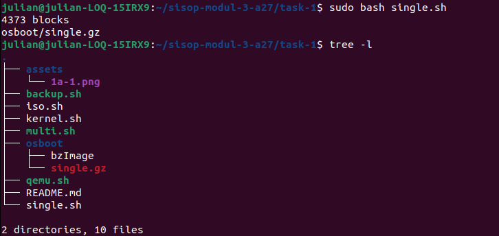

### Kode Penuh _(Full Code)_
Masukkan kode lengkap yang digunakan untuk menyelesaikan bagian ini.  
_Insert the full source code used to solve this section._

```bash
#!/bin/bash

mkdir -p myramdisk/{bin,dev,proc,sys}

cp -a /dev/null myramdisk/dev
cp -a /dev/tty* myramdisk/dev
cp -a /dev/zero myramdisk/dev
cp -a /dev/console myramdisk/dev

cp /usr/bin/busybox myramdisk/bin
cd myramdisk/bin
./busybox --install .

cd ../..

echo "#!/bin/sh" > myramdisk/init
echo "/bin/mount -t proc none /proc" >> myramdisk/init
echo "/bin/mount -t sysfs none /sys" >> myramdisk/init
echo "exec /bin/sh" >> myramdisk/init

chmod +x myramdisk/init

cd myramdisk
find . | cpio -oH newc | gzip > ../osboot/single.gz
cd ..

rm -rf myramdisk

echo "osboot/single.gz"
```

## C. Langkah-langkah & Potongan Kode, Screenshot, Kode Penuh  
_(Steps & Code Snippets, Screenshot, Full Code)_

### Langkah-langkah & Potongan Kode _(Steps & Code Snippets)_
Jelaskan langkah-langkah yang dilakukan dan berikan potongan kode dari langkah-langkah yang kalian jelaskan jika ada.  
_Explain the steps performed and include relevant code snippets from the steps you describe if applicable._

1. Membuka file multi.sh

2. Mengawali script dengan shebang
    ```bash
    #!/bin/bash
    ```

3. Membuat direktori untuk initramfs
    ```bash
    mkdir -p myramdisk/{bin,dev,proc,sys,etc,root,home/{blue,green,red,pink}}
    ```

4. Menyalin file device ke direktori dev
    ```bash
    cp -a /dev/null myramdisk/dev
    cp -a /dev/tty* myramdisk/dev
    cp -a /dev/zero myramdisk/dev
    cp -a /dev/console myramdisk/dev
    ```

5. Menyalin file busybox ke direktori bin
    ```bash
    cp /usr/bin/busybox myramdisk/bin
    cd myramdisk/bin
    ./busybox --install .
    ```

6. Membuat user & password
    ```bash
    root_pw=$(openssl passwd -1 root123)
    blue_pw=$(openssl passwd -1 blue123)
    green_pw=$(openssl passwd -1 green123)
    red_pw=$(openssl passwd -1 red123)
    pink_pw=$(openssl passwd -1 pink123)
    ```

7. Konfigurasi user
    ```bash
    echo "root:$root_pw:0:0:root:/root:/bin/sh" > myramdisk/etc/passwd
    echo "blue:$blue_pw:1001:100:blue:/home/blue:/bin/sh" >> myramdisk/etc/passwd
    echo "green:$green_pw:1002:100:green:/home/green:/bin/sh" >> myramdisk/etc/passwd
    echo "red:$red_pw:1003:100:red:/home/red:/bin/sh" >> myramdisk/etc/passwd
    echo "pink:$pink_pw:1004:100:pink:/home/pink:/bin/sh" >> myramdisk/etc/passwd
    ```

8. Konfigurasi group
    ```bash
    echo "root:x:0:" > myramdisk/etc/group
    echo "bin:x:1:root" >> myramdisk/etc/group
    echo "sys:x:2:root" >> myramdisk/etc/group
    echo "tty:x:5:root,blue,green,red,pink" >> myramdisk/etc/group
    echo "disk:x:6:root" >> myramdisk/etc/group
    echo "wheel:x:10:root,blue,green,red,pink" >> myramdisk/etc/group

    echo "blue:x:1001:" >> myramdisk/etc/group
    echo "green:x:1002:blue" >> myramdisk/etc/group
    echo "red:x:1003:blue,green" >> myramdisk/etc/group
    echo "pink:x:1004:blue,green,red" >> myramdisk/etc/group
    ```

9. Mengatur permission
    ```bash
    chmod 700 myramdisk/root
    chmod 750 myramdisk/home/blue
    chmod 750 myramdisk/home/green
    chmod 750 myramdisk/home/red
    chmod 750 myramdisk/home/pink

    chmod 755 myramdisk/bin
    chmod 755 myramdisk/etc
    ```

10. Membuat file init
    ```bash
    echo "#!/bin/sh" > myramdisk/init
    echo "/bin/mount -t proc none /proc" >> myramdisk/init
    echo "/bin/mount -t sysfs none /sys" >> myramdisk/init
    echo "echo 0 > /proc/sys/kernel/printk" >> myramdisk/init
    echo "chown blue:blue /home/blue" >> myramdisk/init
    echo "chown green:green /home/green" >> myramdisk/init
    echo "chown red:red /home/red" >> myramdisk/init
    echo "chown pink:pink /home/pink" >> myramdisk/init
    echo "while true; do /bin/getty -L tty1 115200 vt100; done" >> myramdisk/init
    ```

11. Memberi izin eksekusi pada file init
    ```bash
    chmod +x myramdisk/init
    ```

12. Pembuatan profile login
    ```bash
    echo "#!/bin/sh" > myramdisk/etc/profile
    echo "clear" >> myramdisk/etc/profile
    echo "echo '██╗  ██╗██╗'" >> myramdisk/etc/profile
    echo "echo '██║  ██║██║'" >> myramdisk/etc/profile
    echo "echo '███████║██║'" >> myramdisk/etc/profile
    echo "echo '██╔══██║██║'" >> myramdisk/etc/profile
    echo "echo '██║  ██║██║'" >> myramdisk/etc/profile
    echo "echo '╚═╝  ╚═╝╚═╝'" >> myramdisk/etc/profile
    echo "echo ''" >> myramdisk/etc/profile

    echo "case \$(whoami) in" >> myramdisk/etc/profile
    echo "root)" >> myramdisk/etc/profile
    echo "echo '██████╗  ██████╗  ██████╗ ████████╗'" >> myramdisk/etc/profile
    echo "echo '██╔══██╗██╔═══██╗██╔═══██╗╚══██╔══╝'" >> myramdisk/etc/profile
    echo "echo '██████╔╝██║   ██║██║   ██║   ██║   '" >> myramdisk/etc/profile
    echo "echo '██╔══██╗██║   ██║██║   ██║   ██║   '" >> myramdisk/etc/profile
    echo "echo '██║  ██║╚██████╔╝╚██████╔╝   ██║   '" >> myramdisk/etc/profile
    echo "echo '╚═╝  ╚═╝ ╚═════╝  ╚═════╝    ╚═╝   '" >> myramdisk/etc/profile
    echo ";;" >> myramdisk/etc/profile

    echo "blue)" >> myramdisk/etc/profile
    echo "echo '██████╗ ██╗     ██╗   ██╗███████╗'" >> myramdisk/etc/profile
    echo "echo '██╔══██╗██║     ██║   ██║██╔════╝'" >> myramdisk/etc/profile
    echo "echo '██████╔╝██║     ██║   ██║█████╗  '" >> myramdisk/etc/profile
    echo "echo '██╔══██╗██║     ██║   ██║██╔══╝  '" >> myramdisk/etc/profile
    echo "echo '██████╔╝███████╗╚██████╔╝███████╗'" >> myramdisk/etc/profile
    echo "echo '╚═════╝ ╚══════╝ ╚═════╝ ╚══════╝'" >> myramdisk/etc/profile
    echo ";;" >> myramdisk/etc/profile

    echo "green)" >> myramdisk/etc/profile
    echo "echo ' ██████╗ ██████╗ ███████╗███████╗███╗   ██╗'" >> myramdisk/etc/profile
    echo "echo '██╔════╝ ██╔══██╗██╔════╝██╔════╝████╗  ██║'" >> myramdisk/etc/profile
    echo "echo '██║  ███╗██████╔╝█████╗  █████╗  ██╔██╗ ██║'" >> myramdisk/etc/profile
    echo "echo '██║   ██║██╔══██╗██╔══╝  ██╔══╝  ██║╚██╗██║'" >> myramdisk/etc/profile
    echo "echo '╚██████╔╝██║  ██║███████╗███████╗██║ ╚████║'" >> myramdisk/etc/profile
    echo "echo ' ╚═════╝ ╚═╝  ╚═╝╚══════╝╚══════╝╚═╝  ╚═══╝'" >> myramdisk/etc/profile
    echo ";;" >> myramdisk/etc/profile

    echo "red)" >> myramdisk/etc/profile
    echo "echo '██████╗ ███████╗██████╗ '" >> myramdisk/etc/profile
    echo "echo '██╔══██╗██╔════╝██╔══██╗'" >> myramdisk/etc/profile
    echo "echo '██████╔╝█████╗  ██║  ██║'" >> myramdisk/etc/profile
    echo "echo '██╔══██╗██╔══╝  ██║  ██║'" >> myramdisk/etc/profile
    echo "echo '██║  ██║███████╗██████╔╝'" >> myramdisk/etc/profile
    echo "echo '╚═╝  ╚═╝╚══════╝╚═════╝ '" >> myramdisk/etc/profile
    echo ";;" >> myramdisk/etc/profile

    echo "pink)" >> myramdisk/etc/profile
    echo "echo '██████╗ ██╗███╗   ██╗██╗  ██╗'" >> myramdisk/etc/profile
    echo "echo '██╔══██╗██║████╗  ██║██║ ██╔╝'" >> myramdisk/etc/profile
    echo "echo '██████╔╝██║██╔██╗ ██║█████╔╝ '" >> myramdisk/etc/profile
    echo "echo '██╔═══╝ ██║██║╚██╗██║██╔═██╗ '" >> myramdisk/etc/profile
    echo "echo '██║     ██║██║ ╚████║██║  ██╗'" >> myramdisk/etc/profile
    echo "echo '╚═╝     ╚═╝╚═╝  ╚═══╝╚═╝  ╚═╝'" >> myramdisk/etc/profile
    echo ";;" >> myramdisk/etc/profile
    echo "esac" >> myramdisk/etc/profile
    ```

13. Memberi izin eksekusi pada file profile
    ```bash
    chmod +x myramdisk/etc/profile
    ```

14. Membuat file initramfs
    ```bash
    cd myramdisk
    find . | cpio -oHnewc | gzip > ../osboot/multi.gz
    ```

15. Menghapus direktori sementara
    ```bash
    cd ..
    rm -rf myramdisk
    ```

16. Menampilkan output
    ```bash
    echo "osboot/multi.gz"
    ```

### Screenshot _(Screenshot)_
Masukkan screenshot hasil eksekusi program atau proses yang relevan.  
_Insert screenshots of program execution results or other relevant processes._

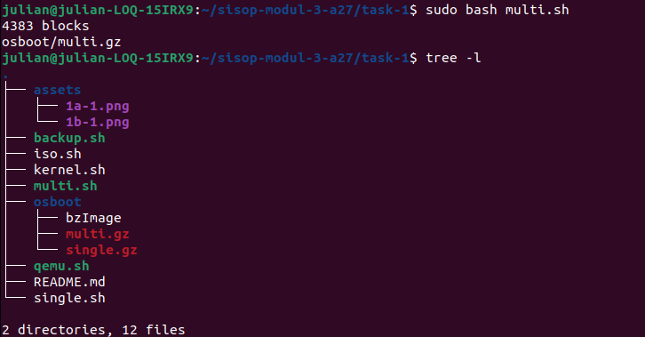

### Kode Penuh _(Full Code)_
Masukkan kode lengkap yang digunakan untuk menyelesaikan bagian ini.  
_Insert the full source code used to solve this section._

```bash
#!/bin/bash

mkdir -p myramdisk/{bin,dev,proc,sys,etc,root,home/{blue,green,red,pink}}

cp -a /dev/null myramdisk/dev
cp -a /dev/tty* myramdisk/dev
cp -a /dev/zero myramdisk/dev
cp -a /dev/console myramdisk/dev

cp /usr/bin/busybox myramdisk/bin
cd myramdisk/bin
./busybox --install .
cd ../..

# Password User
root_pw=$(openssl passwd -1 root123)
blue_pw=$(openssl passwd -1 blue123)
green_pw=$(openssl passwd -1 green123)
red_pw=$(openssl passwd -1 red123)
pink_pw=$(openssl passwd -1 pink123)

# Konfigurasi User
echo "root:$root_pw:0:0:root:/root:/bin/sh" > myramdisk/etc/passwd
echo "blue:$blue_pw:1001:100:blue:/home/blue:/bin/sh" >> myramdisk/etc/passwd
echo "green:$green_pw:1002:100:green:/home/green:/bin/sh" >> myramdisk/etc/passwd
echo "red:$red_pw:1003:100:red:/home/red:/bin/sh" >> myramdisk/etc/passwd
echo "pink:$pink_pw:1004:100:pink:/home/pink:/bin/sh" >> myramdisk/etc/passwd

# Konfigurasi Group
echo "root:x:0:" > myramdisk/etc/group
echo "bin:x:1:root" >> myramdisk/etc/group
echo "sys:x:2:root" >> myramdisk/etc/group
echo "tty:x:5:root,blue,green,red,pink" >> myramdisk/etc/group
echo "disk:x:6:root" >> myramdisk/etc/group
echo "wheel:x:10:root,blue,green,red,pink" >> myramdisk/etc/group

echo "blue:x:1001:" >> myramdisk/etc/group
echo "green:x:1002:blue" >> myramdisk/etc/group
echo "red:x:1003:blue,green" >> myramdisk/etc/group
echo "pink:x:1004:blue,green,red" >> myramdisk/etc/group

# User Permission
chmod 700 myramdisk/root
chmod 750 myramdisk/home/blue
chmod 750 myramdisk/home/green
chmod 750 myramdisk/home/red
chmod 750 myramdisk/home/pink

chmod 755 myramdisk/bin
chmod 755 myramdisk/etc

# File init
echo "#!/bin/sh" > myramdisk/init
echo "/bin/mount -t proc none /proc" >> myramdisk/init
echo "/bin/mount -t sysfs none /sys" >> myramdisk/init
echo "echo 0 > /proc/sys/kernel/printk" >> myramdisk/init
echo "chown blue:blue /home/blue" >> myramdisk/init
echo "chown green:green /home/green" >> myramdisk/init
echo "chown red:red /home/red" >> myramdisk/init
echo "chown pink:pink /home/pink" >> myramdisk/init
echo "while true; do /bin/getty -L tty1 115200 vt100; done" >> myramdisk/init

chmod +x myramdisk/init

# Profile Welcome (ASCII Art Generator: ANSI Shadow)
echo "#!/bin/sh" > myramdisk/etc/profile
echo "clear" >> myramdisk/etc/profile
echo "echo '██╗  ██╗██╗'" >> myramdisk/etc/profile
echo "echo '██║  ██║██║'" >> myramdisk/etc/profile
echo "echo '███████║██║'" >> myramdisk/etc/profile
echo "echo '██╔══██║██║'" >> myramdisk/etc/profile
echo "echo '██║  ██║██║'" >> myramdisk/etc/profile
echo "echo '╚═╝  ╚═╝╚═╝'" >> myramdisk/etc/profile
echo "echo ''" >> myramdisk/etc/profile

echo "case \$(whoami) in" >> myramdisk/etc/profile
echo "root)" >> myramdisk/etc/profile
echo "echo '██████╗  ██████╗  ██████╗ ████████╗'" >> myramdisk/etc/profile
echo "echo '██╔══██╗██╔═══██╗██╔═══██╗╚══██╔══╝'" >> myramdisk/etc/profile
echo "echo '██████╔╝██║   ██║██║   ██║   ██║   '" >> myramdisk/etc/profile
echo "echo '██╔══██╗██║   ██║██║   ██║   ██║   '" >> myramdisk/etc/profile
echo "echo '██║  ██║╚██████╔╝╚██████╔╝   ██║   '" >> myramdisk/etc/profile
echo "echo '╚═╝  ╚═╝ ╚═════╝  ╚═════╝    ╚═╝   '" >> myramdisk/etc/profile
echo ";;" >> myramdisk/etc/profile

echo "blue)" >> myramdisk/etc/profile
echo "echo '██████╗ ██╗     ██╗   ██╗███████╗'" >> myramdisk/etc/profile
echo "echo '██╔══██╗██║     ██║   ██║██╔════╝'" >> myramdisk/etc/profile
echo "echo '██████╔╝██║     ██║   ██║█████╗  '" >> myramdisk/etc/profile
echo "echo '██╔══██╗██║     ██║   ██║██╔══╝  '" >> myramdisk/etc/profile
echo "echo '██████╔╝███████╗╚██████╔╝███████╗'" >> myramdisk/etc/profile
echo "echo '╚═════╝ ╚══════╝ ╚═════╝ ╚══════╝'" >> myramdisk/etc/profile
echo ";;" >> myramdisk/etc/profile

echo "green)" >> myramdisk/etc/profile
echo "echo ' ██████╗ ██████╗ ███████╗███████╗███╗   ██╗'" >> myramdisk/etc/profile
echo "echo '██╔════╝ ██╔══██╗██╔════╝██╔════╝████╗  ██║'" >> myramdisk/etc/profile
echo "echo '██║  ███╗██████╔╝█████╗  █████╗  ██╔██╗ ██║'" >> myramdisk/etc/profile
echo "echo '██║   ██║██╔══██╗██╔══╝  ██╔══╝  ██║╚██╗██║'" >> myramdisk/etc/profile
echo "echo '╚██████╔╝██║  ██║███████╗███████╗██║ ╚████║'" >> myramdisk/etc/profile
echo "echo ' ╚═════╝ ╚═╝  ╚═╝╚══════╝╚══════╝╚═╝  ╚═══╝'" >> myramdisk/etc/profile
echo ";;" >> myramdisk/etc/profile

echo "red)" >> myramdisk/etc/profile
echo "echo '██████╗ ███████╗██████╗ '" >> myramdisk/etc/profile
echo "echo '██╔══██╗██╔════╝██╔══██╗'" >> myramdisk/etc/profile
echo "echo '██████╔╝█████╗  ██║  ██║'" >> myramdisk/etc/profile
echo "echo '██╔══██╗██╔══╝  ██║  ██║'" >> myramdisk/etc/profile
echo "echo '██║  ██║███████╗██████╔╝'" >> myramdisk/etc/profile
echo "echo '╚═╝  ╚═╝╚══════╝╚═════╝ '" >> myramdisk/etc/profile
echo ";;" >> myramdisk/etc/profile

echo "pink)" >> myramdisk/etc/profile
echo "echo '██████╗ ██╗███╗   ██╗██╗  ██╗'" >> myramdisk/etc/profile
echo "echo '██╔══██╗██║████╗  ██║██║ ██╔╝'" >> myramdisk/etc/profile
echo "echo '██████╔╝██║██╔██╗ ██║█████╔╝ '" >> myramdisk/etc/profile
echo "echo '██╔═══╝ ██║██║╚██╗██║██╔═██╗ '" >> myramdisk/etc/profile
echo "echo '██║     ██║██║ ╚████║██║  ██╗'" >> myramdisk/etc/profile
echo "echo '╚═╝     ╚═╝╚═╝  ╚═══╝╚═╝  ╚═╝'" >> myramdisk/etc/profile
echo ";;" >> myramdisk/etc/profile
echo "esac" >> myramdisk/etc/profile

chmod +x myramdisk/etc/profile

cd myramdisk
find . | cpio -oHnewc | gzip > ../osboot/multi.gz

cd ..
rm -rf myramdisk

echo "osboot/multi.gz"
```

## D. Langkah-langkah & Potongan Kode, Screenshot, Kode Penuh  
_(Steps & Code Snippets, Screenshot, Full Code)_

### Langkah-langkah & Potongan Kode _(Steps & Code Snippets)_
Jelaskan langkah-langkah yang dilakukan dan berikan potongan kode dari langkah-langkah yang kalian jelaskan jika ada.  
_Explain the steps performed and include relevant code snippets from the steps you describe if applicable._

1. Membuka file iso.sh

2. Mengawali script dengan shebang
    ```bash
    #!/bin/bash
    ```

3. Membuat struktur direktori ISO
    ```bash
    mkdir -p mylinuxiso/boot/grub
    ```

4. Menyalin file kernel dan initramfs single & multi user
    ```bash
    cp osboot/bzImage mylinuxiso/boot/
    cp osboot/single.gz mylinuxiso/boot/
    cp osboot/multi.gz mylinuxiso/boot/
    ```

5. Membuat file konfigurasi GRUB
    ```bash
    echo "set timeout=5" > mylinuxiso/boot/grub/grub.cfg
    echo "set default=0" >> mylinuxiso/boot/grub/grub.cfg

    echo "menuentry 'MyLinux: Single User' {" >> mylinuxiso/boot/grub/grub.cfg
    echo "linux /boot/bzImage" >> mylinuxiso/boot/grub/grub.cfg
    echo "initrd /boot/single.gz" >> mylinuxiso/boot/grub/grub.cfg
    echo "}" >> mylinuxiso/boot/grub/grub.cfg

    echo "menuentry 'MyLinux: Multi User' {" >> mylinuxiso/boot/grub/grub.cfg
    echo "linux /boot/bzImage" >> mylinuxiso/boot/grub/grub.cfg
    echo "initrd /boot/multi.gz" >> mylinuxiso/boot/grub/grub.cfg
    echo "}" >> mylinuxiso/boot/grub/grub.cfg
    ```

6. Membuat file ISO bootable
    ```bash
    grub-mkrescue -o osboot/mylinux.iso mylinuxiso
    ```

7. Menghapus direktori sementara
    ```bash
    rm -rf mylinuxiso
    ```

8. Menampilkan output
    ```bash
    echo "osboot/mylinux.iso"
    ```

### Screenshot _(Screenshot)_
Masukkan screenshot hasil eksekusi program atau proses yang relevan.  
_Insert screenshots of program execution results or other relevant processes._

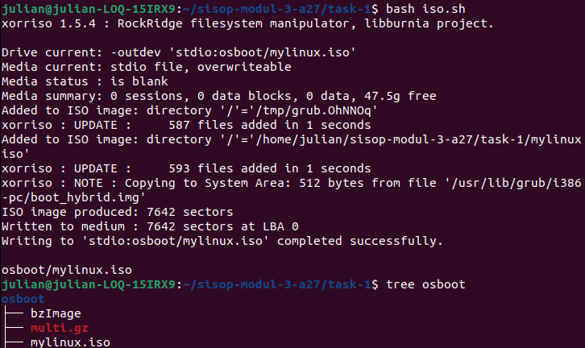

### Kode Penuh _(Full Code)_
Masukkan kode lengkap yang digunakan untuk menyelesaikan bagian ini.  
_Insert the full source code used to solve this section._

```bash
#!/bin/bash

mkdir -p mylinuxiso/boot/grub

cp osboot/bzImage mylinuxiso/boot/
cp osboot/single.gz mylinuxiso/boot/
cp osboot/multi.gz mylinuxiso/boot/

echo "set timeout=5" > mylinuxiso/boot/grub/grub.cfg
echo "set default=0" >> mylinuxiso/boot/grub/grub.cfg

echo "menuentry 'MyLinux: Single User' {" >> mylinuxiso/boot/grub/grub.cfg
echo "linux /boot/bzImage" >> mylinuxiso/boot/grub/grub.cfg
echo "initrd /boot/single.gz" >> mylinuxiso/boot/grub/grub.cfg
echo "}" >> mylinuxiso/boot/grub/grub.cfg

echo "menuentry 'MyLinux: Multi User' {" >> mylinuxiso/boot/grub/grub.cfg
echo "linux /boot/bzImage" >> mylinuxiso/boot/grub/grub.cfg
echo "initrd /boot/multi.gz" >> mylinuxiso/boot/grub/grub.cfg
echo "}" >> mylinuxiso/boot/grub/grub.cfg

grub-mkrescue -o osboot/mylinux.iso mylinuxiso

rm -rf mylinuxiso

echo "osboot/mylinux.iso"
```

## E. Langkah-langkah & Potongan Kode, Screenshot, Kode Penuh  
_(Steps & Code Snippets, Screenshot, Full Code)_

### Langkah-langkah & Potongan Kode _(Steps & Code Snippets)_
Jelaskan langkah-langkah yang dilakukan dan berikan potongan kode dari langkah-langkah yang kalian jelaskan jika ada.  
_Explain the steps performed and include relevant code snippets from the steps you describe if applicable._

1. Membuka file qemu.sh

2. Mengawali script dengan shebang
    ```bash
    #!/bin/bash
    ```

3. Mengecek argumen --single
    ```bash
    if [ "$1" == "--single" ]; 
    then
    ```

4. Menampilkan pesan boot
    ```bash
    echo "Booting Single-User..."
    ```

5. Menjalankan QEMU untuk single user
    ```bash
    qemu-system-x86_64 \
        -smp 2 \
        -m 256 \
        -display curses \
        -vga std \
        -kernel osboot/bzImage \
        -initrd osboot/single.gz 
    ```

6. Mengecek argumen --multi
    ```bash
    elif [ "$1" == "--multi" ];
    then
    ```

7. Menampilkan pesan boot
    ```bash
    echo "Booting Multi-User..."
    ```

8. Menjalankan QEMU untuk multi user
    ```bash
    qemu-system-x86_64 \
        -smp 2 \
        -m 256 \
        -display curses \
        -vga std \
        -kernel osboot/bzImage \
        -initrd osboot/multi.gz  
    ```

9. Mengecek argumen --all
    ```bash
    elif [ "$1" == "--all" ];
    then
    ```

10. Menampilkan pesan boot ISO
    ```bash
    echo "Booting ISO..."
    ```

11. Menjalankan QEMU dengan ISO
    ```bash
    qemu-system-x86_64 \
        -smp 2 \
        -m 256 \
        -display curses \
        -vga std \
        -cdrom osboot/mylinux.iso
    fi
    ```

### Screenshot _(Screenshot)_
Masukkan screenshot hasil eksekusi program atau proses yang relevan.  
_Insert screenshots of program execution results or other relevant processes._

- Output
  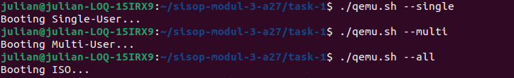

- Opsi
  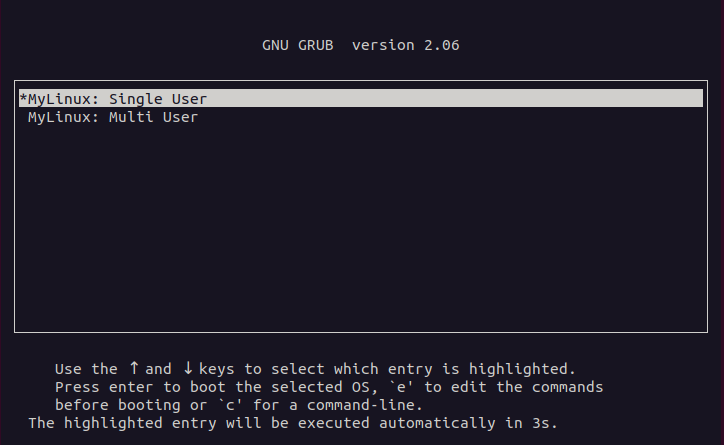

- Single User
  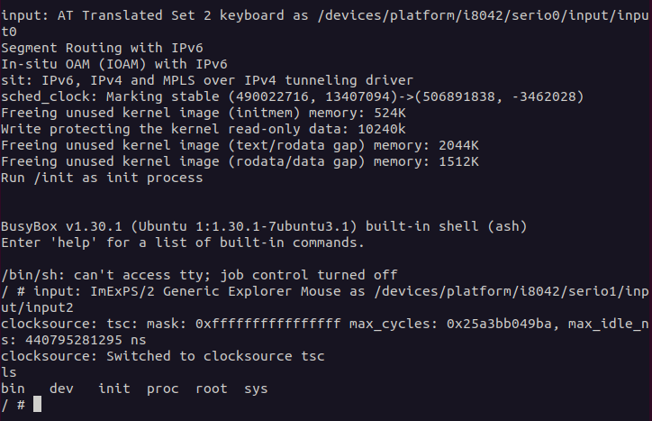

- Multi User : Root
  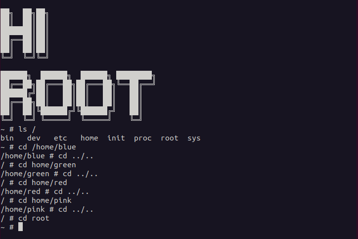

- Multi User : Blue
  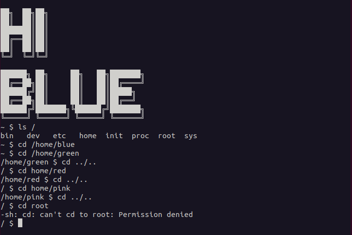

- Multi User : Green
  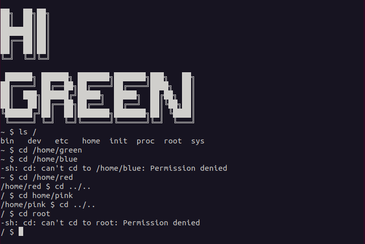

- Multi User : Red
  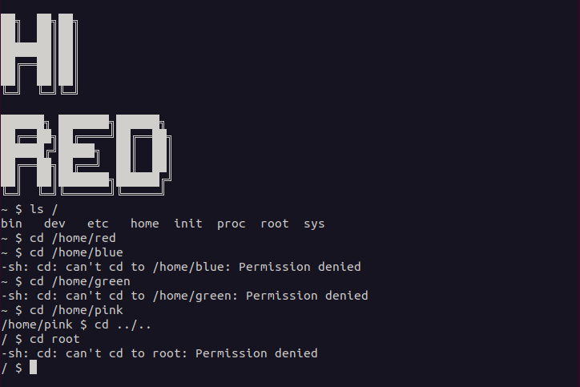

- Multi User : Pink
  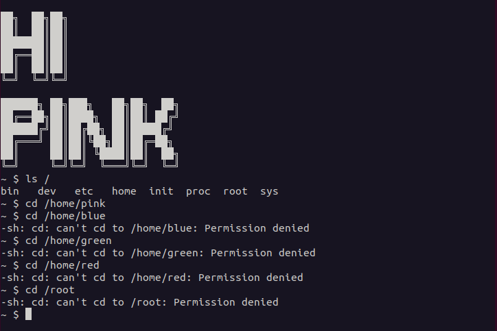

### Kode Penuh _(Full Code)_
Masukkan kode lengkap yang digunakan untuk menyelesaikan bagian ini.  
_Insert the full source code used to solve this section._

```bash
#!/bin/bash

if [ "$1" == "--single" ]; 
then
    echo "Booting Single-User..."
    qemu-system-x86_64 \
      -smp 2 \
      -m 256 \
      -display curses \
      -vga std \
      -kernel osboot/bzImage \
      -initrd osboot/single.gz 

elif [ "$1" == "--multi" ];
then
    echo "Booting Multi-User..."
    qemu-system-x86_64 \
      -smp 2 \
      -m 256 \
      -display curses \
      -vga std \
      -kernel osboot/bzImage \
      -initrd osboot/multi.gz 

elif [ "$1" == "--all" ];
then
    echo "Booting ISO..."
    qemu-system-x86_64 \
      -smp 2 \
      -m 256 \
      -display curses \
      -vga std \
      -cdrom osboot/mylinux.iso
fi
```

## F. Langkah-langkah & Potongan Kode, Screenshot, Kode Penuh  
_(Steps & Code Snippets, Screenshot, Full Code)_

### Langkah-langkah & Potongan Kode _(Steps & Code Snippets)_
Jelaskan langkah-langkah yang dilakukan dan berikan potongan kode dari langkah-langkah yang kalian jelaskan jika ada.  
_Explain the steps performed and include relevant code snippets from the steps you describe if applicable._

1. Membuka file backup.sh

2. Mengawali script dengan shebang
    ```bash
    #!/bin/bash
    ```

3. Membuat timestamp
    ```bash
    timestamp=$(date +%d%m%Y_%H%M%S)
    ```

4. Membuat file backup (arsip zip)
    ```bash
    zip -q osboot/backup_$timestamp.zip \
        osboot/bzImage \
        osboot/single.gz \
        osboot/multi.gz \
        osboot/mylinux.iso
    ```

5. Menampilkan output
    ```bash
    echo "backup_$timestamp.zip"
    ```

### Screenshot _(Screenshot)_
Masukkan screenshot hasil eksekusi program atau proses yang relevan.  
_Insert screenshots of program execution results or other relevant processes._

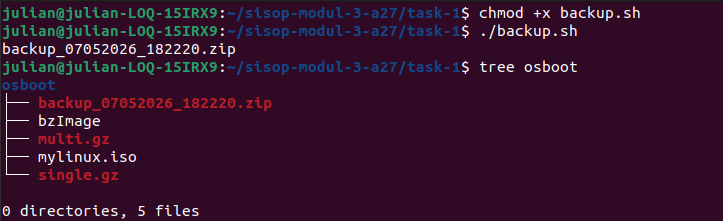

### Kode Penuh _(Full Code)_
Masukkan kode lengkap yang digunakan untuk menyelesaikan bagian ini.  
_Insert the full source code used to solve this section._

```bash
#!/bin/bash

timestamp=$(date +%d%m%Y_%H%M%S)

zip -q osboot/backup_$timestamp.zip \
    osboot/bzImage \
    osboot/single.gz \
    osboot/multi.gz \
    osboot/mylinux.iso

echo "backup_$timestamp.zip"
```

---

# Task 2 - SentinelOS

## A. Langkah-langkah & Potongan Kode, Screenshot, Kode Penuh  
_(Steps & Code Snippets, Screenshot, Full Code)_

### Langkah-langkah & Potongan Kode _(Steps & Code Snippets)_
Jelaskan langkah-langkah yang dilakukan dan berikan potongan kode dari langkah-langkah yang kalian jelaskan jika ada.  
_Explain the steps performed and include relevant code snippets from the steps you describe if applicable._

1. Mengunduh sumber kernel

    Kernel versi 6.1.1 diunduh melalui situs resmi kernel.org menggunakan perintah wget.

    ```bash
    wget https://cdn.kernel.org/pub/linux/kernel/v6.x/linux-6.1.1.tar.xz
    ```

2. Mengekstrak arsip kernel

    File yang diunduh (mempunyai ekstensi .tar.xz), diekstrak dengan perintah "tar".

    ```bash
    tar -xf linux-6.1.1.tar.xz
    ```

3. Masuk ke direktori sumber kernel

    Melakukan seluruh proses konfigurasi dan kompilasi di dalam folder hasil ekstraksi.

    ```bash
    cd linux-6.1.1
    ```

4. Membuat konfigurasi dasar

    Dengan target "defconfig", konfigurasi default untuk arsitektur x86_64 didapatkan.

    ```bash
    make defconfig
    ```

5. Mengaktifkan fitur-fitur yang diperlukan

    Skrip scripts/config digunakan untuk mengaktifkan opsi-opsi berikut tanpa harus mengedit file .config secara manual.
    - CONFIG_MULTIUSER -> dukungan multiuser
    - CONFIG_BINFMT_SCRIPT -> dukungan eksekusi skrip (#!)
    - CONFIG_SERIAL_8250_CONSOLE -> dukungan konsol serial

    ```bash
    scripts/config --enable CONFIG_MULTIUSER
    scripts/config --enable CONFIG_BINFMT_SCRIPT
    scripts/config --enable CONFIG_SERIAL_8250_CONSOLE
    ```

6. Menonaktifkan opsi WERROR

    Opsi CONFIG_WERROR dinonaktifkan agar peringatan dari kompiler tidak menghentikan proses kompilasi.

    ```bash
    scripts/config --disable CONFIG_WERROR
    make olddefconfig
    ```

7. Mengompilasi kernel (hanya bzImage)

    Kompilasi dilakukan dengan menggunakan semua inti CPU (-j$(nproc)) untuk mempercepat proses. Target bzImage akan menghasilkan file kernel yang siap boot. Kompilasi dilakukan dengan memanfaatkan semua inti prosesor dan mengabaikan peringatan terkait format string.

    ```bash
    make KCFLAGS="-Wno-error=format" -j$(nproc) bzImage
    ```

8. Memeriksa hasil kompilasi

    File bzImage yang dihasilkan akan terlihat di arch/x86/boot/bzImage. Dapat dicek melalui perintah:

    ```bash
    ls -lh arch/x86/boot/bzImage
    file arch/x86/boot/bzImage
    ```

### Screenshot _(Screenshot)_
Masukkan screenshot hasil eksekusi program atau proses yang relevan.  
_Insert screenshots of program execution results or other relevant processes._

- "bzImage is ready"
  

- ls -lh arch/x86/boot/bzImage
  

### Kode Penuh _(Full Code)_
Masukkan kode lengkap yang digunakan untuk menyelesaikan bagian ini.  
_Insert the full source code used to solve this section._

```bash
wget https://cdn.kernel.org/pub/linux/kernel/v6.x/linux-6.1.1.tar.xz
tar -xf linux-6.1.1.tar.xz
cd linux-6.1.1
make defconfig
scripts/config --enable CONFIG_MULTIUSER
scripts/config --enable CONFIG_BINFMT_SCRIPT
scripts/config --enable CONFIG_SERIAL_8250_CONSOLE
scripts/config --disable CONFIG_WERROR
make olddefconfig
make KCFLAGS="-Wno-error=format" -j$(nproc) bzImage
ls -lh arch/x86/boot/bzImage
file arch/x86/boot/bzImage
```

## B. Langkah-langkah & Potongan Kode, Screenshot, Kode Penuh  
_(Steps & Code Snippets, Screenshot, Full Code)_

### Langkah-langkah & Potongan Kode _(Steps & Code Snippets)_
Jelaskan langkah-langkah yang dilakukan dan berikan potongan kode dari langkah-langkah yang kalian jelaskan jika ada.  
_Explain the steps performed and include relevant code snippets from the steps you describe if applicable._

1. Membuat struktur direktori rootfs
    ```bash
    mkdir -p ~/rootfs/{bin,dev,etc,proc,sys,tmp,vault,watch,log,home/guardian,home/observer,root}
    ```

2. Melakukan pengunduhan untuk BusyBox

    Mengunduh berkas sumber BusyBox versi 1.36.1 dari situs resmi.

    ```bash
    wget https://busybox.net/downloads/busybox-1.36.1.tar.bz2
    ```

3. Mengekstrak BusyBox

    Melakukan ekstrak untuk berkas yang telah diunduh.

    ```bash
    tar -xjf busybox-1.36.1.tar.bz2
    ```

4. Masuk ke dalam direktori sumber BusyBox
    ```bash
    cd busybox-1.36.1
    ```

5. Mengonfigurasi BusyBox

    Menggunakan konfigurasi dasar.

    ```bash
    make defconfig
    ```

6. Mengaktifkan kompilasi statis

    Karena scripts/config tidak tersedia pada BusyBox, opsi CONFIG_STATIC diaktifkan dengan mengedit berkas .config menggunakan sed.

    ```bash
    sed -i 's/# CONFIG_STATIC is not set/CONFIG_STATIC=y/' .config
    ```

7. Menonaktifkan fitur TC (Traffic Control)

    Fitur TC dinonaktifkan untuk menghindari error kompilasi.

    ```bash
    sed -i 's/CONFIG_TC=y/# CONFIG_TC is not set/' .config
    ```

8. Mengompilasi BusyBox
    ```bash
    make -j$(nproc)
    ```

9. Memasang BusyBox ke dalam rootfs

    Menginstal semua biner BusyBox ke dalam direktori ~/rootfs.

    ```bash
    make CONFIG_PREFIX=~/rootfs install
    ```

10. Kembali ke direktori home
    ```bash
    cd ~
    ```

11. Membuat berkas notifikasi /log/NOTICE

    Membuat berkas NOTICE ke dalam direktori log dengan isi bebas -> contoh : mencatat waktu penyelesaian.

    ```bash
    echo "SentinelOS rootfs selesai pada $(date)" > ~/rootfs/log/NOTICE
    ```

12. Verifikasi hasil

    Memeriksa struktur direktori dan keberadaan berkas NOTICE.

    ```bash
    ls ~/rootfs/
    ls ~/rootfs/log/
    cat ~/rootfs/log/NOTICE
    ls ~/rootfs/bin/busybox
    file ~/rootfs/bin/busybox
    ```

    dan

    ```bash
    tree ~/rootfs -L 2
    ```

### Screenshot _(Screenshot)_
Masukkan screenshot hasil eksekusi program atau proses yang relevan.  
_Insert screenshots of program execution results or other relevant processes._


### Kode Penuh _(Full Code)_
Masukkan kode lengkap yang digunakan untuk menyelesaikan bagian ini.  
_Insert the full source code used to solve this section._

```bash
mkdir -p ~/rootfs/{bin,dev,etc,proc,sys,tmp,vault,watch,log,home/guardian,home/observer,root}
wget https://busybox.net/downloads/busybox-1.36.1.tar.bz2
tar -xjf busybox-1.36.1.tar.bz2
cd busybox-1.36.1
make defconfig
sed -i 's/# CONFIG_STATIC is not set/CONFIG_STATIC=y/' .config
sed -i 's/CONFIG_TC=y/# CONFIG_TC is not set/' .config
make -j$(nproc)
make CONFIG_PREFIX=~/rootfs install
cd ~
echo "SentinelOS rootfs selesai $(date)" > ~/rootfs/log/NOTICE
```

## C. Langkah-langkah & Potongan Kode, Screenshot, Kode Penuh  
_(Steps & Code Snippets, Screenshot, Full Code)_

### Langkah-langkah & Potongan Kode _(Steps & Code Snippets)_
Jelaskan langkah-langkah yang dilakukan dan berikan potongan kode dari langkah-langkah yang kalian jelaskan jika ada.  
_Explain the steps performed and include relevant code snippets from the steps you describe if applicable._

1. Masuk ke dalam home directory
    ```bash
    cd ~
    ```

2. Menginstall utilitas "mkpasswd"
    ```bash
    sudo apt update
    sudo apt install whois -y
    ```

3. Melakukan generate hash password MD5 untuk ketiga user

    Hash dihasilkan menggunakan perintah mkpasswd -m md5 diikuti password masing-masing.

    ```bash
    HASH_ROOT=$(mkpasswd -m md5 SkyLord)
    HASH_GUARDIAN=$(mkpasswd -m md5 Guard123)
    HASH_OBSERVER=$(mkpasswd -m md5 EyeOpen)
    ```

4. Membuat file /etc/passwd

    Berkas ini berisi data akun pengguna tanpa password (disimpan di shadow).

    ```bash
    cat > ~/rootfs/etc/passwd << EOF
    root:x:0:0:root:/root:/bin/sh
    guardian:x:1000:1000:Guardian:/home/guardian:/bin/sh
    observer:x:1001:1001:Observer:/home/observer:/bin/sh
    EOF
    ```

5. Membuat file /etc/shadow

    Berkas ini menyimpan hash password yang telah dihasilkan.

    ```bash
    cat > ~/rootfs/etc/shadow << EOF
    root:${HASH_ROOT}:19000:0:99999:7:::
    guardian:${HASH_GUARDIAN}:19000:0:99999:7:::
    observer:${HASH_OBSERVER}:19000:0:99999:7:::
    EOF
    ```

6. Membuat file /etc/group

    Berkas ini mendefinisikan grup untuk setiap pengguna.

    ```bash
    cat > ~/rootfs/etc/group << EOF
    root:x:0:
    guardian:x:1000:
    observer:x:1001:
    EOF
    ```

7. Melakukan set permission direktori sesuai role

    Set owner dan permission secara statis karena direktori masih dalam rootfs (belum running).
    - Direktori /vault hanya dapat diakses oleh root (UID 0, permission 700)
    - Direktori /watch dan /home/guardian hanya dapat diakses oleh guardian (UID 1000, permission 700)
    - Direktori /home/observer hanya dapat diakses oleh observer (UID 1001, permission 700)

    ```bash
    sudo chown 0:0 ~/rootfs/vault
    sudo chmod 700 ~/rootfs/vault

    sudo chown 1000:1000 ~/rootfs/watch
    sudo chmod 700 ~/rootfs/watch

    sudo chown 1000:1000 ~/rootfs/home/guardian
    sudo chmod 700 ~/rootfs/home/guardian

    sudo chown 1001:1001 ~/rootfs/home/observer
    sudo chmod 700 ~/rootfs/home/observer
    ```

    Sudo digunakan karena mengubah kepemilikan memerlukan hak root.

8. Memperbarui folder osboot
    ```bash
    cp -r ~/rootfs ~/osboot/
    ```

### Screenshot _(Screenshot)_
Masukkan screenshot hasil eksekusi program atau proses yang relevan.  
_Insert screenshots of program execution results or other relevant processes._

- 

- Hash password
  

- Isi file /etc/passwd dan /etc/shadow
  

- Permission direktori sesuai role
  

### Kode Penuh _(Full Code)_
Masukkan kode lengkap yang digunakan untuk menyelesaikan bagian ini.  
_Insert the full source code used to solve this section._

```bash
cd ~
sudo apt update
sudo apt install whois -y

HASH_ROOT=$(mkpasswd -m md5 SkyLord)
HASH_GUARDIAN=$(mkpasswd -m md5 Guard123)
HASH_OBSERVER=$(mkpasswd -m md5 EyeOpen)

cat > ~/rootfs/etc/passwd << EOF
root:x:0:0:root:/root:/bin/sh
guardian:x:1000:1000:Guardian:/home/guardian:/bin/sh
observer:x:1001:1001:Observer:/home/observer:/bin/sh
EOF

cat > ~/rootfs/etc/shadow << EOF
root:${HASH_ROOT}:19000:0:99999:7:::
guardian:${HASH_GUARDIAN}:19000:0:99999:7:::
observer:${HASH_OBSERVER}:19000:0:99999:7:::
EOF

cat > ~/rootfs/etc/group << EOF
root:x:0:
guardian:x:1000:
observer:x:1001:
EOF

sudo chown 0:0 ~/rootfs/vault
sudo chmod 700 ~/rootfs/vault

sudo chown 1000:1000 ~/rootfs/watch
sudo chmod 700 ~/rootfs/watch

sudo chown 1000:1000 ~/rootfs/home/guardian
sudo chmod 700 ~/rootfs/home/guardian

sudo chown 1001:1001 ~/rootfs/home/observer
sudo chmod 700 ~/rootfs/home/observer

cp -r ~/rootfs ~/osboot/
```

## D. Langkah-langkah & Potongan Kode, Screenshot, Kode Penuh  
_(Steps & Code Snippets, Screenshot, Full Code)_

### Langkah-langkah & Potongan Kode _(Steps & Code Snippets)_
Jelaskan langkah-langkah yang dilakukan dan berikan potongan kode dari langkah-langkah yang kalian jelaskan jika ada.  
_Explain the steps performed and include relevant code snippets from the steps you describe if applicable._

1. Memastikan bahwa sekarang berada di home, kemudian memperbaiki kepemilikan rootfs
    ```bash
    cd ~
    sudo chown -R ubuntu:ubuntu rootfs
    chmod -R 755 rootfs
    ```

2. Membuat device node /dev/console dan /dev/null
    ```bash
    mkdir -p rootfs/dev
    sudo mknod -m 622 rootfs/dev/console c 5 1 2>/dev/null
    sudo mknod -m 666 rootfs/dev/null c 1 3 2>/dev/null
    ```

3. Membuat file init dengan loop login agar setelah logout kembali ke prompt login

    File init akan dieksekusi pertama kali oleh kernel. Script ini mount filesystem dan menjalankan login.

    ```bash
    cat > rootfs/init << 'EOF'
    #!/bin/sh
    /bin/mount -t proc none /proc
    /bin/mount -t sysfs none /sys
    /bin/mount -t devtmpfs devtmpfs /dev
    echo "========================================="
    echo "     Selamat datang di SentinelOS        "
    echo "========================================="
    while true; do
        /bin/login
    done
    EOF
    chmod 755 rootfs/init
    ```

4. Membuat file /etc/profile untuk custom prompt

    Warna hijau untuk user@host, biru untuk path, reset di akhir.

    ```bash
    cat > rootfs/etc/profile << 'EOF'
    export PS1='\[\e[32m\]\u@\h\[\e[34m\]:\w\$ \[\e[0m\]'
    EOF
    ```

5. Membuat file /etc/hostname (tambahan agar prompt menunjukkan hostname)
    ```bash
    echo "SentinelOS" > ~/rootfs/etc/hostname
    ```

6. Mengemas rootfs menjadi initramfs (rootfs.cpio.gz)
    ```bash
    cd rootfs
    find . -print | cpio -o -H newc | gzip > ~/rootfs.cpio.gz
    cd ~
    ```

7. Menjalankan QEMU untuk uji boot

    Memastikan bahwa file bzImage di folder kernel dan rootfs.cpio.gz sudah ada.

    ```bash
    qemu-system-x86_64 -kernel ~/linux-6.1.1/arch/x86/boot/bzImage \
                       -initrd ~/rootfs.cpio.gz \
                       -append "console=tty0" \
                       -m 512
    ```

8. Saat QEMU berjalan

    Kondisi:
    - Akan muncul prompt login
    - Coba login dengan salah satu user yang sudah ditentukan sebelumnya:
        1. root password SkyLord
        2. guardian password Guard123
        3. observer password EyeOpen
    - Setelah login, periksa prompt: harus berwarna hijau (user@host) dan biru (path)
    - Ketik exit untuk logout, lalu bisa login lagi

9. Keluar dari QEMU

    Tekan ctrl+c.

### Screenshot _(Screenshot)_
Masukkan screenshot hasil eksekusi program atau proses yang relevan.  
_Insert screenshots of program execution results or other relevant processes._


### Kode Penuh _(Full Code)_
Masukkan kode lengkap yang digunakan untuk menyelesaikan bagian ini.  
_Insert the full source code used to solve this section._

```bash
cd ~
sudo chown -R ubuntu:ubuntu rootfs
chmod -R 755 rootfs
mkdir -p rootfs/dev
sudo mknod -m 622 rootfs/dev/console c 5 1 2>/dev/null
sudo mknod -m 666 rootfs/dev/null c 1 3 2>/dev/null
cat > rootfs/init << 'EOF'
#!/bin/sh
/bin/mount -t proc none /proc
/bin/mount -t sysfs none /sys
/bin/mount -t devtmpfs devtmpfs /dev
echo "========================================="
echo "     Selamat datang di SentinelOS        "
echo "========================================="
while true; do
    /bin/login
done
EOF
chmod 755 rootfs/init
cat > rootfs/etc/profile << 'EOF'
export PS1='\[\e[32m\]\u@\h\[\e[34m\]:\w\$ \[\e[0m\]'
EOF
echo "SentinelOS" > rootfs/etc/hostname
cd rootfs
find . -print | cpio -o -H newc | gzip > ~/rootfs.cpio.gz
cd ~
qemu-system-x86_64 -kernel ~/linux-6.1.1/arch/x86/boot/bzImage -initrd ~/rootfs.cpio.gz -append "console=tty0" -m 512
```

## E. Langkah-langkah & Potongan Kode, Screenshot, Kode Penuh  
_(Steps & Code Snippets, Screenshot, Full Code)_

### Langkah-langkah & Potongan Kode _(Steps & Code Snippets)_
Jelaskan langkah-langkah yang dilakukan dan berikan potongan kode dari langkah-langkah yang kalian jelaskan jika ada.  
_Explain the steps performed and include relevant code snippets from the steps you describe if applicable._

1. Membuat struktur direktori untuk ISO

    Direktori ~/iso/boot/grub akan menjadi tempat menyimpan kernel, initramfs, dan konfigurasi GRUB.

    ```bash
    mkdir -p ~/iso/boot/grub
    ```

2. Menyalin kernel dan initramfs ke dalam direktori ISO

    Kernel (bzImage) diubah namanya menjadi vmlinuz dan initramfs (rootfs.cpio.gz) menjadi initrd.img untuk memenuhi standar GRUB.

    ```bash
    cp ~/linux-6.1.1/arch/x86/boot/bzImage ~/iso/boot/vmlinuz
    cp ~/rootfs.cpio.gz ~/iso/boot/initrd.img
    ```

3. Membuat file konfigurasi GRUB (grub.cfg)

    Konfigurasi ini mendefinisikan tiga menu: Mode 1 (hijau), Mode 2 (biru), Mode 3 (merah). Setiap menu menambahkan parameter mode pada baris linux.

    ```bash
    cat > ~/iso/boot/grub/grub.cfg << 'EOF'
    set default=0
    set timeout=10
    menuentry "SentinelOS - Mode 1 (Hijau)" {
        linux /boot/vmlinuz console=tty0 mode=1
        initrd /boot/initrd.img
    }
    menuentry "SentinelOS - Mode 2 (Biru)" {
        linux /boot/vmlinuz console=tty0 mode=2
        initrd /boot/initrd.img
    }
    menuentry "SentinelOS - Mode 3 (Merah)" {
        linux /boot/vmlinuz console=tty0 mode=3
        initrd /boot/initrd.img
    }
    EOF
    ```

4. Memodifikasi init script di dalam rootfs agar dapat membaca parameter mode dan mengubah warna prompt

    - Membuat direktori /etc/profile.d untuk menyimpan skrip prompt dinamis
    - Mengubah file init dengan tambahan kode untuk membaca /proc/cmdline, menentukan warna berdasarkan mode, dan menulis file prompt.sh ke /etc/profile.d
    - Mengubah file /etc/profile agar menjalankan semua skrip di /etc/profile.d

    ```bash
    mkdir -p ~/rootfs/etc/profile.d

    cat > ~/rootfs/init << 'EOF'
    #!/bin/sh
    /bin/mount -t proc none /proc
    /bin/mount -t sysfs none /sys
    /bin/mount -t devtmpfs devtmpfs /dev

    MODE="1"
    for arg in $(cat /proc/cmdline); do
        case $arg in
            mode=1) MODE="1" ;;
            mode=2) MODE="2" ;;
            mode=3) MODE="3" ;;
        esac
    done

    case $MODE in
        1) COLOR1="32" COLOR2="32" ;;
        2) COLOR1="34" COLOR2="34" ;;
        3) COLOR1="31" COLOR2="31" ;;
        *) COLOR1="32" COLOR2="32" ;;
    esac

    echo "export PS1='\[\e[${COLOR1}m\]\u@\h\[\e[${COLOR2}m\]:\w\$ \[\e[0m\]'" > /etc/profile.d/prompt.sh

    echo "========================================="
    echo "     Selamat datang di SentinelOS        "
    echo "     Mode : ${MODE}                      "
    echo "========================================="

    while true; do
        /bin/login
    done
    EOF

    chmod 755 ~/rootfs/init

    cat > ~/rootfs/etc/profile << 'EOF'
    if [ -d /etc/profile.d ]; then
        for i in /etc/profile.d/*.sh; do
            if [ -r $i ]; then
                . $i
            fi
        done
    fi
    EOF
    ```

5. Mengemas ulang initramfs dan menyalinnya ke direktori ISO
    ```bash
    cd ~/rootfs
    find . | cpio -o -H newc | gzip > ~/rootfs.cpio.gz
    cp ~/rootfs.cpio.gz ~/iso/boot/initrd.img
    cd ~
    ```

6. Memasang paket yang diperlukan untuk membuat ISO (jika belum ada)

    Paket grub-pc-bin, grub-efi-amd64-bin, dan xorriso diperlukan oleh grub-mkrescue.

    ```bash
    sudo apt update
    sudo apt install grub-pc-bin grub-efi-amd64-bin xorriso -y
    ```

7. Membuat berkas ISO menggunakan grub-mkrescue
    ```bash
    grub-mkrescue -o ~/SentinelOS.iso ~/iso
    ```

8. Menguji ISO dengan QEMU

    Menjalankan QEMU dengan mode CD-ROM untuk memastikan menu GRUB muncul dan warna prompt berubah sesuai mode yang dipilih.

    ```bash
    qemu-system-x86_64 -cdrom ~/SentinelOS.iso -m 512 -boot d
    ```

### Screenshot _(Screenshot)_
Masukkan screenshot hasil eksekusi program atau proses yang relevan.  
_Insert screenshots of program execution results or other relevant processes._

- 

- 

- 

- 

### Kode Penuh _(Full Code)_
Masukkan kode lengkap yang digunakan untuk menyelesaikan bagian ini.  
_Insert the full source code used to solve this section._

```bash
mkdir -p ~/iso/boot/grub
cp ~/linux-6.1.1/arch/x86/boot/bzImage ~/iso/boot/vmlinuz
cp ~/rootfs.cpio.gz ~/iso/boot/initrd.img

cat > ~/iso/boot/grub/grub.cfg << 'EOF'
set default=0
set timeout=10
menuentry "SentinelOS - Mode 1 (Hijau)" {
    linux /boot/vmlinuz console=tty0 mode=1
    initrd /boot/initrd.img
}
menuentry "SentinelOS - Mode 2 (Biru)" {
    linux /boot/vmlinuz console=tty0 mode=2
    initrd /boot/initrd.img
}
menuentry "SentinelOS - Mode 3 (Merah)" {
    linux /boot/vmlinuz console=tty0 mode=3
    initrd /boot/initrd.img
}
EOF

mkdir -p ~/rootfs/etc/profile.d

cat > ~/rootfs/init << 'EOF'
#!/bin/sh
/bin/mount -t proc none /proc
/bin/mount -t sysfs none /sys
/bin/mount -t devtmpfs devtmpfs /dev

MODE="1"
for arg in $(cat /proc/cmdline); do
    case $arg in
        mode=1) MODE="1" ;;
        mode=2) MODE="2" ;;
        mode=3) MODE="3" ;;
    esac
done

case $MODE in
    1) COLOR1="32" COLOR2="32" ;;
    2) COLOR1="34" COLOR2="34" ;;
    3) COLOR1="31" COLOR2="31" ;;
    *) COLOR1="32" COLOR2="32" ;;
esac

echo "export PS1='\[\e[${COLOR1}m\]\u@\h\[\e[${COLOR2}m\]:\w\$ \[\e[0m\]'" > /etc/profile.d/prompt.sh

echo "========================================="
echo "     Selamat datang di SentinelOS        "
echo "     Mode : ${MODE}                      "
echo "========================================="

while true; do
    /bin/login
done
EOF

chmod 755 ~/rootfs/init

cat > ~/rootfs/etc/profile << 'EOF'
if [ -d /etc/profile.d ]; then
    for i in /etc/profile.d/*.sh; do
        if [ -r $i ]; then
            . $i
        fi
    done
fi
EOF

cd ~/rootfs
find . | cpio -o -H newc | gzip > ~/rootfs.cpio.gz
cp ~/rootfs.cpio.gz ~/iso/boot/initrd.img
cd ~

sudo apt update
sudo apt install grub-pc-bin grub-efi-amd64-bin xorriso -y
grub-mkrescue -o ~/SentinelOS.iso ~/iso

qemu-system-x86_64 -cdrom ~/SentinelOS.iso -m 512 -boot d
```

## F. Langkah-langkah & Potongan Kode, Screenshot, Kode Penuh  
_(Steps & Code Snippets, Screenshot, Full Code)_

### Langkah-langkah & Potongan Kode _(Steps & Code Snippets)_
Jelaskan langkah-langkah yang dilakukan dan berikan potongan kode dari langkah-langkah yang kalian jelaskan jika ada.  
_Explain the steps performed and include relevant code snippets from the steps you describe if applicable._

1. Membuat file script sysinfo di dalam ~/rootfs/bin

    Menggunakan perintah cat dengan heredoc untuk membuat script. Script akan memanfaatkan perintah-perintah yang tersedia di BusyBox (hostname, date, uptime, who, ps) serta membaca /proc/meminfo untuk mendapatkan sisa memori (karena free tidak selalu tersedia).

    ```bash
    cat > ~/rootfs/bin/sysinfo << 'EOF'
    #!/bin/sh
    echo "================================"
    echo "       SentinelOS System Info   "
    echo "================================"
    echo "Hostname        : $(cat /etc/hostname 2>/dev/null || hostname)"
    echo "Tanggal & Waktu : $(date)"
    echo "Uptime          : $(uptime | awk -F 'up ' '{print $2}' | awk -F ',' '{print $1}')"
    echo ""
    echo "User yang login:"
    who | while read line; do
        user=$(echo $line | awk '{print $1}')
        home=$(grep "^$user:" /etc/passwd | cut -d: -f6)
        if [ -z "$home" ]; then
            home=$(eval echo ~$user)
        fi
        echo "  - $user (home: $home)"
    done
    echo ""
    echo "Jumlah proses   : $(ps -e | wc -l)"
    MemFree=$(grep MemFree /proc/meminfo | awk '{print $2}')
    MemFreeMB=$((MemFree / 1024))
    echo "Sisa memori     : ${MemFreeMB} MB"
    echo "================================"
    EOF
    ```

2. Memberikan hak eksekusi pada script

    Script harus dapat dijalankan oleh semua user, sehingga permission diatur menjadi 755.

    ```bash
    chmod 755 ~/rootfs/bin/sysinfo
    ```

3. Mengemas ulang initramfs agar script tersimpan
    ```bash
    cd ~/rootfs
    find . | cpio -o -H newc | gzip > ~/rootfs.cpio.gz
    cd ~
    ```

4. Memperbarui ISO

    Agar perubahan tercakup dalam ISO bootable, salin initramfs baru ke direktori ISO dan rebuild ISO.

    ```bash
    cp ~/rootfs.cpio.gz ~/iso/boot/initrd.img
    grub-mkrescue -o ~/SentinelOS.iso ~/iso
    ```

5. Menguji script dengan QEMU

    Boot ISO, login sebagai salah satu user (misal root), lalu jalankan perintah sysinfo.

    ```bash
    qemu-system-x86_64 -cdrom ~/SentinelOS.iso -m 512 -boot d
    ```

    Di dalam QEMU, setelah login, ketik:

    ```bash
    sysinfo
    ```

### Screenshot _(Screenshot)_
Masukkan screenshot hasil eksekusi program atau proses yang relevan.  
_Insert screenshots of program execution results or other relevant processes._


### Kode Penuh _(Full Code)_
Masukkan kode lengkap yang digunakan untuk menyelesaikan bagian ini.  
_Insert the full source code used to solve this section._

```bash
cat > ~/rootfs/bin/sysinfo << 'EOF'
#!/bin/sh
echo "================================"
echo "       SentinelOS System Info   "
echo "================================"
echo "Hostname        : $(cat /etc/hostname 2>/dev/null || hostname)"
echo "Tanggal & Waktu : $(date)"
echo "Uptime          : $(uptime | awk -F 'up ' '{print $2}' | awk -F ',' '{print $1}')"
echo ""
echo "User yang login:"
who | while read line; do
    user=$(echo $line | awk '{print $1}')
    home=$(grep "^$user:" /etc/passwd | cut -d: -f6)
    if [ -z "$home" ]; then
        home=$(eval echo ~$user)
    fi
    echo "  - $user (home: $home)"
done
echo ""
echo "Jumlah proses   : $(ps -e | wc -l)"
MemFree=$(grep MemFree /proc/meminfo | awk '{print $2}')
MemFreeMB=$((MemFree / 1024))
echo "Sisa memori     : ${MemFreeMB} MB"
echo "================================"
EOF
chmod 755 ~/rootfs/bin/sysinfo
cd ~/rootfs
find . | cpio -o -H newc | gzip > ~/rootfs.cpio.gz
cd ~
cp ~/rootfs.cpio.gz ~/iso/boot/initrd.img
grub-mkrescue -o ~/SentinelOS.iso ~/iso
qemu-system-x86_64 -cdrom ~/SentinelOS.iso -m 512 -boot d
```

---

# Task 3 - Project V-Protocol: HSS Recovery

## A. Langkah-langkah & Potongan Kode, Screenshot, Kode Penuh  
_(Steps & Code Snippets, Screenshot, Full Code)_

### Langkah-langkah & Potongan Kode _(Steps & Code Snippets)_
Jelaskan langkah-langkah yang dilakukan dan berikan potongan kode dari langkah-langkah yang kalian jelaskan jika ada.  
_Explain the steps performed and include relevant code snippets from the steps you describe if applicable._

1. Mengunduh source code kernel

    Mengunduh source code kernel _Linux versi 6.1.1_ dari situs resmi menggunakan perintah wget beserta argumen `--show-progress` untuk menampilkan bar unduhan.

    ```bash
    wget --show-progress https://cdn.kernel.org/pub/linux/kernel/v6.x/linux-6.1.1.tar.xz
    ```

2. Ekstraksi file dan berpindah direktori

    Mengekstrak file `tar.xz` yang telah diunduh, kemudian masuk ke dalam direktori hasil ekstraksi tersebut.

    ```bash
    tar -xf linux-6.1.1.tar.xz
    cd linux-6.1.1
    ```

3. Konfigurasi dan kompilasi kernel

    Melakukan konfigurasi default untuk arsitektur x86_64. Setelah itu, proses kompilasi dilakukan dengan target `bzImage` secara paralel menggunakan seluruh core CPU yang tersedia melalui perintah make `-j$(nproc)`.

    ```bash
    make x86_64_defconfig
    make -j$(nproc) bzImage
    ```

4. Pengamanan file dan pembersihan jejak

    Memindahkan hasil kompilasi bzImage ke direktori luar (utama) --> menghapus folder beserta file mentahan source code untuk membersihkan jejak.

    ```bash
    cd ..
    cp arch/x86/boot/bzImage ../
    rm -rf linux-6.1.1 linux-6.1.1.tar.xz
    ```

### Screenshot _(Screenshot)_
Masukkan screenshot hasil eksekusi program atau proses yang relevan.  
_Insert screenshots of program execution results or other relevant processes._

### Kode Penuh _(Full Code)_
Masukkan kode lengkap yang digunakan untuk menyelesaikan bagian ini.  
_Insert the full source code used to solve this section._

```bash
#!/bin/bash
wget --show-progress https://cdn.kernel.org/pub/linux/kernel/v6.x/linux-6.1.1.tar.xz

tar -xf linux-6.1.1.tar.xz
cd linux-6.1.1

make x86_64_defconfig

make -j$(nproc) bzImage

cd ..
cp arch/x86/boot/bzImage ../

rm -rf linux-6.1.1 linux-6.1.1.tar.xz
```

## B. Langkah-langkah & Potongan Kode, Screenshot, Kode Penuh  
_(Steps & Code Snippets, Screenshot, Full Code)_

### Langkah-langkah & Potongan Kode _(Steps & Code Snippets)_
Jelaskan langkah-langkah yang dilakukan dan berikan potongan kode dari langkah-langkah yang kalian jelaskan jika ada.  
_Explain the steps performed and include relevant code snippets from the steps you describe if applicable._

1. Mengunduh dan mengompilasi BusyBox

    Mengunduh source code _BusyBox versi 1.36.1_, mengekstrak, dan masuk ke direktorinya. Melakukan konfigurasi default dan menggunakan `sed` untuk mengubah konfigurasi agar di-compile secara statis. File biner kemudian diinstal ke direktori `../rootfs`.

    ```bash
    wget -q https://busybox.net/downloads/busybox-1.36.1.tar.bz2
    tar -xf busybox-1.36.1.tar.bz2
    cd busybox-1.36.1
    make defconfig
    sed -i 's/^.*CONFIG_STATIC.*/CONFIG_STATIC=y/' .config
    make -j$(nproc)
    make install CONFIG_PREFIX=../rootfs
    cd ..
    rm -rf busybox-1.36.1 busybox-1.36.1.tar.bz2
    ```

2. Membangun struktur rootfs dan setup kredensial user

    Masuk ke folder `rootfs` --> mengatur password untuk user root dan user nous di dalam `/etc/passwd` dan `/etc/shadow`.

    ```bash
    cd rootfs
    mkdir -p bin sbin etc proc sys usr/bin usr/sbin dev home/nous root etc/init.d
    echo "root:x:0:0:root:/root:/bin/sh" > etc/passwd
    echo "nous:x:1000:1000:Linux User,,,:/home/nous:/bin/sh" >> etc/passwd
    echo "root:*::0:99999:7:::" > etc/shadow
    echo "nous:\$1\$herta\$k9T8E3n0M4i8v.kP5Lg6Z.:19000:0:99999:7:::" >> etc/shadow
    ```

3. Membuat file rahasia Madame Herta

    Menulis kalimat rahasia ke dalam file `secret.txt` di direktori home milik user nous, lalu mengatur hak kepemilikannya.

    ```bash
    echo "Herta's Secret: Silver Wolf actually sucks at osu!" > home/nous/secret.txt
    chown -R 1000:1000 home/nous
    ```

4. Mengatur file inisialisasi dan deteksi mode booting

    Menyiapkan inittab dan rcS untuk proses boot. Membuat skrip init utama yang me-mount direktori dasar dan mendeteksi cmdline. Jika menemukan parameter single, maka akan menjalankan Emergency Mode dengan memunculkan banner sapaan dan akses `/bin/sh` langsung.

    ```bash
    cat << 'EOF' > init
    #!/bin/sh
    mount -t proc none /proc
    mount -t sysfs none /sys
    mount -t devtmpfs none /dev

    if grep -q "single" /proc/cmdline; then
        echo "HERTA STATION: EMERGENCY ACCESS MODE ACTIVATED."
        exec /bin/sh
    else
        exec /sbin/init
    fi
    EOF
    chmod +x init
    ```

5. Mengemas rootfs

    Menggunakan `find` dan `cpio` untuk mengemas isi direktori menjadi `rootfs.cpio`, lalu dikompresi menjadi `rootfs.cpio.gz`. Raw folder kemudian dihapus.

    ```bash
    find . | cpio -o -H newc > ../rootfs.cpio
    cd ..
    gzip -f rootfs.cpio
    rm -rf rootfs
    ```

### Screenshot _(Screenshot)_
Masukkan screenshot hasil eksekusi program atau proses yang relevan.  
_Insert screenshots of program execution results or other relevant processes._

### Kode Penuh _(Full Code)_
Masukkan kode lengkap yang digunakan untuk menyelesaikan bagian ini.  
_Insert the full source code used to solve this section._

```bash
#!/bin/bash
wget -q https://busybox.net/downloads/busybox-1.36.1.tar.bz2
tar -xf busybox-1.36.1.tar.bz2
cd busybox-1.36.1

make defconfig

sed -i 's/^.*CONFIG_STATIC.*/CONFIG_STATIC=y/' .config
make -j$(nproc)
make install CONFIG_PREFIX=../rootfs
cd ..
rm -rf busybox-1.36.1 busybox-1.36.1.tar.bz2

cd rootfs
mkdir -p bin sbin etc proc sys usr/bin usr/sbin dev home/nous root etc/init.d

echo "root:x:0:0:root:/root:/bin/sh" > etc/passwd
echo "nous:x:1000:1000:Linux User,,,:/home/nous:/bin/sh" >> etc/passwd
echo "root:*::0:99999:7:::" > etc/shadow
echo "nous:\$1\$herta\$k9T8E3n0M4i8v.kP5Lg6Z.:19000:0:99999:7:::" >> etc/shadow
chmod 600 etc/shadow

echo "root:x:0:" > etc/group
echo "nous:x:1000:" >> etc/group
echo "Herta's Secret: Silver Wolf actually sucks at osu!" > home/nous/secret.txt
chown -R 1000:1000 home/nous

cat << 'EOF' > etc/inittab
::sysinit:/etc/init.d/rcS
tty1::respawn:/sbin/getty -L tty1 115200 vt100
::ctrlaltdel:/sbin/reboot
EOF

cat << 'EOF' > etc/init.d/rcS
#!/bin/sh
hostname HSS
EOF
chmod +x etc/init.d/rcS

cat << 'EOF' > init
#!/bin/sh
mount -t proc none /proc
mount -t sysfs none /sys
mount -t devtmpfs none /dev

if grep -q "single" /proc/cmdline; then
    echo "HERTA STATION: EMERGENCY ACCESS MODE ACTIVATED."
    exec /bin/sh
else
    exec /sbin/init
fi
EOF
chmod +x init

find . | cpio -o -H newc > ../rootfs.cpio
cd ..
gzip -f rootfs.cpio
rm -rf rootfs
```

## C. Langkah-langkah & Potongan Kode, Screenshot, Kode Penuh  
_(Steps & Code Snippets, Screenshot, Full Code)_

### Langkah-langkah & Potongan Kode _(Steps & Code Snippets)_
Jelaskan langkah-langkah yang dilakukan dan berikan potongan kode dari langkah-langkah yang kalian jelaskan jika ada.  
_Explain the steps performed and include relevant code snippets from the steps you describe if applicable._

1. Menyiapkan struktur direktori bootloader

    Membuat folder `iso/boot/grub` untuk menyiapkan pembuatan file `.iso`. Kemudian menyalin bzImage (kernel) dan `rootfs.cpio.gz` (sistem operasi) ke dalam direktori `/boot/`.

    ```bash
    mkdir -p iso/boot/grub
    cp bzImage iso/boot/
    cp rootfs.cpio.gz iso/boot/
    ```

2. Mengonfigurasi menu booting GRUB

    Membuat file konfigurasi `grub.cfg`. Konfigurasi ini mendefinisikan dua pilihan. Menu Emergency Shell memberikan argumen single pada kernel untuk mengaktifkan akses Single Mode, sementara menu HSS Secure Login melakukan proses boot normal.

    ```bash
    cat << 'EOF' > iso/boot/grub/grub.cfg
    set timeout=5
    set default=1

    menuentry "Emergency Shell" {
        linux /boot/bzImage console=tty1 single
        initrd /boot/rootfs.cpio.gz
    }

    menuentry "HSS Secure Login" {
        linux /boot/bzImage console=tty1
        initrd /boot/rootfs.cpio.gz
    }
    EOF
    ```

3. Membuat file ISO dan pembersihan

    Membuat media bootable menggunakan perintah grub-mkrescue dan memberinya nama `aha.iso`. Setelah berhasil, folder `iso/` sementara dihapus.

    ```bash
    grub-mkrescue -o aha.iso iso
    rm -rf iso
    ```

### Screenshot _(Screenshot)_
Masukkan screenshot hasil eksekusi program atau proses yang relevan.  
_Insert screenshots of program execution results or other relevant processes._

### Kode Penuh _(Full Code)_
Masukkan kode lengkap yang digunakan untuk menyelesaikan bagian ini.  
_Insert the full source code used to solve this section._

```bash
#!/bin/bash
mkdir -p iso/boot/grub
cp bzImage iso/boot/
cp rootfs.cpio.gz iso/boot/

cat << 'EOF' > iso/boot/grub/grub.cfg
set timeout=5
set default=1

menuentry "Emergency Shell" {
    linux /boot/bzImage console=tty1 single
    initrd /boot/rootfs.cpio.gz
}

menuentry "HSS Secure Login" {
    linux /boot/bzImage console=tty1
    initrd /boot/rootfs.cpio.gz
}
EOF

grub-mkrescue -o aha.iso iso
rm -rf iso
```

## D. Langkah-langkah & Potongan Kode, Screenshot, Kode Penuh  
_(Steps & Code Snippets, Screenshot, Full Code)_

### Langkah-langkah & Potongan Kode _(Steps & Code Snippets)_
Jelaskan langkah-langkah yang dilakukan dan berikan potongan kode dari langkah-langkah yang kalian jelaskan jika ada.  
_Explain the steps performed and include relevant code snippets from the steps you describe if applicable._

1. Menjalankan uji coba lapangan dengan QEMU

    Melakukan pengujian media ISO yang telah di-build menggunakan emulator QEMU dengan mengalokasikan RAM 512M untuk mem-bypass protokol sistem.

    ```bash
    qemu-system-x86_64 -cdrom aha.iso -m 512M
    ```

2. Verifikasi Emergency Shell (single mode)

    Pada tampilan bootloader GRUB, pilih menu "Emergency Shell". Verifikasi berhasil dibuktikan dengan munculnya banner "HERTA STATION: EMERGENCY ACCESS MODE ACTIVATED." dan akses seketika ke root shell (/ #).

3. Verifikasi HSS Secure Login (multi mode)

    Melakukan restart pada QEMU dan masuk ke menu "HSS Secure Login". Verifikasi berhasil saat sistem meminta login. Masukkan username nous dan password nous123.

4. Mengakses rahasia Madame Herta

    Membuktikan bahwa direktori terlindungi dapat diakses dengan membuka isi file `secret.txt` milik nous melalui perintah cat.

    ```bash
    cat /home/nous/secret.txt
    ```

### Screenshot _(Screenshot)_
Masukkan screenshot hasil eksekusi program atau proses yang relevan.  
_Insert screenshots of program execution results or other relevant processes._

### Kode Penuh _(Full Code)_
Masukkan kode lengkap yang digunakan untuk menyelesaikan bagian ini.  
_Insert the full source code used to solve this section._

## E. Langkah-langkah & Potongan Kode, Screenshot, Kode Penuh  
_(Steps & Code Snippets, Screenshot, Full Code)_

### Langkah-langkah & Potongan Kode _(Steps & Code Snippets)_
Jelaskan langkah-langkah yang dilakukan dan berikan potongan kode dari langkah-langkah yang kalian jelaskan jika ada.  
_Explain the steps performed and include relevant code snippets from the steps you describe if applicable._

1. Pengarsipan komponen V-Protocol

    Menggunakan utilitas zip untuk membungkus `bzImage`, `rootfs.cpio.gz`, dan `aha.iso` ke dalam satu brankas digital utuh dengan nama `v_protocol_HSS.zip`.

    ```bash
    zip v_protocol_HSS.zip bzImage rootfs.cpio.gz aha.iso
    ```

2. Final wipe (pembersihan ekstrem berbasis logika ekstensi)

    Mengaktifkan fitur extended globbing di Bash menggunakan `shopt -s extglob`. Fitur ini memungkinkan pembersihan presisi dengan `rm -rf`, di mana sistem akan menghapus SELURUH isi direktori, KECUALI (!) beberapa skrip utama (kernel.sh, herta.sh, curioDisc.sh, save.sh) dan file arsipnya (v_protocol_HSS.zip).

    ```bash
    shopt -s extglob
    rm -rf !(kernel.sh|herta.sh|curioDisc.sh|save.sh|v_protocol_HSS.zip)
    ```

### Screenshot _(Screenshot)_
Masukkan screenshot hasil eksekusi program atau proses yang relevan.  
_Insert screenshots of program execution results or other relevant processes._

### Kode Penuh _(Full Code)_
Masukkan kode lengkap yang digunakan untuk menyelesaikan bagian ini.  
_Insert the full source code used to solve this section._

```bash
#!/bin/bash
zip v_protocol_HSS.zip bzImage rootfs.cpio.gz aha.iso

shopt -s extglob

rm -rf !(kernel.sh|herta.sh|curioDisc.sh|save.sh|v_protocol_HSS.zip)
```
