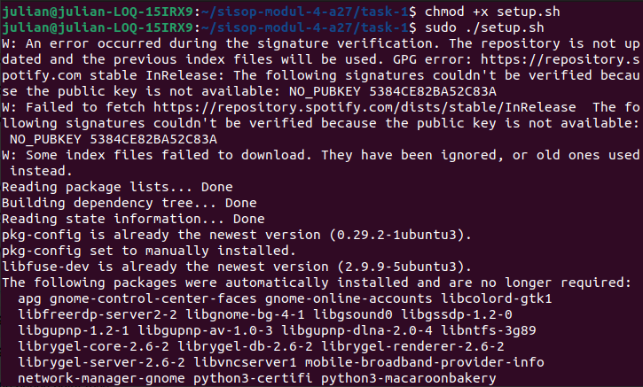
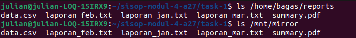
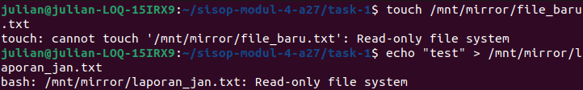
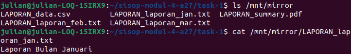
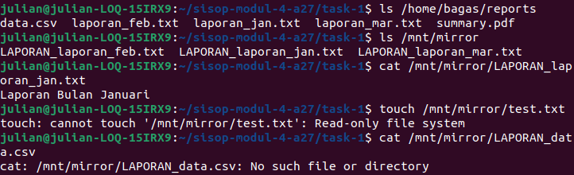

<div align=center>

|    NRP     |           Nama                     |
| :--------: |       :------------:               |
| 5025251028 | Julianda Caesar Prakoso            |
| 5025251045 | Khalisya Zahra Putria Rahman       |
| 5025251072 | Deborah Amalia Sheraviningrum      |

# Praktikum Modul 4 _(Module 4 Lab Work)_

</div>

### Daftar Soal _(Task List)_

- [Task 1 - MirrorFS](https://github.com/juliandacp/s1-sistem-operasi/tree/main/sisop-modul-4-a27/task-1/)

- [Task 2 - The Plagiarist's Trap](https://github.com/juliandacp/s1-sistem-operasi/tree/main/sisop-modul-4-a27/task-2/)

- [Task 3 - SumbulOS — The Piping Gauntlet](https://github.com/juliandacp/s1-sistem-operasi/tree/main/sisop-modul-4-a27/task-3/)

---

### Laporan Resmi Praktikum Modul 4 _(Module 4 Lab Work Report)_

Tulis laporan di template berikut!

_Write your lab work on the template here!_

---

# Task 1 - MirrorFS

## A. Langkah-langkah & Potongan Kode, Screenshot, Kode Penuh  
_(Steps & Code Snippets, Screenshot, Full Code)_

### Langkah-langkah & Potongan Kode _(Steps & Code Snippets)_
Jelaskan langkah-langkah yang dilakukan dan berikan potongan kode dari langkah-langkah yang kalian jelaskan jika ada.  
_Explain the steps performed and include relevant code snippets from the steps you describe if applicable._

1. Memberi izin eksekusi pada file setup.sh
    ```bash
    chmod +x setup.sh
    ```

2. Menjalankan file setup.sh
    ```bash
    sudo ./setup.sh
    ```

3. Membuat file mirrorfs.c
    ```bash
    touch mirrorfs.c
    ```

4. Membuka file mirrorfs.c

5. Import library dan konfigurasi FUSE
    ```c
    #define FUSE_USE_VERSION 28
    #include <fuse.h>
    #include <stdio.h>
    #include <string.h>
    #include <unistd.h>
    #include <fcntl.h>
    #include <dirent.h>
    #include <errno.h>
    #include <sys/time.h>
    ```

6. Menentukan direktori sumber
    ```c
    static const char *dirpath = "/home/bagas/reports";
    ```

7. Implementasi fungsi getattr untuk mendapatkan atribut dari sebuah file
    ```c
    static int xmp_getattr(const char *path, struct stat *stbuf){
        int res;
        char fpath[1000];

        sprintf(fpath, "%s%s", dirpath, path); // Membuat path lengkap

        res = lstat(fpath, stbuf); // Memperoleh informasi file

        if(res == -1) return -errno;

        return 0;
    }
    ```

8. Implementasi fungsi readdir untuk membaca isi direktori
    ```c
    static int xmp_readdir(const char *path, void *buf, fuse_fill_dir_t filler, off_t offset, struct fuse_file_info *fi){
        char fpath[1000];

        // Mengecek path yang diakses merupakan root direktori
        if(strcmp(path, "/") == 0){
            path = dirpath;
            sprintf(fpath, "%s", path);
        }
        else sprintf(fpath, "%s%s", dirpath, path);
        
        int res = 0;

        DIR *dp;
        struct dirent *de;
        (void) offset;
        (void) fi;

        dp = opendir(fpath); // Membuka direktori

        if(dp == NULL) return -errno;

        // Membaca seluruh isi direktori
        while((de = readdir(dp)) != NULL){
            struct stat st;

            memset(&st, 0, sizeof(st));

            st.st_ino = de->d_ino;
            st.st_mode = de->d_type << 12;

            res = filler(buf, de->d_name, &st, 0); // Memasukkan ke buffer FUSE setiap file yang ditemukan

            if(res != 0) break;
        }

        closedir(dp);

        return 0;
    }
    ```

9. Implementasi fungsi read untuk membaca isi file
    ```c
    static int xmp_read(const char *path, char *buf, size_t size, off_t offset, struct fuse_file_info *fi){
        char fpath[1000];
        if(strcmp(path, "/") == 0){
            path = dirpath;
            sprintf(fpath, "%s", path);
        }
        else sprintf(fpath, "%s%s", dirpath, path); // Membuat path lengkap file

        int res = 0;
        int fd = 0;

        (void) fi;

        fd = open(fpath, O_RDONLY); // Membuka file dalam mode read-only

        if(fd == -1) return -errno;

        res = pread(fd, buf, size, offset); // Membaca isi file

        if(res == -1) res = -errno;

        close(fd);

        return res;
    }
    ```

10. Mendefinisikan operasi FUSE untuk menghubungkan operasi filesystem FUSE dengan fungsi yang telah dibuat
    ```c
    static struct fuse_operations xmp_oper = {
        .getattr = xmp_getattr,
        .readdir = xmp_readdir,
        .read = xmp_read,
    };
    ```

11. Implementasi fungsi main
    ```c
    int main(int argc, char *argv[]){
        umask(0); // Permission file

        return fuse_main(argc, argv, &xmp_oper, NULL); // Proses mount filesystem
    }
    ```

### Screenshot _(Screenshot)_
Masukkan screenshot hasil eksekusi program atau proses yang relevan.  
_Insert screenshots of program execution results or other relevant processes._

- Run setup.sh

  

- Output

  

### Kode Penuh _(Full Code)_
Masukkan kode lengkap yang digunakan untuk menyelesaikan bagian ini.  
_Insert the full source code used to solve this section._

```c
#define FUSE_USE_VERSION 28
#include <fuse.h>
#include <stdio.h>
#include <string.h>
#include <unistd.h>
#include <fcntl.h>
#include <dirent.h>
#include <errno.h>
#include <sys/time.h>

static const char *dirpath = "/home/bagas/reports";

static int xmp_getattr(const char *path, struct stat *stbuf){
    int res;
    char fpath[1000];

    sprintf(fpath, "%s%s", dirpath, path);

    res = lstat(fpath, stbuf);

    if(res == -1) return -errno;

    return 0;
}

static int xmp_readdir(const char *path, void *buf, fuse_fill_dir_t filler, off_t offset, struct fuse_file_info *fi){
    char fpath[1000];

    if(strcmp(path, "/") == 0){
        path = dirpath;
        sprintf(fpath, "%s", path);
    }
    else sprintf(fpath, "%s%s", dirpath, path);
    
    int res = 0;

    DIR *dp;
    struct dirent *de;
    (void) offset;
    (void) fi;

    dp = opendir(fpath);

    if(dp == NULL) return -errno;

    while((de = readdir(dp)) != NULL){
        struct stat st;

        memset(&st, 0, sizeof(st));

        st.st_ino = de->d_ino;
        st.st_mode = de->d_type << 12;

        res = filler(buf, de->d_name, &st, 0);

        if(res != 0) break;
    }

    closedir(dp);

    return 0;
}

static int xmp_read(const char *path, char *buf, size_t size, off_t offset, struct fuse_file_info *fi){
    char fpath[1000];
    if(strcmp(path, "/") == 0){
        path = dirpath;
        sprintf(fpath, "%s", path);
    }
    else sprintf(fpath, "%s%s", dirpath, path);

    int res = 0;
    int fd = 0;

    (void) fi;

    fd = open(fpath, O_RDONLY);

    if(fd == -1) return -errno;

    res = pread(fd, buf, size, offset);

    if(res == -1) res = -errno;

    close(fd);

    return res;
}

static struct fuse_operations xmp_oper = {
    .getattr = xmp_getattr,
    .readdir = xmp_readdir,
    .read = xmp_read,
};

int main(int argc, char *argv[]){
    umask(0);

    return fuse_main(argc, argv, &xmp_oper, NULL);
}
```

## B. Langkah-langkah & Potongan Kode, Screenshot, Kode Penuh  
_(Steps & Code Snippets, Screenshot, Full Code)_

### Langkah-langkah & Potongan Kode _(Steps & Code Snippets)_
Jelaskan langkah-langkah yang dilakukan dan berikan potongan kode dari langkah-langkah yang kalian jelaskan jika ada.  
_Explain the steps performed and include relevant code snippets from the steps you describe if applicable._

1. Membuka file mirrorfs.c

2. Membuat seluruh filesystem bersifat read-only
    ```c
    static int xmp_write(const char *path, const char *buf, size_t size, off_t offset, struct fuse_file_info *fi){
        return -EROFS;
    }

    static int xmp_create(const char *path, mode_t mode, struct fuse_file_info *fi){
        return -EROFS;
    }

    static int xmp_mkdir(const char *path, mode_t mode){
        return -EROFS;
    }

    static int xmp_unlink(const char *path){
        return -EROFS;
    }

    static int xmp_rmdir(const char *path){
        return -EROFS;
    }

    static int xmp_rename(const char *from, const char *to){
        return -EROFS;
    }

    static int xmp_truncate(const char *path, off_t size){
        return -EROFS;
    }
    ```

3. Menambahkan operasi baru pada fuse_operations
    ```c
    static struct fuse_operations xmp_oper = {
        .getattr = xmp_getattr,
        .readdir = xmp_readdir,
        .read = xmp_read,
        .write = xmp_write,
        .create = xmp_create,
        .mkdir = xmp_mkdir,
        .unlink = xmp_unlink,
        .rmdir = xmp_rmdir,
        .rename = xmp_rename,
        .truncate = xmp_truncate,
    };
    ```

### Screenshot _(Screenshot)_
Masukkan screenshot hasil eksekusi program atau proses yang relevan.  
_Insert screenshots of program execution results or other relevant processes._



### Kode Penuh _(Full Code)_
Masukkan kode lengkap yang digunakan untuk menyelesaikan bagian ini.  
_Insert the full source code used to solve this section._

```c
#define FUSE_USE_VERSION 28
#include <fuse.h>
#include <stdio.h>
#include <string.h>
#include <unistd.h>
#include <fcntl.h>
#include <dirent.h>
#include <errno.h>
#include <sys/time.h>

static const char *dirpath = "/home/bagas/reports";

static int xmp_getattr(const char *path, struct stat *stbuf){
    int res;
    char fpath[1000];

    sprintf(fpath, "%s%s", dirpath, path);

    res = lstat(fpath, stbuf);

    if(res == -1) return -errno;

    return 0;
}

static int xmp_readdir(const char *path, void *buf, fuse_fill_dir_t filler, off_t offset, struct fuse_file_info *fi){
    char fpath[1000];

    if(strcmp(path, "/") == 0){
        path = dirpath;
        sprintf(fpath, "%s", path);
    }
    else sprintf(fpath, "%s%s", dirpath, path);
    
    int res = 0;

    DIR *dp;
    struct dirent *de;
    (void) offset;
    (void) fi;

    dp = opendir(fpath);

    if(dp == NULL) return -errno;

    while((de = readdir(dp)) != NULL){
        struct stat st;

        memset(&st, 0, sizeof(st));

        st.st_ino = de->d_ino;
        st.st_mode = de->d_type << 12;

        res = filler(buf, de->d_name, &st, 0);

        if(res != 0) break;
    }

    closedir(dp);

    return 0;
}

static int xmp_read(const char *path, char *buf, size_t size, off_t offset, struct fuse_file_info *fi){
    char fpath[1000];
    if(strcmp(path, "/") == 0){
        path = dirpath;
        sprintf(fpath, "%s", path);
    }
    else sprintf(fpath, "%s%s", dirpath, path);

    int res = 0;
    int fd = 0;

    (void) fi;

    fd = open(fpath, O_RDONLY);

    if(fd == -1) return -errno;

    res = pread(fd, buf, size, offset);

    if(res == -1) res = -errno;

    close(fd);

    return res;
}

// Read Only
static int xmp_write(const char *path, const char *buf, size_t size, off_t offset, struct fuse_file_info *fi){
    return -EROFS;
}

static int xmp_create(const char *path, mode_t mode, struct fuse_file_info *fi){
    return -EROFS;
}

static int xmp_mkdir(const char *path, mode_t mode){
    return -EROFS;
}

static int xmp_unlink(const char *path){
    return -EROFS;
}

static int xmp_rmdir(const char *path){
    return -EROFS;
}

static int xmp_rename(const char *from, const char *to){
    return -EROFS;
}

static int xmp_truncate(const char *path, off_t size){
    return -EROFS;
}

static struct fuse_operations xmp_oper = {
    .getattr = xmp_getattr,
    .readdir = xmp_readdir,
    .read = xmp_read,
    .write = xmp_write,
    .create = xmp_create,
    .mkdir = xmp_mkdir,
    .unlink = xmp_unlink,
    .rmdir = xmp_rmdir,
    .rename = xmp_rename,
    .truncate = xmp_truncate,
};

int main(int argc, char *argv[]){
    umask(0);

    return fuse_main(argc, argv, &xmp_oper, NULL);
}
```

## C. Langkah-langkah & Potongan Kode, Screenshot, Kode Penuh  
_(Steps & Code Snippets, Screenshot, Full Code)_

### Langkah-langkah & Potongan Kode _(Steps & Code Snippets)_
Jelaskan langkah-langkah yang dilakukan dan berikan potongan kode dari langkah-langkah yang kalian jelaskan jika ada.  
_Explain the steps performed and include relevant code snippets from the steps you describe if applicable._

1. Membuka file mirrorfs.c

2. Mengubah ukuran buffer path
    ```c
    char fpath[4096];
    ```

3. Mengubah sprintf menjadi snprintf untuk membatasi jumlah karakter yang ditulis ke buffer
    ```c
    snprintf(fpath, sizeof(fpath), "%s%s", dirpath, path);
    ```

4. Menambahkan prefix LAPORAN_ pada nama file
    ```c
    snprintf(new_name, sizeof(new_name), "LAPORAN_%s", de->d_name);
    ```

5. Menambahkan pengecekan prefix pada getattr
    ```c
    if(strncmp(path, "/LAPORAN_", 9) == 0) snprintf(fpath, sizeof(fpath), "%s/%s", dirpath, path + 9);
    ```

6. Memodifikasi readdir untuk menampilkan nama baru
    ```c
    while((de = readdir(dp)) != NULL){
        struct stat st;
        char new_name[4096];

        memset(&st, 0, sizeof(st));

        st.st_ino = de->d_ino;
        st.st_mode = de->d_type << 12;

        if(strcmp(de->d_name, ".") == 0 || strcmp(de->d_name, "..") == 0) res = filler(buf, de->d_name, &st, 0); // Pengecekan untuk direktori khusus . dan ..
        else{
            snprintf(new_name, sizeof(new_name), "LAPORAN_%s", de->d_name);
            res = filler(buf, new_name, &st, 0); // Mengirim nama file yang telah dimodifikasi ke buffer
        }
        if(res != 0) break;
    }
    ```

7. Menambahkan translasi path pada fungsi read agar dapat membaca file dengan nama virtual yang memiliki prefix LAPORAN_
    ```c
    if(strncmp(path, "/LAPORAN_", 9) == 0) snprintf(fpath, sizeof(fpath), "%s/%s", dirpath, path + 9);
    ```

### Screenshot _(Screenshot)_
Masukkan screenshot hasil eksekusi program atau proses yang relevan.  
_Insert screenshots of program execution results or other relevant processes._



### Kode Penuh _(Full Code)_
Masukkan kode lengkap yang digunakan untuk menyelesaikan bagian ini.  
_Insert the full source code used to solve this section._

```c
#define FUSE_USE_VERSION 28
#include <fuse.h>
#include <stdio.h>
#include <string.h>
#include <unistd.h>
#include <fcntl.h>
#include <dirent.h>
#include <errno.h>
#include <sys/time.h>

static const char *dirpath = "/home/bagas/reports";

static int xmp_getattr(const char *path, struct stat *stbuf){
    int res;
    char fpath[4096];

    if(strncmp(path, "/LAPORAN_", 9) == 0) snprintf(fpath, sizeof(fpath), "%s/%s", dirpath, path + 9);
    else snprintf(fpath, sizeof(fpath), "%s%s", dirpath, path);

    res = lstat(fpath, stbuf);

    if(res == -1) return -errno;

    return 0;
}

static int xmp_readdir(const char *path, void *buf, fuse_fill_dir_t filler, off_t offset, struct fuse_file_info *fi){
    char fpath[4096];

    if(strcmp(path, "/") == 0) snprintf(fpath, sizeof(fpath), "%s", dirpath);
    else snprintf(fpath, sizeof(fpath), "%s%s", dirpath, path);

    int res = 0;

    DIR *dp;
    struct dirent *de;
    (void) offset;
    (void) fi;

    dp = opendir(fpath);

    if(dp == NULL) return -errno;

    while((de = readdir(dp)) != NULL){
        struct stat st;
        char new_name[4096];

        memset(&st, 0, sizeof(st));

        st.st_ino = de->d_ino;
        st.st_mode = de->d_type << 12;

        if(strcmp(de->d_name, ".") == 0 || strcmp(de->d_name, "..") == 0) res = filler(buf, de->d_name, &st, 0);
        else{
            snprintf(new_name, sizeof(new_name), "LAPORAN_%s", de->d_name);
            res = filler(buf, new_name, &st, 0);
        }
        if(res != 0) break;
    }

    closedir(dp);

    return 0;
}

static int xmp_read(const char *path, char *buf, size_t size, off_t offset, struct fuse_file_info *fi){
    char fpath[4096];

    if(strncmp(path, "/LAPORAN_", 9) == 0) snprintf(fpath, sizeof(fpath), "%s/%s", dirpath, path + 9);
    else if(strcmp(path, "/") == 0) snprintf(fpath, sizeof(fpath), "%s", dirpath);
    else snprintf(fpath, sizeof(fpath), "%s%s", dirpath, path);

    int res = 0;
    int fd = 0;

    (void) fi;

    fd = open(fpath, O_RDONLY);

    if(fd == -1) return -errno;

    res = pread(fd, buf, size, offset);

    if(res == -1) res = -errno;

    close(fd);

    return res;
}

// Read Only
static int xmp_write(const char *path, const char *buf, size_t size, off_t offset, struct fuse_file_info *fi){
    return -EROFS;
}

static int xmp_create(const char *path, mode_t mode, struct fuse_file_info *fi){
    return -EROFS;
}

static int xmp_mkdir(const char *path, mode_t mode){
    return -EROFS;
}

static int xmp_unlink(const char *path){
    return -EROFS;
}

static int xmp_rmdir(const char *path){
    return -EROFS;
}

static int xmp_rename(const char *from, const char *to){
    return -EROFS;
}

static int xmp_truncate(const char *path, off_t size){
    return -EROFS;
}

static struct fuse_operations xmp_oper = {
    .getattr = xmp_getattr,
    .readdir = xmp_readdir,
    .read = xmp_read,
    .write = xmp_write,
    .create = xmp_create,
    .mkdir = xmp_mkdir,
    .unlink = xmp_unlink,
    .rmdir = xmp_rmdir,
    .rename = xmp_rename,
    .truncate = xmp_truncate,
};

int main(int argc, char *argv[]){
    umask(0);

    return fuse_main(argc, argv, &xmp_oper, NULL);
}
```

## D. Langkah-langkah & Potongan Kode, Screenshot, Kode Penuh  
_(Steps & Code Snippets, Screenshot, Full Code)_

### Langkah-langkah & Potongan Kode _(Steps & Code Snippets)_
Jelaskan langkah-langkah yang dilakukan dan berikan potongan kode dari langkah-langkah yang kalian jelaskan jika ada.  
_Explain the steps performed and include relevant code snippets from the steps you describe if applicable._

1. Membuka file mirrorfs.c

2. Menambahkan filter ekstensi .txt pada getattr
    ```c
    if(strcmp(path, "/") != 0){
        char *extension = strrchr(fpath, '.');
        if(extension == NULL || strcmp(extension, ".txt") != 0) return -ENOENT;
    }
    ```

3. Menambahkan filter file .txt pada readdir
    ```c
    char *extension = strrchr(de->d_name, '.');
    if(extension != NULL && strcmp(extension, ".txt") == 0){
        snprintf(new_name, sizeof(new_name), "LAPORAN_%s", de->d_name);
        res = filler(buf, new_name, &st, 0);
    }
    ```

4. Menambahkan validasi .txt pada fungsi read
    ```c
    char *extension = strrchr(fpath, '.');
    if(extension == NULL || strcmp(extension, ".txt") != 0) return -ENOENT;
    ```

### Screenshot _(Screenshot)_
Masukkan screenshot hasil eksekusi program atau proses yang relevan.  
_Insert screenshots of program execution results or other relevant processes._



### Kode Penuh _(Full Code)_
Masukkan kode lengkap yang digunakan untuk menyelesaikan bagian ini.  
_Insert the full source code used to solve this section._

```c
#define FUSE_USE_VERSION 28
#include <fuse.h>
#include <stdio.h>
#include <string.h>
#include <unistd.h>
#include <fcntl.h>
#include <dirent.h>
#include <errno.h>
#include <sys/time.h>

static const char *dirpath = "/home/bagas/reports";

static int xmp_getattr(const char *path, struct stat *stbuf){
    int res;
    char fpath[4096];

    if(strncmp(path, "/LAPORAN_", 9) == 0) snprintf(fpath, sizeof(fpath), "%s/%s", dirpath, path + 9);
    else snprintf(fpath, sizeof(fpath), "%s%s", dirpath, path);

    if(strcmp(path, "/") != 0){
        char *extension = strrchr(fpath, '.');
        if(extension == NULL || strcmp(extension, ".txt") != 0) return -ENOENT;
    }

    res = lstat(fpath, stbuf);

    if(res == -1) return -errno;

    return 0;
}

static int xmp_readdir(const char *path, void *buf, fuse_fill_dir_t filler, off_t offset, struct fuse_file_info *fi){
    char fpath[4096];

    if(strcmp(path, "/") == 0) snprintf(fpath, sizeof(fpath), "%s", dirpath);
    else snprintf(fpath, sizeof(fpath), "%s%s", dirpath, path);

    int res = 0;

    DIR *dp;
    struct dirent *de;
    (void) offset;
    (void) fi;

    dp = opendir(fpath);

    if(dp == NULL) return -errno;

    while((de = readdir(dp)) != NULL){
        struct stat st;
        char new_name[4096];

        memset(&st, 0, sizeof(st));

        st.st_ino = de->d_ino;
        st.st_mode = de->d_type << 12;

        if(strcmp(de->d_name, ".") == 0 || strcmp(de->d_name, "..") == 0) res = filler(buf, de->d_name, &st, 0);
        else{
            char *extension = strrchr(de->d_name, '.');
            if(extension != NULL && strcmp(extension, ".txt") == 0){
                snprintf(new_name, sizeof(new_name), "LAPORAN_%s", de->d_name);
                res = filler(buf, new_name, &st, 0);
            }
        }
        if(res != 0) break;
    }

    closedir(dp);

    return 0;
}

static int xmp_read(const char *path, char *buf, size_t size, off_t offset, struct fuse_file_info *fi){
    char fpath[4096];

    if(strncmp(path, "/LAPORAN_", 9) == 0) snprintf(fpath, sizeof(fpath), "%s/%s", dirpath, path + 9);
    else if(strcmp(path, "/") == 0) snprintf(fpath, sizeof(fpath), "%s", dirpath);
    else snprintf(fpath, sizeof(fpath), "%s%s", dirpath, path);

    char *extension = strrchr(fpath, '.');
    if(extension == NULL || strcmp(extension, ".txt") != 0) return -ENOENT;

    int res = 0;
    int fd = 0;

    (void) fi;

    fd = open(fpath, O_RDONLY);

    if(fd == -1) return -errno;

    res = pread(fd, buf, size, offset);

    if(res == -1) res = -errno;

    close(fd);

    return res;
}

// Read Only
static int xmp_write(const char *path, const char *buf, size_t size, off_t offset, struct fuse_file_info *fi){
    return -EROFS;
}

static int xmp_create(const char *path, mode_t mode, struct fuse_file_info *fi){
    return -EROFS;
}

static int xmp_mkdir(const char *path, mode_t mode){
    return -EROFS;
}

static int xmp_unlink(const char *path){
    return -EROFS;
}

static int xmp_rmdir(const char *path){
    return -EROFS;
}

static int xmp_rename(const char *from, const char *to){
    return -EROFS;
}

static int xmp_truncate(const char *path, off_t size){
    return -EROFS;
}

static struct fuse_operations xmp_oper = {
    .getattr = xmp_getattr,
    .readdir = xmp_readdir,
    .read = xmp_read,
    .write = xmp_write,
    .create = xmp_create,
    .mkdir = xmp_mkdir,
    .unlink = xmp_unlink,
    .rmdir = xmp_rmdir,
    .rename = xmp_rename,
    .truncate = xmp_truncate,
};

int main(int argc, char *argv[]){
    umask(0);

    return fuse_main(argc, argv, &xmp_oper, NULL);
}
```

---

# Task 2 - The Plagiarist's Trap

## A. Langkah-langkah & Potongan Kode, Screenshot, Kode Penuh  
_(Steps & Code Snippets, Screenshot, Full Code)_

### Langkah-langkah & Potongan Kode _(Steps & Code Snippets)_
Jelaskan langkah-langkah yang dilakukan dan berikan potongan kode dari langkah-langkah yang kalian jelaskan jika ada.  
_Explain the steps performed and include relevant code snippets from the steps you describe if applicable._

1. Menentukan konstanta yang dibutuhkan dan membuat fungsi `troll_getattr` untuk mengatur atribut file di direktori root
    ```c
    static int troll_getattr(const char *path, struct stat *stbuf) {
        memset(stbuf, 0, sizeof(*stbuf));
        if (strcmp(path, "/") == 0) {
            stbuf->st_mode  = S_IFDIR | 0755;
            stbuf->st_nlink = 2;
            return 0;
        }
        if (strcmp(path, file1) == 0 || strcmp(path, file2) == 0) {
            stbuf->st_mode  = S_IFREG | 0644;
            stbuf->st_nlink = 1;
            stbuf->st_size  = 1024;
            return 0;
        }
        return -ENOENT;
    }
    ```

2. Membuat fungsi `troll_open` untuk mengizinkan akses
    ```c
    static int troll_open(const char *path, struct fuse_file_info *fi) {
        if (strcmp(path, file1) == 0 || strcmp(path, file2) == 0) return 0;
        return -ENOENT;
    }
    ```

3. Mengimplementasikan fungsi `main` dan me-mount FUSE menggunakan opsi `allow_other` agar dapat diakses oleh user lain
    ```bash
    # Instalasi dependencies FUSE
    sudo apt update
    sudo apt install -y build-essential pkg-config libfuse-dev fuse

    # Build
    gcc -Wall troll_skeleton.c -o troll `pkg-config fuse --cflags --libs`

    # Mount + Run
    sudo mkdir -p /mnt/honeypot
    sudo ./troll /mnt/honeypot
    ```

### Screenshot _(Screenshot)_
Masukkan screenshot hasil eksekusi program atau proses yang relevan.  
_Insert screenshots of program execution results or other relevant processes._


### Kode Penuh _(Full Code)_
Masukkan kode lengkap yang digunakan untuk menyelesaikan bagian ini.  
_Insert the full source code used to solve this section._

Silakan merujuk pada kode lengkap di bagian E.

## B. Langkah-langkah & Potongan Kode, Screenshot, Kode Penuh  
_(Steps & Code Snippets, Screenshot, Full Code)_

### Langkah-langkah & Potongan Kode _(Steps & Code Snippets)_
Jelaskan langkah-langkah yang dilakukan dan berikan potongan kode dari langkah-langkah yang kalian jelaskan jika ada.  
_Explain the steps performed and include relevant code snippets from the steps you describe if applicable._

1. Implementasi fungsi `troll_readdir` untuk menampilkan daftar file

    File `secret_solution.txt` dan `submit.txt` dimasukkan agar terlihat di direktori.

    ```c
    static int troll_readdir(const char *path, void *buf, fuse_fill_dir_t filler, off_t offset, struct fuse_file_info *fi) {
        if (strcmp(path, "/") != 0) return -ENOENT;

        filler(buf, ".",  NULL, 0);
        filler(buf, "..", NULL, 0);

        // Task B
        filler(buf, "secret_solution.txt", NULL, 0);
        filler(buf, "submit.txt", NULL, 0);

        return 0;
    }
    ```

2. Melakukan verifikasi di terminal
    ```bash
    # Verifikasi
    ls -l /mnt/honeypot
    ```

### Screenshot _(Screenshot)_
Masukkan screenshot hasil eksekusi program atau proses yang relevan.  
_Insert screenshots of program execution results or other relevant processes._


### Kode Penuh _(Full Code)_
Masukkan kode lengkap yang digunakan untuk menyelesaikan bagian ini.  
_Insert the full source code used to solve this section._

Silakan merujuk pada kode lengkap di bagian E.

## C. Langkah-langkah & Potongan Kode, Screenshot, Kode Penuh  
_(Steps & Code Snippets, Screenshot, Full Code)_

### Langkah-langkah & Potongan Kode _(Steps & Code Snippets)_
Jelaskan langkah-langkah yang dilakukan dan berikan potongan kode dari langkah-langkah yang kalian jelaskan jika ada.  
_Explain the steps performed and include relevant code snippets from the steps you describe if applicable._

1. Implementasi batasan akses pada fungsi `troll_read`

    Fungsi membaca `uid` user yang menjalankan proses, mengubahnya menjadi username, dan mengecek kecocokan dengan `target_user` (yaitu CodeCopier).

    ```c
    static int troll_read(const char *path, char *buf, size_t size, off_t offset, struct fuse_file_info *fi) {
        uid_t uid = fuse_get_context()->uid;
        struct passwd *pw = getpwuid(uid);
        const char *user = (pw && pw->pw_name) ? pw->pw_name : "unknown", *filename = (path[0] == '/') ? path + 1 : path;
        int log_rc = 0;

        if (strcmp(path, file1) != 0 && strcmp(path, file2) != 0) return -ENOENT;

        // ... bagian task E untuk log_operation ada di sini ...

        const char *data = "";

        // ... bagian task D is_triggered ada di sini ...

        // Task C
        if (data[0] == '\0' && strcmp(path, file1) == 0) {
            if (strcmp(user, target_user) == 0) data = "Algorithm walkthrough: Use dynamic programming with memoization on overlapping subproblems\n";
            else data = "CodeCopier's plagiarized assignments archive!!.txt\n";
        }

        size_t len = strlen(data);
        if (offset < (off_t)len) {
            if (offset + size > len) size = len - offset;
            memcpy(buf, data + offset, size);
        } else size = 0;
        return size;
    }
    ```

2. Membuat user baru dan melakukan verifikasi
    ```bash
    # Tambah user testing
    sudo useradd -m CodeCopier
    sudo passwd CodeCopier
    sudo useradd -m AlgoAnna
    sudo passwd AlgoAnna
    sudo useradd -m BinaryBen
    sudo passwd BinaryBen

    # Test akses file
    cat /mnt/honeypot/secret_solution.txt
    sudo -u CodeCopier cat /mnt/honeypot/secret_solution.txt
    ```

### Screenshot _(Screenshot)_
Masukkan screenshot hasil eksekusi program atau proses yang relevan.  
_Insert screenshots of program execution results or other relevant processes._


### Kode Penuh _(Full Code)_
Masukkan kode lengkap yang digunakan untuk menyelesaikan bagian ini.  
_Insert the full source code used to solve this section._

Silakan merujuk pada kode lengkap di bagian E.

## D. Langkah-langkah & Potongan Kode, Screenshot, Kode Penuh  
_(Steps & Code Snippets, Screenshot, Full Code)_

### Langkah-langkah & Potongan Kode _(Steps & Code Snippets)_
Jelaskan langkah-langkah yang dilakukan dan berikan potongan kode dari langkah-langkah yang kalian jelaskan jika ada.  
_Explain the steps performed and include relevant code snippets from the steps you describe if applicable._

1. Implementasi trigger pada fungsi `troll_write`

    Saat `submit` terdeteksi ditulis ke `submit.txt`, sebuah flag file dibuat menggunakan `set_triggered()`.

    ```c
    static int troll_write(const char *path, const char *buf, size_t size, off_t offset, struct fuse_file_info *fi) {
        // ...
        if (strcmp(path, file2) != 0) return -EACCES;
        
        // ... bagian task E untuk log_operation ...

        // Task D
        if (!is_triggered() && is_submit_trigger(buf, size, offset)) {
            int rc = set_triggered();
            if (rc != 0) return rc;
        }
        return size;
    }
    ```

2. Menampilkan ascii art saat flag dibuat

    Saat flag dibuat (`is_triggered()`), semua file `.txt` yang di-read akan me-return ascii art.

    ```c
    // pada fungsi troll_read
        // Task D
        if (is_triggered() && is_txt_file(path)) data = ascii_art;
    ```

3. Melakukan verifikasi trap submission pada terminal
    ```bash
    cat /mnt/honeypot/submit.txt
    echo "submit" > /mnt/honeypot/submit.txt
    cat /mnt/honeypot/secret_solution.txt
    cat /mnt/honeypot/submit.txt
    ```

### Screenshot _(Screenshot)_
Masukkan screenshot hasil eksekusi program atau proses yang relevan.  
_Insert screenshots of program execution results or other relevant processes._


### Kode Penuh _(Full Code)_
Masukkan kode lengkap yang digunakan untuk menyelesaikan bagian ini.  
_Insert the full source code used to solve this section._

Silakan merujuk pada kode lengkap di bagian E.

## E. Langkah-langkah & Potongan Kode, Screenshot, Kode Penuh  
_(Steps & Code Snippets, Screenshot, Full Code)_

### Langkah-langkah & Potongan Kode _(Steps & Code Snippets)_
Jelaskan langkah-langkah yang dilakukan dan berikan potongan kode dari langkah-langkah yang kalian jelaskan jika ada.  
_Explain the steps performed and include relevant code snippets from the steps you describe if applicable._

1. Menambahkan log function `log_operation` untuk menyimpan histori pembacaan atau penulisan beserta datetime
    ```c
    // Task E
    static int log_operation(const char *username, const char *operation, const char *filename) {
        time_t now = time(NULL);
        struct tm tm_info;
        char timebuf[32], line[512];
        int fd = -1, err = 0, written = 0;

        if (!localtime_r(&now, &tm_info)) return -EIO;
        if (strftime(timebuf, sizeof(timebuf), "%Y-%m-%d %H:%M:%S", &tm_info) == 0) return -EIO;

        fd = open(log_path, O_CREAT | O_WRONLY | O_APPEND, 0644);
        if (fd < 0) return -errno;

        written = snprintf(line, sizeof(line), "[%s] %s %s %s\n", timebuf, username, operation, filename);
        if (written < 0 || (size_t)written >= sizeof(line)) {
            err = -EIO;
            goto out;
        }

        if (write(fd, line, (size_t)written) != written) {
            err = (errno != 0) ? -errno : -EIO;
            goto out;
        }

    out:
        if (close(fd) < 0 && err == 0) err = -errno;
        return err;
    }
    ```

2. Memanggil fungsi tersebut pada bagian atas `troll_read` dan `troll_write`, kemudian melakukan verifikasi di akhir
    ```bash
    # Verifikasi
    sudo tail -n 5 /var/log/honeypot.log

    # Unmount & Clearance
    sudo fusermount -u /mnt/honeypot
    sudo rm -f /var/tmp/honeypot_trigger.flag
    sudo rm -f /var/log/honeypot.log

    # Delete testing users
    sudo userdel -r CodeCopier
    sudo userdel -r AlgoAnna
    sudo userdel -r BinaryBen

    # Unmount verif
    mount | grep /mnt/honeypot
    sudo umount /mnt/honeypot
    ```

### Screenshot _(Screenshot)_
Masukkan screenshot hasil eksekusi program atau proses yang relevan.  
_Insert screenshots of program execution results or other relevant processes._

- Verifikasi
  

- Unmount & Clearance
  
  
  

- Delete user
  

- Unmount verif
  

### Kode Penuh _(Full Code)_
Masukkan kode lengkap yang digunakan untuk menyelesaikan bagian ini.  
_Insert the full source code used to solve this section._

```c
/*
 * troll_skeleton.c
 *
 * Starter code for "The Plagiarist's Trap".
 * Complete the TODOs and fix the BUGs.
 *
 * Build:   gcc -Wall troll_skeleton.c -o troll `pkg-config fuse --cflags --libs`
 * Mount:   sudo ./troll /mnt/honeypot
 * Unmount: sudo fusermount -u /mnt/honeypot
 */
#define FUSE_USE_VERSION 28

#include <fuse.h>
#include <string.h>
#include <errno.h>
#include <fcntl.h>
#include <pwd.h>
#include <unistd.h>
#include <stdlib.h>
#include <sys/types.h>
#include <sys/stat.h>
#include <stdio.h>
#include <time.h>

static const char *file1       = "/secret_solution.txt";
static const char *file2       = "/submit.txt";
static const char *flag_path   = "/var/tmp/honeypot_trigger.flag";
static const char *log_path    = "/var/log/honeypot.log";
static const char *target_user = "CodeCopier";
static const char *ascii_art =
"  ____  ___ _____ ____ _   _    _    _ \n"
" / ___|/ _ \\_   _/ ___| | | |  / \\  | |\n"
"| |  _| | | || || |   | |_| | / _ \\ | |\n"
"| |_| | |_| || || |___|  _  |/ ___ \\|_|\n"
" \\____|\\___/ |_| \\____|_| |_/_/   \\_(_)\n"
"\n"
"GOTCHA!! Caught red-handed!\n"
"ANJAY SLEVEW GWEH JAGO BET MAKASIH BAIK BAIK STACKOVERFLOW MWEHHEHEHEHEH\n";


static int is_triggered(void) {
    struct stat st;
    return (stat(flag_path, &st) == 0);
}


static int set_triggered(void) {
    int fd = open(flag_path, O_CREAT | O_WRONLY, 0644);
    if (fd < 0) return -errno;
    if (close(fd) < 0) return -errno;
    return 0;
}


static int is_txt_file(const char *path) {
    const char *dot = strrchr(path, '.');
    return (dot && strcmp(dot, ".txt") == 0);
}


static int is_submit_trigger(const char *buf, size_t size, off_t offset) {
    const char *cmd = "submit";
    size_t cmd_len = strlen(cmd), i = 0;

    if (offset != 0 || size < cmd_len) return 0;
    if (memcmp(buf, cmd, cmd_len) != 0) return 0;

    i = cmd_len;
    while (i < size && (buf[i] == '\n' || buf[i] == '\r')) i++;
    return (i == size);
}


// Task E
static int log_operation(const char *username, const char *operation, const char *filename) {
    time_t now = time(NULL);
    struct tm tm_info;
    char timebuf[32], line[512];
    int fd = -1, err = 0, written = 0;

    if (!localtime_r(&now, &tm_info)) return -EIO;
    if (strftime(timebuf, sizeof(timebuf), "%Y-%m-%d %H:%M:%S", &tm_info) == 0) return -EIO;

    fd = open(log_path, O_CREAT | O_WRONLY | O_APPEND, 0644);
    if (fd < 0) return -errno;

    written = snprintf(line, sizeof(line), "[%s] %s %s %s\n", timebuf, username, operation, filename);
    if (written < 0 || (size_t)written >= sizeof(line)) {
        err = -EIO;
        goto out;
    }

    if (write(fd, line, (size_t)written) != written) {
        err = (errno != 0) ? -errno : -EIO;
        goto out;
    }

out:
    if (close(fd) < 0 && err == 0) err = -errno;
    return err;
}


static int troll_getattr(const char *path, struct stat *stbuf) {
    memset(stbuf, 0, sizeof(*stbuf));
    if (strcmp(path, "/") == 0) {
        stbuf->st_mode  = S_IFDIR | 0755;
        stbuf->st_nlink = 2;
        return 0;
    }
    if (strcmp(path, file1) == 0 || strcmp(path, file2) == 0) {
        stbuf->st_mode  = S_IFREG | 0644;
        stbuf->st_nlink = 1;
        stbuf->st_size  = 1024;
        return 0;
    }
    return -ENOENT;
}


static int troll_readdir(const char *path, void *buf, fuse_fill_dir_t filler, off_t offset, struct fuse_file_info *fi) {
    if (strcmp(path, "/") != 0) return -ENOENT;

    filler(buf, ".",  NULL, 0);
    filler(buf, "..", NULL, 0);

    // Task B
    filler(buf, "secret_solution.txt", NULL, 0);
    filler(buf, "submit.txt", NULL, 0);

    return 0;
}


static int troll_open(const char *path, struct fuse_file_info *fi) {
    if (strcmp(path, file1) == 0 || strcmp(path, file2) == 0) return 0;
    return -ENOENT;
}


static int troll_read(const char *path, char *buf, size_t size, off_t offset, struct fuse_file_info *fi) {
    uid_t uid = fuse_get_context()->uid;
    struct passwd *pw = getpwuid(uid);
    const char *user = (pw && pw->pw_name) ? pw->pw_name : "unknown", *filename = (path[0] == '/') ? path + 1 : path;
    int log_rc = 0;

    if (strcmp(path, file1) != 0 && strcmp(path, file2) != 0) return -ENOENT;

    // Task E
    log_rc = log_operation(user, "READ", filename);
    if (log_rc != 0) return log_rc;
    const char *data = "";

    // Task D
    if (is_triggered() && is_txt_file(path)) data = ascii_art;

    // Task C
    if (data[0] == '\0' && strcmp(path, file1) == 0) {
        if (strcmp(user, target_user) == 0) data = "Algorithm walkthrough: Use dynamic programming with memoization on overlapping subproblems\n";
        else data = "CodeCopier's plagiarized assignments archive!!.txt\n";
    }

    size_t len = strlen(data);
    if (offset < (off_t)len) {
        if (offset + size > len) size = len - offset;
        memcpy(buf, data + offset, size);
    } else size = 0;
    return size;
}


static int troll_write(const char *path, const char *buf, size_t size, off_t offset, struct fuse_file_info *fi) {
    uid_t uid = fuse_get_context()->uid;
    struct passwd *pw = getpwuid(uid);
    const char *user = (pw && pw->pw_name) ? pw->pw_name : "unknown", *filename = (path[0] == '/') ? path + 1 : path;
    int log_rc = 0;

    if (strcmp(path, file2) != 0) return -EACCES;

    // Task E
    log_rc = log_operation(user, "WRITE", filename);
    if (log_rc != 0) return log_rc;

    // Task D
    if (!is_triggered() && is_submit_trigger(buf, size, offset)) {
        int rc = set_triggered();
        if (rc != 0) return rc;
    }
    return size;
}


static int troll_truncate(const char *path, off_t size) {
    if (strcmp(path, file2) == 0) return 0;
    return -EACCES;
}


static struct fuse_operations troll_oper = {
    .getattr  = troll_getattr,
    .readdir  = troll_readdir,
    .open     = troll_open,
    .read     = troll_read,
    .write    = troll_write,
    .truncate = troll_truncate,
};


int main(int argc, char *argv[]) {
    umask(0);

    int new_argc = 0;
    char **new_argv = malloc(sizeof(char *) * (argc + 4));
    new_argv[new_argc++] = argv[0];
    new_argv[new_argc++] = "-f";
    new_argv[new_argc++] = "-o";
    new_argv[new_argc++] = "allow_other";
    if (argc > 1) new_argv[new_argc++] = argv[1];

    int ret = fuse_main(new_argc, new_argv, &troll_oper, NULL);
    free(new_argv);
    return ret;
}
```

---

# Task 3 - SumbulOS — The Piping Gauntlet

## A. Langkah-langkah & Potongan Kode, Screenshot, Kode Penuh  
_(Steps & Code Snippets, Screenshot, Full Code)_

### Langkah-langkah & Potongan Kode _(Steps & Code Snippets)_
Jelaskan langkah-langkah yang dilakukan dan berikan potongan kode dari langkah-langkah yang kalian jelaskan jika ada.  
_Explain the steps performed and include relevant code snippets from the steps you describe if applicable._

1. Menginstall tools
    - Bochs

        Menginstall bochs melalui website yang telah tersedia di website

    - NASM
        ```bash
        sudo apt install nasm
        ```

    - BCC
        ```bash
        sudo apt install bcc
        ```

    - make
        ```bash
        sudo apt install make
        ```

    - ld86
        ```bash
        sudo apt install bin86
        ```

2. Mempersiapkan disk image
    ```bash
    dd if=/dev/zero of=floppy.img bs=512 count=2880
    ```

3. Compile bootloader
    ```bash
    nasm -f bin bootloader.asm -o bootloader.bin
    ```

4. Menggabungkan dengan disk image
    ```bash
    dd if=bootloader.bin of=floppy.img bs=512 count=1 conv=notrunc
    ```

5. Membuka dan mengedit kernel.c
    ```bash
    nano /src/kernel.c
    ```

6. Menambahkan fungsi yang diperlukan di dalam soal
    - Fungsi printString(char* str)
        ```c
        void printString(char* str) {
            while (*str != '\0') {
                interrupt(0x10, (0x0E << 8) | (*str), 0, 0, 0);
                str++;
            }
        }
        ```

    - Fungsi readString(char* buf)
        ```c
        void readString(char* buf) {
            int i = 0;
            while (1) {
                char ch = (char)(interrupt(0x16, 0x0000, 0, 0, 0) & 0xFF);
                if (ch == '\r') {
                    buf[i] = '\0';
                    printString("\r\n");
                    break;
                } else if (ch == '\b' && i > 0) {
                    i--;
                    printString("\b \b");
                } else if (ch >= ' ' && ch <= '~') {
                    buf[i++] = ch;
                    interrupt(0x10, (0x0E << 8) | ch, 0, 0, 0);
                }
            }
        }
        ```

    - Fungsi clearScreen
        ```c
        void clearScreen() {
            interrupt(0x10, (0x06 << 8) | 0x00, 0x0007, 0x0000, 0x184F);
            interrupt(0x10, (0x02 << 8) | 0x00, 0x0000, 0x0000, 0x0000);
            for (int i = 0; i < 2000; i++) {
                putInMemory(0xB800, i * 2, ' ');
                putInMemory(0xB800, i * 2 + 1, 0x07);
            }
        }
        ```

7. Menjalankan sistem operasi
    ```bash
    bochs -f bochsrc.txt -q
    ```

### Screenshot _(Screenshot)_
Masukkan screenshot hasil eksekusi program atau proses yang relevan.  
_Insert screenshots of program execution results or other relevant processes._


### Kode Penuh _(Full Code)_
Masukkan kode lengkap yang digunakan untuk menyelesaikan bagian ini.  
_Insert the full source code used to solve this section._

```c
#include "std_lib.h"
#include "kernel.h"

void parseSegment(char* seg, char* cmd, char* args);
void handleEcho(char* args, char* output);
void handleGrep(char* pattern, char* input, char* output);
void handleWc(char* input, char* output);
void handleCommand(char* buf);
void intToStr(int n, char* str);

void printString(char* str) {
       while (*str != '\0') {
        interrupt(0x10, (0x0E << 8) | (*str), 0, 0, 0);
        str++;
    }
}

void readString(char* buf) {
         int i = 0;
    while (1) {
        char ch = (char)(interrupt(0x16, 0x0000, 0, 0, 0) & 0xFF);
        if (ch == '\r') {
            buf[i] = '\0';
            printString("\r\n");
            break;
        } else if (ch == '\b' && i > 0) {
            i--;
            printString("\b \b");
        } else if (ch >= ' ' && ch <= '~') {
            buf[i++] = ch;
            interrupt(0x10, (0x0E << 8) | ch, 0, 0, 0);
        }
    }
}

void clearScreen() {
        interrupt(0x10, (0x06 << 8) | 0x00, 0x0007, 0x0000, 0x184F);
    interrupt(0x10, (0x02 << 8) | 0x00, 0x0000, 0x0000, 0x0000);
    for (int i = 0; i < 2000; i++) {
        putInMemory(0xB800, i * 2, ' ');
        putInMemory(0xB800, i * 2 + 1, 0x07);
    }
}

void intToStr(int n, char* str) {
    int i = 0;
    char tmp[12];
    if (n == 0) {
        str[0] = '0';
        str[1] = '\0';
        return;
    }
    while (n > 0) {
        tmp[i++] = '0' + mod(n, 10);
        n = div(n, 10);
    }
    int j;
    for (j = 0; j < i; j++) {
        str[j] = tmp[i - 1 - j];
    }
    str[i] = '\0';
}

void parseSegment(char* seg, char* cmd, char* args) {
    int i = 0, j = 0;
    while (seg[i] == ' ') i++;
    while (seg[i] != ' ' && seg[i] != '\0') cmd[j++] = seg[i++];
    cmd[j] = '\0';
    j = 0;
    while (seg[i] == ' ') i++;
    while (seg[i] != '\0') args[j++] = seg[i++];
    while (j > 0 && args[j - 1] == ' ') j--;
    args[j] = '\0';
}


void handleEcho(char* args, char* output) {
     /* Insert Function Here */
}

void handleGrep(char* pattern, char* input, char* output) {
     /* Insert Function Here */
}


void handleWc(char* input, char* output) {
     /* Insert Function Here */
}

void handleCommand(char* buf) {
    char segments[3][128];
    int segCount = 0;
    int i = 0, j = 0, seg = 0;
    char cmd[32], args[128], pipeIn[128], pipeOut[128];

    clear((byte*)segments[0], 128);
    clear((byte*)segments[1], 128);
    clear((byte*)segments[2], 128);
    clear((byte*)pipeIn, 128);
    clear((byte*)pipeOut, 128);

    while (buf[i] != '\0' && seg < 3) {
        if (buf[i] == '|') {
            segments[seg][j] = '\0';
            seg++;
            j = 0;
        } else {
            segments[seg][j++] = buf[i];
        }
        i++;
    }
    segments[seg][j] = '\0';
    segCount = seg + 1;

    for (i = 0; i < segCount; i++) {
        clear((byte*)cmd, 32);
        clear((byte*)args, 128);
        clear((byte*)pipeOut, 128);

        parseSegment(segments[i], cmd, args);

        if (strcmp(cmd, "echo")) {
            handleEcho(args, pipeOut);
        } else if (strcmp(cmd, "grep")) {
            handleGrep(args, pipeIn, pipeOut);
        } else if (strcmp(cmd, "wc")) {
            handleWc(pipeIn, pipeOut);
        } else {
            printString("Unknown command: ");
            printString(cmd);
            printString("\n");
            return;
        }

        strcpy(pipeOut, pipeIn);
    }

    if (strlen(pipeIn) > 0) {
        printString(pipeIn);
        printString("\n");
    } else {
        printString("NULL\n");
    }
}

int main() {
    char buf[128];

    clearScreen();
    printString("SumbulOS - [[PUT YOUR TEAM CODE HERE]]\n");

    while (true) {
        printString("$> ");
        readString(buf);
        printString("\n");

        if (strlen(buf) > 0) {
             /* Insert Function Here */
            handleCommand(buf);
        }
    }
}
```

## B. Langkah-langkah & Potongan Kode, Screenshot, Kode Penuh  
_(Steps & Code Snippets, Screenshot, Full Code)_

### Langkah-langkah & Potongan Kode _(Steps & Code Snippets)_
Jelaskan langkah-langkah yang dilakukan dan berikan potongan kode dari langkah-langkah yang kalian jelaskan jika ada.  
_Explain the steps performed and include relevant code snippets from the steps you describe if applicable._

1. Membuka std_lib.c
    ```bash
    nano std_lib.c
    ```

2. Mengatur fungsi div

    Cara kerja:
    - Cek pembagi nol → return 0
    - Tentukan tanda hasil (positif/negatif)
    - Ubah kedua bilangan ke positif (nilai absolut)
    - Kurangi berulang sampai habis, hitung berapa kali
    - Kembalikan hasil dengan tanda yang sudah ditentukan

    ```c
    #include "std_lib.h"
    int div(int a, int b) {
        // Kalau pembagi 0, return 0 (hindari infinite loop)
        if (b == 0) return 0;
        
        int quotient = 0;     // menyimpan hasil bagi
        int sign = 1;         // tanda hasil (1 = positif, -1 = negatif)
        
        // Tentukan tanda: jika salah satu negatif, hasilnya negatif
        if ((a < 0 && b > 0) || (a > 0 && b < 0)) {
            sign = -1;
        }
        
        // Ubah ke nilai absolut (positif semua)
        int absA = a < 0 ? -a : a;
        int absB = b < 0 ? -b : b;
        
        // Kurangi berulang sampai absA < absB
        while (absA >= absB) {
            absA -= absB;     // kurangi
            quotient++;       // hitung berapa kali
        }
        
        // Kembalikan hasil dengan tanda yang sesuai
        return sign * quotient;
    }
    ```

3. Mengatur fungsi mod

    Cara kerja:
    - Rumus: mod = a - (div(a,b) * b)

    ```c
    int mod(int a, int b) {
        if (b == 0) return 0;           // hindari pembagian nol
        return a - (div(a, b) * b);     // a - (hasil_bagi * b)
    }
    ```

4. Mengatur fungsi memcpy

    Cara kerja:
    - Loop dari 0 sampai size-1, copy setiap byte satu per satu

    ```c
    void memcpy(byte* src, byte* dst, unsigned int size) {
        for (unsigned int i = 0; i < size; i++) {
            dst[i] = src[i];    // salin byte ke byte
        }
    }
    ```

5. Mengatur fungsi strlen

    Cara kerja:
    - Loop dari index 0 sampai ketemu karakter '\0'
    - Hitung berapa kali loop berjalan

    ```c
    unsigned int strlen(char* str) {
        unsigned int len = 0;
        while (str[len] != '\0') {
            len++;
        }
        return len;
    }
    ```

6. Mengatur fungsi strcmp

    Cara kerja:
    - Loop selama kedua string belum habis
    - Jika ada karakter yang berbeda, return false
    - Return true hanya jika kedua string sama-sama habis

    ```c
    bool strcmp(char* str1, char* str2) {
        int i = 0;
        
        // loop selama kedua string belum habis
        while (str1[i] != '\0' && str2[i] != '\0') {
            if (str1[i] != str2[i]) {
                return 0;           // beda, return false
            }
            i++;
        }
        
        // return true hanya jika kedua string sama-sama habis
        return (str1[i] == '\0' && str2[i] == '\0');
    }
    ```

7. Mengatur fungsi strcpy

    Cara kerja:
    - Copy setiap karakter dari src ke dst
    - Berhenti ketika ketemu '\0'
    - Pastikan '\0' juga ikut disalin

    ```c
    void strcpy(char* src, char* dst) {
        int i = 0;
        
        // salin semua karakter termasuk null terminator
        while (src[i] != '\0') {
            dst[i] = src[i];
            i++;
        }
        dst[i] = '\0';    // pastikan null terminator disalin
    }
    ```

8. Mengatur fungsi clear

    Cara kerja:
    - Loop dari 0 sampai size-1, isi setiap byte dengan 0

    ```c
    void clear(byte* buf, unsigned int size) {
        for (unsigned int i = 0; i < size; i++) {
            buf[i] = 0;      // isi dengan 0
        }
    }
    ```

### Screenshot _(Screenshot)_
Masukkan screenshot hasil eksekusi program atau proses yang relevan.  
_Insert screenshots of program execution results or other relevant processes._

### Kode Penuh _(Full Code)_
Masukkan kode lengkap yang digunakan untuk menyelesaikan bagian ini.  
_Insert the full source code used to solve this section._

```c
#include "std_lib.h"


int div(int a, int b) {
         if (b == 0) return 0;
    
    int quotient = 0;
    int sign = 1;
    
    if ((a < 0 && b > 0) || (a > 0 && b < 0)) {
        sign = -1;
    }
    
    int absA = a < 0 ? -a : a;
    int absB = b < 0 ? -b : b;
    
    while (absA >= absB) {
        absA -= absB;
        quotient++;
    }
    
    return sign * quotient;
}

int mod(int a, int b) {
    if (b == 0) return 0;
    return a - (div(a, b) * b);
}

void memcpy(byte* src, byte* dst, unsigned int size) {
    for (unsigned int i = 0; i < size; i++) {
    dst[i] = src[i];
    }
}

unsigned int strlen(char* str) {
    unsigned int len = 0;
    while (str[len] != '\0') {
        len++;
    }
    return len;
}

bool strcmp(char* str1, char* str2) {
        int i = 0;
    while (str1[i] != '\0' && str2[i] != '\0') {
        if (str1[i] != str2[i]) {
            return 0;
        }
        i++;
    }
    return (str1[i] == '\0' && str2[i] == '\0');
}

void strcpy(char* src, char* dst) {
    int i = 0;
    while (src[i] != '\0') {
        dst[i] = src[i];
        i++;
    }
    dst[i] = '\0';
}

void clear(byte* buf, unsigned int size) {
    for (unsigned int i = 0; i < size; i++) {
    buf[i] = 0;
    }
}
```

## C. Langkah-langkah & Potongan Kode, Screenshot, Kode Penuh  
_(Steps & Code Snippets, Screenshot, Full Code)_

### Langkah-langkah & Potongan Kode _(Steps & Code Snippets)_
Jelaskan langkah-langkah yang dilakukan dan berikan potongan kode dari langkah-langkah yang kalian jelaskan jika ada.  
_Explain the steps performed and include relevant code snippets from the steps you describe if applicable._

1. Membuka dan mengedit kernel.c
    ```bash
    nano kernel.c
    ```

2. Melengkapi fungsi handleEcho

    Cara kerja:
    - Menerima teks setelah perintah echo (parameter args)
    - Menyalin teks tersebut ke output menggunakan fungsi strcpy()
    - Hasil: output berisi teks yang sama persis dengan input

    ```c
    void handleEcho(char* args, char* output) {
        strcpy(args, output);
    }
    ```

3. Melengkapi fungsi handleGrep

    Cara kerja:
    - Jika pattern kosong → output langsung kosong (NULL)
    - Loop setiap karakter di input:
        1. Cocokkan pattern dengan potongan input mulai dari posisi tersebut
        2. Jika semua karakter pattern cocok → tandai "ditemukan" dan hentikan loop
        3. Jika ditemukan → salin input ke output
        4. Jika tidak ditemukan → output diisi kosong (NULL)

    ```c
    void handleGrep(char* pattern, char* input, char* output) {
        if (pattern[0] == '\0') {
            output[0] = '\0';
            return;
        }
        
        int i = 0;
        int j = 0;
        int found = 0;
        
        while (input[i] != '\0') {
            j = 0;
            while (pattern[j] != '\0' && input[i + j] != '\0' && pattern[j] == input[i + j]) {
                j++;
            }
            
            if (pattern[j] == '\0') {
                found = 1;
                break;
            }
            i++;
        }
        
        if (found) {
            strcpy(input, output);
        } else {
            output[0] = '\0';
        }
    }
    ```

### Screenshot _(Screenshot)_
Masukkan screenshot hasil eksekusi program atau proses yang relevan.  
_Insert screenshots of program execution results or other relevant processes._


### Kode Penuh _(Full Code)_
Masukkan kode lengkap yang digunakan untuk menyelesaikan bagian ini.  
_Insert the full source code used to solve this section._

```c
#include "std_lib.h"
#include "kernel.h"

void parseSegment(char* seg, char* cmd, char* args);
void handleEcho(char* args, char* output);
void handleGrep(char* pattern, char* input, char* output);
void handleWc(char* input, char* output);
void handleCommand(char* buf);
void intToStr(int n, char* str);

void printString(char* str) {
       while (*str != '\0') {
        interrupt(0x10, (0x0E << 8) | (*str), 0, 0, 0);
        str++;
    }
}

void readString(char* buf) {
         int i = 0;
    while (1) {
        char ch = (char)(interrupt(0x16, 0x0000, 0, 0, 0) & 0xFF);
        if (ch == '\r') {
            buf[i] = '\0';
            printString("\r\n");
            break;
        } else if (ch == '\b' && i > 0) {
            i--;
            printString("\b \b");
        } else if (ch >= ' ' && ch <= '~') {
            buf[i++] = ch;
            interrupt(0x10, (0x0E << 8) | ch, 0, 0, 0);
        }
    }
}

void clearScreen() {
        interrupt(0x10, (0x06 << 8) | 0x00, 0x0007, 0x0000, 0x184F);
    interrupt(0x10, (0x02 << 8) | 0x00, 0x0000, 0x0000, 0x0000);
    for (int i = 0; i < 2000; i++) {
        putInMemory(0xB800, i * 2, ' ');
        putInMemory(0xB800, i * 2 + 1, 0x07);
    }
}

void intToStr(int n, char* str) {
    int i = 0;
    char tmp[12];
    if (n == 0) {
        str[0] = '0';
        str[1] = '\0';
        return;
    }
    while (n > 0) {
        tmp[i++] = '0' + mod(n, 10);
        n = div(n, 10);
    }
    int j;
    for (j = 0; j < i; j++) {
        str[j] = tmp[i - 1 - j];
    }
    str[i] = '\0';
}

void parseSegment(char* seg, char* cmd, char* args) {
    int i = 0, j = 0;
    while (seg[i] == ' ') i++;
    while (seg[i] != ' ' && seg[i] != '\0') cmd[j++] = seg[i++];
    cmd[j] = '\0';
    j = 0;
    while (seg[i] == ' ') i++;
    while (seg[i] != '\0') args[j++] = seg[i++];
    while (j > 0 && args[j - 1] == ' ') j--;
    args[j] = '\0';
}


void handleEcho(char* args, char* output) {
     strcpy(args, output);
}

void handleGrep(char* pattern, char* input, char* output) {
        if (pattern[0] == '\0') {
        output[0] = '\0';
        return;
    }
    
    int i = 0;
    int j = 0;
    int found = 0;
    
    while (input[i] != '\0') {
        j = 0;
        while (pattern[j] != '\0' && input[i + j] != '\0' && pattern[j] == input[i + j]) {
            j++;
        }
        
        if (pattern[j] == '\0') {
            found = 1;
            break;
        }
        i++;
    }
    
    if (found) {
        strcpy(input, output);
    } else {
        output[0] = '\0';
    }
}


void handleWc(char* input, char* output) {
     /* Insert Function Here */
}

void handleCommand(char* buf) {
    char segments[3][128];
    int segCount = 0;
    int i = 0, j = 0, seg = 0;
    char cmd[32], args[128], pipeIn[128], pipeOut[128];

    clear((byte*)segments[0], 128);
    clear((byte*)segments[1], 128);
    clear((byte*)segments[2], 128);
    clear((byte*)pipeIn, 128);
    clear((byte*)pipeOut, 128);

    while (buf[i] != '\0' && seg < 3) {
        if (buf[i] == '|') {
            segments[seg][j] = '\0';
            seg++;
            j = 0;
        } else {
            segments[seg][j++] = buf[i];
        }
        i++;
    }
    segments[seg][j] = '\0';
    segCount = seg + 1;

    for (i = 0; i < segCount; i++) {
        clear((byte*)cmd, 32);
        clear((byte*)args, 128);
        clear((byte*)pipeOut, 128);

        parseSegment(segments[i], cmd, args);

        if (strcmp(cmd, "echo")) {
            handleEcho(args, pipeOut);
        } else if (strcmp(cmd, "grep")) {
            handleGrep(args, pipeIn, pipeOut);
        } else if (strcmp(cmd, "wc")) {
            handleWc(pipeIn, pipeOut);
        } else {
            printString("Unknown command: ");
            printString(cmd);
            printString("\n");
            return;
        }

        strcpy(pipeOut, pipeIn);
    }

    if (strlen(pipeIn) > 0) {
        printString(pipeIn);
        printString("\n");
    } else {
        printString("NULL\n");
    }
}

int main() {
    char buf[128];

    clearScreen();
    printString("SumbulOS - [[PUT YOUR TEAM CODE HERE]]\n");

    while (true) {
        printString("$> ");
        readString(buf);
        printString("\n");

        if (strlen(buf) > 0) {
             /* Insert Function Here */
            handleCommand(buf);
        }
    }
}
```

## D. Langkah-langkah & Potongan Kode, Screenshot, Kode Penuh  
_(Steps & Code Snippets, Screenshot, Full Code)_

### Langkah-langkah & Potongan Kode _(Steps & Code Snippets)_
Jelaskan langkah-langkah yang dilakukan dan berikan potongan kode dari langkah-langkah yang kalian jelaskan jika ada.  
_Explain the steps performed and include relevant code snippets from the steps you describe if applicable._

### Screenshot _(Screenshot)_
Masukkan screenshot hasil eksekusi program atau proses yang relevan.  
_Insert screenshots of program execution results or other relevant processes._

### Kode Penuh _(Full Code)_
Masukkan kode lengkap yang digunakan untuk menyelesaikan bagian ini.  
_Insert the full source code used to solve this section._

## E. Langkah-langkah & Potongan Kode, Screenshot, Kode Penuh  
_(Steps & Code Snippets, Screenshot, Full Code)_

### Langkah-langkah & Potongan Kode _(Steps & Code Snippets)_
Jelaskan langkah-langkah yang dilakukan dan berikan potongan kode dari langkah-langkah yang kalian jelaskan jika ada.  
_Explain the steps performed and include relevant code snippets from the steps you describe if applicable._

### Screenshot _(Screenshot)_
Masukkan screenshot hasil eksekusi program atau proses yang relevan.  
_Insert screenshots of program execution results or other relevant processes._

### Kode Penuh _(Full Code)_
Masukkan kode lengkap yang digunakan untuk menyelesaikan bagian ini.  
_Insert the full source code used to solve this section._

---

### Revisi Praktikum Modul 4 _(Module 4 Lab Work Revision)_

Tuliskan hanya bagian yang direvisi pada template berikut.  
_Only write the revised sections using the template below._

Gunakan format yang sama seperti pada laporan utama.  
_Use the same format as in the main report._

---

# Task 3 - SumbulOS

## B. Langkah-langkah & Potongan Kode, Screenshot, Kode Penuh  
_(Steps & Code Snippets, Screenshot, Full Code)_

### Langkah-langkah & Potongan Kode _(Steps & Code Snippets)_
Jelaskan langkah-langkah yang dilakukan dan berikan potongan kode dari langkah-langkah yang kalian jelaskan jika ada.  
_Explain the steps performed and include relevant code snippets from the steps you describe if applicable._

### Screenshot _(Screenshot)_
Masukkan screenshot hasil eksekusi program atau proses yang relevan.  
_Insert screenshots of program execution results or other relevant processes._


### Kode Penuh _(Full Code)_
Masukkan kode lengkap yang digunakan untuk menyelesaikan bagian ini.  
_Insert the full source code used to solve this section._

...

## C. Langkah-langkah & Potongan Kode, Screenshot, Kode Penuh  
_(Steps & Code Snippets, Screenshot, Full Code)_

### Langkah-langkah & Potongan Kode _(Steps & Code Snippets)_
Jelaskan langkah-langkah yang dilakukan dan berikan potongan kode dari langkah-langkah yang kalian jelaskan jika ada.  
_Explain the steps performed and include relevant code snippets from the steps you describe if applicable._

### Screenshot _(Screenshot)_
Masukkan screenshot hasil eksekusi program atau proses yang relevan.  
_Insert screenshots of program execution results or other relevant processes._


### Kode Penuh _(Full Code)_
Masukkan kode lengkap yang digunakan untuk menyelesaikan bagian ini.  
_Insert the full source code used to solve this section._

...

## D. Langkah-langkah & Potongan Kode, Screenshot, Kode Penuh  
_(Steps & Code Snippets, Screenshot, Full Code)_

### Langkah-langkah & Potongan Kode _(Steps & Code Snippets)_
Jelaskan langkah-langkah yang dilakukan dan berikan potongan kode dari langkah-langkah yang kalian jelaskan jika ada.  
_Explain the steps performed and include relevant code snippets from the steps you describe if applicable._

1. Membuka dan mengedit kernel.c
    ```bash
    nano kernel.c
    ```

2. Mengedit bagian handleWc dengan logika:
    - Deklarasi variabel
        ```c
        int len;          // panjang string input
        int lines;        // jumlah baris
        int words;        // jumlah kata
        int inWord;       // flag: sedang di dalam kata atau tidak (1 = ya, 0 = tidak)
        int chars;        // jumlah karakter
        int i, j, pos;    // counter untuk loop
        char lineStr[12]; // tempat konversi angka lines ke string
        char wordStr[12]; // tempat konversi angka words ke string
        char charStr[12]; // tempat konversi angka chars ke string
        ```

    - Menghitung panjang input (len)
        ```c
        len = 0;
        while (input[len] != '\0') len++;
        ```

    - Menghapus \n di akhir (jika ada)
        ```c
        if (len > 0 && input[len-1] == '\n') {
            input[len-1] = '\0';
            len--;
        }
        ```

    - Jika input kosong setelah newline dihapus
        ```c
        if (len == 0) {
            output[0] = '0';
            output[1] = ' ';
            output[2] = '0';
            output[3] = ' ';
            output[4] = '0';
            output[5] = '\0';
            return;
        }
        ```

    - Inisialisasi dan perhitungan baris serta kata
        ```c
        lines = 1;
        words = 0;
        inWord = 0;

        for (i = 0; i < len; i++) {
            if (input[i] == '\n') {
                lines++;                     // setiap \n = baris baru
            }
            if (input[i] == ' ' || input[i] == '\t' || input[i] == '\n') {
                inWord = 0;                  // keluar dari kata
            } else {
                if (inWord == 0) {
                    words++;                 // ketemu kata baru
                    inWord = 1;              // sekarang sedang di dalam kata
                }
            }
        }
        ```

    - Menghitung karakter
        ```c
        chars = len;
        ```

    - Konversi angka ke string
        ```c
        intToStr(lines, lineStr);   // 1 → "1"
        intToStr(words, wordStr);   // 2 → "2"
        intToStr(chars, charStr);   // 11 → "11"
        ```

    - Menggabungkan ke output
        ```c
        pos = 0;
        for (j = 0; lineStr[j] != '\0'; j++) {
            output[pos] = lineStr[j];
            pos++;
        }
        output[pos] = ' ';
        pos++;
        for (j = 0; wordStr[j] != '\0'; j++) {
            output[pos] = wordStr[j];
            pos++;
        }
        output[pos] = ' ';
        pos++;
        for (j = 0; charStr[j] != '\0'; j++) {
            output[pos] = charStr[j];
            pos++;
        }
        output[pos] = '\0';
        ```

### Screenshot _(Screenshot)_
Masukkan screenshot hasil eksekusi program atau proses yang relevan.  
_Insert screenshots of program execution results or other relevant processes._


### Kode Penuh _(Full Code)_
Masukkan kode lengkap yang digunakan untuk menyelesaikan bagian ini.  
_Insert the full source code used to solve this section._

```c
#include "std_lib.h"
#include "kernel.h"

void parseSegment(char* seg, char* cmd, char* args);
void handleEcho(char* args, char* output);
void handleGrep(char* pattern, char* input, char* output);
void handleWc(char* input, char* output);
void handleCommand(char* buf);
void intToStr(int n, char* str);

int main() {
    char buf[128];

    clearScreen();
    printString("SumbulOS - [[PUT YOUR TEAM CODE HERE]]\n");

    while (true) {
        printString("$> ");
        readString(buf);
        printString("\n");

        if (strlen(buf) > 0) {
   
            handleCommand(buf);
        }
    }
}


void printString(char* str) {
       while (*str != '\0') {

        interrupt(0x10, (0x0E << 8) | (*str), 0, 0, 0);
        str++;

    }
}

void readString(char* buf) {
        int i;
    char ch;
    
    i = 0;
    while (1) {
        ch = (char)(interrupt(0x16, 0x0000, 0, 0, 0) & 0xFF);
        if (ch == '\r') {
            buf[i] = '\0';
            printString("\r\n");
            break;
        } else if (ch == '\b' && i > 0) {
            i--;
            printString("\b \b");
        } else if (ch >= ' ' && ch <= '~') {
            buf[i] = ch;
            i++;
            interrupt(0x10, (0x0E << 8) | ch, 0, 0, 0);
        }
    }
}

void clearScreen() {
	int i;
        interrupt(0x10, (0x06 << 8) | 0x00, 0x0007, 0x0000, 0x184F);
    interrupt(0x10, (0x02 << 8) | 0x00, 0x0000, 0x0000, 0x0000);
  for (i = 0; i < 2000; i++) {
        putInMemory(0xB800, i * 2, ' ');
        putInMemory(0xB800, i * 2 + 1, 0x07);
    }
}

void intToStr(int n, char* str) {
        int i;
    int j;
    char tmp[12];
    
    i = 0;
    if (n == 0) {
        str[0] = '0';
        str[1] = '\0';
        return;
    }
    while (n > 0) {
        tmp[i] = '0' + mod(n, 10);
        i++;
        n = div(n, 10);
    }
    for (j = 0; j < i; j++) {
        str[j] = tmp[i - 1 - j];
    }
    str[i] = '\0';
}

void parseSegment(char* seg, char* cmd, char* args) {
    int i;
    int j;
    i = 0;
    j = 0;
    while (seg[i] == ' ') i++;
    while (seg[i] != ' ' && seg[i] != '\0'){
	cmd[j]=seg[i];
	j++;
	i++;
    }

    cmd[j] = '\0';
    j = 0;
    while (seg[i] == ' ') i++;
    while (seg[i] != '\0'){
    args[j] = seg[i];
	j++;
	i++;
    }
    while (j > 0 && args[j - 1] == ' ') j--;
    args[j] = '\0';
}


void handleEcho(char* args, char* output) {
     strcpy(args, output);
}

void handleGrep(char* pattern, char* input, char* output) {
      int i;
      int j;
      int found;
        if (pattern[0] == '\0') {
        output[0] = '\0';
        return;
    }
    i = 0;
    found = 0;
    
    while (input[i] != '\0') {
        j = 0;
        while (pattern[j] != '\0' && input[i + j] != '\0' && pattern[j] == input[i + j]) {
            j++;
        }
        
        if (pattern[j] == '\0') {
            found = 1;
            break;
        }
        i++;
    }
    
    if (found) {
        strcpy(input, output);
    } else {
        output[0] = '\0';
    }
}

void handleWc(char* input, char* output) {
	int len;
	int lines;
	int words;
	int inWord;
	int chars;
	int i;
	int j;
	int pos;
	char lineStr[12];
	char wordStr[12];
	char charStr[12];
	len = 0;
	while (input[len] != '\0') len++;
	if (len > 0 && input[len-1] == '\n') {
	input[len-1] = '\0';
	len--;
	}

    if (len  == 0) {
        output[0] = '0';
        output[1] = ' ';
        output[2] = '0';
        output[3] = ' ';
        output[4] = '0';
        output[5] = '\0';
        return;
    }

    lines = 1;
    words = 0;
   inWord = 0;
    for (i = 0; i < len; i++) {
        if (input[i] == '\n') {
            lines++;
        }
	if (input[i] == ' ' || input[i] == '\t' || input[i] == '\n'){
	inWord = 0;
	}
	else {
	if (inWord == 0) {
	words++;
	inWord = 1;
	}
    }

 }
    chars = len;

    intToStr(lines, lineStr);
    intToStr(words, wordStr);
    intToStr(chars, charStr);

    pos = 0;
    for (j = 0; lineStr[j] != '\0'; j++){
	 output[pos] = lineStr[j];
	 pos++;
    }
    output[pos] = ' ';
    pos++;
    for (j = 0; wordStr[j] != '\0'; j++){
     output[pos] = wordStr[j];
     pos++;
    }
    output[pos] = ' ';
    pos++;
    for (j = 0; charStr[j] != '\0'; j++){
    output[pos] = charStr[j];
    pos++;
    }
    output[pos] = '\0';
}

void handleCommand(char* buf) {
    char segments[3][128];
    int segCount;
    int i;
    int j;
    int seg;
    char cmd [32];
    char args[128];
    char pipeIn[128];
    char pipeOut[128];

    segCount = 0;
    i=0;
    j=0;
    seg=0;

    clear((byte*)segments[0], 128);

    clear((byte*)segments[1], 128);

    clear((byte*)segments[2], 128);

    clear((byte*)pipeIn, 128);

    clear((byte*)pipeOut, 128);

    while (buf[i] != '\0' && seg < 3) {
        if (buf[i] == '|') {
	    segments[seg][j] = '\0';
	    seg++;
	    j = 0;
        } else {
            segments[seg][j] = buf[i];
            j++;
        }
	i++;
    }

    segments[seg][j] = '\0';
    segCount = seg + 1;

    for (i = 0; i < segCount; i++) {
        clear((byte*)cmd, 32);
        clear((byte*)args, 128);
        clear((byte*)pipeOut, 128);

        parseSegment(segments[i], cmd, args);

        if (strcmp(cmd, "echo")) {
            handleEcho(args, pipeOut);
        } else if (strcmp(cmd, "grep")) {
            handleGrep(args, pipeIn, pipeOut);
        } else if (strcmp(cmd, "wc")) {
            handleWc(pipeIn, pipeOut);
        } else {
            printString("Unknown command: ");
            printString(cmd);
            printString("\n");
            return;
        }

        strcpy(pipeOut, pipeIn);
    }

    if (strlen(pipeIn) > 0) {
        printString(pipeIn);
        printString("\n");
    } else {
        printString("NULL\n");
    }
}
```

## E. Langkah-langkah & Potongan Kode, Screenshot, Kode Penuh  
_(Steps & Code Snippets, Screenshot, Full Code)_

### Langkah-langkah & Potongan Kode _(Steps & Code Snippets)_
Jelaskan langkah-langkah yang dilakukan dan berikan potongan kode dari langkah-langkah yang kalian jelaskan jika ada.  
_Explain the steps performed and include relevant code snippets from the steps you describe if applicable._

1. Membuka makefile
    ```bash
    nano makefile
    ```

2. Mengedit prepare
    ```bash
    prepare:
    	mkdir -p bin
    	dd if=/dev/zero of=bin/floppy.img bs=512 count=2880
    ```

3. Mengedit bootloader
    ```bash
    bootloader:
    	nasm -f bin src/bootloader.asm -o bin/bootloader.bin
    	dd if=bin/bootloader.bin of=bin/floppy.img bs=512 count=1 conv=notrunc
    ```

4. Mengedit stdlib
    ```bash
    stdlib:
    	bcc -ansi -c -Iinclude -o bin/std_lib.o src/std_lib.c
    ```

5. Mengedit kernel
    ```bash
    kernel:
    	bcc -ansi -c -Iinclude -o bin/kernel.o src/kernel.c
    	nasm -f as86 src/kernel.asm -o bin/kernel_asm.o
    ```

6. Mengedit link
    ```bash
    link:
    	ld86 -o bin/kernel.bin -d bin/kernel.o bin/kernel_asm.o bin/std_lib.o
    	dd if=bin/kernel.bin of=bin/floppy.img bs=512 seek=1 count=15 conv=notrunc
    ```

7. Mengedit build
    ```bash
    build: prepare bootloader stdlib kernel link
    ```

8. Mengedit run
    ```bash
    run:
    	bochs -f bochsrc.txt -q
    ```

9. Mengedit kernel dengan format tertentu (diuraikan) agar dapat dieksekusi, serta mengubah printString menjadi A27 (sesuai format)

    Kode lengkap kernel.c sama dengan bagian D, dengan perubahan pada baris berikut:

    ```c
    printString("SumbulOS - A27\n");
    ```

### Screenshot _(Screenshot)_
Masukkan screenshot hasil eksekusi program atau proses yang relevan.  
_Insert screenshots of program execution results or other relevant processes._


### Kode Penuh _(Full Code)_
Masukkan kode lengkap yang digunakan untuk menyelesaikan bagian ini.  
_Insert the full source code used to solve this section._

```bash
# =========================================================
# Task E — Complete every target below.
# All compiled outputs must go into the bin/ directory.
# =========================================================

prepare:
	# TODO: Create the bin/ directory if it does not exist.
	# TODO: Generate a blank 1.44 MB floppy image at bin/floppy.img.
	#       Use dd: input /dev/zero, 512-byte blocks, 2880 blocks total.
	mkdir -p bin
	dd if=/dev/zero of=bin/floppy.img bs=512 count=2880

bootloader:
	# TODO: Assemble src/bootloader.asm → bin/bootloader.bin  (nasm, flat binary format).
	# TODO: Write bin/bootloader.bin to sector 0 of bin/floppy.img
	#       (dd: 1 block, conv=notrunc so the rest of the image is preserved).
	nasm -f bin src/bootloader.asm -o bin/bootloader.bin
	dd if=bin/bootloader.bin of=bin/floppy.img bs=512 count=1 conv=notrunc

stdlib:
	bcc -ansi -c src/std_lib.c -o bin/std_lib.o -Iinclude
	# TODO: Compile src/std_lib.c → bin/std_lib.o  (bcc, -ansi -c flags).

kernel:
	bcc -ansi -c src/kernel.c -o bin/kernel.o -Iinclude
	nasm -f as86 src/kernel.asm -o bin/kernel_asm.o
	# TODO: Compile src/kernel.c   → bin/kernel.o     (bcc, -ansi -c flags).
	# TODO: Assemble src/kernel.asm → bin/kernel_asm.o (nasm, as86 format).

link:
	ld86 -o bin/kernel.bin -d bin/kernel.o bin/kernel_asm.o bin/std_lib.o
	dd if=bin/kernel.bin of=bin/floppy.img bs=512 seek=1 count=15 conv=notrunc

	# TODO: Link bin/kernel.o + bin/kernel_asm.o + bin/std_lib.o → bin/kernel.bin
	#       (ld86 with -d flag for no-standard-library linking).
	# TODO: Write bin/kernel.bin to bin/floppy.img starting at sector 1
	#       (dd: seek=1, conv=notrunc).

build: prepare bootloader stdlib kernel link

run:
	# TODO: Launch Bochs using bochsrc.txt in quiet mode (-q flag).
	bochs -f bochsrc.txt -q
```
